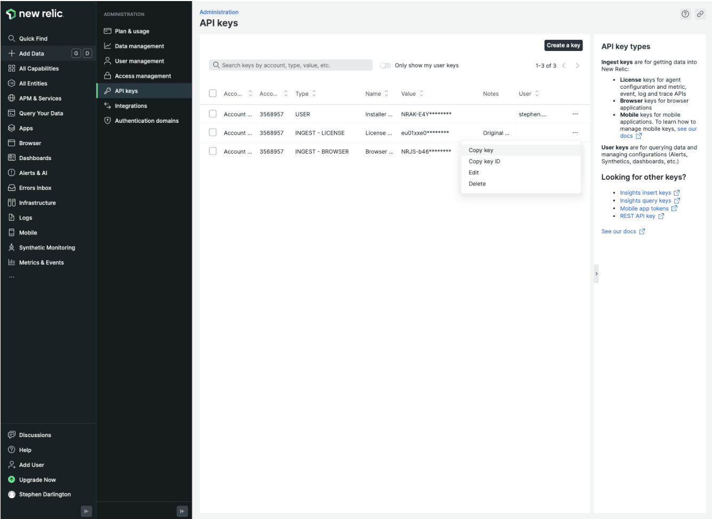
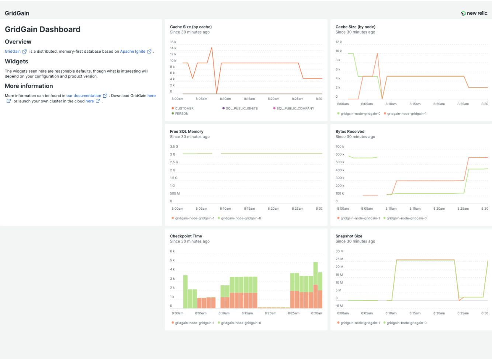

# How to Monitor GridGain Clusters With New Relic

<!-- TODO (not tested): The New Relic integration (needs a New Relic account) was not run against GridGain 8.10. Run it on an 8.10 build, compare the output and samples with the page, fix differences, then delete this comment. -->

## Prerequisites

- A running **GridGain 8** cluster on bare metal or a VM
- A [**New Relic**](https://www.newrelic.com/) account with an `INGEST - LICENSE` key
- The [**OpenTelemetry Java agent**](https://github.com/open-telemetry/opentelemetry-java-instrumentation) installed on each cluster node

## Overview

Monitoring and alerting are essential parts of any production system. GridGain has its own management and diagnostics tools in [Control Center](https://app.gitbook.com/o/diTpXxF5WsbHqTReoBsS/s/kuTXWg0NDbRx6XUeYpGD/enterprise/control-center). However, if you want to monitor your entire application portfolio, you need a more generalized solution. One popular option is [New Relic](https://www.newrelic.com/), an "all-in-one observability platform" that provides "data for engineers to monitor, debug, and improve their entire stack."

This guide shows you how to export GridGain metrics and logs to New Relic. It uses the OpenTelemetry Java agent to extract metrics from GridGain and export them to New Relic, assuming a basic GridGain installation on bare metal or a VM. More sophisticated approaches may be available when deploying to Kubernetes.

The integration process has four steps:

1. [Find your New Relic account details](#find-your-new-relic-account-details)
2. [Install the OpenTelemetry Java agent](#install-the-opentelemetry-java-agent)
3. [Configure GridGain to use the agent](#configure-gridgain-to-use-the-agent)
4. [View cluster metrics in the dashboard](#view-cluster-metrics-in-the-dashboard)

## Find Your New Relic Account Details

1. Log into your New Relic account.
2. Find your API key:

   

   1. Click your username in the bottom left corner of the screen.
   2. Select **API keys**.
   3. Find the correct license key of type `INGEST - LICENSE`.
   4. From the license key's context menu, select **Copy key**.
   5. Save the key aside — you will need it later.

## Install the OpenTelemetry Java Agent

1. Get the latest version of the [OpenTelemetry Java agent](https://github.com/open-telemetry/opentelemetry-java-instrumentation).
2. Make sure you install a copy of the agent on each of your GridGain nodes.

## Configure GridGain to use the Agent

Set the necessary server parameters in your `JVM_OPTS`. For example:

```bash
export JVM_OPTS="-Xmx5g -XX:+UseG1GC -DIGNITE_QUIET=false \
-Djava.net.preferIPv4Stack=true \
-javaagent:$AGENT_PATH/opentelemetry-javaagent.jar \
-Dotel.exporter.otlp.endpoint=$NEW_RELIC_ENDPOINT \
-Dotel.exporter.otlp.headers=api-key=$NEW_RELIC_API \
-Dotel.service.name=$SERVICE_NAME \
-Dotel.jmx.config=$NEW_RELIC_CONFIG/gridgain-newrelic.yaml"
```

`$NEW_RELIC_ENDPOINT` is `https://otlp.eu01.nr-data.net:4317` if you are in the US, `https://otlp.nr-data.net:4317` otherwise. Check the [New Relic documentation](https://docs.newrelic.com/docs/more-integrations/open-source-telemetry-integrations/opentelemetry/get-started/opentelemetry-set-up-your-app/#review-settings) for the most up-to-date information.

`$NEW_RELIC_API` is the key you have copied from your New Relic account.

`$SERVICE_NAME` is the name of a cluster or application. This should uniquely identify the entire cluster. An example might be `gridgain-prod`.

To identify your GridGain nodes in New Relic, name them. It is recommended to use the consistent ID; for example:

```bash
export OTEL_RESOURCE_ATTRIBUTES=service.instance.id=gridgain-prod-node-1
```

To collect logs in New Relic, set the following:

```bash
export OTEL_EXPORTER_OTLP_COMPRESSION=gzip
export OTEL_LOGS_EXPORTER=otlp
```

The [sample startup script](https://github.com/GridGain-Demos/gridgain-observation/blob/main/newrelic/nr-start.sh) includes all the above parameters.

The [sample configuration file](https://github.com/GridGain-Demos/gridgain-observation/blob/main/newrelic/gridgain-newrelic.yaml) maps many of GridGain's JMX metrics to New Relic. You can import other metrics to meet your specific requirements.

## View Cluster Metrics in the Dashboard

The [sample dashboard](https://github.com/GridGain-Demos/gridgain-observation/blob/main/newrelic/dashboard.json) looks like this:



To import the dashboard and use it for viewing the cluster metrics:

1. In New Relic, select **Dashboard** from the menu bar on the left-hand side.
2. At the top right of the screen, click **Import dashboard**.
3. Copy the JSON content from the [sample dashboard file](https://github.com/GridGain-Demos/gridgain-observation/blob/main/newrelic/dashboard.json) and paste it into the dialog.
4. Click **Import dashboard**.

## Related

- [OpenTelemetry Java instrumentation](https://github.com/open-telemetry/opentelemetry-java-instrumentation) - The agent used to export GridGain metrics and logs.
- [Principles of Logging in Apache Ignite](https://university.gridgain.com/courses/course/principles-of-logging-in-apache-ignite) - GridGain University lesson on choosing the metrics to track.
