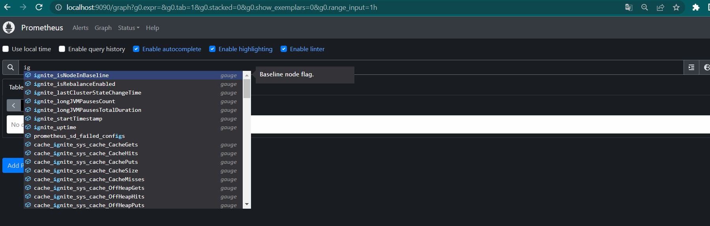
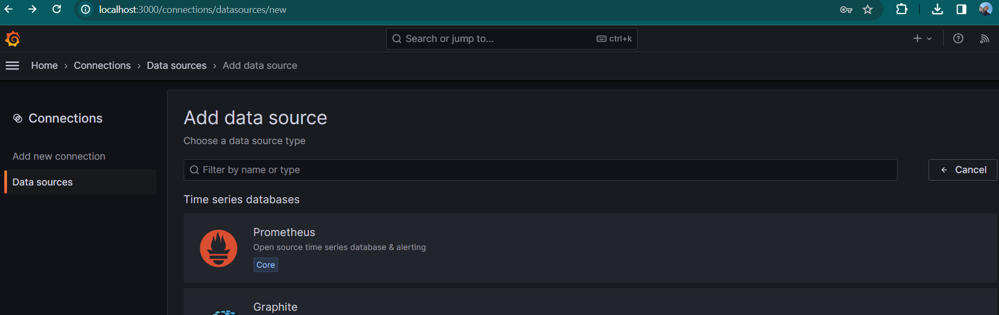
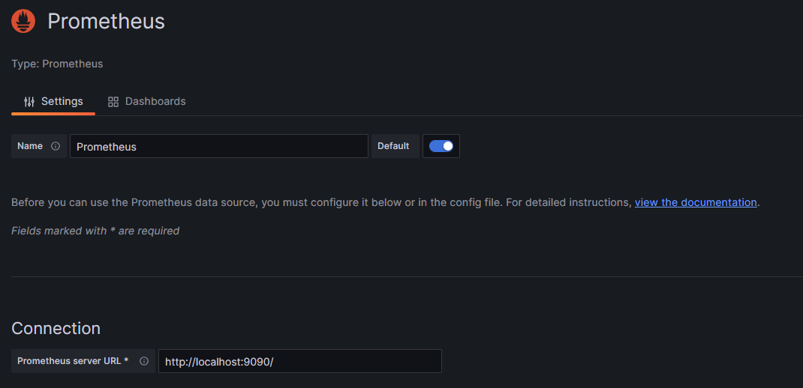
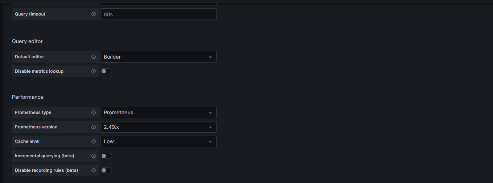
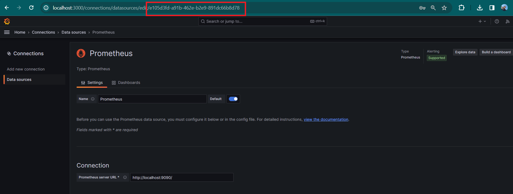
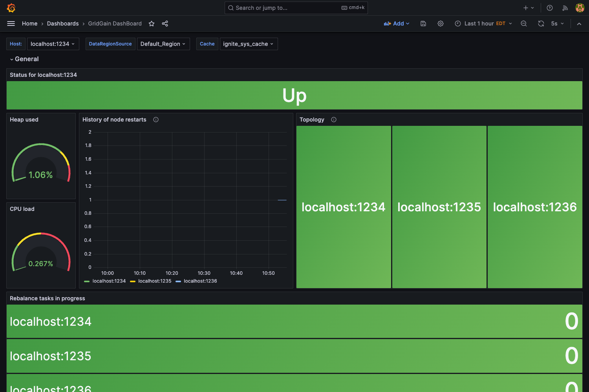

# How to Monitor GridGain 8 With Prometheus and Grafana

## Prerequisites

- A **GridGain 8** project you can launch from Java code, built with **JDK 17** or later and **Maven**
- A GridGain Enterprise or Ultimate license file for the nodes
- A [**Prometheus**](https://prometheus.io/download/) server
- [**Grafana**](https://grafana.com/grafana/download)

## Overview

GridGain supports a wide range of integrations and tools that can be used to monitor its status. Among them, a popular tool is Grafana, a popular open source software for monitoring metrics and building dashboards. This guide shows how you can export GridGain metrics to Prometheus, which can then be connected to Grafana.

This guide uses the following program versions:

- GridGain 8.10
- Grafana OSS 10.3.1
- Prometheus server 2.49.1

When using different versions, required dependencies may be different.

## GridGain Configuration

First, you need to configure GridGain to use a Prometheus exporter and create an HTTP server for Prometheus to collect data from. In this example, you launch GridGain from Java code, so you update Maven dependencies to include Prometheus:

- Add the following dependencies to your project:

  ```xml
  <?xml version="1.0" encoding="UTF-8"?>
  <project xmlns="http://maven.apache.org/POM/4.0.0"
           xmlns:xsi="http://www.w3.org/2001/XMLSchema-instance"
           xsi:schemaLocation="http://maven.apache.org/POM/4.0.0 http://maven.apache.org/xsd/maven-4.0.0.xsd">
      <modelVersion>4.0.0</modelVersion>

      <groupId>test</groupId>
      <artifactId>test</artifactId>
      <version>1.0-SNAPSHOT</version>
      <build>
          <plugins>
              <plugin>
                  <groupId>org.apache.maven.plugins</groupId>
                  <artifactId>maven-compiler-plugin</artifactId>
                  <configuration>
                      <source>17</source>
                      <target>17</target>
                  </configuration>
              </plugin>
          </plugins>
      </build>

      <repositories>
          <repository>
              <id>GridGain External Repository</id>
              <url>https://www.gridgainsystems.com/nexus/content/repositories/external</url>
          </repository>
      </repositories>

      <properties>
          <maven.compiler.source>17</maven.compiler.source>
          <maven.compiler.target>17</maven.compiler.target>
          <ignite.version>8.10.0</ignite.version>
          <prometheus.version>0.16.0</prometheus.version>
          <opencensus.version>0.31.1</opencensus.version>
      </properties>

      <dependencies>
          <dependency>
              <groupId>org.gridgain</groupId>
              <artifactId>ignite-indexing</artifactId>
              <version>${ignite.version}</version>
          </dependency>
          <dependency>
              <groupId>org.gridgain</groupId>
              <artifactId>ignite-core</artifactId>
              <version>${ignite.version}</version>
          </dependency>
          <dependency>
              <groupId>org.gridgain</groupId>
              <artifactId>ignite-spring</artifactId>
              <version>${ignite.version}</version>
          </dependency>
          <dependency>
              <groupId>org.gridgain</groupId>
              <artifactId>ignite-opencensus</artifactId>
              <version>${ignite.version}</version>
          </dependency>
          <dependency>
              <groupId>io.opencensus</groupId>
              <artifactId>opencensus-exporter-stats-prometheus</artifactId>
              <version>${opencensus.version}</version>
          </dependency>
          <dependency>
              <groupId>io.prometheus</groupId>
              <artifactId>simpleclient</artifactId>
              <version>${prometheus.version}</version>
          </dependency>
          <dependency>
              <groupId>io.prometheus</groupId>
              <artifactId>simpleclient_httpserver</artifactId>
              <version>${prometheus.version}</version>
          </dependency>
      </dependencies>
  </project>
  ```

  You use the following versions:

  - The latest version of Prometheus from the [maven repository](https://mvnrepository.com/artifact/io.prometheus/simpleclient_httpserver). It is recommended to update it to the latest version if it is available.
  - The OpenCensus version included in GridGain 8.10. The included OpenCensus library is updated regularly and can be different for different GridGain versions. You can check the version of the library for your version in the `{IGNITE_HOME}/libs/optional/ignite-opencensus` folder. The `opencensus-impl-X.XX.X` file denotes the version you should use in the configuration.

- Enable exporting of data. You can do it by configuring `OpenCensusMetricExporterSpi` in your configuration or from Java code:




  ```xml
  <?xml version="1.0" encoding="UTF-8"?>
  <beans xmlns="http://www.springframework.org/schema/beans"
         xmlns:xsi="http://www.w3.org/2001/XMLSchema-instance"
         xsi:schemaLocation=" http://www.springframework.org/schema/beans
  http://www.springframework.org/schema/beans/spring-beans.xsd">
      <bean id="httpServer" class="io.prometheus.client.exporter.HTTPServer">
          <constructor-arg type="java.lang.String" value="127.0.0.1"/>
          <constructor-arg type="int" value="1234"/>
          <constructor-arg type="boolean" value="true"/>
      </bean>

      <bean id="opencensusWrapper" class="org.springframework.beans.factory.config.MethodInvokingBean">
          <property name="staticMethod"
                    value="io.opencensus.exporter.stats.prometheus.PrometheusStatsCollector.createAndRegister"/>
      </bean>

      <bean id="grid.cfg" class="org.apache.ignite.configuration.IgniteConfiguration">
          <property name="metricsUpdateFrequency" value="1000"/>
          <property name="cacheConfiguration">
              <list>
                  <bean class="org.apache.ignite.configuration.CacheConfiguration">
                      <property name="name" value="mycache"/>
                      <!-- Enable statistics for the cache. -->
                      <property name="statisticsEnabled" value="true"/>
                      <property name="backups" value="1"/>
                  </bean>
              </list>
          </property>
          <property name="metricExporterSpi">
              <list>
                  <bean class="org.apache.ignite.spi.metric.opencensus.OpenCensusMetricExporterSpi">
                      <property name="period" value="1000"/>
                  </bean>
              </list>
          </property>
          <property name="dataStorageConfiguration">
              <bean class="org.apache.ignite.configuration.DataStorageConfiguration">
                  <property name="metricsEnabled" value="true"/>
                  <property name="defaultDataRegionConfiguration">
                      <bean class="org.apache.ignite.configuration.DataRegionConfiguration">
                          <property name="name" value="Default_Region"/>
                          <property name="initialSize" value="#{4L * 1024 * 1024 * 1024}"/>
                          <property name="maxSize" value="#{4L * 1024 * 1024 * 1024}"/>
                          <property name="persistenceEnabled" value="true"/>
                          <property name="metricsEnabled" value="true"/>
                      </bean>
                  </property>
              </bean>
          </property>
          <property name="discoverySpi">
              <bean class="org.apache.ignite.spi.discovery.tcp.TcpDiscoverySpi">
                  <property name="localPort" value="47500"/>
                  <property name="localPortRange" value="10"/>
                  <property name="ipFinder">
                      <bean class="org.apache.ignite.spi.discovery.tcp.ipfinder.vm.TcpDiscoveryVmIpFinder">
                          <property name="addresses">
                              <list>
                                  <value>127.0.0.1:47500..47509</value>
                              </list>
                          </property>
                      </bean>
                  </property>
              </bean>
          </property>
      </bean>
  </beans>
  ```





  ```java
  import io.opencensus.exporter.stats.prometheus.PrometheusStatsCollector;
  import io.prometheus.client.exporter.HTTPServer;
  import org.apache.ignite.Ignite;
  import org.apache.ignite.IgniteException;
  import org.apache.ignite.lifecycle.LifecycleBean;
  import org.apache.ignite.lifecycle.LifecycleEventType;
  import org.apache.ignite.resources.IgniteInstanceResource;

  import java.io.IOException;

  public class Exporter implements LifecycleBean {
      private int port;
      public Exporter(int port) {
          this.port = port;
      }
      private HTTPServer server;

      @IgniteInstanceResource
      Ignite ignite;

      // Creates an exporter for Prometheus.
      // This method will be executed when the node starts.
      @Override
      public void onLifecycleEvent(LifecycleEventType evt) throws IgniteException {
          if (evt == LifecycleEventType.BEFORE_NODE_START) {

              ignite.log().info("Starting Prometheus collector");

              PrometheusStatsCollector.createAndRegister();
              try {
                  server = new HTTPServer("localhost", port, true);
              } catch (IOException e) {
                  e.printStackTrace();
              }
          }
          else if (evt == LifecycleEventType.BEFORE_NODE_STOP) {
              if (server != null) {
                  server.stop();
                  server = null;
              }
          }
      }
  }
  ```

  The `Exporter` class starts the HTTP server that Prometheus scrapes, so register it as a lifecycle bean in the node configuration, together with `OpenCensusMetricExporterSpi`. (The XML tab does the same job with the `httpServer` and `opencensusWrapper` beans, so it does not use this class.)

  ```java
  IgniteConfiguration cfg = new IgniteConfiguration();

  cfg.setLifecycleBeans(new Exporter(1234));
  OpenCensusMetricExporterSpi exporterSpi = new OpenCensusMetricExporterSpi();
  exporterSpi.setPeriod(1000);
  cfg.setMetricExporterSpi(exporterSpi);
  cfg.setMetricsUpdateFrequency(1000);

  Ignition.start(cfg);
  ```





- Start GridGain nodes. Give each node on the same host its own exporter port, for example `1234`, `1235`, and `1236`.
- If you use native persistence, as in the XML example, activate the cluster with `control.sh --set-state ACTIVE`.

You should be able to access the metrics on the HTTP server URL: [http://localhost:1234](http://localhost:1234).

## Prometheus Server Configuration

To produce metrics ready for Grafana, you need to collect them on the [Prometheus](https://prometheus.io/download/) server. You can find instructions on using Prometheus in the [Prometheus documentation](https://prometheus.io/docs/prometheus/latest/getting_started/). In this example you modify the default `prometheus.yml` file to also collect data from GridGain:

- Add the `ignite-metrics` job to make Prometheus collect GridGain metrics:

  ```yaml
  scrape_configs:
  - job_name: ignite-metrics
  ```

- List the addresses of all OpenCensus exporters for each node in the `targets` block:

  ```yaml
  static_configs:
  - targets: ['localhost:1234', 'localhost:1235', 'localhost:1236']
  ```

- Start your Prometheus server:

  ```yaml
  prometheus.exe --config.file=./prometheus.yml
  ```

By default, the Prometheus server will start on port `9090`. Open the [http://localhost:9090](http://localhost:9090) URL in your browser and use Prometheus to make sure the metrics are available:



## Grafana Configuration

To proceed with the guide, you will need Grafana. [Download](https://grafana.com/grafana/download) a standalone executable from the website.

When you start Grafana, it will be available on the [http://localhost:3000/login](http://localhost:3000/login) URL by default. Default credentials will be `admin`/`admin`. You must change them after the first login.

- Go to **Connections**/**Data sources** section and select **Add data source**.

  

- Add the Prometheus data source to Grafana. The image below shows the example parameters for this document:

  

- Make sure the connection is configured correctly:

  

Grafana can now receive metrics from GridGain.

### Importing a Sample Dashboard

For this guide, a sample dashboard has been prepared that displays a number of metrics for the cluster.

1. Open your data source in Grafana by going to the **Connections**/**Data sources** section and selecting a newly created data source.
1. Copy the data source ID from the URL:

   

1. Download the [sample dashboard](../../.gitbook/assets/gg8_dashboard.json). Grafana imports dashboards in a JSON format.
1. Open the downloaded dashboard JSON and replace every `datasource.uid` value (`e105d3fd-a91b-462e-b2e9-891dc66b8d78` in the file) with your data source ID and replace:

   ```json
   "datasource": {
     "type": "prometheus",
     "uid": "e105d3fd-a91b-462e-b2e9-891dc66b8d78"
   }
   ```

1. In Grafana, go to **Dashboards**/**Create dashboard** and click **Import dashboard**. Load the prepared dashboard file.

Grafana will import the dashboard and display the metrics on it:



## Related

- [How to Monitor GridGain Clusters with New Relic](../how-to-guides/new-relic.md) - Export GridGain metrics and logs to New Relic with the OpenTelemetry Java agent.
- [Prometheus documentation](https://prometheus.io/docs/prometheus/latest/getting_started/) - Getting started with the Prometheus server.
