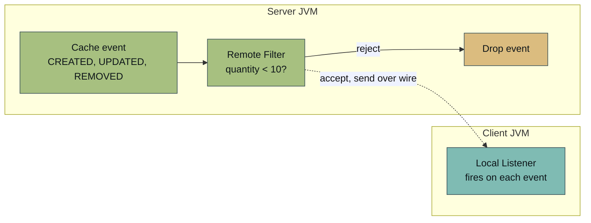

# Real-Time Event Processing: The Streaming Problem

## Introduction

Every tutorial in this path so far runs on requests from your code. You query the cache with SQL, run ACID transactions across keys, dispatch compute to where the data lives, make storage durable, and reach for cluster-wide coordination primitives. Each operation starts when the application calls in.

This tutorial inverts that direction. The application registers interest once, and the cluster pushes matching events as they happen.

A traditional caching layer offers two patterns and neither fits. Pub/sub is fire-and-forget and value-blind. The cache fans out a topic message and moves on, with no record of what changed. Keyspace notifications report that a key changed but carry no value, and the set of watched events is fixed by configuration. Neither pattern lets the application say "send me every update where a SKU's quantity drops below ten." Production teams either accept those limits or build a CDC pipeline against an external write-ahead log.

`ContinuousQuery<K, V>` is a subscription against a cache. You register two halves once. A remote filter factory ships a predicate to every server. The predicate runs against each cache event and decides whether the event reaches the client. A local listener runs on the client and fires on every event the filter accepts. An optional initial scan lets the listener see existing matching entries before live changes start. The cluster pushes filtered events to the application with no polling, no external log, and no custom CDC pipeline. This tutorial closes the Beyond Key-Value path.

## Prerequisites

- **A running single-node cluster** using `cache-cluster/docker-compose.yml` from [Start a Local Cache Development Cluster](../../quick-start/start-local-cache-cluster.md). One node is enough. Continuous-query semantics are independent of topology, so an extra server adds no teaching value at this stage.
- **The Stock cache value class on the server's classpath.** The continuous query's filter and the initial ScanQuery deserialize cache values inside the server. Peer class loading covers closures (the filter factory, the filter itself), but binary deserialization of cache value classes uses a separate path. The fix is to mount the project jar in the server's `libs/user-libs/` directory once. Step 1 covers the one-time mount.
- **Java 17** or later for the client runtime. The Maven project compiles to Java 17 bytecode, the same version the GridGain 8 server JVM runs.
- **Maven 3.6** or later.
- **Two terminal windows.** One runs the listener, the other runs the writer that drives the events.

This tutorial creates a fresh `continuous-events/` Maven project alongside any other project directories from earlier tutorials in this path. The single-node `cache-cluster/` from Start a Local Cache Cluster stays where it is. Step 1 adds a `user-libs/` mount to it.

<details>
<summary>Returning to this tutorial? Restart the single-node cluster.</summary>

If the single-node cluster is no longer running, start it before continuing.

```bash
docker compose -f cache-cluster/docker-compose.yml up -d
docker ps --filter name=gridgain8-node --format "table {{.Names}}\t{{.Status}}"
```

One server container in the `Up` state. The cluster is in-memory, so any prior data was discarded with the previous session. You reseed the Stock cache below.

</details>

## What You Will Learn

- How `ContinuousQuery` turns a cache into an event source the application subscribes to
- How `setRemoteFilterFactory` ships a predicate to the server so non-matching updates never cross the network
- Why the initial query is a `ScanQuery` (not `SqlFieldsQuery`) and how the type system enforces it
- How the `QueryCursor` doubles as the subscription handle and why closing it unregisters the listener
- What `CacheEntryEvent` carries for CREATED, UPDATED, and REMOVED events

## What You Will Build

A small Maven project with three runnable scenarios and a model class. `SeedStock` creates a `Stock` cache (Integer SKU -> StockLevel) and loads twenty entries with mixed quantities. `LowStockListener` registers a continuous query whose filter fires whenever an update lands below the threshold. `StockWriter` runs in a second terminal and decrements quantities every half-second. A writer update whose new value falls under ten appears in the listener's terminal in real time. Updates whose new value stays above the threshold are dropped at the server and never reach the listener.

## Define the Stock Cache and Seed Data

Create the `continuous-events/` Maven project. The pom uses the same Java 17 bytecode target as the rest of the path so the host client and the cluster server agree on class file format.

<details>
<summary><code>continuous-events/pom.xml</code></summary>


```xml
<?xml version="1.0" encoding="UTF-8"?>
<project xmlns="http://maven.apache.org/POM/4.0.0"
         xmlns:xsi="http://www.w3.org/2001/XMLSchema-instance"
         xsi:schemaLocation="http://maven.apache.org/POM/4.0.0 http://maven.apache.org/xsd/maven-4.0.0.xsd">
    <modelVersion>4.0.0</modelVersion>

    <groupId>com.example</groupId>
    <artifactId>continuous-events</artifactId>
    <version>1.0-SNAPSHOT</version>
    <packaging>jar</packaging>

    <properties>
        <maven.compiler.release>17</maven.compiler.release>
        <project.build.sourceEncoding>UTF-8</project.build.sourceEncoding>
        <gridgain.version>8.10.0</gridgain.version>
        <exec.mainClass>com.example.SeedStock</exec.mainClass>
    </properties>

    <repositories>
        <repository>
            <id>GridGain External Repository</id>
            <url>https://www.gridgainsystems.com/nexus/content/repositories/external</url>
        </repository>
    </repositories>

    <dependencies>
        <dependency>
            <groupId>org.gridgain</groupId>
            <artifactId>gridgain-core</artifactId>
            <version>${gridgain.version}</version>
        </dependency>
        <dependency>
            <groupId>org.gridgain</groupId>
            <artifactId>ignite-indexing</artifactId>
            <version>${gridgain.version}</version>
        </dependency>
    </dependencies>

    <build>
        <plugins>
            <plugin>
                <groupId>org.codehaus.mojo</groupId>
                <artifactId>exec-maven-plugin</artifactId>
                <version>3.1.0</version>
                <configuration>
                    <executable>java</executable>
                    <arguments>
                        <argument>--add-opens=java.base/jdk.internal.misc=ALL-UNNAMED</argument>
                        <argument>--add-opens=java.base/sun.nio.ch=ALL-UNNAMED</argument>
                        <argument>--add-opens=java.base/java.io=ALL-UNNAMED</argument>
                        <argument>--add-opens=java.base/java.nio=ALL-UNNAMED</argument>
                        <argument>--add-opens=java.base/java.net=ALL-UNNAMED</argument>
                        <argument>--add-opens=java.base/java.util=ALL-UNNAMED</argument>
                        <argument>--add-opens=java.base/java.lang=ALL-UNNAMED</argument>
                        <argument>--add-opens=java.base/java.lang.invoke=ALL-UNNAMED</argument>
                        <argument>--add-opens=java.base/java.math=ALL-UNNAMED</argument>
                        <argument>--add-opens=jdk.management/com.sun.management.internal=ALL-UNNAMED</argument>
                        <argument>-Djava.net.preferIPv4Stack=true</argument>
                        <argument>-DIGNITE_QUIET=true</argument>
                        <argument>-DIGNITE_NO_ASCII=true</argument>
                        <argument>-classpath</argument>
                        <classpath/>
                        <argument>${exec.mainClass}</argument>
                    </arguments>
                </configuration>
            </plugin>
        </plugins>
    </build>
</project>
```


</details>

GridGain 8 artifacts are not on Maven Central. The `<repositories>` block points Maven at the GridGain external Nexus.

The `ignite-indexing` dependency is required because the `Stock` cache registers indexed types so any client can run SQL queries against it. The continuous query itself does not use SQL, but the cache's QueryEntity makes the cache productive for adjacent operational queries.

Add the `StockLevel` POJO. It has two fields, both annotated for SQL access:


```java
package com.example.model;

import org.apache.ignite.cache.query.annotations.QuerySqlField;

import java.io.Serializable;

/**
 * Cache value for the Stock cache. Each entry maps a SKU (Integer key) to
 * its current quantity on hand.
 *
 * The class is annotated for SQL access so the Stock cache can be queried
 * with the standard SqlFieldsQuery vocabulary. The continuous query in this
 * tutorial does not need the SQL annotations, but later operational queries
 * (low-stock dashboards, reordering pipelines) typically do, and registering
 * the indexed types now keeps the cache configuration close to production
 * shape.
 */
public class StockLevel implements Serializable {

    private static final long serialVersionUID = 1L;

    @QuerySqlField
    private Integer sku;

    @QuerySqlField(index = true)
    private int quantity;

    public StockLevel() {}

    public StockLevel(Integer sku, int quantity) {
        this.sku = sku;
        this.quantity = quantity;
    }

    public Integer getSku() { return sku; }
    public void setSku(Integer sku) { this.sku = sku; }
    public int getQuantity() { return quantity; }
    public void setQuantity(int quantity) { this.quantity = quantity; }

    @Override
    public String toString() {
        return "StockLevel{sku=" + sku + ", quantity=" + quantity + "}";
    }
}
```


Add `SeedStock`. The class creates the cache, loads twenty entries with mixed quantities, and prints both the total count and the count below threshold so the listener's initial state is predictable.


```java
package com.example;

import com.example.model.StockLevel;
import org.apache.ignite.Ignite;
import org.apache.ignite.IgniteCache;
import org.apache.ignite.Ignition;
import org.apache.ignite.cache.query.SqlFieldsQuery;
import org.apache.ignite.configuration.CacheConfiguration;
import org.apache.ignite.configuration.IgniteConfiguration;
import org.apache.ignite.spi.discovery.tcp.TcpDiscoverySpi;
import org.apache.ignite.spi.discovery.tcp.ipfinder.vm.TcpDiscoveryVmIpFinder;

import java.util.Arrays;
import java.util.List;
import java.util.Random;

/**
 * Run-once seeder for the Stock cache.
 *
 * Creates the Stock cache configured with indexed types so the continuous
 * query in LowStockListener can run a ScanQuery initial query against typed
 * cache entries. Loads 20 SKUs with quantities mixed across the threshold
 * the listener watches, with some entries below 10 and most well above.
 *
 * The Stock cache is destroyed and recreated on every run so re-running the
 * seeder produces the same starting state. This keeps the listener and
 * writer scenarios reproducible across sessions.
 */
public class SeedStock {

    private static final String CACHE_NAME = "Stock";
    private static final int ENTRIES = 20;

    public static void main(String[] args) {
        IgniteConfiguration cfg = clientConfig("br06-seed");

        try (Ignite ignite = Ignition.start(cfg)) {
            // Drop any existing Stock cache so the seed is reproducible.
            ignite.destroyCache(CACHE_NAME);

            CacheConfiguration<Integer, StockLevel> cacheCfg =
                    new CacheConfiguration<>(CACHE_NAME);
            // setIndexedTypes builds the QueryEntity from StockLevel's
            // @QuerySqlField annotations so SQL queries (including the
            // listener's initial ScanQuery) can read typed entries.
            cacheCfg.setIndexedTypes(Integer.class, StockLevel.class);

            IgniteCache<Integer, StockLevel> cache =
                    ignite.getOrCreateCache(cacheCfg);

            // About a quarter of the 20 SKUs land below 10 so the
            // listener sees initial low-stock entries to print and the
            // writer has headroom to drive later crossings.
            Random rnd = new Random(42);
            for (int sku = 1; sku <= ENTRIES; sku++) {
                int qty = 5 + rnd.nextInt(45);
                cache.put(sku, new StockLevel(sku, qty));
            }

            System.out.printf("Stock cache created (%d entries)%n", cache.size());

            List<List<?>> sample = cache.query(new SqlFieldsQuery(
                    "SELECT sku, quantity FROM StockLevel ORDER BY sku LIMIT 5"))
                    .getAll();
            System.out.print("Sample: ");
            for (int i = 0; i < sample.size(); i++) {
                if (i > 0) System.out.print(", ");
                System.out.printf("SKU %s=%s", sample.get(i).get(0), sample.get(i).get(1));
            }
            System.out.println();

            long lowCount = (Long) cache.query(new SqlFieldsQuery(
                    "SELECT COUNT(*) FROM StockLevel WHERE quantity < 10"))
                    .getAll().get(0).get(0);
            System.out.printf("Initial entries below threshold (qty < 10): %d%n", lowCount);
        }

        System.exit(0);
    }

    static IgniteConfiguration clientConfig(String instanceName) {
        IgniteConfiguration cfg = new IgniteConfiguration();
        cfg.setIgniteInstanceName(instanceName);
        // Client mode keeps this JVM out of the data-storage rotation. The
        // single-node server handles all cache state.
        cfg.setClientMode(true);
        // Peer class loading must match between client and server. The
        // server config sets it true. The client must agree or the join
        // fails immediately.
        cfg.setPeerClassLoadingEnabled(true);

        TcpDiscoverySpi discovery = new TcpDiscoverySpi();
        TcpDiscoveryVmIpFinder ipFinder = new TcpDiscoveryVmIpFinder();
        // The server publishes 47500 on the host loopback via Docker
        // port mapping. A single endpoint is enough for the single-node
        // cluster this tutorial uses.
        ipFinder.setAddresses(Arrays.asList("127.0.0.1:47500"));
        discovery.setIpFinder(ipFinder);
        cfg.setDiscoverySpi(discovery);

        return cfg;
    }
}
```


The `clientConfig` helper is `static` and package-private so the listener and the writer can reuse it. All three classes share one connection profile.

Build the jar once. The Step 1 artifact contains `StockLevel` and is mounted on every server. Step 2 introduces the filter factory and ships it to the servers through peer class loading, so this initial jar is intentionally small. If you edit anything in `continuous-events/src/` between steps, repackage with `mvn -f continuous-events/pom.xml package -DskipTests` before re-running:

```bash
mvn -f continuous-events/pom.xml package -DskipTests
```

Mount the jar in the cluster's `libs/user-libs/` directory, then restart the cluster so the server picks it up:

```bash
mkdir -p cache-cluster/user-libs
cp continuous-events/target/continuous-events-1.0-SNAPSHOT.jar cache-cluster/user-libs/
```

Add the volume mount to `cache-cluster/docker-compose.yml`. Under `volumes:`:


```yaml
    volumes:
      - ./ignite-config.xml:/config/ignite-config.xml:ro
      - ./gridgain-license.xml:/opt/gridgain/gridgain-license.xml:ro
      - ./user-libs:/opt/gridgain/libs/user-libs:ro
```


Restart the cluster:

```bash
docker compose -f cache-cluster/docker-compose.yml down
docker compose -f cache-cluster/docker-compose.yml up -d
```

The mount is a one-time setup. When you rebuild the jar after editing classes, the new build lands at the same path, and the next cluster restart picks it up. Peer class loading covers the filter and filter factory closures, but the cache value class (`StockLevel`) needs to be on the server's classpath because the server deserializes the binary form to evaluate the predicate.

Run `SeedStock`:

```bash
mvn -f continuous-events/pom.xml exec:exec -Dexec.mainClass=com.example.SeedStock
```

```text
Stock cache created (20 entries)
Sample: SKU 1=40, SKU 2=8, SKU 3=23, SKU 4=49, SKU 5=5
Initial entries below threshold (qty < 10): 3
```

The seed is deterministic (`new Random(42)`), so re-running the command produces the same twenty entries. SKUs 2, 5, and 11 are below the threshold. Change the seed and the listener reports whatever falls below ten when it registers.


**Checkpoint:** The Stock cache exists with twenty entries, three of which are below ten.


## Register the Continuous Query

The `ContinuousQuery` API has three slots you fill: a local listener, a remote filter factory, and an initial query. The local listener is a callback that runs on this JVM. The remote filter factory ships to every server node and produces the predicate that decides which events leave the server. The initial query is a one-time scan that runs before the subscription starts so the listener can see existing entries that match.

The remote filter factory is a separate class for two reasons. The factory needs to be `Serializable` (the cluster sends it across the wire), and a named class deserializes cleanly under peer class loading on every JDK. Lambdas can synthesize as JDK hidden classes on Java 17 and above, which the marshaller cannot ship. A named class is the production pattern.


```java
package com.example;

import com.example.model.StockLevel;
import org.apache.ignite.cache.CacheEntryEventSerializableFilter;

import javax.cache.configuration.Factory;

/**
 * Factory that produces the server-side predicate for the continuous query.
 *
 * The factory ships from the client to each server node when the continuous
 * query is registered. Each server creates its own filter instance (the
 * Factory.create() call) and applies it to every cache event before deciding
 * whether to send the event to the client. An event whose value passes the
 * predicate crosses the network. An event that fails is dropped at the
 * server.
 *
 * The factory is a named class instead of a lambda. Named classes
 * deserialize cleanly under peer class loading on every JDK. Lambdas can be
 * synthesized as JDK hidden classes on Java 17+, which the marshaller
 * cannot ship. The named form is the production pattern.
 */
public class LowStockFilterFactory
        implements Factory<CacheEntryEventSerializableFilter<Integer, StockLevel>> {

    private static final long serialVersionUID = 1L;

    private final int threshold;

    public LowStockFilterFactory(int threshold) {
        this.threshold = threshold;
    }

    @Override
    public CacheEntryEventSerializableFilter<Integer, StockLevel> create() {
        // Capture threshold by value. The filter instance is serialized to
        // the server, so capturing a primitive keeps the closure compact.
        final int t = threshold;
        return event -> event.getValue().getQuantity() < t;
    }
}
```


The factory takes the threshold in its constructor. The `create()` method runs on each server and returns the predicate. The lambda inside `create()` runs on the server and never serializes. Only the factory itself crosses the wire.

The architecture for the registered subscription:



The filter runs once per cache event on the server. Events that pass the predicate cross the network to the client, and the rest stop at the server before they reach the wire.

Add `LowStockListener`. The class registers the continuous query and blocks for sixty seconds so the writer scenario in Step 3 has time to fire updates that cross the threshold.


```java
package com.example;

import com.example.model.StockLevel;
import org.apache.ignite.Ignite;
import org.apache.ignite.IgniteCache;
import org.apache.ignite.Ignition;
import org.apache.ignite.cache.query.ContinuousQuery;
import org.apache.ignite.cache.query.QueryCursor;
import org.apache.ignite.cache.query.ScanQuery;
import org.apache.ignite.configuration.IgniteConfiguration;
import org.apache.ignite.lang.IgniteBiPredicate;

import javax.cache.Cache;
import javax.cache.event.CacheEntryEvent;
import java.io.Serializable;
import java.time.LocalTime;
import java.time.format.DateTimeFormatter;

/**
 * Subscribes to low-stock events on the Stock cache.
 *
 * Registers a ContinuousQuery with three parts:
 *   1. A local listener that prints each delivered event with a wall-clock
 *      timestamp. The listener runs on this JVM (the client).
 *   2. A remote filter factory that ships LowStockFilterFactory to the
 *      server. The server creates one filter per node and applies it to
 *      every cache event before deciding whether to send the event.
 *   3. An initial ScanQuery whose predicate matches existing entries below
 *      the threshold. The cursor yields those entries so the listener has
 *      a snapshot of already-low SKUs before the subscription starts.
 *
 * The cursor returned by cache.query(continuousQuery) is the subscription
 * handle. Closing it unregisters the listener on the cluster. The
 * try-with-resources block plus an in-block sleep keeps the listener alive
 * for the duration of the scenario; production code substitutes the
 * application's main loop for the sleep.
 */
public class LowStockListener {

    private static final String CACHE_NAME = "Stock";
    private static final int THRESHOLD = 10;
    private static final long LISTEN_MILLIS = 60_000;
    private static final DateTimeFormatter TS = DateTimeFormatter.ofPattern("HH:mm:ss.SSS");

    public static void main(String[] args) throws InterruptedException {
        IgniteConfiguration cfg = SeedStock.clientConfig("br06-listener");

        try (Ignite ignite = Ignition.start(cfg)) {
            IgniteCache<Integer, StockLevel> cache = ignite.cache(CACHE_NAME);
            if (cache == null) {
                System.err.println("Stock cache not found. Run SeedStock first.");
                System.exit(1);
            }

            ContinuousQuery<Integer, StockLevel> qry = new ContinuousQuery<>();

            // The local listener runs on this JVM. The events iterable
            // arrives in a single batch per delivery. Iterate and print each
            // entry.
            qry.setLocalListener(events -> {
                for (CacheEntryEvent<? extends Integer, ? extends StockLevel> e : events) {
                    String oldQty = (e.getOldValue() == null)
                            ? "new"
                            : String.valueOf(e.getOldValue().getQuantity());
                    System.out.printf("[%s] %s SKU %d -> qty %d (was %s)%n",
                            LocalTime.now().format(TS),
                            e.getEventType(),
                            e.getKey(),
                            e.getValue().getQuantity(),
                            oldQty);
                }
            });

            // The remote filter factory ships to every server node. Each
            // server applies the produced filter to every cache event. Only
            // events that pass cross the network to the local listener.
            qry.setRemoteFilterFactory(new LowStockFilterFactory(THRESHOLD));

            // The initial query is a ScanQuery with the same predicate as
            // the filter. The cursor yields existing entries that already
            // match, so the listener has the current low-stock set before
            // any new event arrives. ContinuousQuery.setInitialQuery
            // requires Query<Cache.Entry<K, V>>. SqlFieldsQuery extends
            // Query<List<?>> and is rejected by the type checker. The
            // predicate is a named class for the same reason
            // LowStockFilterFactory is. See that class for the rationale.
            qry.setInitialQuery(new ScanQuery<>(new LowStockScanPredicate(THRESHOLD)));

            try (QueryCursor<Cache.Entry<Integer, StockLevel>> cursor = cache.query(qry)) {
                System.out.println("Listener registered. Watching for quantity < " + THRESHOLD + ".");
                System.out.println("Initial low-stock entries:");
                int initialCount = 0;
                for (Cache.Entry<Integer, StockLevel> e : cursor) {
                    System.out.printf("  SKU %d (qty %d)%n", e.getKey(), e.getValue().getQuantity());
                    initialCount++;
                }
                System.out.println("Initial scan complete (" + initialCount + " entries).");
                System.out.println("Listening for " + (LISTEN_MILLIS / 1000) + " seconds. Run StockWriter in another terminal.");

                // Keeping the cursor open keeps the subscription active.
                // Production code replaces this sleep with the application's
                // main loop or service runtime.
                Thread.sleep(LISTEN_MILLIS);
            }

            System.out.println("Cursor closed. Listener unregistered.");
        }
    }

    /**
     * Named predicate for the initial ScanQuery.
     *
     * Implemented as a named class for the same reason LowStockFilterFactory
     * is. Lambdas can synthesize as JDK hidden classes on Java 17 and above,
     * which the marshaller cannot ship to the server. The named form
     * deserializes cleanly under peer class loading on every JDK.
     */
    static final class LowStockScanPredicate
            implements IgniteBiPredicate<Integer, StockLevel>, Serializable {

        private static final long serialVersionUID = 1L;

        private final int threshold;

        LowStockScanPredicate(int threshold) {
            this.threshold = threshold;
        }

        @Override
        public boolean apply(Integer sku, StockLevel level) {
            return level.getQuantity() < threshold;
        }
    }
}
```


The initial query is a `ScanQuery`, not a `SqlFieldsQuery`. You know `SqlFieldsQuery` from earlier in this path, and the natural reach is to write `setInitialQuery(new SqlFieldsQuery("..."))`. The compiler rejects it. `ContinuousQuery.setInitialQuery` is declared `Query<Cache.Entry<K, V>>`. `SqlFieldsQuery` extends `Query<List<?>>`, which returns field rows rather than entries, so the type checker turns it away. `ScanQuery<K, V>` extends `Query<Cache.Entry<K, V>>` and is the runnable form. The predicate signature is `IgniteBiPredicate<K, V>`, so the same threshold check shows up twice (filter, scan): once shipped to the server, and once issued as a one-time query at registration.

Run `LowStockListener` in your first terminal:

```bash
mvn -f continuous-events/pom.xml exec:exec -Dexec.mainClass=com.example.LowStockListener
```

```text
Listener registered. Watching for quantity < 10.
Initial low-stock entries:
  SKU 2 (qty 8)
  SKU 5 (qty 5)
  SKU 11 (qty 7)
Initial scan complete (3 entries).
Listening for 60 seconds. Run StockWriter in another terminal.
```

The three SKUs below ten match the count `SeedStock` printed. The listener now waits for live events. Leave this terminal running and switch to the second terminal for Step 3.


**Checkpoint:** The listener prints three initial low-stock entries and "Listening for 60 seconds." It blocks until you run the writer or sixty seconds pass.


## Drive Updates From a Second Terminal

`StockWriter` connects as a separate thick client and decrements quantities every half-second for sixty seconds. Each writer update is a `cache.put` against an existing SKU. The server applies the continuous-query filter to each event. An update whose new value falls under ten flows through to the listener. An update whose new value stays at or above ten is dropped at the server. The filter is level-based, not edge-based, so a SKU that updates from 8 to 7 also fires the listener. An explicit `oldValue >= threshold` guard would give edge semantics.

`StockWriter` reads a quantity, computes the next value, and writes it back. There is no transaction between the read and the write. The pattern is safe in this scenario because `StockWriter` is the only writer. If two writers raced on the same SKU between this tutorial's `cache.get` and `cache.put`, one decrement would be lost. Production code with multiple writers wraps the read/write pair in a transaction or uses `cache.invoke(...)` with an `EntryProcessor`. See [Use Transactions with the Cache API](../cache-centric-foundations/cache-transactions.md) for both patterns.


```java
package com.example;

import com.example.model.StockLevel;
import org.apache.ignite.Ignite;
import org.apache.ignite.IgniteCache;
import org.apache.ignite.Ignition;
import org.apache.ignite.configuration.IgniteConfiguration;

import java.time.LocalTime;
import java.time.format.DateTimeFormatter;
import java.util.Random;

/**
 * Drives quantity decrements against the Stock cache.
 *
 * Picks a random SKU between 1 and 20, reads its current quantity,
 * decrements by one (clamping at zero), writes the new value, sleeps
 * briefly, and repeats. Runs for the same duration as LowStockListener so
 * the two processes can be started back to back without coordination.
 *
 * The writer is a separate process so push-based delivery is visible on
 * the wall clock. The writer prints in one terminal, the listener prints
 * in another, and the listener fires only on quantity decrements that
 * cross below the listener's threshold.
 */
public class StockWriter {

    private static final String CACHE_NAME = "Stock";
    private static final int MAX_SKU = 20;
    private static final long RUN_MILLIS = 60_000;
    private static final long STEP_MILLIS = 500;
    private static final DateTimeFormatter TS = DateTimeFormatter.ofPattern("HH:mm:ss.SSS");

    public static void main(String[] args) throws InterruptedException {
        IgniteConfiguration cfg = SeedStock.clientConfig("br06-writer");

        try (Ignite ignite = Ignition.start(cfg)) {
            IgniteCache<Integer, StockLevel> cache = ignite.cache(CACHE_NAME);
            if (cache == null) {
                System.err.println("Stock cache not found. Run SeedStock first.");
                System.exit(1);
            }

            Random rnd = new Random();
            long deadline = System.currentTimeMillis() + RUN_MILLIS;
            int updates = 0;

            System.out.println("Writer running for " + (RUN_MILLIS / 1000) + " seconds. Decrements every " + STEP_MILLIS + " ms.");

            while (System.currentTimeMillis() < deadline) {
                int sku = 1 + rnd.nextInt(MAX_SKU);
                StockLevel current = cache.get(sku);
                if (current == null) {
                    Thread.sleep(STEP_MILLIS);
                    continue;
                }
                if (current.getQuantity() == 0) {
                    // Skip no-op puts. The writer reaches 0 occasionally
                    // and would otherwise spam zero-to-zero updates that
                    // still fire CacheEntryEvent without conveying state.
                    Thread.sleep(STEP_MILLIS);
                    continue;
                }
                int newQty = current.getQuantity() - 1;
                cache.put(sku, new StockLevel(sku, newQty));
                updates++;
                System.out.printf("[%s] put SKU %d qty %d -> %d%n",
                        LocalTime.now().format(TS), sku, current.getQuantity(), newQty);
                Thread.sleep(STEP_MILLIS);
            }

            System.out.println("Writer done (" + updates + " updates).");
        }

        System.exit(0);
    }
}
```


In your second terminal:

```bash
mvn -f continuous-events/pom.xml exec:exec -Dexec.mainClass=com.example.StockWriter
```


```text
Writer running for 60 seconds. Decrements every 500 ms.
[21:43:45.156] put SKU 10 qty 43 -> 42
[21:43:45.669] put SKU 19 qty 33 -> 32
[21:43:46.187] put SKU 17 qty 11 -> 10
[21:43:46.701] put SKU 18 qty 20 -> 19
[21:43:47.218] put SKU 4 qty 49 -> 48
[21:43:47.736] put SKU 3 qty 23 -> 22
[21:43:48.251] put SKU 13 qty 11 -> 10
[21:43:48.760] put SKU 16 qty 37 -> 36
[21:43:49.277] put SKU 6 qty 30 -> 29
[21:43:49.792] put SKU 11 qty 7 -> 6
...
```


Now look at terminal 1, the listener:


```text
[21:43:49.792] UPDATED SKU 11 -> qty 6 (was 7)
[21:43:50.313] UPDATED SKU 2 -> qty 7 (was 8)
[21:43:51.347] UPDATED SKU 11 -> qty 5 (was 6)
[21:43:52.384] UPDATED SKU 11 -> qty 4 (was 5)
[21:43:53.941] UPDATED SKU 13 -> qty 9 (was 10)
[21:43:54.973] UPDATED SKU 11 -> qty 3 (was 4)
[21:43:55.493] UPDATED SKU 2 -> qty 6 (was 7)
[21:43:57.574] UPDATED SKU 2 -> qty 5 (was 6)
[21:43:58.090] UPDATED SKU 5 -> qty 4 (was 5)
[21:43:58.610] UPDATED SKU 7 -> qty 9 (was 10)
...
```


Compare the two terminals. The writer issued 116 updates over its sixty-second run. The listener received 27 events. Every event in the listener's terminal corresponds to a writer line. The writer lines that did not cross the threshold (SKU 10 at quantity 43, SKU 19 at 33, SKU 4 at 48, and so on) appear nowhere in the listener's output. Those events ran the filter on the server, the predicate returned false, and the cluster dropped them before they crossed the network.

Look at the boundary cases. The third writer line is `put SKU 17 qty 11 -> 10`. The next line is `put SKU 13 qty 11 -> 10`. Neither appears in the listener. Ten is not below ten. The listener picks up `[21:43:53.941] UPDATED SKU 13 -> qty 9 (was 10)` later, when the writer decrements SKU 13 from ten to nine. That decrement crosses the threshold and fires the event.

The wall-clock alignment is the proof. The writer's `[21:43:49.792] put SKU 11 qty 7 -> 6` and the listener's `[21:43:49.792] UPDATED SKU 11 -> qty 6 (was 7)` share a timestamp to the millisecond. The cache is pushing the event in real time. There is no polling loop in either process.


**Checkpoint:** The listener fires only on writer updates whose new quantity is below ten. The two terminals share timestamps for the crossing events, and the listener never prints lines for non-crossing updates.


## Lifecycle and Cleanup

The cursor returned by `cache.query(continuousQuery)` is the subscription handle. Iterating it yields the initial query results. Closing it unregisters the listener on every server node.

```java
try (QueryCursor<Cache.Entry<Integer, StockLevel>> cursor = cache.query(qry)) {
    // initial query iteration + Thread.sleep keeps the cursor open
}
// Cursor closed here. Listener unregistered. New events are dropped.
```

After sixty seconds the listener exits the try-with-resources block:

```text
Cursor closed. Listener unregistered.
```

The timeline:

```mermaid
gantt
    dateFormat HH:mm:ss
    axisFormat %H:%M:%S
    title Cursor lifecycle (one minute window)

    section Subscription
    Cursor open (subscription active) :a1, 21:43:42, 60s

    section Initial scan
    Initial query yields 3 SKUs :milestone, m1, 21:43:42, 1s

    section Live events
    Crossing events delivered :a2, 21:43:49, 39s

    section Close
    cur.close() unregisters listener :milestone, m2, 21:44:42, 1s
```



After the cursor closes, the listener stops firing on new events. If the writer continues running (the writer in Step 3 was sized to finish at the same time so this does not come up), any further crossings produce no listener output.

Two patterns to know. First, leaking the cursor (storing it in a field and never closing it) leaves the listener registered indefinitely. The cluster keeps the subscription alive and continues sending events the application is no longer reading. Closing in a `finally` block or via try-with-resources prevents this.

Second, the sixty-second sleep is a tutorial convenience. Production code substitutes the application's main loop, an HTTP server's request handler, or a background thread that waits for shutdown signals. The continuous query stays active as long as the cursor stays open. The sleep is doing nothing more than keeping `main` alive.

`CacheEntryEvent` carries different fields for each event type. CREATED has a value, and `getOldValue()` returns null. UPDATED carries both a new value and the prior value. REMOVED returns the removed value from `getValue()` (and also from `getOldValue()` when the cache configuration enables old-value retrieval), per the JSR 107 spec. The listener's print statement handles this with `e.getOldValue() == null ? "new" : ...`. A CREATED event prints "(was new)". An UPDATED event prints the prior quantity, like "(was 7)".


**Checkpoint:** The listener exits cleanly with `Cursor closed. Listener unregistered.` after the sleep ends.


## Summary

`ContinuousQuery` turns a cache into an event source. You registered two halves once. The remote filter factory shipped a predicate to the server, where the predicate ran on every cache event and decided whether the event was sent. The local listener received the events the filter accepted and printed them on the client. The cluster pushed events to the application as they happened.

Two frameworks land. First, continuous queries are subscriptions, not polls. The application registers interest once and processes events as they arrive. The polling loop you would otherwise build, with its timing knobs and back-pressure tuning, becomes unnecessary. Second, the predicate runs on the server next to the data, and only matching events cross the network. This is the same map/reduce shape colocated compute used earlier in this path, applied to events: push the predicate to the data, pull only the matches.

The deeper reframing matches the shape of every other tutorial in this path. The cache-aside scenario had a database that accepted writes and a cache that offloaded reads. With continuous queries, the application subscribes to the cache itself and reacts to writes as a first-class operation. Audit logs, alerting systems, downstream caches, and inventory dashboards now have a natural home against the cache.

The Beyond Key-Value path closes here. You have now seen every place the cache is more than a cache: SQL on cache, atomic writes across keys, in-place compute, durable storage, coordination primitives, and event delivery. The reader who started the path looking for the cache's limits has now found them. The limits are configuration and licensing, not capability.

Three adjacent topics for follow-up content. `ContinuousQueryWithTransformer` runs a transformation on the server before the event crosses the wire, so the listener receives a projection (one field, a derived value) instead of the full cache value. The JCache `CacheEntryListener` API registers directly on `cache.registerCacheEntryListener` with similar semantics. The GridGain-specific `ContinuousQuery` is the production form because it includes the remote filter factory, but JCache is portable across cache providers. Backup event queues add at-least-once delivery for failover safety. The single-node setup in this tutorial does not exercise them, but production deployments rely on them when a primary node fails.

For the next path, choose between Design for Data Locality for the design-driven treatment of affinity, or the Operations path for production deployment, monitoring, and security. Both build on the cache vocabulary you have completed.

## Related

- [Distributed Primitives: The Coordination Problem](distributed-data-structures.md) - the prior step in this path. Cluster-wide JUC-shaped APIs replace coordination libraries.
- [From Key-Value to SQL: The JOIN Problem](from-keyvalue-to-sql.md) - the source of the `SqlFieldsQuery` vocabulary you brought into Step 2.
- [Cache Sizing and Expiry](../cache-centric-foundations/cache-sizing-and-expiry.md) - the foundations tutorial that deferred listeners to "later content". This tutorial is the later content.
