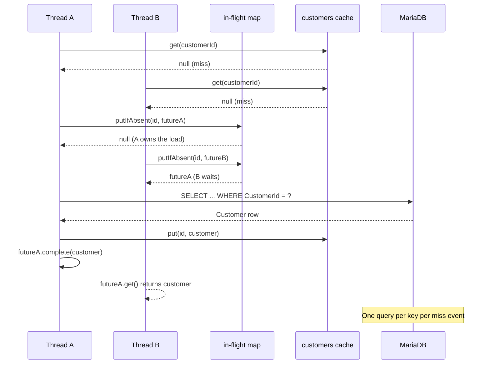

# Cache-Aside Under Load

## Introduction

Your relational database works. It serves correct results, enforces constraints, and survives restarts. Under growing load, customer lookups start queuing behind invoice writes, p99 latency climbs, and the operations team asks for a plan.

The benchmark from [Work with the Cache API](../../quick-start/work-with-cache-api.md) answered one question: on a single localhost hop, MariaDB is 3 to 4 times faster than the cache for primary-key lookups. A database with a warm buffer pool is hard to beat at one read. A cache earns its place by taking the read volume off the database so the database has room to handle everything else: writes, analytical queries, range scans, joins, etc.

In this tutorial, you build a cache-aside implementation that reads from the `customers` cache first, falls through to MariaDB on a miss, and populates the cache with the fresh row. Then you pressure MariaDB with a workload simulator that drives realistic mixed traffic and measure what the cache absorbs. On a 60-second run with 8 concurrent readers and a second client running 2,000 queries per second against the database, the cache serves 2.5 million lookups while MariaDB sees 118 additional queries from the listen harness. That is the offload.

Cache-aside is mediation, not delegation. The cache does not know about the database and the database does not know about the cache. Application code checks one, falls through to the other, and writes the result back. Everything the cache does for consistency, staleness, and concurrency is controlled by that application code and the cache configuration you already set up in [Cache Sizing and Expiry](cache-sizing-and-expiry.md).

This tutorial labels itself "beginner" for GridGain. The surrounding Java stack (Maven, JDBC, Spring XML) is assumed prior knowledge. If any of those is new, skim the linked primer before starting.

You work from a companion repository that ships the Docker configurations and a pre-built workload simulator alongside the reference code you will write. Clone it once during setup and use it through the rest of the tutorial.

## Prerequisites

- **Cache API familiarity** from [Work with the Cache API](../../quick-start/work-with-cache-api.md)
- **Eviction and expiry vocabulary** from [Cache Sizing and Expiry](cache-sizing-and-expiry.md)
- **Java 17** or later
- **Maven 3.6** or later
- **Docker Compose 2.23** or later
- **JDBC and connection-pool (HikariCP) familiarity.** The tutorial writes a JDBC `SELECT` and wraps it in a HikariCP `DataSource`. If you have never touched JDBC, read the [Oracle JDBC Basics tutorial](https://docs.oracle.com/javase/tutorial/jdbc/basics/) first.

Clone the companion repository into your working directory:

```bash
git clone https://github.com/maglietti/cache-aside.git
```

The repository contains `docker/` (MariaDB and GridGain 8 compose files), `listen-harness/` (a multi-threaded driver that exercises the same cache-aside pattern you will write), and `workload-simulator/` (the traffic generator). You will start the database from it in Step 1 and build the listen harness from it in Step 8. The code you write in Steps 3-6 lives in your own `cache-client/` project; the harness keeps its own copy in a separate Java package (`com.example.listen`) so the jar builds and runs on its own.

If you completed [Start a Local Cache Development Cluster](../../quick-start/start-local-cache-cluster.md), you can reuse your existing cache cluster. If you arrived here fresh, `docker/gridgain8/` inside the clone starts a single-node cluster in one command.

<details>
<summary>Returning to these tutorials? Verify your cluster is running.</summary>

Check that the cluster container is up:

```bash
docker ps --filter name=gridgain8-node1 --format "table {{.Names}}\t{{.Status}}"
```

Expected output:

```text
NAMES             STATUS
gridgain8-node1   Up X hours
```

**If the container is stopped**, restart it:

```bash
docker compose -f cache-cluster/docker-compose.yml start
```

**If the cluster was destroyed** (`docker compose down`), recreate it from your existing setup or from the companion repo's configs:

```bash
docker compose -f cache-aside/docker/gridgain8/docker-compose.yml up -d
```

The GridGain 8 compose file requires a trial license at `cache-aside/docker/gridgain8/gridgain-license.xml`. Follow the license steps in `cache-aside/docker/gridgain8/README.md` if you do not already have one.

The cluster runs in-memory. Destroying and recreating it starts with an empty cache.

</details>

## What You Will Learn

In this tutorial, you:

- Add a MariaDB container loaded with the Chinook sample dataset alongside the cache cluster
- Write a `Customer` POJO and a `CustomerRepository` that implements cache-aside with coalesced concurrent loads
- Run a baseline workload simulator against MariaDB alone and record the database's response
- Run a listen-mode client that drives the cache-aside path in parallel with the simulator
- Quantify the read offload, interpret the serve rate, and reason about the staleness window the TTL enforces

## Start MariaDB With the Chinook Dataset

The cache lives in the GridGain container from the earlier tutorials. The source of truth is a MariaDB container loaded with the [Chinook sample database](https://github.com/lerocha/chinook-database), which models a digital media store: 59 customers, 412 invoices, 2,240 invoice lines, and 3,503 tracks. You run MariaDB alongside the cache in a separate Docker Compose project.

The companion repository you cloned in the prerequisites ships a ready-to-run MariaDB compose file with the Chinook dump already in the `init/` directory. Start the container:

```bash
docker compose -f cache-aside/docker/music-db/docker-compose.yml up -d
```

<details>
<summary>What this compose file does</summary>

`cache-aside/docker/music-db/docker-compose.yml` is a small MariaDB 11.4 definition:


```yaml
name: music-db

services:
  mariadb:
    image: mariadb:11.4
    container_name: music-db
    environment:
      MARIADB_ROOT_PASSWORD: chinook
    volumes:
      - ./init:/docker-entrypoint-initdb.d:ro
    ports:
      - "3306:3306"
```


The image auto-executes any `.sql` or `.sh` file placed in `/docker-entrypoint-initdb.d` the first time the container starts. The repository mounts the `init/` directory read-only into that location, and `init/chinook.sql` loads the full Chinook schema and data on first boot.

</details>

Wait about fifteen seconds for the database to accept connections and the dataset to load, then verify the row counts:

```bash
docker exec music-db mariadb -uroot -pchinook Chinook \
  -e "SELECT 'Customer' AS tbl, COUNT(*) AS cnt FROM Customer \
      UNION SELECT 'Invoice', COUNT(*) FROM Invoice \
      UNION SELECT 'InvoiceLine', COUNT(*) FROM InvoiceLine;"
```

Expected output:

```text
tbl          cnt
Customer     59
Invoice      412
InvoiceLine  2240
```

Customer is the read-heavy reference data the cache will absorb. Invoice and InvoiceLine are the write-heavy transactional data that stays in MariaDB. The workload simulator will exercise both.


**Checkpoint:** The query returns three rows with 59 customers, 412 invoices, and 2,240 invoice lines. The cluster container from the earlier tutorials is still up, and MariaDB answers on `localhost:3306` with password `chinook`.


## Extend the Maven Project

If you are working through the [Cache-Centric Foundations](README.md) learning path, you may now have two directories side by side in your working directory: the `cache-client/` Maven project you built in [Work with the Cache API](../../quick-start/work-with-cache-api.md) and [Cache Sizing and Expiry](cache-sizing-and-expiry.md), and the `cache-aside/` companion repository you cloned in the prerequisites. You edit `cache-client/` throughout this tutorial; `cache-aside/` ships Docker configurations and pre-built tools you start using in Step 1.

```text
working-directory/
├── cache-client/              ← your code; edited in previous tutorials
│   ├── pom.xml
│   └── src/main/java/com/example/   (seven classes from the earlier tutorials)
└── cache-aside/               ← companion repo, read-only for this tutorial
    ├── docker/
    │   ├── music-db/          ← started in Step 1
    │   └── gridgain8/
    ├── listen-harness/        ← you built and run in Step 8
    └── workload-simulator/    ← you built and run in Step 7
```

`cache-client/pom.xml` currently declares the GridGain 8 core dependency and an `exec-maven-plugin` block that runs the program with the `--add-opens` flags the thick client needs on Java 17. Its seven classes live in package `com.example` and exercise the cache in isolation; none of them talk to an external database.

You make two edits to `cache-client/` in this step:

1. Add the **MariaDB JDBC driver** and **HikariCP** to `pom.xml`. MariaDB is the source-of-truth database the cache will fall through to on a miss. HikariCP wraps a pool of connections behind the `javax.sql.DataSource` interface, reuses TCP sessions across calls, and applies connection-level timeouts. The cache-aside code accepts a `DataSource`, so the single-threaded example in Step 6 and the multi-threaded listen harness in Step 8 share the same repository class.
2. Create a new Java package `com.example.cacheaside` so the new Java files live next to the earlier classes without a name collision.

<details>
<summary>Starting fresh without `cache-client/` from the earlier tutorials</summary>

If `cache-client/` does not exist in your working directory, create the directory tree now:

```bash
mkdir -p cache-client/src/main/java/com/example/cacheaside
```

Then continue with the pom block below. You are creating `cache-client/pom.xml` for the first time rather than replacing an existing file, but the contents are the same. Skip the `mkdir` command further down this step; you already ran it. The Checkpoint at the end of this step passes either way.

Step 4 walks through `LruEvictionPolicyFactory` and `ModifiedExpiryPolicy` without re-introducing those APIs. Both come from [Cache Sizing and Expiry](cache-sizing-and-expiry.md); skim that tutorial if the names are unfamiliar.

</details>

Replace `cache-client/pom.xml` with the following:


```xml
<?xml version="1.0" encoding="UTF-8"?>
<project xmlns="http://maven.apache.org/POM/4.0.0"
         xmlns:xsi="http://www.w3.org/2001/XMLSchema-instance"
         xsi:schemaLocation="http://maven.apache.org/POM/4.0.0
         http://maven.apache.org/xsd/maven-4.0.0.xsd">
    <modelVersion>4.0.0</modelVersion>

    <groupId>com.example</groupId>
    <artifactId>cache-client</artifactId>
    <version>1.0-SNAPSHOT</version>

    <properties>
        <maven.compiler.source>17</maven.compiler.source>
        <maven.compiler.target>17</maven.compiler.target>
        <project.build.sourceEncoding>UTF-8</project.build.sourceEncoding>
        <exec.mainClass>com.example.cacheaside.CacheClient</exec.mainClass>
    </properties>

    <dependencies>
        <dependency>
            <groupId>org.gridgain</groupId>
            <artifactId>gridgain-core</artifactId>
            <version>8.10.0</version>
        </dependency>
        <dependency>
            <groupId>org.mariadb.jdbc</groupId>
            <artifactId>mariadb-java-client</artifactId>
            <version>3.3.3</version>
        </dependency>
        <dependency>
            <groupId>com.zaxxer</groupId>
            <artifactId>HikariCP</artifactId>
            <version>5.1.0</version>
        </dependency>
    </dependencies>

    <repositories>
        <repository>
            <id>GridGain External Repository</id>
            <url>https://www.gridgainsystems.com/nexus/content/repositories/external</url>
        </repository>
    </repositories>

    <build>
        <plugins>
            <plugin>
                <groupId>org.codehaus.mojo</groupId>
                <artifactId>exec-maven-plugin</artifactId>
                <version>3.1.0</version>
                <configuration>
                    <executable>java</executable>
                    <arguments>
                        <argument>--add-opens</argument>
                        <argument>java.base/java.nio=ALL-UNNAMED</argument>
                        <argument>--add-opens</argument>
                        <argument>java.base/java.io=ALL-UNNAMED</argument>
                        <argument>--add-opens</argument>
                        <argument>java.base/sun.nio.ch=ALL-UNNAMED</argument>
                        <argument>--add-opens</argument>
                        <argument>java.base/java.lang=ALL-UNNAMED</argument>
                        <argument>--add-opens</argument>
                        <argument>java.base/java.util=ALL-UNNAMED</argument>
                        <argument>-classpath</argument>
                        <classpath/>
                        <argument>${exec.mainClass}</argument>
                    </arguments>
                </configuration>
            </plugin>
        </plugins>
    </build>
</project>
```


Create the new package directory:

```bash
mkdir -p cache-client/src/main/java/com/example/cacheaside
```

Confirm the project still compiles:

```bash
mvn -f cache-client/pom.xml compile
```

Maven prints a `BUILD SUCCESS` line. No class files exist in the new package yet; the next step adds the first one.


**Checkpoint:** `cache-client/pom.xml` lists the MariaDB JDBC driver. `mvn compile` succeeds. The `com/example/cacheaside/` directory exists and is empty.


## Define the Customer POJO

The cache stores Customer objects keyed by `CustomerId`. Each field maps one-to-one to a column in the MariaDB Customer table, which keeps the JDBC row-to-object translation straightforward.

The cache stores values as bytes on the server so the thick client can fetch them back later. The Java object must implement `Serializable` (or use a custom marshaller) for that round-trip to work. A plain POJO with a no-argument constructor and standard getters and setters is enough; no GridGain annotations are needed because this tutorial does not run SQL queries against the cache.

Create `cache-client/src/main/java/com/example/cacheaside/Customer.java`:


```java
package com.example.cacheaside;

import java.io.Serializable;

/**
 * A Chinook Customer row cached by CustomerId.
 *
 * Implements Serializable so the GridGain thick client can round-trip
 * the object through the cluster. The cache holds values as bytes on
 * the server and deserialises them back into Customer instances when
 * the client reads them. Serializable is the round-trip contract;
 * a non-Serializable value throws NotSerializableException on put().
 *
 * Field names and types match the Chinook Customer DDL. The JDBC
 * loader in CustomerRepository reads rs.getString("FirstName") into
 * firstName, rs.getInt("CustomerId") into customerId, and so on, so
 * the column-to-field mapping lines up when you read both side by
 * side.
 *
 * serialVersionUID is declared explicitly. When a later version of
 * this class changes its fields, bumping the UID invalidates cached
 * bytes written by older versions instead of deserialising them
 * into a field layout that no longer matches.
 */
public class Customer implements Serializable {
    private static final long serialVersionUID = 1L;

    private int customerId;
    private String firstName;
    private String lastName;
    private String company;
    private String address;
    private String city;
    private String state;
    private String country;
    private String postalCode;
    private String phone;
    private String fax;
    private String email;
    // supportRepId is Integer (not int) because the Customer.SupportRepId
    // column in Chinook is nullable. Using the wrapper type preserves the
    // null distinction. An int primitive stores 0 for a NULL column,
    // which makes "no support rep assigned" indistinguishable from
    // "support rep 0".
    private Integer supportRepId;

    // No-arg constructor is required so Java deserialisation can
    // instantiate the object before calling the setters.
    public Customer() {}

    public int getCustomerId() { return customerId; }
    public void setCustomerId(int customerId) { this.customerId = customerId; }
    public String getFirstName() { return firstName; }
    public void setFirstName(String firstName) { this.firstName = firstName; }
    public String getLastName() { return lastName; }
    public void setLastName(String lastName) { this.lastName = lastName; }
    public String getCompany() { return company; }
    public void setCompany(String company) { this.company = company; }
    public String getAddress() { return address; }
    public void setAddress(String address) { this.address = address; }
    public String getCity() { return city; }
    public void setCity(String city) { this.city = city; }
    public String getState() { return state; }
    public void setState(String state) { this.state = state; }
    public String getCountry() { return country; }
    public void setCountry(String country) { this.country = country; }
    public String getPostalCode() { return postalCode; }
    public void setPostalCode(String postalCode) { this.postalCode = postalCode; }
    public String getPhone() { return phone; }
    public void setPhone(String phone) { this.phone = phone; }
    public String getFax() { return fax; }
    public void setFax(String fax) { this.fax = fax; }
    public String getEmail() { return email; }
    public void setEmail(String email) { this.email = email; }
    public Integer getSupportRepId() { return supportRepId; }
    public void setSupportRepId(Integer supportRepId) { this.supportRepId = supportRepId; }

    // toString is used by the example so the sample customer print at the
    // end of Pass 2 is human-readable. Keeping it to identifying fields
    // keeps cache debug logs scannable.
    @Override
    public String toString() {
        return "Customer{id=" + customerId
            + ", name='" + firstName + " " + lastName + "'"
            + ", email='" + email + "'"
            + ", country='" + country + "'}";
    }
}
```


Thirteen fields. `SupportRepId` is `Integer` (not `int`) because the column is nullable; the other fields use primitives or `String` to match the schema. The `serialVersionUID` is explicit so later revisions of the class do not accidentally invalidate entries written by earlier versions.


**Checkpoint:** The file exists at `cache-client/src/main/java/com/example/cacheaside/Customer.java`. `mvn compile` still succeeds.


## Review the Cache Configuration

The `customers` cache configuration applies four controls from [Cache Sizing and Expiry](cache-sizing-and-expiry.md): on-heap storage, LRU eviction, eager TTL, and modified expiry.

```java
CacheConfiguration<Integer, Customer> cfg = new CacheConfiguration<>("customers");
cfg.setOnheapCacheEnabled(true);
cfg.setEvictionPolicyFactory(new LruEvictionPolicyFactory<>(1000));
cfg.setEagerTtl(true);
cfg.setExpiryPolicyFactory(
    ModifiedExpiryPolicy.factoryOf(new Duration(TimeUnit.SECONDS, 60)));

IgniteCache<Integer, Customer> cache = ignite.getOrCreateCache(cfg);
```

Each line matches a decision from the previous tutorial:

- **`setOnheapCacheEnabled(true)`** opts the cache in to the on-heap tier that LRU bounds. Without it, the cluster rejects the configuration.
- **`LruEvictionPolicyFactory(1000)`** caps the on-heap tier at 1,000 entries. That is an order of magnitude larger than the 59-customer Chinook dataset, so every row stays hot for this tutorial.
- **`setEagerTtl(true)`** keeps the TTL sweeper active on this cache. Eager TTL is the default on GridGain 8. The call is explicit to make the setting visible.
- **`ModifiedExpiryPolicy`** sets the entry lifetime to 60 seconds, starting the clock on every write or update. Sixty seconds is short enough to demonstrate TTL behaviour and long enough that the cache warms before the first refresh cycle.

`IgniteCache<Integer, Customer>` parameterises the cache so `findById` accepts an `int` and returns a `Customer` without casts on either side of the call.


**Checkpoint:** You can read each line of the configuration and explain which control it sets. If any line is unfamiliar, review [Cache Sizing and Expiry](cache-sizing-and-expiry.md).


## Implement the Cache-Aside Read

Cache-aside is four steps in a read method:

1. Check the cache for the key.
2. If a value is there, return it.
3. On a miss, query the database.
4. Write the row into the cache and return it.

That sequence describes what a single thread does. Concurrent callers introduce a second concern. On a cold key, every thread sees a miss and queries the database before any of them writes the cache. Eight threads hitting the same unpopulated key produce eight database queries for the same row.

Single-flight coalescing fixes that race. Each key has at most one in-flight database load at a time:

- **The first thread to miss on a key** creates a `CompletableFuture`, publishes it into an in-flight map, queries the database, writes the row into the cache, and completes the future.
- **Every later thread that misses on the same key** finds the future already in the map and waits on it instead of issuing its own query. When the first thread completes, all waiters receive the same value.

The database sees exactly one query per unique key per miss event.

The sequence below shows two threads racing on the same cold key. Thread A claims the in-flight slot and runs the database load; Thread B finds the slot occupied and waits on A's future.



Create `cache-client/src/main/java/com/example/cacheaside/CustomerRepository.java`:


```java
package com.example.cacheaside;

import java.sql.Connection;
import java.sql.PreparedStatement;
import java.sql.ResultSet;
import java.sql.SQLException;
import java.util.concurrent.CompletableFuture;
import java.util.concurrent.ConcurrentHashMap;
import java.util.concurrent.ExecutionException;
import java.util.concurrent.atomic.AtomicLong;

import javax.sql.DataSource;

import org.apache.ignite.IgniteCache;

/**
 * Cache-aside repository for the Chinook Customer table.
 *
 * Reads go through findById(int), which implements the cache-aside
 * pattern plus single-flight coalescing for concurrent misses.
 *
 * Cache-aside is mediation: the application checks the cache first,
 * falls through to the source database on a miss, writes the fresh
 * value back into the cache, and returns. The cache does not know
 * about the database; the database does not know about the cache.
 * This class is the code that connects them.
 *
 * Single-flight coalescing handles a race that plain cache-aside
 * does not. When N threads miss on the same key at the same time,
 * a plain implementation sends N queries to the database for the
 * same row. The ConcurrentHashMap below lets the first thread
 * claim the key, and the other N-1 threads wait on the first
 * thread's result. The database sees exactly one query per unique
 * key per miss event.
 */
public class CustomerRepository {

    // One SQL statement. PreparedStatement with a positional parameter
    // keeps the plan cache-friendly inside MariaDB and avoids the SQL
    // injection risk of string-concatenated queries.
    private static final String SELECT_BY_ID =
        "SELECT CustomerId, FirstName, LastName, Company, Address, City, State, "
            + "Country, PostalCode, Phone, Fax, Email, SupportRepId "
            + "FROM Customer WHERE CustomerId = ?";

    // The cache this repository reads and writes. Parameterised on
    // <Integer, Customer>: keys are CustomerIds, values are the
    // Serializable POJOs from the previous step.
    private final IgniteCache<Integer, Customer> cache;

    // Pooled JDBC data source. Every call to loadFromDatabase borrows
    // a connection from the pool and returns it via try-with-resources.
    // DataSource is the interface; HikariCP is the concrete pool, set
    // up in the entry point class. Accepting DataSource here means the
    // repository does not know or care which pool implementation is
    // wired in.
    private final DataSource dataSource;

    // The in-flight map is the single-flight mechanism. The key is a
    // CustomerId currently being loaded; the value is a future that
    // will complete with the loaded Customer (or null if the row
    // does not exist). Only one entry per key can exist at any time
    // because every put goes through putIfAbsent.
    private final ConcurrentHashMap<Integer, CompletableFuture<Customer>> inflight =
        new ConcurrentHashMap<>();

    // Observability counters. AtomicLong so multiple lookup threads
    // increment them without stepping on each other. These live here
    // rather than in a separate class because this is the only place
    // that writes them, and entry points just read the totals.
    //
    // Three counters distinguish what happened on each lookup:
    //   cacheHits        - the key was already in the cache
    //   dbLoads          - this thread executed the SELECT against MariaDB
    //   waitedOnInFlight - this thread blocked on another thread's load
    //
    // Keeping these separate matters because the in-flight branch does
    // not hit the cache and does not hit the database. Counting it as
    // a hit would overstate cache effectiveness; counting it as a miss
    // would overstate database traffic.
    private final AtomicLong cacheHits = new AtomicLong();
    private final AtomicLong dbLoads = new AtomicLong();
    private final AtomicLong waitedOnInFlight = new AtomicLong();

    public CustomerRepository(IgniteCache<Integer, Customer> cache, DataSource dataSource) {
        this.cache = cache;
        this.dataSource = dataSource;
    }

    /**
     * Look up a customer by id. Returns the cached row if present,
     * or loads it from MariaDB, populates the cache, and returns.
     * Returns null when no row with this id exists in the database.
     *
     * Concurrent calls with the same customerId share one database
     * query. The first caller does the load; later callers block on
     * the same future and receive the same result.
     */
    public Customer findById(int customerId) throws SQLException {
        // Step 1 of cache-aside: check the cache first.
        // A hit returns immediately, skipping the database entirely.
        Customer cached = cache.get(customerId);
        if (cached != null) {
            cacheHits.incrementAndGet();
            return cached;
        }

        // Step 2: the cache missed. Before querying the database,
        // try to claim this key in the in-flight map.
        //
        // putIfAbsent is atomic. It returns null if this thread is
        // the first to publish a future for this customerId, or the
        // existing future if another thread already claimed the key.
        CompletableFuture<Customer> newFuture = new CompletableFuture<>();
        CompletableFuture<Customer> inFlight = inflight.putIfAbsent(customerId, newFuture);

        if (inFlight != null) {
            // Another thread is already loading this key. Do not
            // send a second query to the database; wait on the
            // existing future. Count this separately from cache
            // hits: the cache did not serve this read and the
            // database is not seeing another query for this key.
            waitedOnInFlight.incrementAndGet();
            return awaitLoad(inFlight);
        }

        // This thread won the race: it owns the load for this key.
        // Everything from here until the finally block populates the
        // cache and publishes the result to any waiting threads.
        try {
            dbLoads.incrementAndGet();

            // Step 3: load the row from the source of truth.
            Customer loaded = loadFromDatabase(customerId);

            // Step 4: populate the cache so the next reader gets a
            // hit. Putting into the cache BEFORE completing the
            // future is important: when a waiting thread wakes up
            // from future.get(), the value must already be in the
            // cache so subsequent reads (not for this load, but
            // for the next findById of the same key) see it.
            if (loaded != null) {
                cache.put(customerId, loaded);
            }

            // Complete the future so waiting threads can proceed.
            newFuture.complete(loaded);
            return loaded;

        } catch (SQLException e) {
            // The load failed. Propagate the failure to every waiter
            // so they all get the exception instead of hanging or
            // falsely receiving null. Then rethrow so the caller
            // sees the same failure this thread saw.
            newFuture.completeExceptionally(e);
            throw e;

        } finally {
            // Clean up the in-flight map on every path. The
            // two-argument remove drops the entry only if the
            // current value is still the future created above. That
            // check matters because a later load (different thread,
            // same key) could publish its own future between the
            // try body finishing and this line running; the check
            // keeps that later future in place.
            inflight.remove(customerId, newFuture);
        }
    }

    // Public counters. The entry points use these to print per-pass
    // or per-interval metrics.
    public long cacheHits() { return cacheHits.get(); }
    public long dbLoads() { return dbLoads.get(); }
    public long waitedOnInFlight() { return waitedOnInFlight.get(); }

    /**
     * Fraction of lookups that avoided a database query. A lookup
     * avoids the database when it is served from the cache or when
     * it blocks on another thread's in-flight load. The complement
     * is the fraction of lookups that executed a SELECT.
     */
    public double serveRate() {
        long served = cacheHits.get() + waitedOnInFlight.get();
        long total = served + dbLoads.get();
        return total == 0 ? 0.0 : (served * 100.0) / total;
    }

    /**
     * Wait for another thread's in-flight load to finish, and return
     * its result. The future may complete with either a Customer
     * instance, null (no such row), or an exception.
     *
     * Exception handling translates checked JDBC failures back into
     * SQLException so callers see the same interface whether they
     * ran the load or waited on another thread that did.
     */
    private Customer awaitLoad(CompletableFuture<Customer> future) throws SQLException {
        try {
            return future.get();
        } catch (InterruptedException e) {
            // Restore the interrupt flag for code higher up the stack.
            Thread.currentThread().interrupt();
            throw new SQLException("Interrupted waiting for in-flight load", e);
        } catch (ExecutionException e) {
            // future.get() wraps the original exception in ExecutionException.
            // Unwrap it and rethrow as SQLException so callers see a
            // consistent checked-exception signature on every path.
            Throwable cause = e.getCause();
            if (cause instanceof SQLException) {
                throw (SQLException) cause;
            }
            throw new SQLException(cause);
        }
    }

    /**
     * Execute the SELECT against MariaDB and map the result row
     * into a Customer instance. Returns null when the id is not
     * present in the database (for example, a deleted customer).
     *
     * try-with-resources closes the Connection, PreparedStatement,
     * and ResultSet in reverse order of acquisition, even when the
     * body throws. HikariCP recycles a borrowed Connection back to
     * the pool when it closes, so reliable closure is how pool
     * capacity stays available for later callers.
     */
    private Customer loadFromDatabase(int customerId) throws SQLException {
        try (Connection conn = dataSource.getConnection();
             PreparedStatement ps = conn.prepareStatement(SELECT_BY_ID)) {

            ps.setInt(1, customerId);

            try (ResultSet rs = ps.executeQuery()) {
                if (!rs.next()) {
                    // Row not found. Return null; the caller will
                    // NOT cache a null (that would be negative
                    // caching, which is out of scope here).
                    return null;
                }

                // Map every column of the row onto the POJO. The
                // order matches the SELECT clause at the top of
                // the class, so visually verifying the mapping
                // means running down both lists in parallel.
                Customer c = new Customer();
                c.setCustomerId(rs.getInt("CustomerId"));
                c.setFirstName(rs.getString("FirstName"));
                c.setLastName(rs.getString("LastName"));
                c.setCompany(rs.getString("Company"));
                c.setAddress(rs.getString("Address"));
                c.setCity(rs.getString("City"));
                c.setState(rs.getString("State"));
                c.setCountry(rs.getString("Country"));
                c.setPostalCode(rs.getString("PostalCode"));
                c.setPhone(rs.getString("Phone"));
                c.setFax(rs.getString("Fax"));
                c.setEmail(rs.getString("Email"));

                // SupportRepId is nullable. getInt returns 0 for a
                // NULL column, so the code checks wasNull() to tell a
                // real 0 apart from a missing value.
                int supportRepId = rs.getInt("SupportRepId");
                c.setSupportRepId(rs.wasNull() ? null : supportRepId);

                return c;
            }
        }
    }
}
```


Three lines in this class carry the weight of the pattern:

- **`cache.get(customerId)`** is the fast path. A hit returns immediately in microseconds and never touches MariaDB.
- **`inflight.putIfAbsent(customerId, newFuture)`** is the single-flight guard. The call is atomic: at most one thread publishes its future for a given key. Every other thread that misses on the same key receives the existing future and blocks in `awaitLoad`.
- **`cache.put(customerId, loaded)` before `newFuture.complete(loaded)`** is the write-back. The value lands in the cache before any waiting thread sees it, so every caller observes a populated cache after the first miss resolves.

The `try/finally` around the load is what keeps the in-flight map from leaking. Whether the load succeeds, returns `null`, or throws, the method removes its future from the map before returning. The two-argument `remove` checks that the current value is still the expected future; if a race leaves a stale mapping the operation is a no-op.


**Checkpoint:** The file compiles with `mvn -f cache-client/pom.xml compile`. The method reads as four ideas: check the cache, claim the key with a future, load from the database and publish, clean up.


## Run the Cache-Aside Example

The entry point wires the cache configuration from step 4, the repository from step 5, and a two-pass loop that reads all 59 customers twice: once with a cold cache to force misses, then again with a warm cache to serve hits.

Create `cache-client/src/main/java/com/example/cacheaside/CacheClient.java`:


```java
package com.example.cacheaside;

import java.sql.SQLException;
import java.util.Collections;
import java.util.concurrent.TimeUnit;

import javax.cache.expiry.Duration;
import javax.cache.expiry.ModifiedExpiryPolicy;

import org.apache.ignite.Ignite;
import org.apache.ignite.IgniteCache;
import org.apache.ignite.Ignition;
import org.apache.ignite.cache.eviction.lru.LruEvictionPolicyFactory;
import org.apache.ignite.configuration.CacheConfiguration;
import org.apache.ignite.configuration.IgniteConfiguration;
import org.apache.ignite.spi.discovery.tcp.TcpDiscoverySpi;
import org.apache.ignite.spi.discovery.tcp.ipfinder.vm.TcpDiscoveryVmIpFinder;

import com.zaxxer.hikari.HikariConfig;
import com.zaxxer.hikari.HikariDataSource;

/**
 * Entry point for the cache-aside example. Connects a thick client,
 * creates the customers cache, and runs two passes over every
 * Chinook customer: the first pass populates the cache from
 * MariaDB, the second serves every read from memory.
 */
public class CacheClient {

    // Connection parameters as constants to keep the example readable.
    // In a real service these come from configuration: environment
    // variables, a properties file, or a secret store.
    private static final String JDBC_URL = "jdbc:mariadb://localhost:3306/Chinook";
    private static final String DB_USER = "root";
    private static final String DB_PASSWORD = "chinook";
    private static final int CUSTOMER_COUNT = 59;

    public static void main(String[] args) throws SQLException {
        // Static IP discovery: the client announces itself on
        // port 47500 and the server node on the same port forms
        // the ring.
        TcpDiscoverySpi disco = new TcpDiscoverySpi();
        disco.setIpFinder(new TcpDiscoveryVmIpFinder()
            .setAddresses(Collections.singleton("127.0.0.1:47500")));

        // clientMode(true) makes this JVM a client, not a data
        // owner. Clients join the topology but host no partitions.
        // peerClassLoadingEnabled must match the server-side flag
        // from the cluster configuration in CC-01; a mismatch fails
        // discovery with "Remote node has peer class loading enabled
        // flag different from local".
        IgniteConfiguration cfg = new IgniteConfiguration();
        cfg.setDiscoverySpi(disco);
        cfg.setClientMode(true);
        cfg.setPeerClassLoadingEnabled(true);

        // HikariCP connection pool. Even though this run is
        // single-threaded, HikariCP is how any production Java
        // service talks to JDBC. Keeping the same pattern here
        // means the reader can lift this class straight into
        // their own service without reworking the DB layer.
        HikariConfig dsCfg = new HikariConfig();
        dsCfg.setJdbcUrl(JDBC_URL);
        dsCfg.setUsername(DB_USER);
        dsCfg.setPassword(DB_PASSWORD);
        dsCfg.setMaximumPoolSize(4);
        dsCfg.setPoolName("cache-client");

        // try-with-resources on both GridGain and the HikariCP pool
        // shuts everything down on exit. GridGain spawns non-daemon
        // threads; HikariCP owns TCP connections to MariaDB. Both
        // need explicit close() to avoid dangling resources.
        try (Ignite ignite = Ignition.start(cfg);
             HikariDataSource dataSource = new HikariDataSource(dsCfg)) {

            // Cache configuration: the four controls introduced in
            // the previous tutorial (on-heap LRU at 1,000, eager
            // TTL, 60-second modified expiry).
            CacheConfiguration<Integer, Customer> cacheCfg =
                new CacheConfiguration<>("customers");
            cacheCfg.setOnheapCacheEnabled(true);
            cacheCfg.setEvictionPolicyFactory(new LruEvictionPolicyFactory<>(1000));
            cacheCfg.setEagerTtl(true);
            cacheCfg.setExpiryPolicyFactory(
                ModifiedExpiryPolicy.factoryOf(new Duration(TimeUnit.SECONDS, 60)));

            // clear() makes re-runs deterministic: every run
            // starts with an empty cache so Pass 1 reliably misses.
            IgniteCache<Integer, Customer> cache = ignite.getOrCreateCache(cacheCfg);
            cache.clear();

            CustomerRepository repo = new CustomerRepository(cache, dataSource);

            // Startup banner. Showing the config up front lets
            // the reader verify the example is pointed at the cluster
            // and database they expect before any work begins.
            System.out.println();
            System.out.println("=== Cache-Aside Example ===");
            System.out.println("  Ignite host:     127.0.0.1:47500");
            System.out.println("  MariaDB URL:     " + JDBC_URL);
            System.out.println("  Cache:           customers (on-heap LRU=1000, TTL=60s)");
            System.out.println("  Customers in DB: " + CUSTOMER_COUNT);
            System.out.println();

            // Pass 1 (cold): every findById misses, queries MariaDB,
            // and populates the cache. The per-miss log lines make
            // the pattern visible as it executes: check cache, miss,
            // load from DB, populate, return.
            System.out.println("--- Pass 1 (cold cache) ---");
            System.out.println("Reading customers 1.." + CUSTOMER_COUNT
                + ". Each miss hits MariaDB and populates the cache.");

            long pass1Start = System.nanoTime();
            for (int id = 1; id <= CUSTOMER_COUNT; id++) {
                long beforeDbLoads = repo.dbLoads();
                long findStart = System.nanoTime();
                repo.findById(id);
                long findMs = (System.nanoTime() - findStart) / 1_000_000L;

                // Print the first three DB loads and the last one
                // with load time, plus a one-line summary in the
                // middle. 59 individual log lines would bury the
                // headline metrics.
                if (repo.dbLoads() > beforeDbLoads) {
                    if (id <= 3 || id == CUSTOMER_COUNT) {
                        System.out.printf("  id=%-2d miss -> loaded in %dms -> populated%n",
                            id, findMs);
                    } else if (id == 4) {
                        System.out.println("  ... "
                            + (CUSTOMER_COUNT - 4)
                            + " more misses with the same pattern ...");
                    }
                }
            }
            long pass1Ms = (System.nanoTime() - pass1Start) / 1_000_000L;
            System.out.printf(
                "Pass 1 summary: cacheHits=%d dbLoads=%d waitedOnInFlight=%d serveRate=%.1f%%  %dms%n",
                repo.cacheHits(), repo.dbLoads(), repo.waitedOnInFlight(),
                repo.serveRate(), pass1Ms);

            // Capture Pass 1 counters so Pass 2 metrics show only
            // the delta from the second loop.
            long pass1CacheHits = repo.cacheHits();
            long pass1DbLoads = repo.dbLoads();
            long pass1Waited = repo.waitedOnInFlight();

            // Pass 2 (warm): every findById hits the cache. No
            // per-iteration output because no DB loads happen.
            // Silence is the signal that the cache served every
            // read without MariaDB.
            System.out.println();
            System.out.println("--- Pass 2 (warm cache) ---");
            System.out.println("Re-reading the same " + CUSTOMER_COUNT
                + " customers. All reads served from cache, zero MariaDB queries.");

            long pass2Start = System.nanoTime();
            for (int id = 1; id <= CUSTOMER_COUNT; id++) {
                repo.findById(id);
            }
            long pass2Ms = (System.nanoTime() - pass2Start) / 1_000_000L;
            long pass2CacheHits = repo.cacheHits() - pass1CacheHits;
            long pass2DbLoads = repo.dbLoads() - pass1DbLoads;
            long pass2Waited = repo.waitedOnInFlight() - pass1Waited;
            long pass2Served = pass2CacheHits + pass2Waited;
            double pass2Rate = (pass2Served * 100.0) / (pass2Served + pass2DbLoads);
            System.out.printf(
                "Pass 2 summary: cacheHits=%d dbLoads=%d waitedOnInFlight=%d serveRate=%.1f%%  %dms%n",
                pass2CacheHits, pass2DbLoads, pass2Waited, pass2Rate, pass2Ms);

            // Sanity print: confirm the cache round-tripped the
            // POJO intact. Customer 1 is "Luís Gonçalves" from Brazil.
            Customer sample = repo.findById(1);
            System.out.println();
            System.out.println("Sample customer (round-tripped through the cache):");
            System.out.println("  " + sample);
            System.out.println();
            System.out.println("Done.");

            // destroy() drops the cache so the next run starts
            // with a clean slate. This is a convenience for the
            // example; a running service keeps its cache across restarts.
            cache.destroy();
        }

        // Force JVM exit. GridGain clients spawn non-daemon threads
        // that would otherwise keep the process alive.
        System.exit(0);
    }
}
```


Run it:

```bash
mvn -f cache-client/pom.xml compile exec:exec
```

After the cluster banner, the program prints:

```text
=== Cache-Aside Example ===
  Ignite host:     127.0.0.1:47500
  MariaDB URL:     jdbc:mariadb://localhost:3306/Chinook
  Cache:           customers (on-heap LRU=1000, TTL=60s)
  Customers in DB: 59

--- Pass 1 (cold cache) ---
Reading customers 1..59. Each miss hits MariaDB and populates the cache.
  id=1  miss -> loaded in 58ms -> populated
  id=2  miss -> loaded in 3ms -> populated
  id=3  miss -> loaded in 2ms -> populated
  ... 55 more misses with the same pattern ...
  id=59 miss -> loaded in 1ms -> populated
Pass 1 summary: cacheHits=0 dbLoads=59 waitedOnInFlight=0 serveRate=0.0%  207ms

--- Pass 2 (warm cache) ---
Re-reading the same 59 customers. All reads served from cache, zero MariaDB queries.
Pass 2 summary: cacheHits=59 dbLoads=0 waitedOnInFlight=0 serveRate=100.0%  44ms

Sample customer (round-tripped through the cache):
  Customer{id=1, name='Luís Gonçalves', email='luisg@embraer.com.br', country='Brazil'}

Done.
```

Each `id=N miss -> loaded in Xms -> populated` line is one trip through `findById`: cache miss, JDBC query to MariaDB, cache populate, return. Fifty-nine of them add up to roughly 200 ms of wall-clock time, most of which is driver warmup on the first load (id=1 is 58 ms; every later load is 1-3 ms).

Pass 2 produces no per-iteration output because no misses happen. Every read hits the cache and returns without touching MariaDB. The 44 ms total is the local cache round trip done 59 times. Cache-aside delivered its first result. The hot set is warm and subsequent reads are free.

The sample customer at the end is proof that the cache round-tripped the object intact. `cache.get(1)` returned a fully populated `Customer` with name, email, and country still in place. That is the `Serializable` contract from step 3 doing its job: the POJO moved through the cache without a schema, without annotations, without a marshaller.


**Checkpoint:** Pass 1 reports 59 dbLoads, Pass 2 reports 59 cacheHits and a 100% serve rate. The sample customer prints `Luís Gonçalves` from Brazil. Your code reads through the cache and falls through to MariaDB exactly once per key.


## Run the Workload Simulator Alone

A single-threaded loop shows the pattern works. It does not show what happens when the database is carrying production traffic. For that, you need a second client that pressures MariaDB with realistic mixed work while you measure.

The companion repository provides a pre-built workload simulator that drives five concurrent workloads against the Chinook schema. The mix shape approximates production read-heavy traffic:

| Workload | Share of total traffic | What it does |
|----------|------------------------|--------------|
| `customer-lookup` | 70% | SELECT a Customer row by `CustomerId`. This is the read the cache will absorb. |
| `order-processing` | 15% | INSERT an Invoice plus two InvoiceLine rows in a transaction. |
| `customer-registration` | 5% | INSERT a new Customer with IDs above the high-water mark read at startup. |
| `profile-update` | 5% | UPDATE Customer `Phone` by `CustomerId`. |
| `revenue-report` | 5% | SUM Invoice totals grouped by `BillingCountry`. |

Build the simulator jar from the companion repository you cloned during setup:

```bash
mvn -f cache-aside/pom.xml -pl workload-simulator -am clean package
```

Maven produces `cache-aside/workload-simulator/target/workload-simulator.jar`. In a separate terminal, run the simulator for sixty seconds at a target rate of 2,000 queries per second:

```bash
java -jar cache-aside/workload-simulator/target/workload-simulator.jar \
  --url jdbc:mariadb://localhost:3306/Chinook \
  --user root --password chinook \
  --duration 60 --rate 2000
```

The simulator prints a live-metrics line every five seconds and a final summary. A 60-second baseline run ends with:


The output below was captured on a laptop-class machine. Run the same simulator against MariaDB on a faster server and throughput goes up while latencies go down; on a resource-constrained environment the numbers move the other way. What matters is the shape of the run (mix percentages near 65-70% customer-lookup, zero errors) and the comparison between this baseline and the combined run in Step 8, both taken on the same machine. The absolute query counts and millisecond figures are not the signal.


```text
=== Final summary (60s elapsed) ===
Workload                    Queries          qps     avg ms     p99 ms    mix %
------------------------ ---------- ------------ ---------- ---------- --------
customer-lookup               60895       1014.9       0.31       1.34    65.8%
order-processing              15152        252.5       1.34       3.55    16.4%
customer-registration          5516         91.9       0.56       1.78     6.0%
profile-update                 5517         92.0       0.57       1.81     6.0%
revenue-report                 5508         91.8       2.41       5.13     5.9%

Total queries: 92588   Errors: 0   Duration: 60s
```

That is MariaDB under mixed load with no cache in front of it. Roughly 93,000 total queries in sixty seconds, the majority of them customer lookups. Zero errors. The live-metrics ticks during the run also reported `MariaDB Threads_connected=27`, which is the simulator's JDBC pool plus internal MariaDB worker threads. This is the baseline measurement.

Another baseline run produces similar numbers within run-to-run noise. The comparison that matters is this baseline against the next run, where the listen harness is also active.


**Checkpoint:** The simulator completes a 60-second run with zero errors and a final summary that shows customer-lookup around 65-70% of the total queries. You have captured the baseline load the database sees without a cache.


## Run the Listen Harness Alongside the Simulator

Your code from Step 6 was single-threaded. That is enough to prove the cache-aside contract, but a single loop cannot exercise the concurrency that single-flight coalescing protects against. The companion repo ships a `listen-harness/` module that does: a `ListenApp` main spawns eight worker threads that each call `CustomerRepository.findById` in a tight loop. The harness carries its own copy of the Customer, CustomerRepository, and CacheClient classes in package `com.example.listen` so the jar builds and runs without depending on your `cache-client/` project.

Eight threads hitting a cold cache at the same time are exactly the scenario the single-flight coalescing was designed for. Without coalescing, eight threads missing on `CustomerId=1` at once would produce eight MariaDB queries for the same row. The in-flight map in `findById` keeps the database at one query per unique key; the other seven threads wait on the future the first thread published.

<details>
<summary>What's inside `ListenApp.java`</summary>

The class lives at `cache-aside/listen-harness/src/main/java/com/example/listen/ListenApp.java` in the companion repository. It is test-harness plumbing around the `CustomerRepository` the harness ships. You do not type it, but understanding its shape is useful:

- **Arg parsing.** A small helper walks `args[]` looking for `--flag value` pairs. Defaults match what this tutorial uses (MariaDB on localhost, password `chinook`, 8 threads, 5-second metrics interval), so running the jar with no arguments does the right thing.
- **GridGain client + HikariCP pool.** Same TcpDiscoverySpi and HikariCP pattern as your `CacheClient`, duplicated here instead of extracted so each entry point reads end-to-end on its own. The pool is sized to `threads + 2` so every worker can hold a connection during a cache miss.
- **Cache configuration.** Identical block to `CacheClient`. Both entry points see the same `customers` cache because the cluster addresses the cache by name.
- **Worker loop.** Eight daemon threads each call `repo.findById(ThreadLocalRandom.current().nextInt(1, customerCount + 1))` in a while loop. The `CustomerRepository` instance is shared across all eight.
- **Metrics reporter.** A single scheduled executor fires every 5 seconds, reads `repo.cacheHits()`, `repo.dbLoads()`, and `repo.waitedOnInFlight()`, and prints a row with the per-window throughput.
- **Shutdown hook.** On SIGTERM or Ctrl+C, clears the stop flag, drains the workers, and prints the final summary.

No new cache-aside logic. All the coalescing still happens inside `findById`; `ListenApp` is just the harness that exercises it under concurrency.

</details>

Before launching the harness, reset MariaDB back to the original 59-customer state. The simulator you ran in Step 7 inserted roughly 6,000 new rows through its `customer-registration` workload. That is realistic production behavior, but it expands the readable ID range the harness pulls from. The `dbLoads` arithmetic later in this step (59 `dbLoads` per TTL cycle) only lines up when you start from 59 customers.

```bash
docker compose -f cache-aside/docker/music-db/docker-compose.yml down -v
docker compose -f cache-aside/docker/music-db/docker-compose.yml up -d
```

Wait about fifteen seconds for MariaDB to reload the Chinook dataset on the clean volume, then confirm the count:

```bash
docker exec music-db mariadb -uroot -pchinook Chinook -e "SELECT COUNT(*) FROM Customer;"
```

The query returns 59.

Build the listen harness from the companion repo:

```bash
mvn -f cache-aside/pom.xml -pl listen-harness -am clean package
```

Open a second terminal alongside the one running the simulator. Start the listen harness first and let it run. The jar's default main is `ListenApp`, so `java -jar` goes straight to listen mode:

```bash
java --add-opens java.base/java.nio=ALL-UNNAMED \
     --add-opens java.base/java.io=ALL-UNNAMED \
     --add-opens java.base/sun.nio.ch=ALL-UNNAMED \
     --add-opens java.base/java.lang=ALL-UNNAMED \
     --add-opens java.base/java.util=ALL-UNNAMED \
     -jar cache-aside/listen-harness/target/listen-harness.jar
```

The harness prints a metrics header and a row every five seconds:

```text
elapsed    cacheHits      dbLoads       waited  serveRate%  lookups/s
-------- ------------ ------------ ------------ ----------- ----------
```

Wait about fifteen seconds for the cache to warm. The first row appears and reads something like `5.0s  153733  59  4  100.0  30750.2`: `dbLoads` hold at 59 (one per unique key), `waited` settles in the low single digits (the threads that happened to arrive while another thread was mid-load), and the `cacheHits` column grows every tick. Once the cache is warm, `dbLoads` stops changing until the TTL expires.

Now start the simulator in the first terminal with the same arguments as the baseline run:

```bash
java -jar cache-aside/workload-simulator/target/workload-simulator.jar \
  --url jdbc:mariadb://localhost:3306/Chinook \
  --user root --password chinook \
  --duration 60 --rate 2000
```

For the next sixty seconds, MariaDB is handling the simulator's 2,000 queries per second while the harness's eight threads pull customer rows as fast as the cache can serve them. When the simulator finishes, its final summary reads:

```text
=== Final summary (60s elapsed) ===
Workload                    Queries          qps     avg ms     p99 ms    mix %
------------------------ ---------- ------------ ---------- ---------- --------
customer-lookup               70016       1166.9       0.19       0.37    67.8%
order-processing              16080        268.0       1.18       2.19    15.6%
customer-registration          5708         95.1       0.47       1.35     5.5%
profile-update                 5703         95.1       0.49       1.27     5.5%
revenue-report                 5692         94.9       2.37       6.47     5.5%

Total queries: 103199   Errors: 0   Duration: 60s
```

In the second terminal, send a Ctrl+C to the listen harness to stop it and print the final summary:

```text
    5.0s       153733           59            4       100.0    30750.2
   10.0s       329133           59            4       100.0    35077.9
   15.0s       515655           59            4       100.0    37281.6
   20.0s       701649           59            4       100.0    37211.3
   25.0s       890451           59            4       100.0    37770.4
   30.0s      1076846           59            4       100.0    37282.4
   35.0s      1253371           59            4       100.0    35295.8
   40.0s      1429582           59            4       100.0    35218.3
   45.0s      1606216           59            4       100.0    35356.2
   50.0s      1788932           59            4       100.0    36531.2
   55.0s      1975235           59            4       100.0    37275.3
   60.0s      2162100           59            4       100.0    37368.4
   65.0s      2343932          118           14       100.0    36386.2

--- Final summary ---
  Elapsed:             69.3s
  Cache hits:          2497904
  DB loads:            118
  Waited on in-flight: 14
  Serve rate:          100.0%
```

Those numbers come from the latest GridGain 8 Enterprise version on a laptop-class machine. The run reports a `dbLoads` count of exactly 59 per TTL cycle with a 100% serve rate.

Sustained throughput varies on GridGain 8. The Enterprise thick client does additional background work (baseline topology management, distributed metastorage updates) that interleaves with the lookup loop, and on a developer machine the `lookups/s` column sometimes drops to zero for several seconds at a time while a background task holds a communication channel. Under these stalls the harness completes fewer cache hits in the same wall-clock window. The cache-aside contract is unchanged; the `dbLoads` floor and the 100% serve rate hold. Production JVM tuning (heap size, GC options, direct memory, higher `socketWriteTimeout`) smooths the stalls.

Two observations deserve a pause.

**The `dbLoads` column is 59 for the entire warm period.** The final summary lists 118 only because the run crossed the 60-second TTL boundary; each cached entry expired and reloaded once on the way out. Eight worker threads hit every key concurrently during the warmup, but single-flight coalescing held the database to one query per key per TTL cycle. The `waited` column shows the rest of that contention: on fast hardware only a handful of threads per TTL cycle arrive while another thread is mid-load, because the load itself completes in a few milliseconds. That is what the `ConcurrentHashMap` plus `CompletableFuture` in `findById` is doing under real contention.

**The simulator's total queries went up under the combined load, not down.** The baseline was 92,588 queries; this run completed 103,199 queries with identical inputs, an 11% throughput increase. Most p99 latencies dropped on the primary-key paths (customer-lookup 1.34 ms to 0.37 ms, order-processing 3.55 ms to 2.19 ms, customer-registration 1.78 ms to 1.35 ms, profile-update 1.81 ms to 1.27 ms). The revenue-report aggregate rose from 5.13 ms to 6.47 ms p99 because the harness's eight reader threads contend with the `GROUP BY BillingCountry` scan in the buffer pool; the cache absorbs single-row reads, not table scans. The simulator's workload did not change. What changed is that the listen harness took 2.5 million customer lookups off the database's plate, so the database had more capacity to handle the simulator's own queries.


**Checkpoint:** The listen harness reports roughly 2.5 million cache hits and fewer than 200 `dbLoads` for a sixty-second run. The simulator completes with zero errors and at least 100,000 queries. Both the cache serve rate and the simulator's p99 latencies on primary-key workloads are visibly different from the baseline.


## Interpret the Offload

The offload story has four numbers. Find them in the two summary blocks Step 8 produced:

| Variable | Where to find it |
|---|---|
| `cacheHits` | Listen harness final summary, `Cache hits:` line |
| `dbLoads` | Listen harness final summary, `DB loads:` line |
| `waitedOnInFlight` | Listen harness final summary, `Waited on in-flight:` line |
| `sim_queries` | Simulator final summary, `Total queries:` column |

Three derived values tell the rest of the story. Let `harness_reads = cacheHits + dbLoads + waitedOnInFlight` (the total number of `findById` calls the eight worker threads made):

- **Queries MariaDB actually served** = `sim_queries + dbLoads`
- **Queries MariaDB would have served without the cache** = `sim_queries + harness_reads`
- **Offload percentage** = `(harness_reads - dbLoads) / (sim_queries + harness_reads)`

Applied to the reference output (laptop-class machine, 69-second harness run spanning one TTL boundary):

| Step | Calculation | Value |
|---|---|---|
| `cacheHits` | from listen-harness summary | 2,497,904 |
| `dbLoads` | from listen-harness summary | 118 |
| `waitedOnInFlight` | from listen-harness summary | 14 |
| `sim_queries` | from simulator summary | 103,199 |
| `harness_reads` | `cacheHits + dbLoads + waitedOnInFlight` | 2,498,036 |
| MariaDB served | `sim_queries + dbLoads` | 103,317 |
| Without cache | `sim_queries + harness_reads` | 2,601,235 |
| **Offload** | `(harness_reads - dbLoads) / (sim_queries + harness_reads)` | **96.0%** |

Plug your own numbers into the same three formulas. Expect two things to shift and one to stay the same.

`dbLoads` stays near 59 per TTL boundary regardless of hardware. A run that ends before t=60s lands at 59. A run that crosses the 60-second TTL expiry once lands at 118. Two crossings land at 177, and so on. If your `dbLoads` count is off by more than a couple from this pattern, something else is in play (not enough time to reset MariaDB between runs, a different `customerCount`, threads misconfigured).

`cacheHits` scales with your machine. Faster hardware serves more reads in the same wall-clock window, which pushes the offload percentage closer to 100%. Most developer machines land between 95% and 99.9%.

**`dbLoads` is the exact answer to "how many queries did the listen harness send to MariaDB?"** A percentage does not explain where the read work went; `dbLoads` does. With single-flight coalescing, `dbLoads` equals the number of unique keys touched during each TTL cycle. The eight worker threads produced roughly 2.5 million reads; 118 of those forced a database query (two TTL cycles × 59 unique keys) and the rest were served from the cache (`cacheHits`) or from an in-flight future for a load another thread started (`waitedOnInFlight`).

**The simulator's workload mix did not change.** Customer-lookup stayed near 66-68% of the simulator's own queries in both runs, and the write-to-read ratio was the same. What changed is that MariaDB's total throughput went from 92,588 to 103,199 queries in the same 60 seconds, and p99 dropped on the primary-key paths: customer-lookup from 1.34 ms to 0.37 ms, order-processing from 3.55 ms to 2.19 ms, customer-registration from 1.78 ms to 1.35 ms, profile-update from 1.81 ms to 1.27 ms. The revenue-report aggregate slowed (5.13 ms to 6.47 ms p99) because the harness's eight reader threads contend with the `GROUP BY BillingCountry` scan in the buffer pool; the cache absorbs single-row reads, not table scans. The listen harness took 2.5 million customer lookups off MariaDB's plate. Freeing that capacity is what produced the headroom the simulator used.

**Production environments amplify this.** On a single localhost, network latency to MariaDB is well below a millisecond and the cache's advantage is modest per individual read. Across a cloud region or a multi-hop network, the cache's local-memory read is tens to hundreds of times faster than the database round trip, and the load reduction has the same proportional effect on a database that is orders of magnitude larger.


**Checkpoint:** You can run the three formulas against your own summary blocks and state the offload in one sentence. Something like: "The cache served 16 million customer lookups so MariaDB did not have to. Offload: 99.3%."


## Understand the Stale-Read Tradeoff

The cache does not know about the database and the database does not know about the cache. When the simulator's `profile-update` workload runs `UPDATE Customer SET Phone = ? WHERE CustomerId = ?`, MariaDB changes a row that may be cached. The cache keeps serving the old phone number until the entry expires and the next miss reloads from the database. That delay, between a write landing in MariaDB and the cache forgetting its cached copy, is the staleness window.

The `ModifiedExpiryPolicy` from step 4 bounds that window. Set to 60 seconds, it keeps every cached Customer row at most one minute behind MariaDB. The `dbLoads` pattern from Step 8 makes the mechanism visible: 59 cold-cache warmup loads, then another 59 every time a 60-second TTL boundary passes. Each batch is the TTL firing and every cached entry being re-fetched on the next access.

Shortening the TTL tightens freshness at the cost of more database queries. A 10-second TTL crosses six boundaries per minute instead of one, so `dbLoads` runs roughly six times higher for the same workload. The serve rate still stays above 99% because cache-served reads land in the millions while `dbLoads` stays in the hundreds. Longer TTLs reduce database traffic further but widen the window during which the simulator's profile updates are invisible to cache readers.

A second, narrower staleness source lives between the database read and the `cache.put`. If another writer updates the same row between `loadFromDatabase` returning and `cache.put` running, the cache stores the pre-update value and serves it until the TTL expires. The window is small (microseconds to milliseconds in practice) but always greater than zero. Cache-aside's three mitigations are (a) shorter TTL, (b) compare-and-set on the `cache.put` using a version column from the database row, and (c) switching to write-through so the application updates both stores under one call. The tutorial uses (a). Production systems that cannot tolerate this race pick (b) or (c).

There are three ways to tighten the staleness window further, all of which are out of scope for this tutorial:

- **Write-through**: the application writes to the cache and to the database in the same call, so updates never diverge. The cache becomes part of the write path.
- **Write-behind**: the application writes to the cache and the cache asynchronously persists to the database.
- **GridGain `CacheStore`**: binds the cache to the database through a factory so read-through and write-through become first-class configuration.

Each of those changes the consistency contract and the failure model. Cache-aside with a bounded TTL is the simplest pattern and the right default. The later patterns are covered in the Beyond Key-Value learning path when the tutorials need them.


**Checkpoint:** You can describe the staleness window in one sentence and state how the TTL controls it. Something like: "The cache can be at most one TTL behind MariaDB, so a write to MariaDB is invisible to cache readers for up to sixty seconds before the next miss reloads the row."


## Summary

You connected a cache to a source-of-truth database and measured what the cache absorbed. Four files in `cache-client/src/main/java/com/example/cacheaside/` carried the work:

- `Customer.java` implements `Serializable` with thirteen fields that match the Chinook Customer schema. The cache round-trips the POJO by value.
- `CustomerRepository.java` implements cache-aside with single-flight coalescing. The `ConcurrentHashMap<Integer, CompletableFuture<Customer>>` guarantees exactly one MariaDB query per unique key per miss event, even under eight concurrent readers.
- `CacheClient.java` wires the configured `customers` cache to the repository and runs the cold-then-warm sequence that proves the pattern end-to-end.
- The `cache-client/pom.xml` added the MariaDB JDBC driver next to the GridGain dependency from the earlier tutorials.

The measured offload from the combined simulator-plus-listen-mode run was the headline: 2,497,904 cache hits, 14 threads that waited on another thread's in-flight load, 118 database queries, a 96.0% read reduction on MariaDB. The simulator's workload mix was unchanged, but MariaDB served 11% more queries in the same 60 seconds with faster p99 on every primary-key path. The 60-second `ModifiedExpiryPolicy` on the cache bounded the staleness window to one TTL, which is the price cache-aside pays for keeping the cache and the database ignorant of each other.

Four controls produced that outcome:

- The cache configuration from [Cache Sizing and Expiry](cache-sizing-and-expiry.md) bounded memory and set the staleness window.
- The single-flight coalescing in `findById` held `dbLoads` to one per unique key per TTL cycle.
- The workload simulator produced a reproducible baseline to compare against.
- The measured `dbLoads` is the number that convinces: it is the exact count of queries the listen harness sent to MariaDB.

The cache served two million reads from memory, and the database never saw them.

## Next Step

The next tutorial keeps the same cache and adds transactions. Read-modify-write patterns on two or more cache entries (transfer a charge between two customer accounts, for instance) need atomicity guarantees that `put` and `get` do not provide. The next tutorial uses `ignite.transactions().txStart()` with explicit concurrency and isolation levels to close out the Foundations path.
