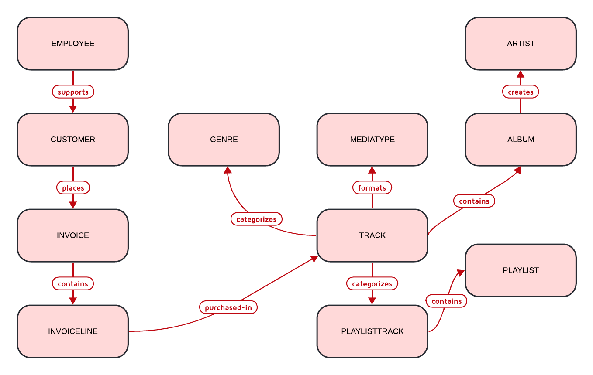
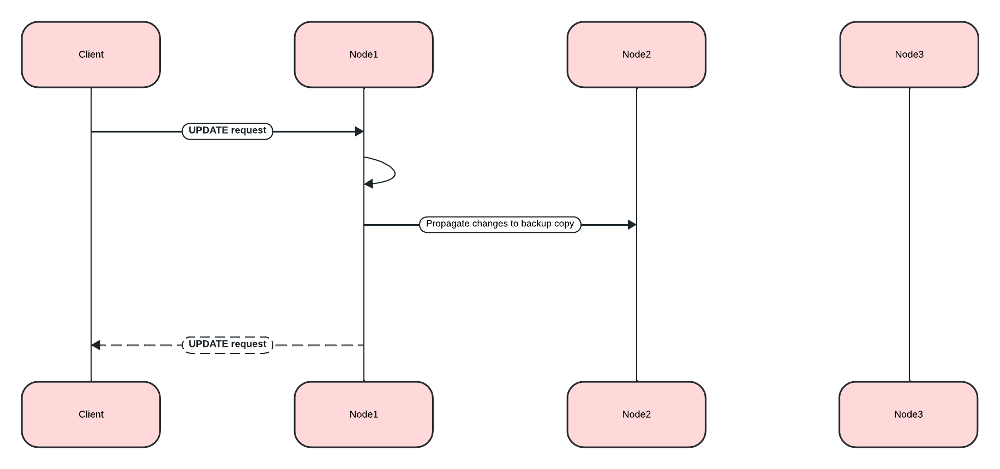

# Getting Started with SQL

This guide walks you through using GridGain 9 SQL capabilities via the command-line interface. You'll set up a distributed Apache GridGain cluster, create and manipulate the Chinook database (a sample database representing a digital media store), and learn to leverage GridGain's powerful SQL features.


GridGain 9 SQL is a distributed, ANSI-based SQL dialect and differs from MariaDB Server SQL in both syntax and supported features. For the full list of supported statements, functions, and data types, see the [SQL Reference](../reference/sql/README.md).


## Prerequisites

* Docker and Docker Compose installed on your system;
* Basic familiarity with SQL;
* Command-line terminal access;
* 8GB+ of available RAM for running the containers;
* SQL directory with Chinook Database files downloaded.

## Before Starting

This tutorial uses prepared files to streamline deployment. Make sure you have downloaded the required files:

- [docker-compose.yml](../.gitbook/assets/gg9-get-started-docker-compose.yml)
- [sql archive](../.gitbook/assets/gg9-get-started-sql.zip)

Unpack the archive into a new folder, and place it and the docker compose file in the same directory where you will be running the Docker CLI commands. The tutorial expects these SQL files to be available and mounted to the container.


Without these files, you will be unable to load the sample data needed for the exercises.


The docker compose file starts GridGain 9.2.0 by default. To run the guide on a different version, set the `GRIDGAIN9_VERSION` environment variable before starting the cluster, for example `GRIDGAIN9_VERSION=9.1.28 docker compose up -d`, and use the same version in the CLI image name below. The 9.1 tabs in this guide show the output of 9.1.

## Setting Up a GridGain 9 Cluster

Before we can start using SQL, we need to set up a GridGain cluster. We will use Docker Compose to create a three-node cluster.

### Starting the Cluster

Open a terminal in the directory containing the docker compose file `docker-compose.yml` file and start the cluster with Docker:

```bash
docker compose up -d
```

This command starts the cluster in detached mode. You should see startup messages from all three nodes. When they are ready, you will see messages indicating that the servers have started successfully.

```
docker compose up -d

[+] Running 4/4
 ✔ Network gridgain9_default    Created
 ✔ Container gridgain9-node1-1  Started
 ✔ Container gridgain9-node2-1  Started
 ✔ Container gridgain9-node3-1  Started
```

You can check that all containers are running with the following command:

```bash
docker compose ps
```

You should see all three nodes with a "running" status.


Verify that all three nodes are "running" before continuing.


## Connecting to the Cluster Using GridGain CLI

Now we will connect to our running cluster using GridGain command-line interface (CLI).

### Starting the CLI

In your terminal, run:

```bash
docker run --rm -it --network=gridgain9_default -v ./sql/:/opt/gridgain/downloads -v /opt/etc/license.json:/opt/gridgain/etc/license.json gridgain/gridgain9:9.2.0 cli
```

This starts an interactive CLI container connected to the same Docker network as our cluster and mounts a volume containing the sql files for the Chinook Database. When prompted, refuse the connection to the default node and connect to node1 by entering:

```bash
connect http://node1:10300
```

You should see a message that you're connected to `http://node1:10300` and a note that the cluster is not initialized.


The CLI container runs separately from the cluster nodes, but connects to them over the Docker network.


### Initializing the Cluster

Before we can use the cluster, we need to initialize it:

```bash
cluster init --name=GridGain --license=/opt/gridgain/etc/license.json
```


If the license is not available, make sure the license file was mounted correctly.


```
  _________        _____ __________________        _____
  __  ____/___________(_)______  /__  ____/______ ____(_)_______
  _  / __  __  ___/__  / _  __  / _  / __  _  __ `/__  / __  __ \
  / /_/ /  _  /    _  /  / /_/ /  / /_/ /  / /_/ / _  /  _  / / /
  \____/   /_/     /_/   \_,__/   \____/   \__,_/  /_/   /_/ /_/
                      GridGain CLI version 9.2.0


You appear to have not connected to any node yet. Do you want to connect to the default node http://localhost:10300? [Y/n] n
[disconnected]> connect http://node1:10300
Connected to http://node1:10300
The cluster is not initialized. Run cluster init command to initialize it.
[node1]> cluster init --name=GridGain --license=/opt/gridgain/etc/license.json
Cluster was initialized successfully.
[node1]> 
```

## Creating the Chinook Database Schema

Now that our cluster is running and initialized, we can start using SQL to create and work with data in GridGain. The Chinook database is a digital music store dataset, with tables for artists, albums, tracks, customers, and sales.

### Entering SQL Mode

To start working with SQL, enter SQL mode in the CLI:

```
sql
```

Your prompt should change to `sql-cli>` indicating you're now in SQL mode.

```
[node1]> sql
sql-cli>
```

### Creating Distribution Zones

Before we create tables, let's set up distribution zones to control how our data is distributed and replicated across the cluster:

```sql
CREATE ZONE IF NOT EXISTS Chinook (REPLICAS 2) STORAGE PROFILES['default'];
CREATE ZONE IF NOT EXISTS ChinookReplicated (REPLICAS 3, PARTITIONS 25) STORAGE PROFILES['default'];
```

These commands create two zones:

* `Chinook` - Standard zone with 2 replicas for most tables;
* `ChinookReplicated` - Zone with 3 replicas for frequently accessed reference data.

### Database Entity Relationship

Here's the entity relationship diagram for our Chinook database:



### Creating Core Tables

Now let's create the main tables for the Chinook database. We will start with the Artist and Album tables.


Copy and paste the following SQL blocks at the `sql-cli>` prompt then hit enter.


```sql
CREATE TABLE Artist (
    ArtistId INT NOT NULL,
    Name VARCHAR(120),
    PRIMARY KEY (ArtistId)
) ZONE Chinook;

CREATE TABLE Album (
    AlbumId INT NOT NULL,
    Title VARCHAR(160) NOT NULL,
    ArtistId INT NOT NULL,
    ReleaseYear INT,
    PRIMARY KEY (AlbumId, ArtistId)
) COLOCATE BY (ArtistId) ZONE Chinook;
```

The `COLOCATE BY` clause in the *Album* table ensures that albums by the same artist are stored on the same nodes. This optimizes joins between Artist and Album tables by eliminating the need for network transfers during queries.

Next, let's create the Genre and MediaType reference tables:

```sql
CREATE TABLE Genre (
    GenreId INT NOT NULL,
    Name VARCHAR(120),
    PRIMARY KEY (GenreId)
) ZONE ChinookReplicated;

CREATE TABLE MediaType (
    MediaTypeId INT NOT NULL,
    Name VARCHAR(120),
    PRIMARY KEY (MediaTypeId)
) ZONE ChinookReplicated;
```

These reference tables are placed in the `ChinookReplicated` zone with 3 replicas because they contain static data that is frequently joined with other tables. Having a copy on each node improves read performance.

Now, let's create the Track table, which references the Album, Genre, and MediaType tables:

```sql
CREATE TABLE Track (
    TrackId INT NOT NULL,
    Name VARCHAR(200) NOT NULL,
    AlbumId INT,
    MediaTypeId INT NOT NULL,
    GenreId INT,
    Composer VARCHAR(220),
    Milliseconds INT NOT NULL,
    Bytes INT,
    UnitPrice NUMERIC(10,2) NOT NULL,
    PRIMARY KEY (TrackId, AlbumId)
) COLOCATE BY (AlbumId) ZONE Chinook;
```

Tracks are colocated by AlbumId, not by TrackId, so all the tracks of an album are stored together. Note that Album itself is colocated by ArtistId, so a join of Track and Album on AlbumId still needs to move data between nodes. You will see this in the execution plans later in this guide.

Let's also create tables to manage customers, employees, and sales:

```sql
CREATE TABLE Employee (
    EmployeeId INT NOT NULL,
    LastName VARCHAR(20) NOT NULL,
    FirstName VARCHAR(20) NOT NULL,
    Title VARCHAR(30),
    ReportsTo INT,
    BirthDate DATE,
    HireDate DATE,
    Address VARCHAR(70),
    City VARCHAR(40),
    State VARCHAR(40),
    Country VARCHAR(40),
    PostalCode VARCHAR(10),
    Phone VARCHAR(24),
    Fax VARCHAR(24),
    Email VARCHAR(60),
    PRIMARY KEY (EmployeeId)
) ZONE Chinook;

CREATE TABLE Customer (
    CustomerId INT NOT NULL,
    FirstName VARCHAR(40) NOT NULL,
    LastName VARCHAR(20) NOT NULL,
    Company VARCHAR(80),
    Address VARCHAR(70),
    City VARCHAR(40),
    State VARCHAR(40),
    Country VARCHAR(40),
    PostalCode VARCHAR(10),
    Phone VARCHAR(24),
    Fax VARCHAR(24),
    Email VARCHAR(60) NOT NULL,
    SupportRepId INT,
    PRIMARY KEY (CustomerId)
) ZONE Chinook;

CREATE TABLE Invoice (
    InvoiceId INT NOT NULL,
    CustomerId INT NOT NULL,
    InvoiceDate DATE NOT NULL,
    BillingAddress VARCHAR(70),
    BillingCity VARCHAR(40),
    BillingState VARCHAR(40),
    BillingCountry VARCHAR(40),
    BillingPostalCode VARCHAR(10),
    Total NUMERIC(10,2) NOT NULL,
    PRIMARY KEY (InvoiceId, CustomerId)
) COLOCATE BY (CustomerId) ZONE Chinook;

CREATE TABLE InvoiceLine (
    InvoiceLineId INT NOT NULL,
    InvoiceId INT NOT NULL,
    TrackId INT NOT NULL,
    UnitPrice NUMERIC(10,2) NOT NULL,
    Quantity INT NOT NULL,
    PRIMARY KEY (InvoiceLineId, TrackId)
) COLOCATE BY (TrackId) ZONE Chinook;
```

Invoices are colocated by CustomerId, so each customer's invoices are stored together with the customer. This optimizes joins between Customer and Invoice.

InvoiceLines are colocated by TrackId. Colocation does not chain: a table is placed only by its own colocation columns, so InvoiceLine rows are not stored together with the Invoice rows they belong to. Later in this guide, you will see how this affects a query that joins several tables.

Finally, let's create the playlist-related tables:

```sql
CREATE TABLE Playlist (
    PlaylistId INT NOT NULL,
    Name VARCHAR(120),
    PRIMARY KEY (PlaylistId)
) ZONE Chinook;

CREATE TABLE PlaylistTrack (
    PlaylistId INT NOT NULL,
    TrackId INT NOT NULL,
    PRIMARY KEY (PlaylistId, TrackId)
) ZONE Chinook;
```

Note that PlaylistTrack is not colocated with Track. This is a design decision that prioritizes playlist operations over joining with track details. In a real-world scenario, you might make a different colocation choice depending on your most common query patterns.

### Verifying Table Creation

Let's confirm that all our tables were created successfully:

```sql
SELECT table_name, zone_name, table_colocation_columns
FROM system.tables
WHERE schema_name = 'PUBLIC'
ORDER BY table_name;
```

This query checks the system tables to verify that our tables exist, and shows the zone and the colocation columns of each table. You should see a list of all the tables we've created.

```
sql-cli> SELECT table_name, zone_name, table_colocation_columns FROM system.tables WHERE schema_name = 'PUBLIC' ORDER BY table_name;
╔═══════════════╤═══════════════════╤══════════════════════════╗
║ TABLE_NAME    │ ZONE_NAME         │ TABLE_COLOCATION_COLUMNS ║
╠═══════════════╪═══════════════════╪══════════════════════════╣
║ ALBUM         │ CHINOOK           │ ARTISTID                 ║
╟───────────────┼───────────────────┼──────────────────────────╢
║ ARTIST        │ CHINOOK           │ ARTISTID                 ║
╟───────────────┼───────────────────┼──────────────────────────╢
║ CUSTOMER      │ CHINOOK           │ CUSTOMERID               ║
╟───────────────┼───────────────────┼──────────────────────────╢
║ EMPLOYEE      │ CHINOOK           │ EMPLOYEEID               ║
╟───────────────┼───────────────────┼──────────────────────────╢
║ GENRE         │ CHINOOKREPLICATED │ GENREID                  ║
╟───────────────┼───────────────────┼──────────────────────────╢
║ INVOICE       │ CHINOOK           │ CUSTOMERID               ║
╟───────────────┼───────────────────┼──────────────────────────╢
║ INVOICELINE   │ CHINOOK           │ TRACKID                  ║
╟───────────────┼───────────────────┼──────────────────────────╢
║ MEDIATYPE     │ CHINOOKREPLICATED │ MEDIATYPEID              ║
╟───────────────┼───────────────────┼──────────────────────────╢
║ PLAYLIST      │ CHINOOK           │ PLAYLISTID               ║
╟───────────────┼───────────────────┼──────────────────────────╢
║ PLAYLISTTRACK │ CHINOOK           │ PLAYLISTID, TRACKID      ║
╟───────────────┼───────────────────┼──────────────────────────╢
║ TRACK         │ CHINOOK           │ ALBUMID                  ║
╚═══════════════╧═══════════════════╧══════════════════════════╝
```


**Checkpoint**: Verify that all tables appear in the `system.tables` output with their proper zones and colocation settings before proceeding to the next section.


## Inserting Sample Data

Now that we have our tables set up, let's populate them with sample data.

### Adding Artists and Albums

Let's start by adding some artists.

- Exit the interactive sql mode by typing `exit;`.
- Then, load the current store catalog from the sql data file.

```bash
sql --file=/opt/gridgain/downloads/current_catalog.sql;
```

```
sql-cli> exit;
[node1]> sql --file=/opt/gridgain/downloads/current_catalog.sql
Updated 275 rows.
Updated 347 rows.
```

### Adding Genres and Media Types

Let's populate our reference tables the same way:

```bash
sql --file=/opt/gridgain/downloads/media_and_genre.sql
```

```
[node1]> sql --file=/opt/GridGain/downloads/media_and_genre.sql
Updated 25 rows.
Updated 5 rows.
```

### Adding Tracks

Now let's add some tracks to our albums:

```bash
sql --file=/opt/gridgain/downloads/tracks.sql
```

```
[node1]> sql --file=/opt/GridGain/downloads/tracks.sql
Updated 1000 rows.
Updated 1000 rows.
Updated 1000 rows.
Updated 503 rows.
```

### Adding Employees and Customers

Let's add some employee and customer data:

```bash
sql --file=/opt/gridgain/downloads/ee_and_cust.sql
```

```
[node1]> sql --file=/opt/gridgain/downloads/ee_and_cust.sql
Updated 8 rows.
Updated 59 rows.
```

### Adding Invoices and Invoice Lines

Finally, let's add some sales data:

```bash
sql --file=/opt/gridgain/downloads/invoices.sql
```

```
[node1]> sql --file=/opt/gridgain/downloads/invoices.sql
Updated 412 rows.
Updated 1000 rows.
Updated 1000 rows.
Updated 240 rows.
Updated 18 rows.
Updated 1000 rows.
Updated 1000 rows.
Updated 1000 rows.
Updated 1000 rows.
Updated 1000 rows.
Updated 1000 rows.
Updated 1000 rows.
Updated 1000 rows.
Updated 715 rows.
```


**Checkpoint**: Verify that all the data has been loaded successfully by checking that the "Updated X rows" messages match the expected row counts for each file.


## Querying Data in GridGain SQL

Now that we have data in our tables, let's run some SQL queries to explore the Chinook database.

### Basic Queries

Let's return to the `sql-cli>` and start with some simple SELECT queries:

```bash
sql
```

```sql
-- Get all artists
SELECT * FROM Artist;

-- Get all albums for a specific artist
SELECT * FROM Album WHERE ArtistId = 3;

-- Get all tracks for a specific album
SELECT * FROM Track WHERE AlbumId = 133;
```

### Joins

Now let's try some more complex queries with joins:

```sql
-- Get all tracks with artist and album information
SELECT
    t.Name AS TrackName,
    a.Title AS AlbumTitle,
    ar.Name AS ArtistName
FROM
    Track t
    JOIN Album a ON t.AlbumId = a.AlbumId
    JOIN Artist ar ON a.ArtistId = ar.ArtistId
LIMIT 10;
```

This query joins three tables to list each track with its album and artist, and returns the first 10 rows.

## Data Manipulation in GridGain SQL

Let's explore how to modify data using SQL in GridGain.

### Understanding Distributed Updates

When you update data in a distributed database, the changes need to be coordinated across multiple nodes:



### Inserting New Data

Let's add a new artist and album:

```sql
-- Insert a new artist
INSERT INTO Artist (ArtistId, Name)
VALUES (276, 'New Discovery Band');

-- Insert a new album for this artist
INSERT INTO Album (AlbumId, Title, ArtistId, ReleaseYear)
VALUES (348, 'First Light', 276, 2023);

-- Verify the insertions
SELECT * FROM Artist WHERE ArtistId = 276;
SELECT * FROM Album WHERE AlbumId = 348;
```

### Updating Existing Data

Now let's update some of our existing data:

```sql
-- Update the album release year
UPDATE Album
SET ReleaseYear = 2024
WHERE AlbumId = 348;

-- Update the artist name
UPDATE Artist
SET Name = 'New Discovery Ensemble'
WHERE ArtistId = 276;

-- Verify the updates
SELECT * FROM Artist WHERE ArtistId = 276;
SELECT * FROM Album WHERE AlbumId = 348;
```

In a distributed database like GridGain, these updates are automatically propagated to all replicas. The primary copy is updated first, then the changes are sent to the backup copies on other nodes.

### Deleting Data

Finally, let's clean up by deleting the data we added:

```sql
-- Delete the album
DELETE FROM Album WHERE AlbumId = 348;

-- Delete the artist
DELETE FROM Artist WHERE ArtistId = 276;

-- Verify the deletions
SELECT * FROM Artist WHERE ArtistId = 276;
SELECT * FROM Album WHERE AlbumId = 348;
```

## Advanced SQL Features

Let's explore some of GridGain's more advanced SQL features.

### Querying System Views

GridGain provides system views that let you inspect cluster metadata:

```sql
-- View all tables in the cluster
SELECT * FROM system.tables;

-- View all zones
SELECT * FROM system.zones;

-- View all columns for a specific table
SELECT * FROM system.table_columns WHERE TABLE_NAME = 'TRACK';
```

System views provide important metadata about your cluster configuration. They are essential for monitoring and troubleshooting in production environments.

### Creating Indexes for Better Performance

Let's add some indexes to improve query performance:

```sql
-- Create an index on the Name column of the Track table
CREATE INDEX idx_track_name ON Track (Name);

-- Create a composite index on Artist and Album
CREATE INDEX idx_album_artist ON Album (ArtistId, Title);

-- Create a composite index on Track's AlbumId and Name columns to optimize joins with Album table
-- and to improve performance when filtering or sorting by track name within an album
CREATE INDEX idx_track_albumid_name ON Track(AlbumId, Name);

-- Create an index on Album Title to speed up searches and sorts by album title
CREATE INDEX idx_album_title ON Album(Title);

-- Create a composite index on InvoiceLine connecting TrackId and InvoiceId
-- This supports efficient queries that join InvoiceLine with Track while filtering by InvoiceId
CREATE INDEX idx_invoiceline_trackid_invoiceid ON InvoiceLine(TrackId, InvoiceId);

-- Create a hash index for lookups by email
CREATE INDEX idx_customer_email ON Customer USING HASH (Email);

-- Check index information
SELECT * FROM system.indexes;
```

Indexes improve query performance, but come with maintenance costs. Each write operation must also update all indexes. Choose indexes that support your most common query patterns rather than indexing everything.

## Creating a Dashboard Using SQL

Let's create SQL queries that could be used for a music store dashboard. These queries could be saved and run periodically to generate reports.

### Monthly Sales Summary

```sql
-- Monthly sales summary for the last 12 months
SELECT
    CAST(EXTRACT(YEAR FROM i.InvoiceDate) AS VARCHAR) || '-' ||
    CASE
        WHEN EXTRACT(MONTH FROM i.InvoiceDate) < 10
        THEN '0' || CAST(EXTRACT(MONTH FROM i.InvoiceDate) AS VARCHAR)
        ELSE CAST(EXTRACT(MONTH FROM i.InvoiceDate) AS VARCHAR)
    END AS YearMonth,
    COUNT(DISTINCT i.InvoiceId) AS InvoiceCount,
    COUNT(DISTINCT i.CustomerId) AS CustomerCount,
    SUM(i.Total) AS MonthlyRevenue,
    AVG(i.Total) AS AverageOrderValue
FROM
    Invoice i
GROUP BY
    EXTRACT(YEAR FROM i.InvoiceDate), EXTRACT(MONTH FROM i.InvoiceDate)
ORDER BY
    YearMonth DESC;
```

This query formats the year and month into a sortable string (YYYY-MM) while calculating several key business metrics.

### Top Selling Genres

```sql
-- Top selling genres by revenue
SELECT
    g.Name AS Genre,
    SUM(il.UnitPrice * il.Quantity) AS Revenue
FROM
    InvoiceLine il
    JOIN Track t ON il.TrackId = t.TrackId
    JOIN Genre g ON t.GenreId = g.GenreId
GROUP BY
    g.Name
ORDER BY
    Revenue DESC;
```

### Sales Performance by Employee

```sql
-- Sales performance by employee
SELECT
    e.EmployeeId,
    e.FirstName || ' ' || e.LastName AS EmployeeName,
    COUNT(DISTINCT i.InvoiceId) AS TotalInvoices,
    COUNT(DISTINCT i.CustomerId) AS UniqueCustomers,
    SUM(i.Total) AS TotalSales
FROM
    Employee e
    JOIN Customer c ON e.EmployeeId = c.SupportRepId
    JOIN Invoice i ON c.CustomerId = i.CustomerId
GROUP BY
    e.EmployeeId, e.FirstName, e.LastName
ORDER BY
    TotalSales DESC;
```

### Top 20 Longest Tracks with Genres

```sql
-- Top 20 longest tracks with genre information
SELECT
    t.trackid,
    t.name AS track_name,
    g.name AS genre_name,
    ROUND(t.milliseconds / (1000 * 60), 2) AS duration_minutes
FROM
    track t
    JOIN genre g ON t.genreId = g.genreId
WHERE
    t.genreId < 17
ORDER BY
    duration_minutes DESC
LIMIT
    20;
```

### Customer Purchase Patterns by Month

```sql
-- Customer purchase patterns by month
SELECT
    c.CustomerId,
    c.FirstName || ' ' || c.LastName AS CustomerName,
    CAST(EXTRACT(YEAR FROM i.InvoiceDate) AS VARCHAR) || '-' ||
    CASE
        WHEN EXTRACT(MONTH FROM i.InvoiceDate) < 10
        THEN '0' || CAST(EXTRACT(MONTH FROM i.InvoiceDate) AS VARCHAR)
        ELSE CAST(EXTRACT(MONTH FROM i.InvoiceDate) AS VARCHAR)
    END AS YearMonth,
    COUNT(DISTINCT i.InvoiceId) AS NumberOfPurchases,
    SUM(i.Total) AS TotalSpent,
    SUM(i.Total) / COUNT(DISTINCT i.InvoiceId) AS AveragePurchaseValue
FROM
    Customer c
    JOIN Invoice i ON c.CustomerId = i.CustomerId
GROUP BY
    c.CustomerId, c.FirstName, c.LastName,
    EXTRACT(YEAR FROM i.InvoiceDate), EXTRACT(MONTH FROM i.InvoiceDate)
ORDER BY
    c.CustomerId, YearMonth;
```

## Performance Tuning with Colocated Tables

One of the key advantages of GridGain is its ability to optimize joins through data colocation. Let's explore this with our existing colocated tables.

Colocation helps a join only when both tables are in the same zone and are colocated by the columns used in the join. In an execution plan, you can see the result by looking at the `Exchange` operators, which show where rows are moved between nodes. We will compare three cases: a join that matches the colocation columns, a join that does not, and a change of the colocation column that does not fix the mismatch.


Row estimates in an execution plan come from table statistics, which are updated some time after the data changes. If you run `EXPLAIN` right after loading data, the estimates and the join types in your plan can differ from the ones shown here. Compare the `Exchange` operators rather than the estimates.


### Joining Tables Colocated by the Join Column

Let's start with a join where the colocation columns match the join columns. `Album` is colocated by `ArtistId`, which is also the column that joins it to `Artist`:

```sql
EXPLAIN PLAN FOR
SELECT
    ar.Name AS ArtistName,
    a.Title AS AlbumTitle
FROM
    Artist ar
    JOIN Album a ON a.ArtistId = ar.ArtistId;
```

```
╔═════════════════════════════════════════════════════════╗
║ PLAN                                                    ║
╠═════════════════════════════════════════════════════════╣
║ Exchange                                                ║
║     distribution: single                                ║
║     est: (rows=347)                                     ║
║   Project                                               ║
║       fieldNames: [ARTISTNAME, ALBUMTITLE]              ║
║       projection: [NAME, TITLE]                         ║
║       est: (rows=347)                                   ║
║     HashJoin                                            ║
║         predicate: =(ARTISTID, ARTISTID$0)              ║
║         fieldNames: [TITLE, ARTISTID, ARTISTID$0, NAME] ║
║         type: inner                                     ║
║         est: (rows=347)                                 ║
║       TableScan                                         ║
║           table: PUBLIC.ALBUM                           ║
║           fieldNames: [TITLE, ARTISTID]                 ║
║           est: (rows=347)                               ║
║       TableScan                                         ║
║           table: PUBLIC.ARTIST                          ║
║           fieldNames: [ARTISTID, NAME]                  ║
║           est: (rows=275)                               ║
╚═════════════════════════════════════════════════════════╝
```


The plan above is the same in 9.1 and 9.2.


There is no `Exchange` between the two scans and the join. Each node joins the artists and albums it stores, and the only `Exchange`, at the top of the plan, gathers the results for the client. The join of `Customer` and `Invoice`, which are colocated by `CustomerId`, has the same plan shape.

Next, let's see what the plan looks like when the colocation columns do not match the join.

### Joining Tables Colocated by Different Columns

Now let's look at a query that joins three tables on columns that do not match how the tables are colocated.

First, consider `InvoiceLine` colocated by `InvoiceId`. You do not need to run this statement, because the table already exists from an earlier step. It is shown for comparison.

```sql
--An alternative layout: InvoiceLine colocated by InvoiceId.
CREATE TABLE InvoiceLine (
    InvoiceLineId INT NOT NULL,
    InvoiceId INT NOT NULL,
    TrackId INT NOT NULL,
    UnitPrice NUMERIC(10,2) NOT NULL,
    Quantity INT NOT NULL,
    PRIMARY KEY (InvoiceLineId, InvoiceId)
) COLOCATE BY (InvoiceId) ZONE Chinook;
```

With this layout, the colocation columns do not match the join columns of our query:

* Album is colocated by ArtistId, but the query joins it on AlbumId
* Track is colocated by AlbumId, but the query joins it with InvoiceLine on TrackId
* InvoiceLine is colocated by InvoiceId, but the query joins it with Track on TrackId

This means that when you run a query joining InvoiceLine, Track, and Album, the rows to join might be on different nodes, so the data has to be gathered first.

```sql
EXPLAIN PLAN FOR
SELECT
    il.InvoiceId,
    COUNT(il.InvoiceLineId) AS LineItemCount,
    SUM(il.UnitPrice * il.Quantity) AS InvoiceTotal,
    t.Name AS TrackName,
    a.Title AS AlbumTitle
FROM
    InvoiceLine il
    JOIN Track t ON il.TrackId = t.TrackId
    JOIN Album a ON t.AlbumId = a.AlbumId
WHERE
    il.InvoiceId = 1
GROUP BY
    il.InvoiceId, t.Name, a.Title;
```



```
╔═════════════════════════════════════════════════════════════════════════════════════════════════════════════╗
║ PLAN                                                                                                        ║
╠═════════════════════════════════════════════════════════════════════════════════════════════════════════════╣
║ Project                                                                                                     ║
║     fieldNames: [INVOICEID, LINEITEMCOUNT, INVOICETOTAL, TRACKNAME, ALBUMTITLE]                             ║
║     projection: [INVOICEID, LINEITEMCOUNT, INVOICETOTAL, TRACKNAME, ALBUMTITLE]                             ║
║     est: (rows=13347)                                                                                       ║
║   HashAggregate                                                                                             ║
║       fieldNames: [INVOICEID, TRACKNAME, ALBUMTITLE, LINEITEMCOUNT, INVOICETOTAL]                           ║
║       group: [INVOICEID, TRACKNAME, ALBUMTITLE]                                                             ║
║       aggregation: [COUNT(), SUM($f4)]                                                                      ║
║       est: (rows=13347)                                                                                     ║
║     Project                                                                                                 ║
║         fieldNames: [INVOICEID, TRACKNAME, ALBUMTITLE, $f4]                                                 ║
║         projection: [INVOICEID, NAME, TITLE, *(UNITPRICE, QUANTITY)]                                        ║
║         est: (rows=27350)                                                                                   ║
║       HashJoin                                                                                              ║
║           predicate: =(ALBUMID, ALBUMID$0)                                                                  ║
║           fieldNames: [TRACKID, NAME, ALBUMID, INVOICEID, TRACKID$0, UNITPRICE, QUANTITY, ALBUMID$0, TITLE] ║
║           type: inner                                                                                       ║
║           est: (rows=27350)                                                                                 ║
║         HashJoin                                                                                            ║
║             predicate: =(TRACKID$0, TRACKID)                                                                ║
║             fieldNames: [TRACKID, NAME, ALBUMID, INVOICEID, TRACKID$0, UNITPRICE, QUANTITY]                 ║
║             type: inner                                                                                     ║
║             est: (rows=525)                                                                                 ║
║           Exchange                                                                                          ║
║               distribution: single                                                                          ║
║               est: (rows=3503)                                                                              ║
║             TableScan                                                                                       ║
║                 table: PUBLIC.TRACK                                                                         ║
║                 fieldNames: [TRACKID, NAME, ALBUMID]                                                        ║
║                 est: (rows=3503)                                                                            ║
║           Exchange                                                                                          ║
║               distribution: single                                                                          ║
║               est: (rows=1)                                                                                 ║
║             TableScan                                                                                       ║
║                 table: PUBLIC.INVOICELINE                                                                   ║
║                 predicate: =(INVOICEID, 1)                                                                  ║
║                 fieldNames: [INVOICEID, TRACKID, UNITPRICE, QUANTITY]                                       ║
║                 est: (rows=1)                                                                               ║
║         Exchange                                                                                            ║
║             distribution: single                                                                            ║
║             est: (rows=347)                                                                                 ║
║           TableScan                                                                                         ║
║               table: PUBLIC.ALBUM                                                                           ║
║               fieldNames: [ALBUMID, TITLE]                                                                  ║
║               est: (rows=347)                                                                               ║
╚═════════════════════════════════════════════════════════════════════════════════════════════════════════════╝
```



```
╔═════════════════════════════════════════════════════════════════════════════════════════════════════════════╗
║ PLAN                                                                                                        ║
╠═════════════════════════════════════════════════════════════════════════════════════════════════════════════╣
║ Project                                                                                                     ║
║     fieldNames: [INVOICEID, LINEITEMCOUNT, INVOICETOTAL, TRACKNAME, ALBUMTITLE]                             ║
║     projection: [INVOICEID, LINEITEMCOUNT, INVOICETOTAL, TRACKNAME, ALBUMTITLE]                             ║
║     est: (rows=13347)                                                                                       ║
║   ColocatedHashAggregate                                                                                    ║
║       fieldNames: [INVOICEID, TRACKNAME, ALBUMTITLE, LINEITEMCOUNT, INVOICETOTAL]                           ║
║       group: [INVOICEID, TRACKNAME, ALBUMTITLE]                                                             ║
║       aggregation: [COUNT(), SUM($f4)]                                                                      ║
║       est: (rows=13347)                                                                                     ║
║     Project                                                                                                 ║
║         fieldNames: [INVOICEID, TRACKNAME, ALBUMTITLE, $f4]                                                 ║
║         projection: [INVOICEID, NAME, TITLE, *(UNITPRICE, QUANTITY)]                                        ║
║         est: (rows=27350)                                                                                   ║
║       HashJoin                                                                                              ║
║           predicate: =(ALBUMID, ALBUMID$0)                                                                  ║
║           fieldNames: [TRACKID, NAME, ALBUMID, INVOICEID, TRACKID$0, UNITPRICE, QUANTITY, ALBUMID$0, TITLE] ║
║           type: inner                                                                                       ║
║           est: (rows=27350)                                                                                 ║
║         HashJoin                                                                                            ║
║             predicate: =(TRACKID$0, TRACKID)                                                                ║
║             fieldNames: [TRACKID, NAME, ALBUMID, INVOICEID, TRACKID$0, UNITPRICE, QUANTITY]                 ║
║             type: inner                                                                                     ║
║             est: (rows=525)                                                                                 ║
║           Exchange                                                                                          ║
║               distribution: single                                                                          ║
║               est: (rows=3503)                                                                              ║
║             TableScan                                                                                       ║
║                 table: PUBLIC.TRACK                                                                         ║
║                 fieldNames: [TRACKID, NAME, ALBUMID]                                                        ║
║                 est: (rows=3503)                                                                            ║
║           Exchange                                                                                          ║
║               distribution: single                                                                          ║
║               est: (rows=1)                                                                                 ║
║             TableScan                                                                                       ║
║                 table: PUBLIC.INVOICELINE                                                                   ║
║                 predicate: =(INVOICEID, 1)                                                                  ║
║                 fieldNames: [INVOICEID, TRACKID, UNITPRICE, QUANTITY]                                       ║
║                 est: (rows=1)                                                                               ║
║         Exchange                                                                                            ║
║             distribution: single                                                                            ║
║             est: (rows=347)                                                                                 ║
║           TableScan                                                                                         ║
║               table: PUBLIC.ALBUM                                                                           ║
║               fieldNames: [ALBUMID, TITLE]                                                                  ║
║               est: (rows=347)                                                                               ║
╚═════════════════════════════════════════════════════════════════════════════════════════════════════════════╝
```



#### Key Observations for Mismatched Colocation



*HashAggregate Operation*: The plan uses a single `HashAggregate` with no `phase` attribute. A plan with a `phase` line shows a two-phase aggregation, where a `PARTIAL` aggregate runs on each node and a `FINAL` aggregate combines the results. Here the aggregation runs once, after the join results have been gathered on one node.

*Exchange Operations*: Three `Exchange` operators with `distribution: single` appear in the plan, one each for the Track, InvoiceLine (filtered by `InvoiceId = 1`), and Album inputs. Each one gathers the rows of a table on a single node because the join keys do not match how the tables are colocated.

*Join Implementation*: Both joins are `HashJoin` operations:

* The first joins Track with the filtered InvoiceLine rows on `TRACKID`.
* The second joins that result with Album on `ALBUMID`.

*Full Table Scans*: All three inputs use a `TableScan`. The filter `InvoiceId = 1` is applied as a predicate during the InvoiceLine scan.

*Row Count Estimation*: The estimates grow after the joins: 1 row from the filtered InvoiceLine scan, 525 after the join with Track, and 27,350 after the join with Album. The estimates come from table statistics and are approximate.




In 9.1, the plan is the same as in 9.2, except for the name of the aggregate operator. 9.1 prints `ColocatedHashAggregate` where 9.2 prints `HashAggregate` without a `phase` line.


*ColocatedHashAggregate Operation*: The plan uses a single `ColocatedHashAggregate`, which runs the aggregation in one step. Here the aggregation runs once, after the join results have been gathered on one node. A two-phase aggregation shows `MapHashAggregate` and `ReduceHashAggregate` operators instead.

*Exchange Operations*: Three `Exchange` operators with `distribution: single` appear in the plan, one each for the Track, InvoiceLine (filtered by `InvoiceId = 1`), and Album inputs. Each one gathers the rows of a table on a single node because the join keys do not match how the tables are colocated.

*Join Implementation*: Both joins are `HashJoin` operations:

* The first joins Track with the filtered InvoiceLine rows on `TRACKID`.
* The second joins that result with Album on `ALBUMID`.

*Full Table Scans*: All three inputs use a `TableScan`. The filter `InvoiceId = 1` is applied as a predicate during the InvoiceLine scan.

*Row Count Estimation*: The estimates grow after the joins: 1 row from the filtered InvoiceLine scan, 525 after the join with Track, and 27,350 after the join with Album. The estimates come from table statistics and are approximate.



### Colocating by a Different Column

Would a different colocation column fix the mismatch? Let's look at the layout that this guide created earlier, with the `InvoiceLine` table colocated by `TrackId`, and run the same query. You do not need to run the statement below, because this is the table that you already created.

```sql
--This table was already created on an earlier step.
CREATE TABLE InvoiceLine (
    InvoiceLineId INT NOT NULL,
    InvoiceId INT NOT NULL,
    TrackId INT NOT NULL,
    UnitPrice NUMERIC(10,2) NOT NULL,
    Quantity INT NOT NULL,
    PRIMARY KEY (InvoiceLineId, TrackId)
) COLOCATE BY (TrackId) ZONE Chinook;
```



Run `EXPLAIN PLAN FOR` again. The plan is:



Run `EXPLAIN PLAN FOR` again. The plan is:



```sql
EXPLAIN PLAN FOR
SELECT
    il.InvoiceId,
    COUNT(il.InvoiceLineId) AS LineItemCount,
    SUM(il.UnitPrice * il.Quantity) AS InvoiceTotal,
    t.Name AS TrackName,
    a.Title AS AlbumTitle
FROM
    Track t
    JOIN Album a ON t.AlbumId = a.AlbumId
    JOIN InvoiceLine il ON t.TrackId = il.TrackId
WHERE
    il.InvoiceId = 1
GROUP BY
    il.InvoiceId, t.Name, a.Title;
```



```
╔═════════════════════════════════════════════════════════════════════════════════════════════════════════════╗
║ PLAN                                                                                                        ║
╠═════════════════════════════════════════════════════════════════════════════════════════════════════════════╣
║ Project                                                                                                     ║
║     fieldNames: [INVOICEID, LINEITEMCOUNT, INVOICETOTAL, TRACKNAME, ALBUMTITLE]                             ║
║     projection: [INVOICEID, LINEITEMCOUNT, INVOICETOTAL, TRACKNAME, ALBUMTITLE]                             ║
║     est: (rows=13347)                                                                                       ║
║   HashAggregate                                                                                             ║
║       fieldNames: [INVOICEID, TRACKNAME, ALBUMTITLE, LINEITEMCOUNT, INVOICETOTAL]                           ║
║       group: [INVOICEID, TRACKNAME, ALBUMTITLE]                                                             ║
║       aggregation: [COUNT(), SUM($f4)]                                                                      ║
║       est: (rows=13347)                                                                                     ║
║     Project                                                                                                 ║
║         fieldNames: [INVOICEID, TRACKNAME, ALBUMTITLE, $f4]                                                 ║
║         projection: [INVOICEID, NAME, TITLE, *(UNITPRICE, QUANTITY)]                                        ║
║         est: (rows=27350)                                                                                   ║
║       HashJoin                                                                                              ║
║           predicate: =(ALBUMID, ALBUMID$0)                                                                  ║
║           fieldNames: [TRACKID, NAME, ALBUMID, INVOICEID, TRACKID$0, UNITPRICE, QUANTITY, ALBUMID$0, TITLE] ║
║           type: inner                                                                                       ║
║           est: (rows=27350)                                                                                 ║
║         HashJoin                                                                                            ║
║             predicate: =(TRACKID, TRACKID$0)                                                                ║
║             fieldNames: [TRACKID, NAME, ALBUMID, INVOICEID, TRACKID$0, UNITPRICE, QUANTITY]                 ║
║             type: inner                                                                                     ║
║             est: (rows=525)                                                                                 ║
║           Exchange                                                                                          ║
║               distribution: single                                                                          ║
║               est: (rows=3503)                                                                              ║
║             TableScan                                                                                       ║
║                 table: PUBLIC.TRACK                                                                         ║
║                 fieldNames: [TRACKID, NAME, ALBUMID]                                                        ║
║                 est: (rows=3503)                                                                            ║
║           Exchange                                                                                          ║
║               distribution: single                                                                          ║
║               est: (rows=1)                                                                                 ║
║             TableScan                                                                                       ║
║                 table: PUBLIC.INVOICELINE                                                                   ║
║                 predicate: =(INVOICEID, 1)                                                                  ║
║                 fieldNames: [INVOICEID, TRACKID, UNITPRICE, QUANTITY]                                       ║
║                 est: (rows=1)                                                                               ║
║         Exchange                                                                                            ║
║             distribution: single                                                                            ║
║             est: (rows=347)                                                                                 ║
║           TableScan                                                                                         ║
║               table: PUBLIC.ALBUM                                                                           ║
║               fieldNames: [ALBUMID, TITLE]                                                                  ║
║               est: (rows=347)                                                                               ║
╚═════════════════════════════════════════════════════════════════════════════════════════════════════════════╝
```



```
╔═════════════════════════════════════════════════════════════════════════════════════════════════════════════╗
║ PLAN                                                                                                        ║
╠═════════════════════════════════════════════════════════════════════════════════════════════════════════════╣
║ Project                                                                                                     ║
║     fieldNames: [INVOICEID, LINEITEMCOUNT, INVOICETOTAL, TRACKNAME, ALBUMTITLE]                             ║
║     projection: [INVOICEID, LINEITEMCOUNT, INVOICETOTAL, TRACKNAME, ALBUMTITLE]                             ║
║     est: (rows=13347)                                                                                       ║
║   ColocatedHashAggregate                                                                                    ║
║       fieldNames: [INVOICEID, TRACKNAME, ALBUMTITLE, LINEITEMCOUNT, INVOICETOTAL]                           ║
║       group: [INVOICEID, TRACKNAME, ALBUMTITLE]                                                             ║
║       aggregation: [COUNT(), SUM($f4)]                                                                      ║
║       est: (rows=13347)                                                                                     ║
║     Project                                                                                                 ║
║         fieldNames: [INVOICEID, TRACKNAME, ALBUMTITLE, $f4]                                                 ║
║         projection: [INVOICEID, NAME, TITLE, *(UNITPRICE, QUANTITY)]                                        ║
║         est: (rows=27350)                                                                                   ║
║       HashJoin                                                                                              ║
║           predicate: =(ALBUMID, ALBUMID$0)                                                                  ║
║           fieldNames: [TRACKID, NAME, ALBUMID, INVOICEID, TRACKID$0, UNITPRICE, QUANTITY, ALBUMID$0, TITLE] ║
║           type: inner                                                                                       ║
║           est: (rows=27350)                                                                                 ║
║         HashJoin                                                                                            ║
║             predicate: =(TRACKID, TRACKID$0)                                                                ║
║             fieldNames: [TRACKID, NAME, ALBUMID, INVOICEID, TRACKID$0, UNITPRICE, QUANTITY]                 ║
║             type: inner                                                                                     ║
║             est: (rows=525)                                                                                 ║
║           Exchange                                                                                          ║
║               distribution: single                                                                          ║
║               est: (rows=3503)                                                                              ║
║             TableScan                                                                                       ║
║                 table: PUBLIC.TRACK                                                                         ║
║                 fieldNames: [TRACKID, NAME, ALBUMID]                                                        ║
║                 est: (rows=3503)                                                                            ║
║           Exchange                                                                                          ║
║               distribution: single                                                                          ║
║               est: (rows=1)                                                                                 ║
║             TableScan                                                                                       ║
║                 table: PUBLIC.INVOICELINE                                                                   ║
║                 predicate: =(INVOICEID, 1)                                                                  ║
║                 fieldNames: [INVOICEID, TRACKID, UNITPRICE, QUANTITY]                                       ║
║                 est: (rows=1)                                                                               ║
║         Exchange                                                                                            ║
║             distribution: single                                                                            ║
║             est: (rows=347)                                                                                 ║
║           TableScan                                                                                         ║
║               table: PUBLIC.ALBUM                                                                           ║
║               fieldNames: [ALBUMID, TITLE]                                                                  ║
║               est: (rows=347)                                                                               ║
╚═════════════════════════════════════════════════════════════════════════════════════════════════════════════╝
```



#### Key Observations After the Change



The plan has the same shape as the one for the `InvoiceId` layout: a single `HashAggregate` over two `HashJoin` operators, with an `Exchange` with `distribution: single` above each of the Track, InvoiceLine, and Album scans. The only difference is the order of the operands in the first join predicate, `=(TRACKID, TRACKID$0)` instead of `=(TRACKID$0, TRACKID)`.

Colocating `InvoiceLine` by `TrackId` does not help this query, because `Track` is colocated by `AlbumId`, not `TrackId`. An `InvoiceLine` row is therefore still not stored together with its `Track` row, and the join has to gather the rows of both tables.

The estimates and the join types are not a measure of this. They follow the table statistics. For example, the same `TrackId` layout produces a plan with `MergeJoin` and an `IndexScan` on `InvoiceLine`, and much larger estimates, once the statistics are updated. Even then, the plan has an `Exchange` above each of the three scans.



The plan has the same shape as the one for the `InvoiceId` layout: a single `ColocatedHashAggregate` over two `HashJoin` operators, with an `Exchange` with `distribution: single` above each of the Track, InvoiceLine, and Album scans. The only difference is the order of the operands in the first join predicate, `=(TRACKID, TRACKID$0)` instead of `=(TRACKID$0, TRACKID)`.

Colocating `InvoiceLine` by `TrackId` does not help this query, because `Track` is colocated by `AlbumId`, not `TrackId`. An `InvoiceLine` row is therefore still not stored together with its `Track` row, and the join has to gather the rows of both tables.

The estimates and the join types are not a measure of this. They follow the table statistics. For example, the same `TrackId` layout produces a plan with `MergeJoin` and an `IndexScan` on `InvoiceLine`, and much larger estimates, once the statistics are updated. Even then, the plan has an `Exchange` above each of the three scans.



### How Colocation Affects Joins

The three plans show how colocation works in GridGain:

* Colocation places rows of two tables together only when both tables are in the same zone and are colocated by the join columns. `Artist` and `Album`, and `Customer` and `Invoice`, are such pairs.
* Colocation does not chain. `Invoice` is stored with `Customer`, but that does not place `InvoiceLine` with `Customer` or with `Invoice`. Each table is placed only by its own colocation columns, so every join that you want to keep local needs both tables colocated by the join columns.
* Estimated row counts and join types depend on table statistics. They are not evidence of how much data moves. To check for data movement, count the `Exchange` operators in the plan.

In this schema, `Track` is colocated by `AlbumId` and `InvoiceLine` by `TrackId`, so the query that joins `InvoiceLine`, `Track`, and `Album` gathers the data whichever column `InvoiceLine` is colocated by. If this query is common in your workload, choose the colocation columns for these tables together, so that the columns that you join on match, and compare the plans before and after.

## Best Practices for GridGain SQL

To get the most out of GridGain SQL, follow these best practices:

### Schema Design

* Colocate frequently joined tables in the same zone, by the columns used in the join;
* Choose primary keys that distribute data evenly across the cluster;
* Design with query patterns in mind, especially for large-scale deployments.

### Query Optimization

* Create indexes for columns used in `WHERE`, `JOIN`, and `ORDER BY` clauses;
* Use the `EXPLAIN` statement to analyze and optimize your queries;
* Avoid cartesian products and inefficient join conditions.

### Transaction Management

* Keep transactions as short as possible;
* Do not hold transactions open during user think time;
* Group related operations into a single transaction for atomicity.

### Resource Management

* Monitor query performance in production;
* Consider partitioning strategies for very large tables;
* Use appropriate data types to minimize storage requirements.

## Cleaning Up

When you are finished with the GridGain SQL CLI, you can exit by typing:

```sql
exit;
```

This will return you to the GridGain CLI. To exit the GridGain CLI, type:

```bash
exit
```

To stop the GridGain cluster, run the following command in your terminal:

```bash
docker compose down
```

This will stop and remove the Docker containers for your GridGain cluster.

## What's Next

GridGain's SQL capabilities make it a powerful platform for building distributed applications that require high throughput, low latency, and strong consistency. By following the patterns and practices in this guide, you can leverage GridGain SQL to build scalable, resilient systems.

Remember that GridGain is not just a SQL database—it's a comprehensive distributed computing platform with capabilities beyond what we've covered here. As you become more comfortable with GridGain SQL, you may want to explore other features such as compute grid, machine learning, and stream processing.

Happy querying!

## See Also

- [Create Tables and Query Data With SQL](learning-paths/distributed-sql-foundations/query-music-store-sql.md)

<sub>_This page is: Copyright © 2026 MariaDB. All rights reserved._</sub>


