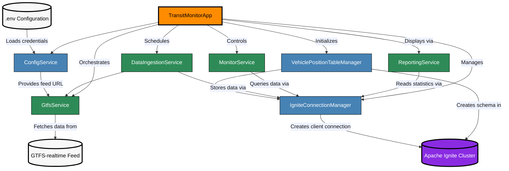
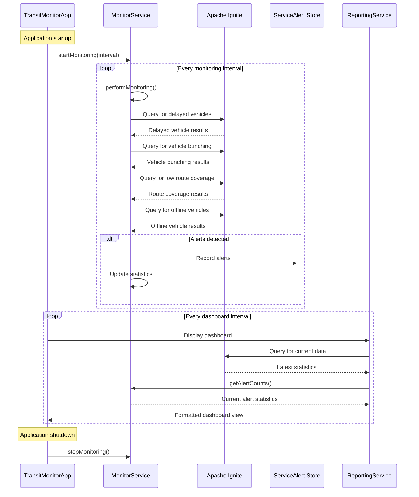

# Putting It All Together

This final module brings all the components together into a complete transit monitoring application with a live console dashboard.

## The Application Architecture

Review the complete architecture of the transit monitoring system:



This architecture demonstrates several design principles:

1. **Component Separation**: Each class has a focused responsibility
2. **Clean Integration**: Components interact through well-defined interfaces
3. **Central Coordination**: The main application orchestrates all components
4. **Configuration Management**: External configuration keeps credentials secure
5. **Resource Lifecycle**: Components are properly started and stopped

## The Monitoring Process Workflow

The monitoring system follows a specific workflow to detect potential service disruptions:



This workflow shows how the monitoring service runs queries at specified intervals, each targeting a specific disruption condition. Detected issues generate alerts that are stored and tracked. The dashboard regularly updates with the latest statistics.

## Exploring the Main Application

Open the `TransitMonitorApp` class:

```bash
open src/main/java/com/example/transit/app/TransitMonitorApp.java
```

The class defines key components and configuration:

```java
// Configuration constants
private static final int INGESTION_INTERVAL = 30;  // seconds
private static final int MONITORING_INTERVAL = 60; // seconds
private static final int DASHBOARD_REFRESH = 10;   // seconds

// Dashboard view types
private static final int VIEW_SUMMARY = 0;
private static final int VIEW_ALERTS = 1;
private static final int VIEW_DETAILS = 2;
private static final int TOTAL_VIEWS = 3;

// Core services
private final ConnectService connectionService;
private final IngestService ingestionService;
private final MonitorService monitoringService;
private final ReportService reportingService;
private final ScheduledExecutorService dashboardScheduler;
private final IgniteClient client;

// Dashboard state
private final AtomicInteger currentView = new AtomicInteger(0);
private boolean isRunning = false;
```

The constructor initializes all services:

```java
public TransitMonitorApp() {
    // Get configuration
    ConfigService config = ConfigService.getInstance();
    if (!config.validateConfiguration()) {
        throw new IllegalStateException("Invalid configuration");
    }

    // Initialize core services
    this.connectionService = new ConnectService();
    this.client = connectionService.getClient();
    this.ingestionService = new IngestService(
            new GtfsService(config.getFeedUrl()),
            connectionService)
            .withBatchSize(100);
    this.monitoringService = new MonitorService(connectionService);
    this.reportingService = new ReportService(client);
    this.dashboardScheduler = Executors.newSingleThreadScheduledExecutor(r -> {
        Thread t = new Thread(r, "dashboard-thread");
        t.setDaemon(true);
        return t;
    });

    // Set quiet mode to true to suppress individual alert output
    this.monitoringService.setQuietMode(true);
}
```

This loads and validates configuration, creates service instances, sets up a dashboard scheduler, and configures the monitoring service to suppress individual alert messages (the dashboard displays aggregate counts instead).

## Starting and Stopping the Application

The `start()` method initializes and starts all services:

```java
public boolean start() {
    if (isRunning) {
        TerminalUtil.logInfo("System already running");
        return true;
    }

    try {
        // Setup UI
        TerminalUtil.clearScreen();
        TerminalUtil.printWelcomeBanner();
        TerminalUtil.showStartupAnimation();

        // Setup database
        TerminalUtil.logInfo("Setting up database schema...");
        boolean schemaCreated = new SchemaService(connectionService).createSchema();
        if (!schemaCreated) {
            TerminalUtil.logError("Schema creation failed. Aborting.");
            return false;
        }

        // Start services
        TerminalUtil.logInfo("Starting data ingestion (interval: " + INGESTION_INTERVAL + "s)");
        ingestionService.start(INGESTION_INTERVAL);

        TerminalUtil.logInfo("Starting monitoring (interval: " + MONITORING_INTERVAL + "s)");
        monitoringService.startMonitoring(MONITORING_INTERVAL);

        // Start dashboard
        startDashboard();

        isRunning = true;
        TerminalUtil.logInfo(TerminalUtil.ANSI_GREEN + "Transit monitoring system started" + TerminalUtil.ANSI_RESET);
        return true;
    } catch (Exception e) {
        TerminalUtil.logError("Startup error: " + e.getMessage());
        stop();
        return false;
    }
}
```

The `stop()` method performs an orderly shutdown:

```java
public void stop() {
    TerminalUtil.logInfo("Stopping Transit Monitoring System");
    TerminalUtil.showShutdownAnimation();

    // Stop all services
    shutdownScheduler(dashboardScheduler);
    monitoringService.stopMonitoring();
    ingestionService.stop();

    try {
        connectionService.close();
    } catch (Exception e) {
        TerminalUtil.logError("Error closing connection: " + e.getMessage());
    }

    isRunning = false;
    TerminalUtil.logInfo(TerminalUtil.ANSI_GREEN + "System stopped" + TerminalUtil.ANSI_RESET);
}
```

The shutdown sequence stops the dashboard, monitoring service, and ingestion service in order, then closes the database connection.

## The Dashboard System

The `startDashboard()` method sets up periodic console updates:

```java
private void startDashboard() {
    TerminalUtil.logInfo("Starting dashboard (refresh: " + DASHBOARD_REFRESH + "s)");
    dashboardScheduler.scheduleAtFixedRate(() -> {
        try {
            // Rotate through views
            displayDashboard(currentView.get());
            currentView.set((currentView.get() + 1) % TOTAL_VIEWS);
        } catch (Exception e) {
            TerminalUtil.logError("Dashboard error: " + e.getMessage());
        }
    }, DASHBOARD_REFRESH, DASHBOARD_REFRESH, TimeUnit.SECONDS);
}
```

The dashboard has three views that rotate automatically:

```java
private void displayDashboard(int viewType) {
    int terminalWidth = TerminalUtil.getTerminalWidth();
    TerminalUtil.clearScreen();

    // Display header
    reportingService.printDashboardHeader(terminalWidth);

    // Display view title
    String viewTitle = reportingService.getViewTitle(viewType);
    System.out.println(TerminalUtil.ANSI_BOLD + TerminalUtil.ANSI_YELLOW + viewTitle + TerminalUtil.ANSI_RESET);
    System.out.println(TerminalUtil.ANSI_CYAN + "─".repeat(Math.min(terminalWidth, 80)) + TerminalUtil.ANSI_RESET);

    // Display view content
    switch (viewType) {
        case VIEW_SUMMARY:  displaySummaryView(); break;
        case VIEW_ALERTS:   displayAlertsView(); break;
        case VIEW_DETAILS:  displayDetailsView(); break;
    }

    // Display footer
    reportingService.printDashboardFooter(DASHBOARD_REFRESH);
}
```

The three views are:

1. **Summary View**: Active vehicles by route, status distribution, and ingestion statistics
2. **Alerts View**: Service alerts and alert statistics
3. **Details View**: System-wide statistics, monitoring thresholds, and connection status

The summary view implementation:

```java
private void displaySummaryView() {
    // Active vehicles section
    System.out.println(TerminalUtil.ANSI_BOLD + "ACTIVE VEHICLES BY ROUTE" + TerminalUtil.ANSI_RESET);
    reportingService.displayActiveVehicles();

    // Vehicle status section
    System.out.println();
    System.out.println(TerminalUtil.ANSI_BOLD + "VEHICLE STATUS DISTRIBUTION" + TerminalUtil.ANSI_RESET);
    reportingService.displayVehicleStatuses();

    // Ingestion status section
    System.out.println();
    System.out.println(TerminalUtil.ANSI_BOLD + "DATA INGESTION STATUS" + TerminalUtil.ANSI_RESET);
    reportingService.displayIngestionStatus(ingestionService.getStatistics());
}
```

## The Main Method

The `main()` method ties everything together:

```java
public static void main(String[] args) {
    // Configure logging to suppress unnecessary output
    LoggingUtil.setLogs("OFF");

    // Create application
    TransitMonitorApp app;
    try {
        app = new TransitMonitorApp();
    } catch (IllegalStateException e) {
        return; // Exit if configuration is invalid
    }

    if (app.start()) {
        // Show running message
        System.out.println("\n" + TerminalUtil.ANSI_BOLD + "═".repeat(60) + TerminalUtil.ANSI_RESET);
        System.out.println(TerminalUtil.ANSI_GREEN + "Transit monitoring system is running" + TerminalUtil.ANSI_RESET);
        System.out.println(TerminalUtil.ANSI_BLUE + "Press ENTER to exit" + TerminalUtil.ANSI_RESET);
        System.out.println(TerminalUtil.ANSI_BOLD + "═".repeat(60) + TerminalUtil.ANSI_RESET + "\n");

        // Wait for user input to exit
        try {
            new Scanner(System.in).nextLine();
        } catch (Exception e) {
            try {
                Thread.sleep(60000); // Wait 1 minute if input doesn't work
            } catch (InterruptedException ie) {
                Thread.currentThread().interrupt();
            }
        }

        // Stop application
        app.stop();
    }
}
```

## Running the Complete Application

Run the transit monitoring application:

```bash
mvn compile exec:java@run-app
```

When the application starts, you see a welcome banner, status messages as each component initializes, the dashboard updating every few seconds, and a prompt to press Enter to exit.

The dashboard output:

```text
╔══════════════════════════════════════════════════════╗
║            TRANSIT MONITORING DASHBOARD              ║
╚══════════════════════════════════════════════════════╝
Current time: 2023-05-21 14:22:38

SUMMARY VIEW
────────────────────────────────────────────────────────────────
ACTIVE VEHICLES BY ROUTE (last 15 minutes)
• Route 14      : 32 vehicles ↑
• Route 5       : 30 vehicles =
• Route 38      : 28 vehicles ↓
• Route 1       : 26 vehicles =
• Route 8       : 24 vehicles ↑

VEHICLE STATUS DISTRIBUTION
• IN_TRANSIT_TO  : 342 vehicles ↑
• STOPPED_AT     : 198 vehicles ↓

DATA INGESTION STATUS
• Status: Running
• Total records fetched: 45,280
• Total records stored: 45,280
• Last fetch count: 540
• Last fetch time: 876ms
• Running time: 01:23:45
• Ingestion rate: 9.12 records/second

Views rotate automatically every 10 seconds
Press ENTER at any time to exit
```


**Checkpoint:** The dashboard should cycle through three views: Summary (active vehicles, status distribution, ingestion stats), Alerts (service disruption alerts), and Details (system-wide statistics). The dashboard refreshes every 10 seconds.


## What You Built

This tutorial built a complete transit monitoring system using Apache Ignite 3:

1. **Real-time data acquisition** from GTFS-realtime feeds
2. **Distributed storage** with schema annotations and batch transactions
3. **SQL-based monitoring** for detecting service disruptions
4. **Live dashboard** with rotating views and system metrics
5. **Full lifecycle management** of all application components

The architecture patterns demonstrated here apply to many domains beyond transit monitoring, including IoT systems, financial transaction monitoring, logistics tracking, and real-time analytics.

## Further Learning

- [Apache Ignite Documentation](https://ignite.apache.org/docs/ignite3/latest/)
- [Apache Ignite GitHub Repository](https://github.com/apache/ignite-3)
- [Transit Monitor Source Code](https://github.com/maglietti/transit-monitor)
