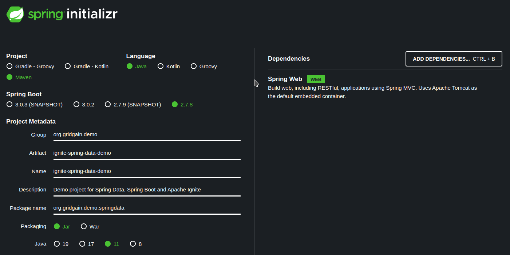

# Build a RESTful Web Service With Spring Boot and GridGain

## Introduction

This tutorial walks you through the process of creating a RESTful web service that uses GridGain 8 as a high-performance, in-memory database. The service is a Spring Boot application with an embedded Apache Tomcat instance that interacts with a GridGain cluster via Spring Data repository abstraction.

## Prerequisites

- **GridGain 8.10** binary distribution and a GridGain Enterprise or Ultimate license file (`gridgain-license.xml`)
- **Java Development Kit**, version 17 or later
- **[Apache Maven 3.6.3](https://maven.apache.org)** or later
- Your favorite IDE, such as IntelliJ IDEA, or Eclipse

## What You Will Learn

- How to start a GridGain cluster and load the World sample database
- How to model GridGain data as Spring Data POJOs and DTOs
- How to query GridGain through Spring Data repositories
- How to expose a Spring REST controller backed by a GridGain thick client

## Start the GridGain Cluster and Load the Sample Database

Before you develop the RESTful service, you start the GridGain cluster and load it with sample data. You can deploy GridGain in the environment of your choice. However, for this tutorial, you bootstrap the cluster in a bare-metal environment such as your personal Linux or Windows machine.

First, start a 2-node GridGain cluster:

1. Download and unarchive the GridGain 8.10 binary package to some directory (this tutorial refers to it as `{ignite}` or `$IGNITE_HOME`).
1. Copy your `gridgain-license.xml` file to the top level of that directory. The nodes read the license from there.
1. Open a command-line tool (also known as "a terminal window") and go to the `{ignite}/bin` folder of the GridGain distribution.
1. Using the default configuration settings, start the first cluster node.




   ```bash
   ./ignite.sh
   ```





   ```bash
   ignite.bat
   ```





1. Open another command-line window and use the same command to start the second cluster node:




   ```bash
   ./ignite.sh
   ```





   ```bash
   ignite.bat
   ```





1. After the two nodes form one cluster, look for the following message in the command line output to confirm the cluster is running:

   ```bash
   [15:11:35] Topology snapshot [ver=2, locNode=9eed123b, servers=2, clients=0, state=ACTIVE, CPUs=12, offheap=6.4GB, heap=8.0GB]
   [15:11:35]   ^-- Baseline [id=0, size=2, online=2, offline=0]
   ```

Next, before you initialize a sample database in GridGain, tweak some parameters of the default SQL script that is shipped with the GridGain binary package:

1. In a text editor, open the `{ignite}/examples/sql/world.sql` file.
1. Replace the `VALUE_TYPE=demo.model.Country` parameter of the `CREATE TABLE Country` statement with the `VALUE_TYPE=org.gridgain.demo.springdata.model.Country`.
1. Replace the `KEY_TYPE=demo.model.CityKey` parameter of the `CREATE TABLE City` statement with the `KEY_TYPE=org.gridgain.demo.springdata.model.CityKey`.
1. Replace the `VALUE_TYPE=demo.model.City` parameter of the `CREATE TABLE City` statement with the `VALUE_TYPE=org.gridgain.demo.springdata.model.City`.
1. Save the changes and close the editor.

You made the parameter changes to link the tables with data POJOs, which will be created later. With these settings, you can use the POJOs throughout the application logic, with Ignite taking care of serialization and deserialization to and from the raw data representation.

Finally, connect to the GridGain cluster (by using the SQLLine tool that is shipped with the GridGain binary distribution) and instantiate the database:

1. Open another command-line window, and go to the `{ignite}/bin` folder.
1. Use SQLLine to connect to the cluster:




   ```bash
   ./sqlline.sh -u jdbc:ignite:thin://127.0.0.1/
   ```





   ```bash
   sqlline.bat -u jdbc:ignite:thin://127.0.0.1/
   ```





1. Enter random username and password.
1. Load the sample database:




   ```bash
   !run ../examples/sql/world.sql
   ```





   ```bash
   !run ..\examples\sql\world.sql
   ```





1. After the database is created, quit SQLLine: `!q`

You can use the following script to perform these steps automatically:




```bash
cd $IGNITE_HOME

cd examples/sql \
&& sed 's/demo.model/org.gridgain.demo.springdata.model/g' world.sql > new-world.sql \
&& grep -H '=[a-z.]*model' world.sql new-world.sql \
&& ../../bin/sqlline.sh -u "jdbc:ignite:thin://127.0.0.1/" -n ignite -p ignite --run=new-world.sql
```





## Create the Spring Boot Application

Once the cluster is running, you can proceed with development of the RESTful application. Take advantage of the Spring Initializr tool that generates a Spring Boot project with predefined settings. Go to [https://start.spring.io](https://start.spring.io) and generate a project with the following parameters:



- Project: Maven project for Java
- Spring Boot: `4.1.2` or a later 4.1 release. GridGain 8.10 uses Spring Framework 7 and Spring Data 4.1, which require Spring Boot 4.
- Group: `org.gridgain.demo`
- Artifact: `ignite-spring-data-demo`
- Project name: `ignite-spring-data-demo`
- Package name: `org.gridgain.demo.springdata`
- Packaging: Jar
- Java: 17 or later
- Dependencies: Spring Web.

After you generate and download the project, open it with your favorite IDE and add additional dependencies to the `pom.xml` file:

1. Add the GridGain repository, GridGain dependencies, and a JVM configuration for running the application:

   ```xml
   <properties>
       <java.version>17</java.version>
       <gridgain.version>8.10.0</gridgain.version>
   </properties>

   <repositories>
       <repository>
           <id>GridGain External Repository</id>
           <url>https://www.gridgainsystems.com/nexus/content/repositories/external</url>
       </repository>
   </repositories>

   <dependencies>

       <!-- GridGain -->
       <dependency>
           <groupId>org.gridgain</groupId>
           <artifactId>gridgain-core</artifactId>
           <version>${gridgain.version}</version>
       </dependency>
       <dependency>
           <groupId>org.gridgain</groupId>
           <artifactId>ignite-indexing</artifactId>
           <version>${gridgain.version}</version>
       </dependency>
       <dependency>
           <groupId>org.gridgain</groupId>
           <artifactId>ignite-spring-data</artifactId>
           <version>${gridgain.version}</version>
       </dependency>

       <!-- Spring -->
       <dependency>
           <groupId>org.springframework.boot</groupId>
           <artifactId>spring-boot-starter-webmvc</artifactId>
       </dependency>

   </dependencies>

   <build>
       <plugins>
           <plugin>
               <groupId>org.springframework.boot</groupId>
               <artifactId>spring-boot-maven-plugin</artifactId>
               <configuration>
                   <!-- The GridGain thick client needs access to JDK internals on Java 17 and later. -->
                   <jvmArguments>
                       --add-opens java.base/java.nio=ALL-UNNAMED
                       --add-opens java.base/java.io=ALL-UNNAMED
                       --add-opens java.base/sun.nio.ch=ALL-UNNAMED
                       --add-opens java.base/java.lang=ALL-UNNAMED
                       --add-opens java.base/java.util=ALL-UNNAMED
                   </jvmArguments>
               </configuration>
           </plugin>
       </plugins>
   </build>
   ```

   Keep the `spring-boot-starter-parent` and the other entries that Spring Initializr generated. The `ignite-spring-data` module brings in Spring Data Commons and Spring Transaction, so you do not add them separately. If your Initializr project lists `spring-boot-starter-web`, use the generated dependency as is.

Do a final configuration change, by requesting Spring to start an embedded Tomcat instance on port number `9000`:

1. Open the `src/main/resources/application.properties` file.
1. Add `server.port=9000` to the file.

## Define Data Model POJOs

GridGain stores application records and entries in a cross-platform, language-neutral [binary format](../../architecture/data-modeling/introduction.md#binary-object-format). With this format, applications can query individual object fields. The applications can use SQL as well as use key-value APIs to read a full object entry that can be automatically deserialized to an associated POJO class instance.

In this tutorial, you define two types of POJOs. The first type, which represents the business objects of the RESTful service, is used internally throughout the application logic. The second type, which is called "data transfer objects (DTO)", is used by Spring Boot controllers to exchange the data via the external RESTful APIs.

### Business Objects

In your project, create the `org.gridgain.demo.springdata.model` package for both business objects and DTO classes.

Add the `org.gridgain.demo.springdata.model.Country` class that is associated with the `Country` table (check the `VALUE_TYPE` parameter of the `CREATE TABLE Country` statement from the `{ignite}/examples/sql/world.sql` script):

```java
package org.gridgain.demo.springdata.model;

import java.math.BigDecimal;

public class Country {
    private String name;

    private String continent;

    private String region;

    private int population;

    private BigDecimal surfaceArea;

    private short indepYear;

    private BigDecimal lifeExpectancy;

    private BigDecimal gnp;

    private BigDecimal gnpOld;

    private String localName;

    private String governmentForm;

    private String headOfState;

    private int capital;

    private String code2;

    public String getName() {
        return name;
    }

    public void setName(String name) {
        this.name = name;
    }

    public String getContinent() {
        return continent;
    }

    public void setContinent(String continent) {
        this.continent = continent;
    }

    public String getRegion() {
        return region;
    }

    public void setRegion(String region) {
        this.region = region;
    }

    public int getPopulation() {
        return population;
    }

    public void setPopulation(int population) {
        this.population = population;
    }

    public BigDecimal getSurfaceArea() {
        return surfaceArea;
    }

    public void setSurfaceArea(BigDecimal surfaceArea) {
        this.surfaceArea = surfaceArea;
    }

    public short getIndepYear() {
        return indepYear;
    }

    public void setIndepYear(short indepYear) {
        this.indepYear = indepYear;
    }

    public BigDecimal getLifeExpectancy() {
        return lifeExpectancy;
    }

    public void setLifeExpectancy(BigDecimal lifeExpectancy) {
        this.lifeExpectancy = lifeExpectancy;
    }

    public BigDecimal getGnp() {
        return gnp;
    }

    public void setGnp(BigDecimal gnp) {
        this.gnp = gnp;
    }

    public BigDecimal getGnpOld() {
        return gnpOld;
    }

    public void setGnpOld(BigDecimal gnpOld) {
        this.gnpOld = gnpOld;
    }

    public String getLocalName() {
        return localName;
    }

    public void setLocalName(String localName) {
        this.localName = localName;
    }

    public String getGovernmentForm() {
        return governmentForm;
    }

    public void setGovernmentForm(String governmentForm) {
        this.governmentForm = governmentForm;
    }

    public String getHeadOfState() {
        return headOfState;
    }

    public void setHeadOfState(String headOfState) {
        this.headOfState = headOfState;
    }

    public int getCapital() {
        return capital;
    }

    public void setCapital(int capital) {
        this.capital = capital;
    }

    public String getCode2() {
        return code2;
    }

    public void setCode2(String code2) {
        this.code2 = code2;
    }
}
```

Observations about the POJO class:

- The names of the POJO fields and the names of the columns of the `Country` table need to correspond so that GridGain can transform the internal object representation to an instance of the POJO class.
- The POJO includes all the fields of the `Country` table, except the primary key. The `Code` field is a primary key of the `Country` table, thus, it's not added to this POJO class. On the physical level, Ignite [stores application records as key-value pairs](../../architecture/data-modeling/introduction.md#overview), and your `Country` POJO should hold only the fields that belong to the value of a key-value pair. To retrieve a full key-value entry via a Spring Data repository, you can always use the `Cache.Entry<KeyType,ValueType>` notation, as shown later in the tutorial.

Define the business object classes by creating a POJO that is associated with the `City` table - `org.gridgain.demo.springdata.model.City`:

```java
package org.gridgain.demo.springdata.model;

public class City {
    private String name;

    private String district;

    private int population;

    public String getName() {
        return name;
    }

    public void setName(String name) {
        this.name = name;
    }

    public String getDistrict() {
        return district;
    }

    public void setDistrict(String district) {
        this.district = district;
    }

    public int getPopulation() {
        return population;
    }

    public void setPopulation(int population) {
        this.population = population;
    }
}
```

The `City` table defines a compound primary key (`PRIMARY KEY (ID, CountryCode)`) and you need a custom POJO class that encapsulates the fields of the key. Add the `org.gridgain.demo.springdata.model.CityKey` class:

```java
package org.gridgain.demo.springdata.model;

import java.io.Serializable;
import java.util.Objects;
import org.apache.ignite.cache.affinity.AffinityKeyMapped;

public class CityKey implements Serializable {
    private int ID;

    @AffinityKeyMapped
    private String COUNTRYCODE;

    public CityKey(int id, String countryCode) {
        this.ID = id;
        this.COUNTRYCODE = countryCode;
    }

    public int getId() {
        return ID;
    }

    public String getCountryCode() {
        return COUNTRYCODE;
    }

    @Override public boolean equals(Object o) {
        if (this == o)
            return true;
        if (o == null || getClass() != o.getClass())
            return false;
        CityKey key = (CityKey)o;
        return ID == key.ID &&
            COUNTRYCODE.equals(key.COUNTRYCODE);
    }

    @Override public int hashCode() {
        return Objects.hash(ID, COUNTRYCODE);
    }
}
```

Some observations about the POJO:

- `COUNTRYCODE` field is annotated with `@AffinityKeyMapped`. This field is defined as the [affinity key](../../architecture/data-modeling/affinity-colocation.md) in the `City` table, and it must be annotated accordingly in the POJO class.
- The names of the key fields are capitalized (`COUNTRYCODE` and `ID`). That is a workaround [for a limitation](https://issues.apache.org/jira/browse/IGNITE-6785) that existed when this tutorial was written.

### Data Transfer Objects

Create the `org.gridgain.demo.springdata.model.CityDTO` class that will be used by the Spring REST controllers.

The DTO encapsulates the fields of the internally used `org.gridgain.demo.springdata.model.City` and `org.gridgain.demo.springdata.model.CityKey` classes:

```java
package org.gridgain.demo.springdata.model;

public class CityDTO {
    private int id;

    private String countryCode;

    private String name;

    private String district;

    private int population;

    public CityDTO() {
    }

    public static CityDTO of(CityKey key, City value) {
        CityDTO dto = new CityDTO();
        dto.id = key.getId();
        dto.countryCode = key.getCountryCode();
        dto.name = value.getName();
        dto.district = value.getDistrict();
        dto.population = value.getPopulation();
        return dto;
    }

    public int getId() {
        return id;
    }

    public String getCountryCode() {
        return countryCode;
    }

    public String getName() {
        return name;
    }

    public String getDistrict() {
        return district;
    }

    public int getPopulation() {
        return population;
    }
}
```

The DTO creates itself from a key and a value with the static `of` method, not with a constructor. Spring Boot 4 serializes JSON with Jackson 3, which would treat a public two-argument constructor as a way to create the object from JSON and fail to deserialize the request body of the `PUT` call later in this tutorial.

Add another DTO to hold all the fields of the `Country` table.

`org.gridgain.demo.springdata.model.CountryDTO` encapsulates the fields that are presented in the internally used `org.gridgain.demo.springdata.model.Country` POJO that you added previously, as well as the Code field, which is the table's primary key:

```java
package org.gridgain.demo.springdata.model;

public class CountryDTO {
    private String code;

    private String name;

    private String continent;

    private String region;

    private int population;

    public CountryDTO() {
    }

    public CountryDTO(String key, Country value) {
        this.code = key;
        this.name = value.getName();
        this.continent = value.getContinent();
        this.region = value.getRegion();
        this.population = value.getPopulation();
    }

    public String getCode() {
        return code;
    }

    public String getName() {
        return name;
    }

    public String getContinent() {
        return continent;
    }

    public String getRegion() {
        return region;
    }

    public int getPopulation() {
        return population;
    }
}
```

## Create Spring Data Repositories

The Spring Data repositories will be located under the `org.gridgain.demo.springdata.dao` package.

Add the `org.gridgain.demo.springdata.dao.CountryRepository` repository class that will work with the data from the `Country` table:

```java
package org.gridgain.demo.springdata.dao;

import java.util.List;
import javax.cache.Cache;
import org.apache.ignite.springdata.repository.IgniteRepository;
import org.apache.ignite.springdata.repository.config.RepositoryConfig;
import org.gridgain.demo.springdata.model.Country;
import org.springframework.stereotype.Repository;

@RepositoryConfig (cacheName = "Country")
@Repository
public interface CountryRepository extends IgniteRepository<Country, String> {

    public List<Cache.Entry<String,Country>> findByPopulationGreaterThanEqualOrderByPopulationDesc(int population);
}
```

- This repository is associated with the `Country` table via the `@RepositoryConfig (cacheName = "Country")` annotation. The cache name is predefined in the `{ignite}/examples/sql/world.sql` script via the `CACHE_NAME=Country` parameter of the `CREATE TABLE Country` statement. Check [this documentation page](../../architecture/data-modeling/introduction.md#key-value-cache-vs.-sql-table) to discover why the `cache` and `table` terms co-exist in Ignite.
- The repository implements a method that returns all countries that have a population equal to or greater than the requested value. The `Cache.Entry<String,Country>` object is used to retrieve a full key-value pair from Ignite. Here, `String` is the type of key (`Code` column, in the case of the `Country` table), and `Country` is the custom business objects that hold the fields of the value.

Create a repository that is named `org.gridgain.demo.springdata.dao.CityRepository` and that is associated with the `City` table:

```java
package org.gridgain.demo.springdata.dao;

import java.util.List;
import javax.cache.Cache;
import org.apache.ignite.springdata.repository.IgniteRepository;
import org.apache.ignite.springdata.repository.config.Query;
import org.apache.ignite.springdata.repository.config.RepositoryConfig;
import org.gridgain.demo.springdata.model.City;
import org.gridgain.demo.springdata.model.CityKey;
import org.springframework.stereotype.Repository;

@RepositoryConfig(cacheName = "City")
@Repository
public interface CityRepository extends IgniteRepository<City, CityKey> {

    public List<Cache.Entry<CityKey, City>> findAllByPopulationGreaterThanEqualOrderByPopulation(int population);

    @Query("SELECT city.name, MAX(city.population), country.name, country.GovernmentForm FROM country " +
        "JOIN city ON city.countrycode = country.code " +
        "GROUP BY city.name, country.name, country.GovernmentForm, city.population " +
        "ORDER BY city.population DESC LIMIT ?")
    public List<List<?>> findMostPopulatedCities(int limit);

    public Cache.Entry<CityKey, City> findById(int id);
}
```

In the repository, three methods demonstrate various usage patterns of the GridGain Spring Data integration:

- The `findAllByPopulationGreaterThanEqualOrderByPopulation` method shows how to use Spring's query auto-generation feature to get a list of key-value pairs (`Cache.Entry<CityKey, City>`).
- The `findMostPopulatedCities` method demonstrates how to pass in a direct query to GridGain to join the records of two tables. The method returns individual fields, rather than business model POJOs.
- The `findById` method shows how to get key-value pairs if you need to filter the records by the value of a primary key field or fields.

## Introduce Spring Service Abstraction

Instead of having the Spring REST controller work with the Spring repositories directly, you create a Spring service abstraction that takes care of the business-related logic and performs all necessary transformations between the internal business objects and the DTO classes.

In your project, create the `org.gridgain.demo.springdata.service` package and place the `org.gridgain.demo.springdata.service.WorldDatabaseService` class in it:

```java
package org.gridgain.demo.springdata.service;

import java.util.ArrayList;
import java.util.List;
import javax.cache.Cache;
import org.gridgain.demo.springdata.dao.CityRepository;
import org.gridgain.demo.springdata.dao.CountryRepository;
import org.gridgain.demo.springdata.model.City;
import org.gridgain.demo.springdata.model.CityKey;
import org.gridgain.demo.springdata.model.Country;
import org.gridgain.demo.springdata.model.CityDTO;
import org.gridgain.demo.springdata.model.CountryDTO;
import org.springframework.beans.factory.annotation.Autowired;
import org.springframework.stereotype.Service;

@Service
public class WorldDatabaseService {
    @Autowired CountryRepository countryDao;

    @Autowired CityRepository cityDao;

    public List<CountryDTO> getCountriesByPopulation(int population) {
        List<CountryDTO> countries = new ArrayList<>();

        for (Cache.Entry<String, Country> entry: countryDao.findByPopulationGreaterThanEqualOrderByPopulationDesc(population))
            countries.add(new CountryDTO(entry.getKey(), entry.getValue()));

        return countries;
    }

    public List<CityDTO> getCitiesByPopulation(int population) {
        List<CityDTO> cities = new ArrayList<>();

        for (Cache.Entry<CityKey, City> entry: cityDao.findAllByPopulationGreaterThanEqualOrderByPopulation(population))
            cities.add(CityDTO.of(entry.getKey(), entry.getValue()));

        return cities;
    }

    public List<List<?>> getMostPopulatedCities(Integer limit) {
        return cityDao.findMostPopulatedCities(limit == null ? 5 : limit);
    }

    public CityDTO updateCityPopulation(int cityId, int population) {
        Cache.Entry<CityKey, City> entry = cityDao.findById(cityId);

        entry.getValue().setPopulation(population);

        cityDao.save(entry.getKey(), entry.getValue());

        return CityDTO.of(entry.getKey(), entry.getValue());
    }
}
```

In addition to the methods that read data from the repositories upon controller request, the service implements the `updateCityPopulation` method, which shows how to update a record in Spring Data fashion. With the `cityDao.findById(cityId)` call, the method reads a record that needs to be updated. The method then adjusts the value of the population and writes the record back through the `IgniteRepository.save(key, value)` interface (see `cityDao.save(entry.getKey(), entry.getValue()`).



The implementation of `updateCityPopulation` method presents one of the ways for data modification with Spring Data repositories. Alternatively, you can always send `UPDATE`, `DELETE` or `INSERT` commands to GridGain by adding direct queries to the same repositories.



## Develop the Spring REST Controller

Add the REST controller to your application, so the application will be capable of processing several HTTP-based API calls.

Create the `org.gridgain.demo.springdata.controller` package in your project and add the `org.gridgain.demo.springdata.service.WorldDatabaseController` class to it:

```java
package org.gridgain.demo.springdata.controller;

import java.util.List;
import org.gridgain.demo.springdata.model.CityDTO;
import org.gridgain.demo.springdata.model.CountryDTO;
import org.gridgain.demo.springdata.service.WorldDatabaseService;
import org.springframework.beans.factory.annotation.Autowired;
import org.springframework.web.bind.annotation.GetMapping;
import org.springframework.web.bind.annotation.PathVariable;
import org.springframework.web.bind.annotation.PutMapping;
import org.springframework.web.bind.annotation.RequestBody;
import org.springframework.web.bind.annotation.RequestParam;
import org.springframework.web.bind.annotation.RestController;

@RestController
public class WorldDatabaseController {
    @Autowired WorldDatabaseService service;

    @GetMapping("/api/countries")
    public List<CountryDTO> getCountriesByPopulation(@RequestParam (value = "population", required = true) int population) {
        return service.getCountriesByPopulation(population);
    }

    @GetMapping("/api/cities")
    public List<CityDTO> getCitiesByPopulation(@RequestParam (value = "population", required = true) int population) {
        return service.getCitiesByPopulation(population);
    }

    @GetMapping("/api/cities/mostPopulated")
    public List<List<?>> getMostPopulatedCities(@RequestParam (value = "limit", required = false) Integer limit) {
        return service.getMostPopulatedCities(limit);
    }

    @PutMapping("/api/cities/{id}")
    public CityDTO updateCityPopulation(@PathVariable Integer id, @RequestBody CityDTO cityDTO) {
        return service.updateCityPopulation(id, cityDTO.getPopulation());
    }

}
```

The controller intercepts a handful of GET and PUT requests that delegate the business logic execution to the Spring service abstraction.

## Configure the GridGain Client

Next, you define the GridGain thick client as a Spring bean. The Ignite Spring Data repositories look the client up by the `igniteInstance` bean name. Place the class under the `org.gridgain.demo.springdata` package and name it `org.gridgain.demo.springdata.DemoConfig`:

```java
package org.gridgain.demo.springdata;

import org.apache.ignite.Ignite;
import org.apache.ignite.Ignition;
import org.apache.ignite.configuration.IgniteConfiguration;
import org.springframework.context.annotation.Bean;
import org.springframework.context.annotation.Configuration;

@Configuration
public class DemoConfig {
    @Bean(name = "igniteInstance")
    public Ignite igniteInstance() {
        IgniteConfiguration cfg = new IgniteConfiguration();
        cfg.setClientMode(true);
        return Ignition.start(cfg);
    }
}
```

With the default configuration, the client finds the two server nodes you started earlier through the default IP finder.

Finally, update the auto-generated `org.gridgain.demo.springdata.IgniteSpringDataDemoApplication` class by adding the `@EnableIgniteRepositories` annotation to enable GridGain Spring Data repositories.

```java
package org.gridgain.demo.springdata;

import org.apache.ignite.springdata.repository.config.EnableIgniteRepositories;
import org.springframework.boot.SpringApplication;
import org.springframework.boot.autoconfigure.SpringBootApplication;

@SpringBootApplication
@EnableIgniteRepositories
public class IgniteSpringDataDemoApplication {

	public static void main(String[] args) {
		SpringApplication.run(IgniteSpringDataDemoApplication.class, args);
	}
}
```

## Run the Application

You can build the project and start the application from your IDE or open a command-line window and execute the following Maven command from the project root folder:

```bash
mvn spring-boot:run
```

Next, use the `curl` command-line tool to send HTTP requests, which will be intercepted and processed by your Spring controller.

First, get all the cities with a population equal to or larger than 8 million:

```bash
curl http://localhost:9000/api/cities?population=8000000
```

The response is as follows:

```bash
[{"countryCode":"USA","district":"New York","id":3793,"name":"New York","population":8008278},
{"countryCode":"RUS","district":"Moscow (City)","id":3580,"name":"Moscow","population":8389200},
{"countryCode":"MEX","district":"Distrito Federal","id":2515,"name":"Ciudad de México","population":8591309},
{"countryCode":"TUR","district":"Istanbul","id":3357,"name":"Istanbul","population":8787958},
{"countryCode":"PAK","district":"Sindh","id":2822,"name":"Karachi","population":9269265},
{"countryCode":"IDN","district":"Jakarta Raya","id":939,"name":"Jakarta","population":9604900},
{"countryCode":"CHN","district":"Shanghai","id":1890,"name":"Shanghai","population":9696300},
{"countryCode":"BRA","district":"São Paulo","id":206,"name":"São Paulo","population":9968485},
{"countryCode":"KOR","district":"Seoul","id":2331,"name":"Seoul","population":9981619},
{"countryCode":"IND","district":"Maharashtra","id":1024,"name":"Mumbai (Bombay)","population":10500000}]
```

Second, get the top 10 most populated cities:

```bash
curl http://localhost:9000/api/cities/mostPopulated?limit=10
```

In response, the application joins the `City` and `Country` tables to produce the following result:

```bash
[["Mumbai (Bombay)",10500000,"India","Federal Republic"],
["Seoul",9981619,"South Korea","Republic"],
["São Paulo",9968485,"Brazil","Federal Republic"],
["Shanghai",9696300,"China","PeoplesRepublic"],
["Jakarta",9604900,"Indonesia","Republic"],
["Karachi",9269265,"Pakistan","Republic"],
["Istanbul",8787958,"Turkey","Republic"],
["Ciudad de México",8591309,"Mexico","Federal Republic"],
["Moscow",8389200,"Russian Federation","Federal Republic"],
["New York",8008278,"United States","Federal Republic"]]
```

Finally, update the population value for the city with id `3507`:




```bash
curl -X PUT -H 'Content-Type: application/json' -d '{"population":5000}' http://localhost:9000/api/cities/3507
```





```bash
curl -X PUT -H "Content-Type: application/json" -d "{\"population\":5000}" http://localhost:9000/api/cities/3507
```





The data is updated, and the controller sends back the modified version of the specified city's record:

```bash
{"countryCode":"UZB","district":"Buhoro","id":3507,"name":"Buhoro","population":5000}
```

Congratulations! You've completed the tutorial and learned how to use GridGain with Spring Boot and Spring Data to build high-performance RESTful services.

## Related

- [Spring Boot reference documentation](https://docs.spring.io/spring-boot/index.html) for details on the Spring Boot features used here
