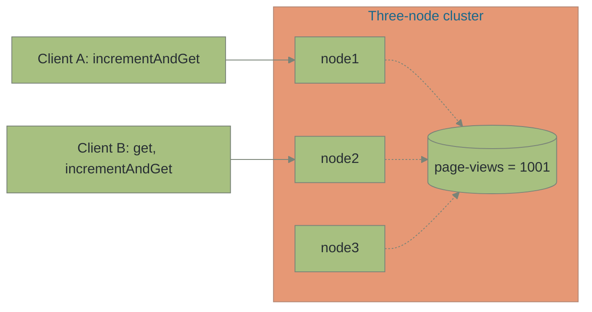
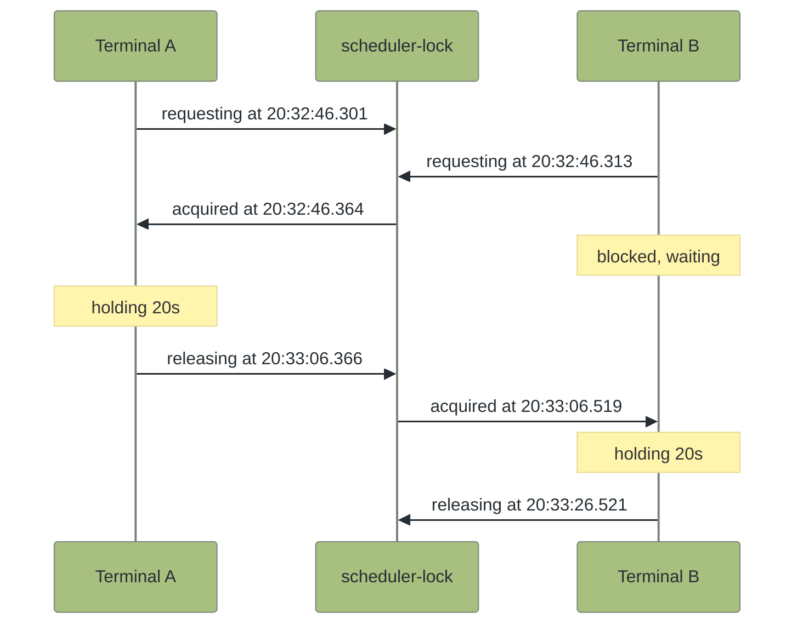

# Distributed Primitives: The Coordination Problem

<!-- TODO (release): the Maven version 8.10.0 is not yet published on the GridGain Nexus repository (it has no 8.10 version), so the pom in this page cannot resolve until it is. After the 8.10.0 release, check that each of these resolves, update this page if the final names differ, and delete this comment. -->

## Introduction

So far in this path the cluster has acted as a data service. You stored entries, queried them, ran compute against them, and learned how to make the storage durable. This tutorial shifts the cluster's role to a coordination service that the application talks to instead of a coordination library.

A team that needs cluster-wide coordination from a key-value cache pieces it together from a few sources. Counter increments and blocking queue pops typically come from the cache server itself. Distributed locks come from a separate library, with correctness tradeoffs the application is left to defend.

GridGain exposes three <dfn title="The API matches the contract of a java.util.concurrent type.">JUC-shaped</dfn> primitives on the `Ignite` interface. `IgniteAtomicLong` mirrors the JDK `AtomicLong` method surface (`get`, `incrementAndGet`, `compareAndSet`), with the difference that every node in the cluster sees the same value through the same coordination path. `IgniteLock` is a cluster-scoped `ReentrantLock`, and `IgniteQueue` is a cluster-scoped `BlockingQueue`. You build a small project with one runnable class per primitive and watch each one work across two clients.

## Prerequisites

- **A running three-node cluster** using `cache-cluster/docker-compose-3nodes.yml` from [Understand How Your Cache Is Distributed](../cache-centric-foundations/understand-cache-distribution.md). The per-node configs in that compose pin discovery and communication ports and register a `BasicAddressResolver` so a host JVM thick client can reach each container through the loopback address. Peer class loading is enabled on every server.
- **Java 17** or later for the client runtime. The Maven project compiles to Java 17 bytecode, the same version the GridGain 8 server JVM runs.
- **Maven 3.6** or later.
- **Docker Compose 2.23** or later.
- **Two terminal windows.** The Lock and Queue scenarios run a second JVM in the second terminal.

This tutorial creates a fresh `distributed-primitives/` Maven project. The clusters and projects from earlier tutorials in this path are not modified.

<details>
<summary>Returning to this tutorial? Restart the three-node cluster.</summary>

If the three-node cluster from the earlier tutorials is no longer running, start it before continuing.

```bash
docker compose -f cache-cluster/docker-compose-3nodes.yml up -d
docker ps --filter name=gridgain8-node --format "table {{.Names}}\t{{.Status}}"
```

The output lists three server containers in the `Up` state. The cluster is in-memory, so any prior data was discarded with the previous session. The primitives this tutorial creates do not depend on existing data.

</details>

## What You Will Learn

- How to acquire a cluster-wide primitive by name with a configuration object and a create-if-absent flag
- Why `IgniteAtomicLong` is JDK `AtomicLong` made cluster-wide and how cross-client visibility works
- How `IgniteLock` contends across two JVMs and why the wall-clock prints prove serialization
- How `IgniteQueue.take()` blocks when empty and unblocks when another process offers
- Why `CollectionConfiguration.setBackups(1)` is required when an AtomicLong already shares the cache group

## What You Will Build

You build a small Maven project with four Java classes. Three are runnable scenarios that connect a thick client to the three-node cluster and exercise one primitive each. The fourth is a code-only reference that lists the other primitives the cluster exposes with a one-line use case for each.

By the end, you run a counter that two clients share, watch two terminals contend for the same named lock, and watch a producer feed work to a consumer that was waiting on `take()`. None of these scenarios use a coordination library. The cluster is the coordination service.

## Set up the Project

Create the `distributed-primitives/` Maven project alongside any other project directories from earlier tutorials. The pom uses the same Java 17 bytecode target as the rest of the path so the host client and the cluster servers agree on class file format.

<details>
<summary><code>distributed-primitives/pom.xml</code></summary>


```xml
<?xml version="1.0" encoding="UTF-8"?>
<project xmlns="http://maven.apache.org/POM/4.0.0"
         xmlns:xsi="http://www.w3.org/2001/XMLSchema-instance"
         xsi:schemaLocation="http://maven.apache.org/POM/4.0.0 http://maven.apache.org/xsd/maven-4.0.0.xsd">
    <modelVersion>4.0.0</modelVersion>

    <groupId>com.example</groupId>
    <artifactId>distributed-primitives</artifactId>
    <version>1.0-SNAPSHOT</version>
    <packaging>jar</packaging>

    <properties>
        <maven.compiler.release>17</maven.compiler.release>
        <project.build.sourceEncoding>UTF-8</project.build.sourceEncoding>
        <gridgain.version>8.10.0</gridgain.version>
        <exec.mainClass>com.example.AtomicLongDemo</exec.mainClass>
    </properties>

    <repositories>
        <repository>
            <id>GridGain External Repository</id>
            <url>https://www.gridgainsystems.com/nexus/content/repositories/external</url>
        </repository>
    </repositories>

    <dependencies>
        <dependency>
            <groupId>org.gridgain</groupId>
            <artifactId>gridgain-core</artifactId>
            <version>${gridgain.version}</version>
        </dependency>
    </dependencies>

    <build>
        <plugins>
            <plugin>
                <groupId>org.codehaus.mojo</groupId>
                <artifactId>exec-maven-plugin</artifactId>
                <version>3.2.0</version>
                <configuration>
                    <executable>java</executable>
                    <arguments>
                        <argument>--add-opens=java.base/jdk.internal.misc=ALL-UNNAMED</argument>
                        <argument>--add-opens=java.base/sun.nio.ch=ALL-UNNAMED</argument>
                        <argument>--add-opens=java.base/java.io=ALL-UNNAMED</argument>
                        <argument>--add-opens=java.base/java.nio=ALL-UNNAMED</argument>
                        <argument>--add-opens=java.base/java.net=ALL-UNNAMED</argument>
                        <argument>--add-opens=java.base/java.util=ALL-UNNAMED</argument>
                        <argument>--add-opens=java.base/java.util.concurrent=ALL-UNNAMED</argument>
                        <argument>--add-opens=java.base/java.util.concurrent.locks=ALL-UNNAMED</argument>
                        <argument>--add-opens=java.base/java.lang=ALL-UNNAMED</argument>
                        <argument>--add-opens=java.base/java.lang.invoke=ALL-UNNAMED</argument>
                        <argument>--add-opens=java.base/java.math=ALL-UNNAMED</argument>
                        <argument>--add-opens=jdk.management/com.sun.management.internal=ALL-UNNAMED</argument>
                        <argument>-Djava.net.preferIPv4Stack=true</argument>
                        <argument>-DIGNITE_QUIET=true</argument>
                        <argument>-DIGNITE_NO_ASCII=true</argument>
                        <argument>-classpath</argument>
                        <classpath/>
                        <argument>${exec.mainClass}</argument>
                    </arguments>
                </configuration>
            </plugin>
        </plugins>
    </build>
</project>
```


</details>

GridGain 8 artifacts are not on Maven Central. The `<repositories>` block points Maven at the GridGain external Nexus.

Build the project once to confirm dependencies resolve and the empty source tree compiles:

```bash
mvn -f distributed-primitives/pom.xml compile
```

The first run downloads the GridGain core jar; subsequent runs reuse the local cache.


**Checkpoint:** The `mvn compile` command finishes with `BUILD SUCCESS`. The `distributed-primitives/target/classes/` directory exists and is empty.


## Cluster-Scoped AtomicLong

`IgniteAtomicLong` is `java.util.concurrent.atomic.AtomicLong` with one extra property. Every node in the cluster sees the same value. Acquire the primitive by name from any client and the cluster routes the operation to the same backing entry.

The first scenario opens two clients in one JVM. Client A creates a counter named `page-views`, increments it 1000 times, and reports the final value. Client B then attaches as a separate `Ignite` instance, reads the counter by name, and increments once more. Client A reads again to confirm B's increment is visible.

A single JVM is enough for this scenario. The second `Ignite` instance is already a separate cluster client, and the cluster does not distinguish two clients in one process from two clients in two processes. The Lock and Queue scenarios that follow use two JVMs because contention and blocking are only observable across processes.


```java
package com.example;

import java.util.Arrays;

import org.apache.ignite.Ignite;
import org.apache.ignite.IgniteAtomicLong;
import org.apache.ignite.Ignition;
import org.apache.ignite.configuration.IgniteConfiguration;
import org.apache.ignite.spi.discovery.tcp.TcpDiscoverySpi;
import org.apache.ignite.spi.discovery.tcp.ipfinder.vm.TcpDiscoveryVmIpFinder;

/**
 * Exercises IgniteAtomicLong, a JDK AtomicLong visible across every
 * node in the cluster, acquired by name.
 *
 * Two clients in the same JVM connect to the same three-node cluster.
 * Client A creates a counter named "page-views", increments it 1000
 * times, and reports the final value. Client B then attaches to the
 * same cluster, acquires the same counter by name, reads the value
 * (proving cluster-wide visibility), increments once more, and
 * confirms the new value. Client A reads again to show the increment
 * is visible from where it started.
 *
 * One JVM is enough for this scenario. IgniteAtomicLong's cluster-wide
 * visibility is independent of JVM count above 1. The Lock and Queue
 * scenarios require separate processes because contention and blocking
 * are only observable across them.
 */
public class AtomicLongDemo {

    /**
     * Cluster-wide name of the counter. Any client on any node that
     * calls atomicLong("page-views", ...) receives the same primitive.
     * The name is the contract.
     */
    private static final String COUNTER_NAME = "page-views";

    public static void main(String[] args) {
        IgniteConfiguration cfgA = newClientConfig("page-views-client-a");
        IgniteConfiguration cfgB = newClientConfig("page-views-client-b");

        try (Ignite a = Ignition.start(cfgA)) {
            // atomicLong(name, initial, createIfAbsent). The initial
            // value is honored only when the counter is created. An
            // existing counter from a prior run keeps its value.
            IgniteAtomicLong counterA = a.atomicLong(COUNTER_NAME, 0L, true);
            counterA.getAndSet(0L);
            System.out.printf("[client A] %s initial: %d%n", COUNTER_NAME, counterA.get());

            // Each incrementAndGet is a cluster-wide CAS routed to the
            // primary node that owns the counter's backing entry.
            for (int i = 0; i < 1000; i++) {
                counterA.incrementAndGet();
            }
            System.out.printf("[client A] %s after 1000 increments: %d%n",
                COUNTER_NAME, counterA.get());

            try (Ignite b = Ignition.start(cfgB)) {
                // create=false documents intent. B is attaching to an
                // existing primitive. If A had not created it, the call
                // returns null.
                IgniteAtomicLong counterB = b.atomicLong(COUNTER_NAME, -1L, false);

                long readFromB = counterB.get();
                System.out.printf("[client B] %s read: %d%n", COUNTER_NAME, readFromB);

                long after = counterB.incrementAndGet();
                System.out.printf("[client B] %s after one more increment: %d%n",
                    COUNTER_NAME, after);
            }

            // The same handle (counterA) sees the value B wrote from
            // a separate GridGain instance.
            System.out.printf("[client A] %s read again: %d%n",
                COUNTER_NAME, counterA.get());
        }

        System.exit(0);
    }

    /**
     * Builds a thick-client IgniteConfiguration for the host JVM.
     *
     * The discovery seed list points at the three host ports (47500,
     * 47501, 47502) the docker-compose-3nodes file maps onto each
     * container's discovery port. Each server registers a
     * BasicAddressResolver that advertises 127.0.0.1 alongside the
     * docker-internal IP, so the host JVM picks the loopback route
     * automatically. No resolver configuration is needed on the
     * client.
     *
     * peerClassLoadingEnabled=true matches the server config in
     * cache-cluster/ignite-config-nodeN.xml. Mismatched flags between
     * client and server cause discovery to fail at join time.
     *
     * @param name Diagnostic instance name. Appears in cluster
     *             topology snapshots and logs.
     * @return The IgniteConfiguration ready to pass to Ignition.start.
     */
    private static IgniteConfiguration newClientConfig(String name) {
        TcpDiscoverySpi disco = new TcpDiscoverySpi();
        disco.setIpFinder(new TcpDiscoveryVmIpFinder()
            .setAddresses(Arrays.asList("127.0.0.1:47500..47502")));

        IgniteConfiguration cfg = new IgniteConfiguration();
        cfg.setIgniteInstanceName(name);
        cfg.setDiscoverySpi(disco);
        cfg.setClientMode(true);
        // Must match the server's peerClassLoadingEnabled flag.
        // The cache-cluster server config has it on so closures can
        // ship.
        cfg.setPeerClassLoadingEnabled(true);
        return cfg;
    }
}
```


Run it:

```bash
mvn -f distributed-primitives/pom.xml exec:exec \
  -Dexec.mainClass=com.example.AtomicLongDemo
```

Expected output (cluster-startup lines elided):

```text
[client A] page-views initial: 0
[client A] page-views after 1000 increments: 1000
[client B] page-views read: 1000
[client B] page-views after one more increment: 1001
[client A] page-views read again: 1001
```

Client A's 1000 increments produce the expected final value because every `incrementAndGet` is an atomic cluster-wide operation. No two increments interleave to lose a count. Client B reads `1000` after attaching as a separate `Ignite` instance, which is the cluster-wide visibility property. Client A's last line reads `1001` because the same counter handle on A sees the value B wrote.

The name `page-views` is the contract. Any code on any node that calls `ignite.atomicLong("page-views", anyInitialValue, anyCreateFlag)` receives the same primitive. The initial value matters only on first creation. Pass `true` for the create flag to create the primitive when it does not yet exist, or `false` when the calling code asserts that the primitive must already be there. Client B's `create=false` is the documenting form. After client A has created the counter, B's call asserts that the counter must already exist.

One named primitive lives in the cluster, and two clients on different nodes each see the same value:




**Checkpoint:** The output ends with `[client A] page-views read again: 1001`. The same counter handle on client A sees the value client B wrote from a separate `Ignite` instance.


## Cluster-Scoped Lock

`IgniteLock` is `java.util.concurrent.locks.Lock` with cluster scope. Two thick clients running in different processes contend on the same name. Whichever JVM finishes its cluster join first acquires the lock, and the other blocks in `lock.lock()` until the holder releases.

The acquire signature is `ignite.reentrantLock(name, failoverSafe, fair, create)`. The `failoverSafe` flag controls what happens when the lock holder's node leaves the cluster. With `true`, the cluster hands the lock to the waiters automatically. With `false`, the cluster interrupts the waiters and surfaces the holder's failure. The `fair` flag chooses between FIFO ordering (`true`, slower but starvation-free) and unordered grant (`false`, faster but a busy contender can keep winning). `create=true` creates the lock if absent.

The hold duration in this scenario is 20 seconds. Cluster join cold-start on the host JVM is roughly 10 seconds, so with both terminals starting at the same time both JVMs are in the cluster while the first holder is still inside its hold. That overlap makes the contention observable.


```java
package com.example;

import java.time.Instant;
import java.util.Arrays;

import org.apache.ignite.Ignite;
import org.apache.ignite.IgniteLock;
import org.apache.ignite.Ignition;
import org.apache.ignite.configuration.IgniteConfiguration;
import org.apache.ignite.spi.discovery.tcp.TcpDiscoverySpi;
import org.apache.ignite.spi.discovery.tcp.ipfinder.vm.TcpDiscoveryVmIpFinder;

/**
 * Exercises IgniteLock, a JDK ReentrantLock that coordinates across
 * the cluster, acquired by name.
 *
 * Run this class in two terminals at roughly the same time. Each JVM
 * connects as a thick client, requests the lock named
 * "scheduler-lock", holds it for 20 seconds, and releases. Whichever
 * JVM finishes its cluster join first acquires the lock. The other
 * blocks in lock.lock() until the holder releases.
 *
 * The 20-second hold is deliberately longer than the cluster join
 * cold-start (about 10 seconds on this hardware), so both JVMs are
 * in the cluster at the same time and the contention is observable
 * in the wall-clock prints. Each line stamps Instant.now() so the
 * acquire-block-acquire sequence is visible by reading the two
 * terminals side by side.
 *
 * Usage: same command in both terminals.
 *   mvn exec:exec -Dexec.mainClass=com.example.LockDemo
 */
public class LockDemo {

    /**
     * Cluster-wide name of the lock. Both terminals contend on the
     * same name, and the cluster routes both to the same primitive.
     */
    private static final String LOCK_NAME = "scheduler-lock";

    /**
     * How long the lock holder sleeps while holding. Long enough
     * that both JVMs have completed their cluster join before the
     * first releases, so the second observes blocking instead of
     * arriving after the lock is already free.
     */
    private static final long HOLD_MILLIS = 20_000L;

    public static void main(String[] args) throws InterruptedException {
        IgniteConfiguration cfg = newClientConfig("lock-client-" + System.currentTimeMillis());

        try (Ignite ignite = Ignition.start(cfg)) {
            // reentrantLock(name, failoverSafe, fair, create).
            // failoverSafe=true releases waiters silently if the lock
            // holder's node leaves. false would interrupt them.
            // fair=true gives FIFO acquire order (slower but
            // starvation-free).
            IgniteLock lock = ignite.reentrantLock(LOCK_NAME, true, true, true);

            System.out.printf("[%s] requesting lock at %s%n",
                LOCK_NAME, Instant.now());

            // lock.lock() blocks until the cluster grants the lock.
            // If another JVM is holding, this thread parks until the
            // holder releases and the cluster's fairness ordering
            // promotes this waiter.
            lock.lock();
            try {
                System.out.printf("[%s] acquired at %s%n",
                    LOCK_NAME, Instant.now());

                // Hold the lock for the configured duration. Other
                // JVMs trying to acquire during this window block.
                Thread.sleep(HOLD_MILLIS);

                System.out.printf("[%s] releasing at %s%n",
                    LOCK_NAME, Instant.now());
            } finally {
                // The unlock call belongs in a finally block so a
                // RuntimeException between acquire and release does
                // not leave the lock held by a dead JVM. With
                // failoverSafe=true the cluster would eventually
                // recover, but explicit unlock is the contract.
                lock.unlock();
            }
        }

        System.exit(0);
    }

    /**
     * Builds a thick-client IgniteConfiguration for the host JVM.
     * Same shape as AtomicLongDemo, documented there.
     *
     * @param name Diagnostic instance name. The millisecond suffix
     *             keeps two concurrent JVMs distinguishable in the
     *             cluster's topology snapshot.
     * @return The IgniteConfiguration.
     */
    private static IgniteConfiguration newClientConfig(String name) {
        TcpDiscoverySpi disco = new TcpDiscoverySpi();
        disco.setIpFinder(new TcpDiscoveryVmIpFinder()
            .setAddresses(Arrays.asList("127.0.0.1:47500..47502")));

        IgniteConfiguration cfg = new IgniteConfiguration();
        cfg.setIgniteInstanceName(name);
        cfg.setDiscoverySpi(disco);
        cfg.setClientMode(true);
        cfg.setPeerClassLoadingEnabled(true);
        return cfg;
    }
}
```


Open two terminals and run the same command in each, as quickly as possible:

```bash
mvn -f distributed-primitives/pom.xml exec:exec \
  -Dexec.mainClass=com.example.LockDemo
```

Terminal A output (the JVM that won the race):

```text
[scheduler-lock] requesting lock at 2026-05-06T20:32:46.301Z
[scheduler-lock] acquired at 2026-05-06T20:32:46.364Z
[scheduler-lock] releasing at 2026-05-06T20:33:06.366Z
```

Terminal B output (the JVM that blocked):

```text
[scheduler-lock] requesting lock at 2026-05-06T20:32:46.313Z
[scheduler-lock] acquired at 2026-05-06T20:33:06.519Z
[scheduler-lock] releasing at 2026-05-06T20:33:26.521Z
```

Read the timestamps left to right. Both terminals call `requesting lock` within 13ms of each other. Terminal A's cluster join completes first and `lock.lock()` returns at `20:32:46.364`. Terminal B's `lock.lock()` does not return until `20:33:06.519`, which is 153ms after A's release at `20:33:06.366`. The 20-second gap on B's side is the wall-clock proof that the lock serialized the two clients.

Which JVM acquires first depends on cold-start jitter. Exactly one holds the lock at a time, and the other blocks the full hold duration. Reverse the terminals or stagger the start by a couple of seconds, and the same shape repeats with the roles swapped.




**Checkpoint:** One terminal's `acquired` timestamp lands within a few hundred milliseconds of the other terminal's `releasing` timestamp. The 20-second gap on the second terminal between `requesting` and `acquired` is the lock's serialization in wall-clock form.


## Cluster-Scoped Queue

`IgniteQueue` is `java.util.concurrent.BlockingQueue` with cluster scope. A producer in one JVM offers items, and a consumer in a different JVM takes them off the same named queue. A call to `take()` parks the consumer thread on an empty queue, and the cluster wakes it when an offer arrives from any client.

One configuration detail is load-bearing here. Acquire the queue with a `CollectionConfiguration` that has `setBackups(1)`. The default `CollectionConfiguration` has 0 backups, but the AtomicLong from the previous step already created the shared cache group with 1 backup (the default for `AtomicConfiguration`). Both primitives' backing caches share the cluster's `default-ds-group` cache group, and group attributes must agree across caches. Without `setBackups(1)` on the queue, the cluster refuses the second primitive's creation:

```text
class org.apache.ignite.IgniteException: Backups mismatch for caches related to the same group
  [groupName=default-ds-group,
   existingCache=ignite-sys-atomic-cache@default-ds-group, existingBackups=1,
   startingCache=datastructures_ATOMIC_PARTITIONED_0@default-ds-group, startingBackups=0]
```

This is the cluster's storage configuration leaking through the API. The fix is a single `setBackups(1)` call. Primitives that share a cache group inherit the group's configuration, so the queue cannot pick its own backup count once the AtomicLong has set one.


```java
package com.example;

import java.time.Instant;
import java.util.Arrays;

import org.apache.ignite.Ignite;
import org.apache.ignite.IgniteQueue;
import org.apache.ignite.Ignition;
import org.apache.ignite.configuration.CollectionConfiguration;
import org.apache.ignite.configuration.IgniteConfiguration;
import org.apache.ignite.spi.discovery.tcp.TcpDiscoverySpi;
import org.apache.ignite.spi.discovery.tcp.ipfinder.vm.TcpDiscoveryVmIpFinder;

/**
 * Exercises IgniteQueue, a JDK BlockingQueue that lives in the
 * cluster, acquired by name.
 *
 * Run this class in two terminals with different arguments. The
 * --producer JVM offers five items at one-second intervals. The
 * --consumer JVM calls take() in a loop and prints how long it
 * waited for each item. The consumer's wait pattern shows take()
 * parking on an empty queue and resuming when an offer arrives from
 * another process.
 *
 * The CollectionConfiguration sets backups=1 to match the AtomicLong
 * already in the cluster's default-ds-group cache group. Taking the
 * default (backups=0) produces an IgniteException because the two
 * primitives' backing caches share the group and group attributes
 * must agree.
 *
 * Usage:
 *   mvn exec:exec -Dexec.mainClass=com.example.QueueDemo -Dexec.args="--producer"
 *   mvn exec:exec -Dexec.mainClass=com.example.QueueDemo -Dexec.args="--consumer"
 */
public class QueueDemo {

    /** Cluster-wide name of the queue. */
    private static final String QUEUE_NAME = "work-queue";

    /** Number of items the producer offers. Small enough that the
     *  reader can read every line of output. */
    private static final int ITEM_COUNT = 5;

    /** Pause between offers, in milliseconds. The consumer's "waited"
     *  number on each take should match this once the producer has
     *  joined the cluster and is offering at the configured cadence. */
    private static final long OFFER_PAUSE_MILLIS = 1_000L;

    public static void main(String[] args) throws InterruptedException {
        boolean producer = args.length > 0 && "--producer".equals(args[0]);

        IgniteConfiguration cfg = newClientConfig(
            producer ? "queue-producer" : "queue-consumer");

        try (Ignite ignite = Ignition.start(cfg)) {
            // backups=1 matches the AtomicLong's default. All
            // data-structure caches share the default-ds-group cache
            // group, so the queue's backing cache must agree on
            // backup count. Without setBackups(1) the cluster
            // refuses queue creation: "Backups mismatch for caches
            // related to the same group".
            CollectionConfiguration colCfg = new CollectionConfiguration();
            colCfg.setBackups(1);

            // queue(name, capacity, cfg). Capacity 0 means unbounded.
            // An unbounded queue lets the producer keep offering even
            // if no consumer is connected. Items pile up in the
            // backing cache until something takes them.
            IgniteQueue<String> queue = ignite.queue(QUEUE_NAME, 0, colCfg);

            if (producer) {
                runProducer(queue);
            } else {
                runConsumer(queue);
            }
        }

        System.exit(0);
    }

    /**
     * Offers ITEM_COUNT items to the queue with a one-second pause
     * between each. The print after each offer reports the queue
     * size as observed locally. If a consumer is faster than the
     * producer, the size reads 0 because the consumer has already
     * drained the item.
     *
     * @param queue The cluster-wide queue.
     * @throws InterruptedException If the producer thread is
     *                              interrupted during sleep.
     */
    private static void runProducer(IgniteQueue<String> queue)
            throws InterruptedException {
        System.out.printf("[producer] starting offers at %s%n", Instant.now());
        for (int i = 1; i <= ITEM_COUNT; i++) {
            Thread.sleep(OFFER_PAUSE_MILLIS);
            String item = "work-" + i;
            // offer() always returns true on an unbounded queue (cap=0).
            queue.offer(item);
            System.out.printf("[producer] offered %s at %s, queue size %d%n",
                item, Instant.now(), queue.size());
        }
    }

    /**
     * Takes ITEM_COUNT items from the queue. take() parks the
     * thread on an empty queue. The wait time printed on each take
     * is the wall-clock interval between calling take and receiving
     * an item. The first take typically reflects the producer's
     * cluster join and first-offer cache setup, so it runs longer
     * than subsequent takes.
     *
     * @param queue The cluster-wide queue.
     * @throws InterruptedException If take is interrupted while
     *                              blocked.
     */
    private static void runConsumer(IgniteQueue<String> queue)
            throws InterruptedException {
        System.out.printf("[consumer] starting takes at %s%n", Instant.now());
        for (int i = 1; i <= ITEM_COUNT; i++) {
            Instant before = Instant.now();
            String item = queue.take();
            Instant after = Instant.now();
            long waitedMs = after.toEpochMilli() - before.toEpochMilli();
            System.out.printf("[consumer] took %s at %s (waited %d ms)%n",
                item, after, waitedMs);
        }
    }

    /**
     * Builds a thick-client IgniteConfiguration for the host JVM.
     * Same shape as AtomicLongDemo, documented there.
     *
     * @param name Diagnostic instance name. Identifies the producer
     *             and consumer JVMs in the cluster topology.
     * @return The IgniteConfiguration.
     */
    private static IgniteConfiguration newClientConfig(String name) {
        TcpDiscoverySpi disco = new TcpDiscoverySpi();
        disco.setIpFinder(new TcpDiscoveryVmIpFinder()
            .setAddresses(Arrays.asList("127.0.0.1:47500..47502")));

        IgniteConfiguration cfg = new IgniteConfiguration();
        cfg.setIgniteInstanceName(name);
        cfg.setDiscoverySpi(disco);
        cfg.setClientMode(true);
        cfg.setPeerClassLoadingEnabled(true);
        return cfg;
    }
}
```


Run the consumer in one terminal first so it joins the cluster and parks on `take()`:

```bash
mvn -f distributed-primitives/pom.xml exec:exec \
  -Dexec.mainClass=com.example.QueueDemo \
  -Dexec.args="--consumer"
```

After the consumer prints `[consumer] starting takes at ...`, run the producer in the second terminal:

```bash
mvn -f distributed-primitives/pom.xml exec:exec \
  -Dexec.mainClass=com.example.QueueDemo \
  -Dexec.args="--producer"
```

Producer output:

```text
[producer] starting offers at 2026-05-06T20:34:15.569Z
[producer] offered work-1 at 2026-05-06T20:34:16.648Z, queue size 0
[producer] offered work-2 at 2026-05-06T20:34:17.700Z, queue size 0
[producer] offered work-3 at 2026-05-06T20:34:18.750Z, queue size 0
[producer] offered work-4 at 2026-05-06T20:34:19.796Z, queue size 0
[producer] offered work-5 at 2026-05-06T20:34:20.853Z, queue size 0
```

Consumer output:

```text
[consumer] starting takes at 2026-05-06T20:34:03.977Z
[consumer] took work-1 at 2026-05-06T20:34:16.659Z (waited 12682 ms)
[consumer] took work-2 at 2026-05-06T20:34:17.707Z (waited 1048 ms)
[consumer] took work-3 at 2026-05-06T20:34:18.751Z (waited 1044 ms)
[consumer] took work-4 at 2026-05-06T20:34:19.797Z (waited 1046 ms)
[consumer] took work-5 at 2026-05-06T20:34:20.859Z (waited 1061 ms)
```

The consumer's first `waited 12682 ms` covers the producer's cluster join (about 10 seconds) and the producer's one-second pre-offer pause. After that, the wait pattern matches the producer's offer cadence. Each `take` returns within 50ms of the corresponding `offer`. The `queue size 0` line on every producer offer means the consumer drained each item before the producer could read the local size. Cross-process delivery is sub-millisecond once both clients are connected.

`take()` is the BlockingQueue contract. The thread parks, and the cluster wakes it when an offer arrives at the queue's backing cache. `poll()` is the non-blocking alternative, returning `null` immediately on an empty queue. `offer()` always returns true on this configuration because capacity 0 means unbounded. On a bounded queue, `offer()` returns false when full. The blocking variant for that case is `put()`, which waits until space is available.


**Checkpoint:** The consumer's `waited 12682 ms` for the first item, followed by `waited ~1000 ms` on each subsequent take, is the proof that `take()` blocks until an offer arrives. The producer's `queue size 0` after every offer shows the consumer drained each item.


## Other Primitives at a Glance

The three primitives in this tutorial cover the most common cluster-coordination uses (counter, lock, queue). The `Ignite` interface exposes six more, all acquired with the same `ignite.<name>(...)` shape. Each call takes a name, an optional initial state, an optional configuration object, and a create-if-absent flag.


```java
package com.example;

import org.apache.ignite.Ignite;
import org.apache.ignite.IgniteAtomicReference;
import org.apache.ignite.IgniteAtomicSequence;
import org.apache.ignite.IgniteAtomicStamped;
import org.apache.ignite.IgniteCountDownLatch;
import org.apache.ignite.IgniteSemaphore;
import org.apache.ignite.IgniteSet;
import org.apache.ignite.configuration.CollectionConfiguration;

/**
 * Reference catalog for the cluster-wide primitives this tutorial
 * does not exercise end-to-end.
 *
 * Each acquire follows the same shape as AtomicLongDemo, LockDemo,
 * and QueueDemo: pass a name, optional initial state, and a
 * create-if-absent flag. Once the acquire-by-name pattern is clear
 * from the three runnable scenarios, every other primitive on the
 * GridGain interface uses the same call shape.
 *
 * The class compiles but is not run end-to-end. The bodies are
 * representative call sites, intentionally abstract. The product
 * docs cover semantics in depth, and the tutorial summary links to
 * them.
 */
public class OtherPrimitives {

    /**
     * IgniteAtomicSequence: high-throughput auto-incrementing
     * counter. Each node reserves a batch of IDs locally
     * (default 1000) and serves out of the batch without a
     * cluster round-trip. Use for ID generation when ordering
     * across nodes does not matter and per-call latency does.
     *
     * Where AtomicLong applies strict cluster ordering on every
     * increment, AtomicSequence trades that ordering for speed.
     * It is N node-local allocators backed by one cluster-wide
     * ceiling, so IDs across nodes interleave rather than form a
     * monotonic sequence.
     */
    public IgniteAtomicSequence sequenceExample(Ignite ignite) {
        // sequence(name, initialValue, create).
        return ignite.atomicSequence("invoice-id-allocator", 1L, true);
    }

    /**
     * IgniteAtomicReference: a cluster-wide typed reference with
     * compareAndSet and get. Use when the single coordinated value
     * is not a long. Common case: a configuration version, a
     * "current leader" pointer, or a feature flag.
     */
    public IgniteAtomicReference<String> referenceExample(Ignite ignite) {
        // atomicReference(name, initialValue, create).
        return ignite.atomicReference("current-leader", "node-1", true);
    }

    /**
     * IgniteAtomicStamped: a cluster-wide reference paired with an
     * integer stamp. compareAndSet matches both the value and the
     * stamp, so consumers can detect ABA changes that a plain
     * AtomicReference would silently accept.
     */
    public IgniteAtomicStamped<String, Integer> stampedExample(Ignite ignite) {
        // atomicStamped(name, initialValue, initialStamp, create).
        // Type parameters: <T, S> where T is the value type and S is
        // the stamp type. Stamps are typically Integer or Long.
        return ignite.atomicStamped("config", "v1", 0, true);
    }

    /**
     * IgniteCountDownLatch: cluster-wide one-shot coordination.
     * One client (or several) waits on the latch while another
     * client counts down. Use for "wait for N workers to finish"
     * or "release the herd at start time" patterns.
     *
     * A Lock serializes access to a critical section across many
     * JVMs over time. A CountDownLatch is single use. Once it
     * reaches zero, it stays zero until destroyed.
     */
    public IgniteCountDownLatch latchExample(Ignite ignite) {
        // countDownLatch(name, count, autoDel, create).
        // autoDel=true removes the latch from the cluster once the
        // count reaches zero and no waiters remain.
        return ignite.countDownLatch("worker-fanout", 3, true, true);
    }

    /**
     * IgniteSemaphore: cluster-wide bounded concurrency. Use to
     * cap the number of nodes (or threads across nodes) that can
     * execute a critical section at once. Typical case: at most N
     * concurrent connections to a downstream system that has its
     * own connection limit.
     */
    public IgniteSemaphore semaphoreExample(Ignite ignite) {
        // semaphore(name, count, failoverSafe, create).
        return ignite.semaphore("downstream-permits", 5, true, true);
    }

    /**
     * IgniteSet: cluster-wide set with add, remove, contains. Items
     * are partitioned by hash across the cluster (or replicated if
     * configured that way). Use for a shared membership view, dedup
     * across producers, or any "is X in the set" question that
     * needs to be answered from any node.
     */
    public IgniteSet<String> setExample(Ignite ignite) {
        // set(name, cfg). The CollectionConfiguration argument is
        // shared with IgniteQueue and controls cache mode, capacity,
        // backups. Passing null does not create the set (the call
        // returns null), so pass a configuration with one backup to
        // match the rest of this tutorial's data-structures cache group.
        return ignite.set("active-sessions", new CollectionConfiguration().setBackups(1));
    }
}
```


Compile it to confirm the imports resolve and the call sites match the API on your version:

```bash
mvn -f distributed-primitives/pom.xml compile
```

`BUILD SUCCESS` confirms the imports resolve and every call site compiles against the version on the classpath. The class is reference material, not an executable. The product docs cover each primitive's semantics in depth.

Type `ignite.` on a thick-client `Ignite` reference in your IDE and trigger auto-complete. Every coordination primitive the cluster offers is on that interface: `atomicLong`, `atomicSequence`, `atomicReference`, `atomicStamped`, `countDownLatch`, `semaphore`, `reentrantLock`, `queue`, `set`. The cluster's coordination toolkit fits on one screen.


**Checkpoint:** The `OtherPrimitives.java` file compiles without errors. The IDE auto-complete on `ignite.` shows the full list of named-primitive factories the cluster exposes.


## Summary

Two ideas carry forward.

**Cluster-wide primitives are named.** Every primitive the cluster exposes is acquired with `ignite.<primitive>(name, ...)`. Pass the same name from any client on any node, and receive the same primitive. Storage mode, backups, capacity, fairness, and failover behavior live on the configuration object passed at creation. The name is the contract.

**JUC-shaped APIs are familiar.** `IgniteAtomicLong` matches the method surface of `java.util.concurrent.atomic.AtomicLong`, `IgniteLock` extends `java.util.concurrent.locks.Lock`, and `IgniteQueue` extends `java.util.concurrent.BlockingQueue`. The Java developer's existing JUC vocabulary applies directly. The cluster handles the distribution, replication, and failover behind those interfaces.

The deeper shift is architectural. The cluster has been a data service throughout the rest of the path: storage, queries, compute, durable persistence. This tutorial uses it as a coordination service. The application no longer needs a separate coordination library for counters, locks, or queues across processes, because the cluster already offers JUC-shaped primitives that span every node. For a team that has been wiring distributed locks together with a separate library, the substitution is direct. A cluster-scoped `Lock` lives next to the data the application is already coordinating around, and the application stops carrying the integration.

Three adjacent topics belong in their own content:

- **`AtomicConfiguration` and `CollectionConfiguration` tuning**, including atomicity mode, custom cache groups, and how to isolate primitives that need different backup counts so they do not collide on `default-ds-group`.
- **Queue capacity and bounded behavior**, including `put()` blocking on a full queue, `offer(timeout)` for bounded waits, and how to size capacity for backpressure.
- **The other six primitives**, particularly `IgniteCountDownLatch` for fan-out coordination, `IgniteSemaphore` for bounded concurrency across nodes, and `IgniteAtomicSequence` for high-throughput ID generation.

The official primitive reference covers these in depth: [Data Structures](../../../gridgain8-development/data-structures/README.md).

## What's Next

The next tutorial in the path, [Real-Time Event Processing: The Streaming Problem](continuous-queries-streaming.md), turns the question around. Instead of asking the cluster for state through atomic reads or blocking takes, register a continuous query and let the cluster push state changes to the client as they happen.

## Related

- [Compute Where the Data Lives](colocated-compute.md) is the previous shift in the cluster's role: from storage to in-place computation. Coordination primitives often pair with compute, for example a worker that uses `IgniteSemaphore` to bound concurrent calls into a downstream system.
- [Beyond Cache: The Persistence Problem](native-persistence-beyond-cache.md) makes the cluster a durable store. Combined with this tutorial, the cluster is a durable coordination service. Queues, sets, and atomics survive a cluster restart when persistence is enabled on the data region the primitive's backing cache lands in. Locks, semaphores, and count-down latches live in a volatile data region and do not survive.
