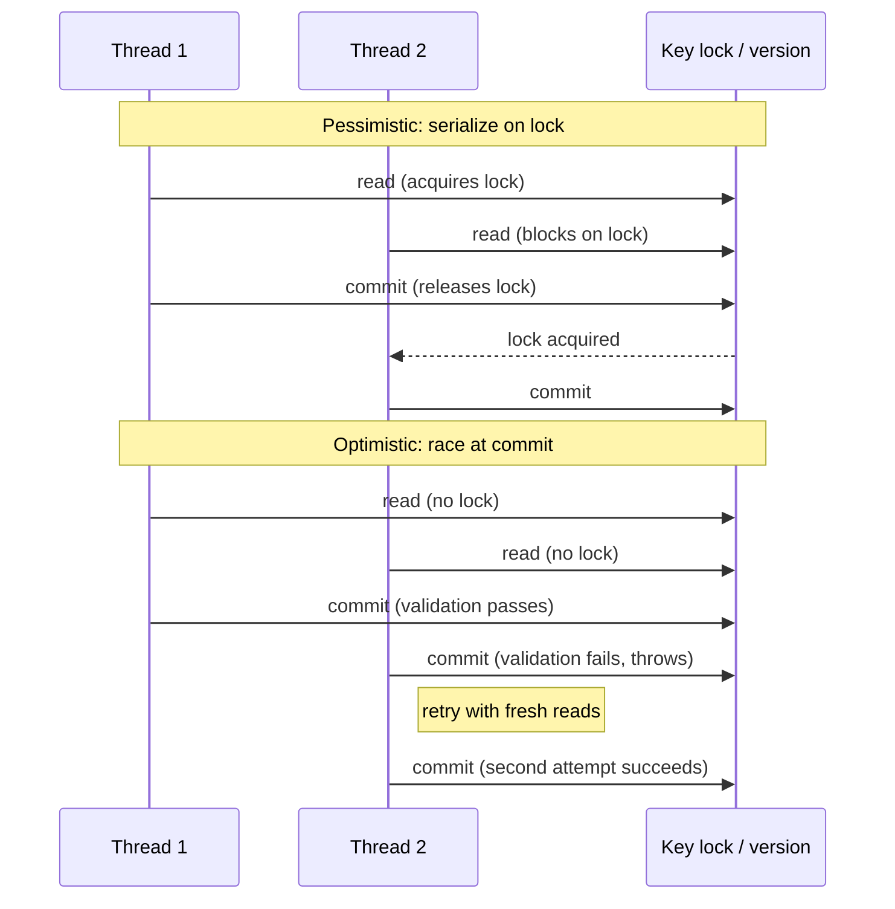

# Use Transactions With the Cache API

<!-- TODO (release): the Maven version 8.10.0 is not yet published on the GridGain Nexus repository (it has no 8.10 version), so the pom in this page cannot resolve until it is. After the 8.10.0 release, check that each of these resolves, update this page if the final names differ, and delete this comment. -->

## Introduction

The cache from [Cache-Aside Under Load](cache-aside-under-load.md) cannot carry multi-key transactions. Each entry arrived from the database at its own moment, so the cache never held a consistent snapshot that a transaction could protect.

When state lives in the cache as the source of truth, multi-key consistency becomes the cache's job. Session data, reservations, counters, loyalty points, in-memory work queues. In each case, several keys have to change together, and the cache is what makes that possible.

You add a `customer-credits` cache that tracks store credit per customer. The cache stores balances as `BigDecimal` in `TRANSACTIONAL` atomicity mode. A referral bonus transfers credit from one customer to another, and both balances must change together so the total credit across all customers stays conserved.

The rest of the tutorial runs the scenario through failure modes and contention, closing on a single-key case that needs no transaction at all. Write-through with `CacheStore` is the other path to multi-key atomicity across a cache and a database; a later guide covers that pattern.

## Prerequisites

- **A running single-node cluster** from [Start a Local Cache Development Cluster](../../quick-start/start-local-cache-cluster.md)
- **Cache API familiarity** from [Work with the Cache API](../../quick-start/work-with-cache-api.md)
- **Java 17 or later for the client runtime.** The Maven project in Step 2 compiles to Java 17 bytecode, the same version the server JVM runs. Step 6 ships a class to the server, and the server rejects bytecode newer than its own JVM.
- **Maven 3.6** or later
- **Docker Compose 2.23** or later

If you have the `cache-client/` Maven project from [Work with the Cache API](../../quick-start/work-with-cache-api.md), you add a new package (`com.example.transactions`) to it. If you arrived here fresh, Step 2 starts a new project with the same dependency footprint.

The last step of this tutorial uses `EntryProcessor`, which requires an additional cluster-side setting. Step 6 explains the requirement and walks through the config change.

<details>
<summary>Returning to these tutorials? Verify your cluster is running.</summary>

Check that the cluster container is up:

```bash
docker ps --filter name=gridgain8-node1 --format "table {{.Names}}\t{{.Status}}"
```

Expected output:

```text
NAMES             STATUS
gridgain8-node1   Up X hours
```

**If the container is stopped**, restart it:

```bash
docker compose -f cache-cluster/docker-compose.yml start
```

**If the cluster was destroyed** (`docker compose down`), recreate it from your existing setup. The cluster runs in-memory, so destroying it discards the cache. Run Step 2's `ConfigureCache` again to recreate the cache and seed balances.

</details>

## What You Will Learn

In this tutorial, you:

- Configure a TRANSACTIONAL cache and seed customer credit balances
- Observe the partial-write failure mode that two sequential `put` calls produce under a crash
- Wrap the same transfer in `ignite.transactions().txStart()` and watch rollback preserve the invariant
- Run two concurrent transfers under pessimistic concurrency and watch them serialize on key locks
- Switch to optimistic concurrency with `SERIALIZABLE` isolation and handle `TransactionOptimisticException` with a retry loop
- Use `cache.invoke(key, EntryProcessor)` for a single-key atomic mutation that does not open a transaction

## Configure a TRANSACTIONAL Cache

Before any code opens a transaction, the cache has to be configured to allow one. That configuration setting is called the cache's *atomicity mode*. Every cache has one, and the choice is made when the cache is first created.

Two modes exist:

- **`ATOMIC`** is the default. Each `put`, `get`, and `remove` runs as an independent operation. The cache does not track groups of operations as a unit, so transactions are not supported. `ATOMIC` caches are faster because the cache skips the lock coordination and two-phase commit that transactions need.
- **`TRANSACTIONAL`** is the opt-in mode that supports `txStart()`. Writes to a `TRANSACTIONAL` cache acquire key-level locks and commit through a two-phase protocol, which is what makes multi-key atomicity possible.

If you skip the setting and try to open a transaction on an `ATOMIC` cache anyway, the first cache operation inside the transaction throws.

Since 8.9.0, atomic operations inside transactions are not allowed by default. The exception message names two escape hatches:

```text
Exception class: org.apache.ignite.IgniteException
Exception message: Transaction spans operations on atomic cache (don't use atomic cache inside transaction or set up flag by cache.allowedAtomicOpsInTx()). Since 8.9.0 atomic operations inside transactions are not allowed by default. To return the previous behaviour and to allow operations with atomic caches in transactions you can set system property IGNITE_ALLOW_ATOMIC_OPS_IN_TX to true.
```

Both escape hatches still exist on current GG8 builds. The `IGNITE_ALLOW_ATOMIC_OPS_IN_TX` system property flips the default cluster-wide, and `cache.withAllowAtomicOpsInTx()` opts in a single cache. Neither is recommended for tutorial code. They exist to ease migration of legacy applications that mix atomic operations into transactional blocks, and using them here would defeat the atomicity guarantee this tutorial is about to teach.

To use transactions, opt into `TRANSACTIONAL` mode explicitly on the cache configuration:

```java
cacheCfg.setAtomicityMode(CacheAtomicityMode.TRANSACTIONAL);
```

The mode is part of the cache's initial configuration and cannot be changed later. Switching modes requires destroying the cache with `ignite.destroyCache("customer-credits")` and creating a fresh one with the new configuration. The decision is worth making deliberately: a TRANSACTIONAL cache pays a small coordination cost on every write in exchange for the ability to group writes, while an ATOMIC cache trades that cost for simpler semantics and higher throughput.

Create a Maven project if you do not already have one, or add a `transactions` package to your existing `cache-client/` project. The `pom.xml` declares a GridGain 8 `-core` dependency and targets Java 17 bytecode so classes shipped to the server in Step 6 load on the server's JVM:


```xml
<?xml version="1.0" encoding="UTF-8"?>
<project xmlns="http://maven.apache.org/POM/4.0.0">
    <modelVersion>4.0.0</modelVersion>
    <groupId>com.example</groupId>
    <artifactId>cache-client</artifactId>
    <version>1.0-SNAPSHOT</version>

    <properties>
        <maven.compiler.release>17</maven.compiler.release>
        <project.build.sourceEncoding>UTF-8</project.build.sourceEncoding>
        <exec.mainClass>com.example.transactions.ConfigureCache</exec.mainClass>
    </properties>

    <repositories>
        <repository>
            <id>GridGain External Repository</id>
            <url>https://www.gridgainsystems.com/nexus/content/repositories/external</url>
        </repository>
    </repositories>

    <dependencies>
        <dependency>
            <groupId>org.gridgain</groupId>
            <artifactId>gridgain-core</artifactId>
            <version>8.10.0</version>
        </dependency>
    </dependencies>

    <build>
        <plugins>
            <plugin>
                <groupId>org.codehaus.mojo</groupId>
                <artifactId>exec-maven-plugin</artifactId>
                <version>3.1.0</version>
                <configuration>
                    <executable>java</executable>
                    <arguments>
                        <argument>--add-opens</argument>
                        <argument>java.base/java.nio=ALL-UNNAMED</argument>
                        <argument>--add-opens</argument>
                        <argument>java.base/sun.nio.ch=ALL-UNNAMED</argument>
                        <argument>--add-opens</argument>
                        <argument>java.base/java.lang=ALL-UNNAMED</argument>
                        <argument>--add-opens</argument>
                        <argument>java.base/java.lang.invoke=ALL-UNNAMED</argument>
                        <argument>--add-opens</argument>
                        <argument>java.base/java.util=ALL-UNNAMED</argument>
                        <argument>--add-opens</argument>
                        <argument>java.base/java.io=ALL-UNNAMED</argument>
                        <argument>-classpath</argument>
                        <classpath/>
                        <argument>${exec.mainClass}</argument>
                    </arguments>
                </configuration>
            </plugin>
        </plugins>
    </build>
</project>
```




The GridGain 8 Docker images run a Java 17 JVM on the server. The `CacheEntryProcessor` class in Step 6 ships from the client to the server through peer class loading. If the class is compiled with bytecode newer than the server JVM supports, the server JVM halts with `UnsupportedClassVersionError` when the closure arrives. Setting `maven.compiler.release=17` matches the bytecode to the server.



Create `ConfigureCache.java` in the `com.example.transactions` package. The class starts a thick client, creates the `customer-credits` cache with `TRANSACTIONAL` atomicity mode, and seeds three customer balances:


```java
package com.example.transactions;

import java.math.BigDecimal;
import java.util.Collections;
import java.util.LinkedHashMap;
import java.util.Map;

import org.apache.ignite.Ignite;
import org.apache.ignite.IgniteCache;
import org.apache.ignite.Ignition;
import org.apache.ignite.cache.CacheAtomicityMode;
import org.apache.ignite.configuration.CacheConfiguration;
import org.apache.ignite.configuration.IgniteConfiguration;
import org.apache.ignite.spi.discovery.tcp.TcpDiscoverySpi;
import org.apache.ignite.spi.discovery.tcp.ipfinder.vm.TcpDiscoveryVmIpFinder;

/**
 * Creates the customer-credits cache in TRANSACTIONAL atomicity mode
 * and seeds three starting balances. Run this class once before any
 * of the transfer scenarios.
 *
 * The cache's atomicity mode is a one-time decision made at cache
 * creation. The default mode (ATOMIC) is faster and does not engage
 * the lock coordinator, but it does not support transactions. The
 * TRANSACTIONAL mode opts into two-phase commit and key-level
 * locking, which is what ignite.transactions().txStart() needs to
 * provide ACID guarantees across multiple cache operations.
 *
 * Because the choice is per-cache and immutable, cache design
 * decisions about atomicity happen before any business logic runs.
 * You cannot defer the decision until you know whether a particular
 * write path will be transactional.
 */
public class ConfigureCache {
    public static void main(String[] args) {
        // TcpDiscoverySpi is the default discovery mechanism for
        // GridGain 8. It handles cluster membership,
        // topology changes, and failure detection via TCP-level
        // heartbeats and messaging. The VM IP finder is the
        // development-friendly choice: it takes a static list of
        // host:port pairs, so no multicast or DNS resolution is
        // required. Point it at the port your cluster container
        // exposes on 47500 (the default discovery port).
        TcpDiscoverySpi disco = new TcpDiscoverySpi();
        disco.setIpFinder(new TcpDiscoveryVmIpFinder()
            .setAddresses(Collections.singleton("127.0.0.1:47500")));

        IgniteConfiguration cfg = new IgniteConfiguration();
        cfg.setDiscoverySpi(disco);

        // Client mode: this JVM joins the cluster topology as a
        // client node. Client nodes do not own cache data and do not
        // host partition primaries or backups; they route cache
        // operations to the server nodes that do. In this tutorial's
        // single-node Docker cluster, "the server" is the lone node
        // running inside the container.
        cfg.setClientMode(true);

        // Peer class loading must match on every node in the
        // cluster. The discovery check refuses to join a client if
        // its flag differs from the server's, so enabling it here
        // also means the server's ignite-config.xml has the same
        // setting. Required for cache.invoke() calls that ship a
        // user-defined EntryProcessor to the server (see Step 6).
        cfg.setPeerClassLoadingEnabled(true);

        // Ignition.start() blocks until the client finishes joining
        // the topology. The returned GridGain instance is
        // AutoCloseable; the try-with-resources ensures a clean
        // disconnect even if an exception exits main.
        try (Ignite ignite = Ignition.start(cfg)) {

            // CacheConfiguration carries every knob the cache needs
            // at creation time: name, atomicity mode, eviction
            // policy, expiry policy, backups, and so on. Most of
            // these are immutable after the cache exists. The name
            // is the string you use to look the cache up later with
            // ignite.cache("customer-credits").
            CacheConfiguration<Integer, BigDecimal> cacheCfg =
                new CacheConfiguration<>("customer-credits");

            // The atomicity mode determines the internal protocol
            // the cache uses for write operations. TRANSACTIONAL
            // caches coordinate writes through a two-phase commit
            // and acquire locks per-key, which is what lets a
            // transaction group multiple writes into one atomic
            // unit. ATOMIC caches skip all of that for throughput.
            // Changing modes later is not allowed; you would need
            // to destroy the cache and recreate it with the new
            // configuration.
            cacheCfg.setAtomicityMode(CacheAtomicityMode.TRANSACTIONAL);

            // getOrCreateCache is idempotent. On the first call it
            // creates the cache from the configuration. On every
            // subsequent call (including across client restarts) it
            // returns the existing cache. This makes the class safe
            // to re-run during development.
            IgniteCache<Integer, BigDecimal> cache = ignite.getOrCreateCache(cacheCfg);

            // clear() removes every entry without destroying the
            // cache itself. We reset state here so the seed is
            // deterministic regardless of what the cache contained
            // before the run. In production, a clear on a shared
            // cache would be a destructive operation reserved for
            // cold starts, migrations, or disaster recovery.
            cache.clear();

            // BigDecimal is the correct type for money. It stores
            // decimal values exactly, unlike double which rounds
            // 0.1 + 0.2 to 0.30000000000000004. Use the String
            // constructor ("100.00") rather than the double
            // constructor (100.00d) to avoid injecting
            // floating-point imprecision into the stored value.
            //
            // LinkedHashMap preserves insertion order, which gives
            // the println loop below a predictable output sequence.
            // A plain HashMap would work functionally but print in
            // hash order, producing non-deterministic output across
            // JVM versions.
            Map<Integer, BigDecimal> seed = new LinkedHashMap<>();
            seed.put(1001, new BigDecimal("100.00"));
            seed.put(1002, new BigDecimal("50.00"));
            seed.put(1003, new BigDecimal("75.00"));

            // putAll on a TRANSACTIONAL cache runs as an implicit
            // transaction: GridGain opens a transaction under the
            // hood, writes all three entries, and commits. Either
            // every entry lands or none of them do, even if the
            // JVM dies mid-call. This implicit-transaction wrapper
            // applies to every mutation on a TRANSACTIONAL cache
            // that is not already inside an explicit txStart()
            // block.
            cache.putAll(seed);

            System.out.println();
            System.out.println("=== customer-credits cache configured ===");
            for (Map.Entry<Integer, BigDecimal> e : seed.entrySet()) {
                // cache.get() returns null for missing keys and the
                // stored BigDecimal for present keys. Since we just
                // called putAll above, all three keys are present.
                System.out.println("  customer " + e.getKey() + ": " + cache.get(e.getKey()));
            }

            // Sum the three balances to establish the invariant the
            // rest of the tutorial protects: "total credit across
            // all customers is conserved." Whatever transfers run
            // later, this sum must not change.
            BigDecimal total = cache.get(1001).add(cache.get(1002)).add(cache.get(1003));
            System.out.println("Total credit: " + total);
        }
    }
}
```


Compile and run:

```bash
mvn -f cache-client/pom.xml compile
mvn -f cache-client/pom.xml exec:exec \
  -Dexec.mainClass=com.example.transactions.ConfigureCache
```

Expected output:

```text
=== customer-credits cache configured ===
  customer 1001: 100.00
  customer 1002: 50.00
  customer 1003: 75.00
Total credit: 225.00
```

The cache holds three customers with balances that sum to 225. That sum is the application invariant the rest of the tutorial protects. No matter what transfers run, the total across all customers stays at 225.



`BigDecimal` stores decimal values exactly, without the rounding errors that `double` introduces around `0.1 + 0.2`. Money calculations need exact arithmetic. Using `BigDecimal` from the start avoids a rewrite later, and it reads identically at the API level: the cache stores whatever serializable type you give it.




**Checkpoint:** `cache.get(1001)` returns `100.00`, `cache.get(1002)` returns `50.00`, `cache.get(1003)` returns `75.00`. Total credit in the system is 225.00.


## Transfer Credit Without a Transaction

Start without a transaction. A referral bonus transfers 30 credit from customer 1001 to customer 1002. In code that means: read both balances, compute the new values, then write each balance back. Two sequential `put` calls.

Create `UnsafeTransfer.java` in the same package:


```java
package com.example.transactions;

import java.math.BigDecimal;
import java.util.Collections;

import org.apache.ignite.Ignite;
import org.apache.ignite.IgniteCache;
import org.apache.ignite.Ignition;
import org.apache.ignite.configuration.IgniteConfiguration;
import org.apache.ignite.spi.discovery.tcp.TcpDiscoverySpi;
import org.apache.ignite.spi.discovery.tcp.ipfinder.vm.TcpDiscoveryVmIpFinder;

/**
 * Transfers credit between two customers using two sequential
 * cache.put() calls with no transaction wrapping them. A simulated
 * crash after the first put demonstrates the partial-write failure
 * mode: customer 1001 is debited, customer 1002 is not credited, and
 * the cache is left in a state that violates the application's
 * invariant that total credit is conserved.
 *
 * The failure is not about the cache being unreliable. Each put
 * succeeds exactly as intended. The problem is that "transfer credit
 * from A to B" is a single business operation that expresses as two
 * independent cache operations, and a plain cache has no way to know
 * those two operations are related. A transaction is the mechanism
 * that ties them together.
 *
 * Prerequisite: run ConfigureCache first to create the
 * customer-credits cache.
 */
public class UnsafeTransfer {
    public static void main(String[] args) {
        // Same thick-client setup as ConfigureCache. The discovery
        // configuration, client mode, and peer class loading flag
        // must match every other class in this tutorial because
        // they all join the same cluster.
        TcpDiscoverySpi disco = new TcpDiscoverySpi();
        disco.setIpFinder(new TcpDiscoveryVmIpFinder()
            .setAddresses(Collections.singleton("127.0.0.1:47500")));

        IgniteConfiguration cfg = new IgniteConfiguration();
        cfg.setDiscoverySpi(disco);
        cfg.setClientMode(true);
        cfg.setPeerClassLoadingEnabled(true);

        try (Ignite ignite = Ignition.start(cfg)) {
            // ignite.cache("customer-credits") looks up the cache
            // by name. This differs from getOrCreateCache: if the
            // cache does not exist, cache() returns null rather
            // than creating one. ConfigureCache must have run
            // first or this returns null and the first put() on
            // the next line throws NullPointerException.
            IgniteCache<Integer, BigDecimal> cache = ignite.cache("customer-credits");

            // Reset balances to a known starting state. Without
            // these puts, re-running this class after a successful
            // run would show leftover values from the previous
            // partial write, which would muddle the result.
            cache.put(1001, new BigDecimal("100.00"));
            cache.put(1002, new BigDecimal("50.00"));

            System.out.println();
            System.out.println("=== Unsafe transfer: two sequential puts, no transaction ===");

            BigDecimal amount = new BigDecimal("30.00");
            printBalances(cache, "Before");

            // The transferUnsafe method throws to simulate a crash.
            // Catching the exception lets the program continue so
            // the After: line prints the partial-write state.
            try {
                transferUnsafe(cache, 1001, 1002, amount);
            }
            catch (RuntimeException e) {
                System.out.println("Simulated crash after first put: " + e.getMessage());
            }

            printBalances(cache, "After ");
        }
    }

    /**
     * Transfers amount from fromId to toId using two independent
     * cache.put() calls. A RuntimeException between the two puts
     * simulates a mid-operation process failure, which leaves the
     * cache holding the first put's effect but not the second's.
     *
     * The critical property of this method is that it cannot be made
     * safe by adding more error handling at this layer. Catching the
     * exception and calling cache.put(fromId, fromBalance) to "undo"
     * the first put would work if nothing else touched fromId in the
     * meantime. But on a shared cache under concurrent access, some
     * other thread could have read the debited balance between the
     * first put and the attempted undo and acted on it. The only
     * reliable fix is a transaction that gives the two puts the same
     * commit-or-rollback outcome atomically.
     */
    private static void transferUnsafe(IgniteCache<Integer, BigDecimal> cache,
                                        int fromId, int toId, BigDecimal amount) {
        // Read both balances first so the arithmetic uses the state
        // at the start of the method. Reading them after the
        // first put would debit the source against its already-
        // updated value, double-counting.
        BigDecimal fromBalance = cache.get(fromId);
        BigDecimal toBalance = cache.get(toId);

        // First write: debit the source. BigDecimal.subtract
        // returns a new BigDecimal; the stored value itself is
        // immutable. This put overwrites the cache entry with the
        // new value.
        cache.put(fromId, fromBalance.subtract(amount));

        // Simulate a process crash between the two puts. In a real
        // system this could be a JVM failure, a thrown exception
        // from downstream code, a network timeout, a container
        // eviction, or anything else that prevents the second put
        // from running. The simulation uses a thrown exception
        // because it is deterministic and cheap; the lesson about
        // partial writes is the same.
        throw new RuntimeException("process crashed before crediting destination");

        // The unreachable line below is what would credit the
        // destination under a clean run:
        //   cache.put(toId, toBalance.add(amount));
    }

    /**
     * Prints both balances and the running total, which is the
     * invariant-check the tutorial relies on. The total should be
     * 150.00 before the transfer and (ideally) 150.00 after. When
     * the total drops, you are looking at broken-invariant state.
     */
    private static void printBalances(IgniteCache<Integer, BigDecimal> cache, String label) {
        BigDecimal b1 = cache.get(1001);
        BigDecimal b2 = cache.get(1002);
        BigDecimal total = b1.add(b2);
        System.out.println(label + ": customer 1001 = " + b1
            + ", customer 1002 = " + b2
            + ", total = " + total);
    }
}
```


The `transferUnsafe` method debits the source account, throws a `RuntimeException` to simulate a process crash, then tries to credit the destination. The crash prevents the second `put` from running. In a real system, this could be a JVM failure, a thrown exception from downstream code, or a network timeout between the two cache calls.

Run it:

```bash
mvn -f cache-client/pom.xml exec:exec \
  -Dexec.mainClass=com.example.transactions.UnsafeTransfer
```

```text
=== Unsafe transfer: two sequential puts, no transaction ===
Before: customer 1001 = 100.00, customer 1002 = 50.00, total = 150.00
Simulated crash after first put: process crashed before crediting destination
After : customer 1001 = 70.00, customer 1002 = 50.00, total = 120.00
```

Customer 1001 was debited. Customer 1002 was not credited. The total credit in the system dropped from 150 to 120. The application's invariant (total credit is conserved) is broken, and nothing in the cache can recover the missing 30.

The problem is not the crash. Every real system can fail mid-operation. The problem is that two sequential `put` calls express the transfer as two independent writes, and a caching layer has no way to know those two writes are related. A transaction is the mechanism that ties both writes to the same commit decision: either both land or neither does.


**Checkpoint:** The unsafe transfer output shows customer 1001 at 70.00, customer 1002 unchanged at 50.00, and the total dropped to 120.00.


## Transfer Credit With a Transaction

A transaction groups cache operations into one all-or-nothing unit. Three calls make up the API:

- `ignite.transactions().txStart()` opens a transaction; every cache operation on the same thread joins it.
- `tx.commit()` makes the operations durable and releases locks.
- `tx.rollback()` undoes them and releases locks.

Java's try-with-resources handles rollback automatically. The `Transaction` object implements `AutoCloseable`, so the JVM calls `tx.close()` on scope exit. When the block exits after reaching `tx.commit()`, close is a no-op. Otherwise close rolls the transaction back. Your code only needs to call `commit()` on the happy path; exception paths handle themselves.

Create `SafeTransfer.java` with two scenarios: the same simulated crash as before, and a clean commit path:


```java
package com.example.transactions;

import java.math.BigDecimal;
import java.util.Collections;

import org.apache.ignite.Ignite;
import org.apache.ignite.IgniteCache;
import org.apache.ignite.Ignition;
import org.apache.ignite.configuration.IgniteConfiguration;
import org.apache.ignite.spi.discovery.tcp.TcpDiscoverySpi;
import org.apache.ignite.spi.discovery.tcp.ipfinder.vm.TcpDiscoveryVmIpFinder;
import org.apache.ignite.transactions.Transaction;

/**
 * Transfers credit between two customers inside an
 * ignite.transactions().txStart() block. Runs two scenarios back-
 * to-back: the same simulated crash as UnsafeTransfer (now rolled
 * back by the transaction machinery), and a clean commit path (to
 * show that successful transfers still land correctly).
 *
 * The transaction API has three essential calls:
 *
 *   txStart()       opens a transaction on the current thread.
 *                   Returns a Transaction handle. Every cache
 *                   operation on this thread that touches a
 *                   TRANSACTIONAL cache joins the transaction
 *                   automatically until commit, rollback, or close.
 *
 *   commit()        makes every change in the transaction durable
 *                   together. Released locks, fires listeners,
 *                   writes to backups. After commit(), the
 *                   transaction is done.
 *
 *   rollback()      discards every change in the transaction and
 *                   releases locks. Called explicitly, or
 *                   automatically by Transaction.close() when the
 *                   try-with-resources block exits without commit().
 *
 * The try-with-resources pattern in this class uses the automatic
 * behavior: if the code reaches commit(), the transaction succeeds;
 * if an exception escapes the try block first, close() rolls back.
 * No explicit rollback() call appears in the code because the
 * pattern handles it.
 *
 * Prerequisite: run ConfigureCache first.
 */
public class SafeTransfer {
    public static void main(String[] args) {
        // Same thick-client setup as ConfigureCache.
        TcpDiscoverySpi disco = new TcpDiscoverySpi();
        disco.setIpFinder(new TcpDiscoveryVmIpFinder()
            .setAddresses(Collections.singleton("127.0.0.1:47500")));

        IgniteConfiguration cfg = new IgniteConfiguration();
        cfg.setDiscoverySpi(disco);
        cfg.setClientMode(true);
        cfg.setPeerClassLoadingEnabled(true);

        try (Ignite ignite = Ignition.start(cfg)) {
            IgniteCache<Integer, BigDecimal> cache = ignite.cache("customer-credits");

            // Reset balances before each run so re-runs are
            // deterministic. The rollback scenario leaves balances
            // unchanged; the commit scenario moves them. Both
            // runs start from 100.00 / 50.00.
            cache.put(1001, new BigDecimal("100.00"));
            cache.put(1002, new BigDecimal("50.00"));

            BigDecimal amount = new BigDecimal("30.00");

            // Scenario 1: the same simulated crash as
            // UnsafeTransfer, but now the puts live inside a
            // transaction. Expected outcome: balances unchanged.
            System.out.println();
            System.out.println("=== Safe transfer with crash: transaction rolls back ===");
            printBalances(cache, "Before");
            try {
                transferWithCrash(ignite, cache, 1001, 1002, amount);
            }
            catch (RuntimeException e) {
                System.out.println("Simulated crash inside transaction: " + e.getMessage());
            }
            printBalances(cache, "After ");

            // Scenario 2: the happy path. No crash, tx.commit()
            // runs, balances update. Expected outcome: 70.00 and
            // 80.00, total still 150.00.
            System.out.println();
            System.out.println("=== Safe transfer without crash: transaction commits ===");
            printBalances(cache, "Before");
            transferAndCommit(ignite, cache, 1001, 1002, amount);
            printBalances(cache, "After ");
        }
    }

    /**
     * Performs the debit-crash-credit sequence inside a transaction.
     * The throw exits the try block before tx.commit() runs, so
     * try-with-resources calls tx.close(), which calls rollback().
     * Every change the transaction made is undone.
     *
     * Note that the three cache operations (two gets and one put)
     * are all part of the transaction. Reads under
     * PESSIMISTIC + REPEATABLE_READ acquire read locks, and writes
     * hold them through commit. If another transaction tried to
     * modify either key between our reads and our commit, it would
     * block on the locks.
     */
    private static void transferWithCrash(Ignite ignite, IgniteCache<Integer, BigDecimal> cache,
                                           int fromId, int toId, BigDecimal amount) {
        // ignite.transactions() returns the IgniteTransactions
        // facade. txStart() with no arguments opens a transaction
        // with the default concurrency (PESSIMISTIC) and the
        // default isolation (REPEATABLE_READ). These defaults are
        // what you want for most multi-key write workloads.
        try (Transaction tx = ignite.transactions().txStart()) {
            // Reads inside the transaction. Under REPEATABLE_READ
            // the values read here are cached in the transaction
            // context, so a second cache.get(fromId) later would
            // return the same value without round-tripping to the
            // server.
            BigDecimal fromBalance = cache.get(fromId);
            BigDecimal toBalance = cache.get(toId);

            // First write. Under PESSIMISTIC, this acquires a
            // write lock on fromId held until commit or rollback.
            cache.put(fromId, fromBalance.subtract(amount));

            // Same simulated crash as UnsafeTransfer. The throw
            // exits the try block without reaching tx.commit();
            // try-with-resources then calls tx.close(), which
            // calls rollback() on the transaction. Rollback
            // reverts the put above and releases the lock.
            throw new RuntimeException("process crashed before crediting destination");

            // Unreachable under the simulated crash. Present here
            // so the structure mirrors transferAndCommit:
            //   cache.put(toId, toBalance.add(amount));
            //   tx.commit();
        }
    }

    /**
     * Happy path: read, modify, write, write, commit. Identical to
     * the business logic that would have run in
     * transferWithCrash without the throw. Demonstrates that the
     * transaction wrapping adds safety without changing the code
     * shape.
     */
    private static void transferAndCommit(Ignite ignite, IgniteCache<Integer, BigDecimal> cache,
                                          int fromId, int toId, BigDecimal amount) {
        try (Transaction tx = ignite.transactions().txStart()) {
            BigDecimal fromBalance = cache.get(fromId);
            BigDecimal toBalance = cache.get(toId);

            cache.put(fromId, fromBalance.subtract(amount));
            cache.put(toId, toBalance.add(amount));

            // commit() makes both puts durable together. Between
            // now and the end of this method, another thread
            // reading either key sees the new value. Before
            // commit() ran, the puts were visible only inside this
            // transaction (REPEATABLE_READ isolation hides
            // uncommitted writes from other transactions).
            tx.commit();
        }
    }

    private static void printBalances(IgniteCache<Integer, BigDecimal> cache, String label) {
        BigDecimal b1 = cache.get(1001);
        BigDecimal b2 = cache.get(1002);
        BigDecimal total = b1.add(b2);
        System.out.println(label + ": customer 1001 = " + b1
            + ", customer 1002 = " + b2
            + ", total = " + total);
    }
}
```


The `transferWithCrash` method does the same debit-crash-credit sequence as before, but the three cache operations live inside `try (Transaction tx = ignite.transactions().txStart())`. The throw exits the try block before `tx.commit()` runs. The `close()` method triggered by try-with-resources calls `rollback()`, and every `put` the transaction performed is undone.

The `transferAndCommit` method shows the happy path: read, modify, write, write, commit. No crash, both balances move.

Run it:

```bash
mvn -f cache-client/pom.xml exec:exec \
  -Dexec.mainClass=com.example.transactions.SafeTransfer
```

```text
=== Safe transfer with crash: transaction rolls back ===
Before: customer 1001 = 100.00, customer 1002 = 50.00, total = 150.00
Simulated crash inside transaction: process crashed before crediting destination
After : customer 1001 = 100.00, customer 1002 = 50.00, total = 150.00

=== Safe transfer without crash: transaction commits ===
Before: customer 1001 = 100.00, customer 1002 = 50.00, total = 150.00
After : customer 1001 = 70.00, customer 1002 = 80.00, total = 150.00
```

In the first scenario, the crash triggered rollback. Both balances are unchanged. Total credit holds at 150.

In the second scenario, `tx.commit()` made the transfer durable. Customer 1001 dropped to 70, customer 1002 rose to 80, and the total stayed at 150. The invariant holds whether the transaction commits or rolls back. That is the guarantee a transaction provides that two sequential `put` calls cannot.

The `txStart()` call with no arguments uses the default concurrency (`PESSIMISTIC`) and the default isolation (`REPEATABLE_READ`). Those defaults are the right starting point. The next two steps show the alternatives and when to reach for them.


**Checkpoint:** The rollback scenario leaves both balances at 100.00 and 50.00. The commit scenario moves them to 70.00 and 80.00. In both cases the total stays at 150.00.


## Handle Contention With Pessimistic Concurrency

One client with one transaction is only half the problem. Real applications have many clients, and they reach for the same keys at the same time. When two transactions both try to transfer credit between customers 1001 and 1002, one of them has to wait.

`PESSIMISTIC` concurrency answers that question by locking keys on access. Recall from the cache API tutorial that every key has a *primary node*: the one server node in the cluster that owns the canonical copy of that key's value. When a transaction first touches a key, it takes a lock on that key's primary node. Any other transaction that tries to read or write the same key blocks until the lock is released. Locks are released when the first transaction commits or rolls back. The wait shows up in the timings.

Create `PessimisticTransfers.java`. Two threads run transfers on the same two keys at the same time. Each holds a 500ms sleep inside the transaction so the contention is visible in the output:


```java
package com.example.transactions;

import java.math.BigDecimal;
import java.util.Collections;
import java.util.concurrent.CountDownLatch;
import java.util.concurrent.atomic.AtomicLong;

import org.apache.ignite.Ignite;
import org.apache.ignite.IgniteCache;
import org.apache.ignite.Ignition;
import org.apache.ignite.configuration.IgniteConfiguration;
import org.apache.ignite.spi.discovery.tcp.TcpDiscoverySpi;
import org.apache.ignite.spi.discovery.tcp.ipfinder.vm.TcpDiscoveryVmIpFinder;
import org.apache.ignite.transactions.Transaction;

/**
 * Two threads run concurrent transfers between the same two
 * customers using PESSIMISTIC + REPEATABLE_READ concurrency (the
 * default that txStart() with no arguments selects). The output
 * shows the key behavior of pessimistic locking: the second thread
 * blocks on the first thread's key lock and does not make progress
 * until the first commits.
 *
 * Pessimistic concurrency in GridGain 8 works as follows:
 *
 *   - A cache operation (get, put, remove, invoke) on a key is
 *     the first thing that acquires the key's primary-node lock.
 *   - The lock is held until the transaction commits or rolls back.
 *   - Any other transaction trying to operate on the same key
 *     blocks until the lock is released.
 *   - Different keys do not interfere. Two transactions that touch
 *     disjoint key sets run in parallel.
 *
 * The 500-millisecond sleep inside each transaction is purely
 * pedagogical. It extends the window during which locks are held so
 * the contention is visible in timestamped log output. A real
 * workload would not sleep intentionally inside a transaction.
 *
 * Prerequisite: run ConfigureCache first.
 */
public class PessimisticTransfers {
    public static void main(String[] args) throws InterruptedException {
        // Same thick-client setup as ConfigureCache.
        TcpDiscoverySpi disco = new TcpDiscoverySpi();
        disco.setIpFinder(new TcpDiscoveryVmIpFinder()
            .setAddresses(Collections.singleton("127.0.0.1:47500")));

        IgniteConfiguration cfg = new IgniteConfiguration();
        cfg.setDiscoverySpi(disco);
        cfg.setClientMode(true);
        cfg.setPeerClassLoadingEnabled(true);

        try (Ignite ignite = Ignition.start(cfg)) {
            IgniteCache<Integer, BigDecimal> cache = ignite.cache("customer-credits");

            // Reset balances so re-runs are reproducible. Without
            // this, each successful run would change the starting
            // state for the next run.
            cache.put(1001, new BigDecimal("100.00"));
            cache.put(1002, new BigDecimal("50.00"));

            System.out.println();
            System.out.println("=== Pessimistic contention: two concurrent transfers ===");
            System.out.println("Before: 1001=" + cache.get(1001) + ", 1002=" + cache.get(1002));

            // Two CountDownLatches coordinate the threads so both
            // transactions start in approximately the same
            // millisecond window, which is what makes the
            // contention observable in the output.
            //
            //   ready: each thread calls countDown() when it has
            //          reached the start line. main() waits on
            //          ready.await() until both have arrived.
            //
            //   go:    main() counts down go, releasing both
            //          threads into the transaction at the same
            //          instant.
            //
            // Without this coordination, one thread would start
            // several milliseconds before the other and the first
            // would finish uncontested, defeating the contention test.
            CountDownLatch ready = new CountDownLatch(2);
            CountDownLatch go = new CountDownLatch(1);

            // AtomicLong holds the wall-clock start time as a
            // nanosecond timestamp. The worker threads read from
            // this to compute their elapsed time for logging.
            // Using an AtomicLong rather than a volatile long is
            // conservative: we never need the atomic compound
            // operations, only the happens-before guarantee that
            // both threads see the write from main().
            AtomicLong startWall = new AtomicLong();

            Thread t1 = new Thread(() -> transferPessimistic(ignite, cache, "T1",
                1001, 1002, new BigDecimal("10.00"), ready, go, startWall));
            Thread t2 = new Thread(() -> transferPessimistic(ignite, cache, "T2",
                1001, 1002, new BigDecimal("15.00"), ready, go, startWall));

            t1.start();
            t2.start();

            // Wait for both workers to reach ready.countDown().
            ready.await();

            // Record the start time, then release both workers
            // simultaneously by counting go down to zero.
            startWall.set(System.nanoTime());
            go.countDown();

            // Wait for both workers to finish before printing the
            // summary. join() returns once the thread's run method
            // has returned.
            t1.join();
            t2.join();

            long totalMs = (System.nanoTime() - startWall.get()) / 1_000_000;
            System.out.println("Total wall time: " + totalMs + "ms");
            System.out.println("After : 1001=" + cache.get(1001) + ", 1002=" + cache.get(1002));

            // The total should still be 150.00. Both transfers
            // apply their amounts (10 and 15) without either one
            // losing data, so customer 1001 ends at 100 - 10 - 15
            // = 75 and customer 1002 ends at 50 + 10 + 15 = 75.
            System.out.println("Total credit: " + cache.get(1001).add(cache.get(1002)));
        }
    }

    /**
     * Worker that performs one transfer inside a pessimistic
     * transaction. Both worker instances run this method with
     * different amounts. The timing logs show exactly when each
     * worker acquires its first lock, when it commits, and how
     * long the other worker blocked waiting.
     */
    private static void transferPessimistic(Ignite ignite, IgniteCache<Integer, BigDecimal> cache,
                                             String name, int fromId, int toId, BigDecimal amount,
                                             CountDownLatch ready, CountDownLatch go,
                                             AtomicLong startWall) {
        try {
            // Signal that this worker has reached the start line.
            ready.countDown();
            // Wait for main() to release both workers together.
            go.await();
        }
        catch (InterruptedException e) {
            Thread.currentThread().interrupt();
            return;
        }

        log(name, elapsedMicros(startWall), "txStart");

        // txStart() with no arguments uses PESSIMISTIC concurrency
        // and REPEATABLE_READ isolation. Locks are acquired lazily
        // on the first cache operation that touches each key, and
        // held until the transaction commits or rolls back.
        try (Transaction tx = ignite.transactions().txStart()) {
            // This get() is the first operation that touches
            // fromId in this transaction. The primary-node lock
            // on fromId is acquired here. If the other thread
            // already holds the lock, this call blocks until the
            // other thread commits or rolls back.
            BigDecimal fromBalance = cache.get(fromId);
            log(name, elapsedMicros(startWall), "read " + fromId + "=" + fromBalance);

            // Second key, same pattern. Under pessimistic locking,
            // reading both keys sequentially means each one
            // acquires its own lock at the moment of first access.
            BigDecimal toBalance = cache.get(toId);
            log(name, elapsedMicros(startWall), "read " + toId + "=" + toBalance);

            // Hold the locks for a visible stretch of wall time so
            // the other thread's blocking is obvious in the
            // timestamps. Real transactions should be as short as
            // possible; every millisecond inside a transaction is
            // a millisecond the other contending threads wait.
            Thread.sleep(500);

            // Writes to locked keys succeed immediately (we
            // already hold the locks from the reads above).
            cache.put(fromId, fromBalance.subtract(amount));
            cache.put(toId, toBalance.add(amount));

            // Commit releases both locks. The other thread, which
            // has been blocked on one of these two locks since its
            // own first get(), unblocks here and proceeds with its
            // reads (now seeing our post-commit values).
            tx.commit();
            log(name, elapsedMicros(startWall), "committed");
        }
        catch (InterruptedException e) {
            Thread.currentThread().interrupt();
        }
    }

    /** Microseconds since main() counted down the go latch. */
    private static long elapsedMicros(AtomicLong startWall) {
        return (System.nanoTime() - startWall.get()) / 1_000;
    }

    /** Timestamped log line with the thread name and an event label. */
    private static void log(String name, long micros, String event) {
        System.out.printf("  [%7dus] %s: %s%n", micros, name, event);
    }
}
```


Two `CountDownLatch` instances coordinate the threads. The first latch confirms both transactions have reached the start line, then the second latch releases them into contention at the same nanosecond. The 500ms sleep inside each transaction makes the contention visible in the timings. Production workloads do not hold locks on purpose.

Run it:

```bash
mvn -f cache-client/pom.xml exec:exec \
  -Dexec.mainClass=com.example.transactions.PessimisticTransfers
```

```text
=== Pessimistic contention: two concurrent transfers ===
Before: 1001=100.00, 1002=50.00
  [     11us] T1: txStart
  [     12us] T2: txStart
  [  21524us] T1: read 1001=100.00
  [  36464us] T1: read 1002=50.00
  [ 564907us] T1: committed
  [ 564981us] T2: read 1001=90.00
  [ 567836us] T2: read 1002=60.00
  [1083458us] T2: committed
Total wall time: 1083ms
After : 1001=75.00, 1002=75.00
Total credit: 150.00
```

Both threads call `txStart()` within one microsecond of each other. T1 wins the race for the primary-node lock on key 1001 and reads the pre-transfer balances (100, 50) at 21ms and 36ms. T2 tried to read key 1001 at roughly the same moment, but its read blocked on T1's lock.

T1 sleeps for 500ms holding the locks, then commits at 564907us. At that moment T1's locks release. T2 unblocks and reads the post-T1 values (90, 60) at 564981us and 567836us, 74us after T1's commit returned. T2 sleeps 500ms of its own and commits at 1083458us.

The total wall time is ~1083ms, very close to the sum of both sleeps. The two transactions serialized cleanly on the key locks. The second transfer waited for the first to finish.

The final balances are 75 and 75. Both transfers applied in full: 100 minus 10 minus 15 equals 75, and 50 plus 10 plus 15 equals 75. Total credit stays at 150. The invariant holds, and the cost is that contended transactions run one at a time.

Microsecond timestamps keep the printed order consistent with the causality GridGain enforces. Millisecond resolution is too coarse. A commit and an unblocked read downstream of that commit often fall in the same millisecond, and the two print statements order themselves by output-buffer flush rather than by wall time. If you see a read of a post-commit value timestamped before the commit on a ms-resolution log, that is a logging artifact, not a consistency violation.

Pessimistic is the right choice when contention is common and the application can tolerate the serialized execution. If two transactions want the same keys, one waits. Nothing unusual happens; the waiting client holds a connection until its turn arrives. If waiting is not acceptable for your workload, optimistic concurrency trades waiting for retries.


**Checkpoint:** The total wall time is roughly twice the per-transaction sleep. The final balances are 75.00 and 75.00, and the total is 150.00.


## Handle Contention With Optimistic Concurrency and Retry

Pessimistic concurrency puts the cost of coordination on wait time. The second transaction sits on a lock until the first one commits. Safe, but contended keys process one transaction at a time.

Optimistic concurrency trades waiting for the possibility of failure. Both transactions read in parallel without locks, work against their own in-transaction view, and race to commit. At commit, GridGain checks whether any key in the transaction's read set was modified by another transaction that already committed. If it was, the commit throws `TransactionOptimisticException` and the application decides what to do next.

The sequence diagram below contrasts the two models on the same two-thread scenario you are about to run:



Three properties of the optimistic model matter for how you write the code:

- **There is no waiting phase.** Both transactions proceed as fast as the network allows.
- **One of them can fail.** The loser's commit throws and the transaction's writes are rolled back.
- **The application owns the retry.** GridGain does not retry for you. Your code catches the exception, reads fresh values, and tries again.

Only `TransactionIsolation.SERIALIZABLE` turns on the commit-time validation. Without it, `OPTIMISTIC` does not detect conflicts at all, and contending transactions silently overwrite each other's writes. That is almost never what multi-key logic wants. This tutorial uses `SERIALIZABLE`.

Create `OptimisticTransfers.java`:


```java
package com.example.transactions;

import java.math.BigDecimal;
import java.util.Collections;
import java.util.concurrent.CountDownLatch;
import java.util.concurrent.atomic.AtomicLong;

import org.apache.ignite.Ignite;
import org.apache.ignite.IgniteCache;
import org.apache.ignite.Ignition;
import org.apache.ignite.configuration.IgniteConfiguration;
import org.apache.ignite.spi.discovery.tcp.TcpDiscoverySpi;
import org.apache.ignite.spi.discovery.tcp.ipfinder.vm.TcpDiscoveryVmIpFinder;
import org.apache.ignite.transactions.Transaction;
import org.apache.ignite.transactions.TransactionConcurrency;
import org.apache.ignite.transactions.TransactionIsolation;
import org.apache.ignite.transactions.TransactionOptimisticException;

/**
 * Two threads run concurrent transfers using OPTIMISTIC +
 * SERIALIZABLE with a bounded retry loop. The output shows the
 * defining behavior of optimistic concurrency: neither thread
 * blocks on the other, both proceed to commit, and one of them
 * throws TransactionOptimisticException because the validation
 * step at commit detected that its read set was modified by the
 * other transaction. The losing thread retries with fresh reads
 * and succeeds on attempt 2.
 *
 * Optimistic concurrency in GridGain 8 works as follows:
 *
 *   - Reads do not acquire locks. Transactions proceed in parallel
 *     and do not know about each other during the read-and-modify
 *     phase.
 *   - At commit time, GridGain runs a validation step that compares
 *     the transaction's read set against the current committed
 *     state. If any key in the read set has been modified by
 *     another transaction since the read, validation fails.
 *   - Validation failure throws TransactionOptimisticException
 *     before the transaction commits any of its writes.
 *   - The application must catch the exception, re-read the
 *     affected keys, and try again. GridGain does not automatically
 *     retry for you.
 *
 * Isolation level matters: SERIALIZABLE is the only isolation
 * level that enables the validation step under OPTIMISTIC.
 * OPTIMISTIC + REPEATABLE_READ and OPTIMISTIC + READ_COMMITTED
 * do not validate and do not throw. Under contention those
 * combinations produce silent last-write-wins behavior, which is
 * almost always wrong for multi-key business logic. For
 * OPTIMISTIC to provide useful guarantees, use SERIALIZABLE.
 *
 * Prerequisite: run ConfigureCache first.
 */
public class OptimisticTransfers {
    public static void main(String[] args) throws InterruptedException {
        // Same thick-client setup as the other classes in this
        // tutorial.
        TcpDiscoverySpi disco = new TcpDiscoverySpi();
        disco.setIpFinder(new TcpDiscoveryVmIpFinder()
            .setAddresses(Collections.singleton("127.0.0.1:47500")));

        IgniteConfiguration cfg = new IgniteConfiguration();
        cfg.setDiscoverySpi(disco);
        cfg.setClientMode(true);
        cfg.setPeerClassLoadingEnabled(true);

        try (Ignite ignite = Ignition.start(cfg)) {
            IgniteCache<Integer, BigDecimal> cache = ignite.cache("customer-credits");

            // Reset balances for deterministic re-runs.
            cache.put(1001, new BigDecimal("100.00"));
            cache.put(1002, new BigDecimal("50.00"));

            System.out.println();
            System.out.println("=== Optimistic contention: OPTIMISTIC + SERIALIZABLE with retry ===");
            System.out.println("Before: 1001=" + cache.get(1001) + ", 1002=" + cache.get(1002));

            // Same CountDownLatch-based thread coordination as
            // PessimisticTransfers. See that file for the reasoning
            // behind the two-latch setup.
            CountDownLatch ready = new CountDownLatch(2);
            CountDownLatch go = new CountDownLatch(1);
            AtomicLong startWall = new AtomicLong();

            Thread t1 = new Thread(() -> transferWithRetry(ignite, cache, "T1",
                1001, 1002, new BigDecimal("10.00"), ready, go, startWall));
            Thread t2 = new Thread(() -> transferWithRetry(ignite, cache, "T2",
                1001, 1002, new BigDecimal("15.00"), ready, go, startWall));

            t1.start();
            t2.start();
            ready.await();
            startWall.set(System.nanoTime());
            go.countDown();
            t1.join();
            t2.join();

            long totalMs = (System.nanoTime() - startWall.get()) / 1_000_000;
            System.out.println("Total wall time: " + totalMs + "ms");
            System.out.println("After : 1001=" + cache.get(1001) + ", 1002=" + cache.get(1002));

            // Invariant check. Total credit should remain 150.00.
            // Both transfers land, the losing one via retry, so
            // customer 1001 ends at 75 and customer 1002 ends at
            // 75 (same final state as the pessimistic run).
            System.out.println("Total credit: " + cache.get(1001).add(cache.get(1002)));
        }
    }

    /**
     * Worker that performs one transfer inside a bounded retry
     * loop. On the first attempt, both workers read the same
     * pre-transfer values and race to commit. One wins; the other
     * throws TransactionOptimisticException. The loser's retry
     * (attempt 2) reads the post-first-commit values and finishes.
     */
    private static void transferWithRetry(Ignite ignite, IgniteCache<Integer, BigDecimal> cache,
                                           String name, int fromId, int toId, BigDecimal amount,
                                           CountDownLatch ready, CountDownLatch go,
                                           AtomicLong startWall) {
        try {
            ready.countDown();
            go.await();
        }
        catch (InterruptedException e) {
            Thread.currentThread().interrupt();
            return;
        }

        // A bounded retry loop protects against runaway retries if
        // contention is persistent. Three attempts is enough to
        // demonstrate the pattern under the tutorial's two-thread
        // scenario (at most one conflict is possible). Production
        // retry budgets depend on the workload:
        //
        //   - Low contention: 3 to 5 attempts is typical.
        //   - High contention on hot keys: increase the bound or
        //     (better) switch that key to PESSIMISTIC.
        //   - Exponential backoff between attempts (not shown
        //     here for simplicity) is common in production.
        int maxRetries = 3;
        for (int attempt = 1; attempt <= maxRetries; attempt++) {
            log(name, elapsed(startWall), "attempt " + attempt);

            // The try-with-resources block is inside the retry
            // loop so each attempt gets a fresh transaction. If a
            // TransactionOptimisticException thrown at commit exits
            // this try, try-with-resources calls tx.close() which
            // rolls back the failed attempt before the loop moves
            // on. No explicit cleanup is needed here.
            try (Transaction tx = ignite.transactions().txStart(
                    TransactionConcurrency.OPTIMISTIC,
                    TransactionIsolation.SERIALIZABLE)) {

                // Reads under OPTIMISTIC do not acquire locks.
                // Both threads execute this line in parallel on
                // the first attempt and read the same values.
                BigDecimal fromBalance = cache.get(fromId);
                BigDecimal toBalance = cache.get(toId);
                log(name, elapsed(startWall),
                    "read " + fromId + "=" + fromBalance + ", " + toId + "=" + toBalance);

                // Brief hold to widen the read window so both
                // threads overlap reliably. The hold is not
                // required for optimistic semantics; it just
                // makes the conflict deterministic in this scenario.
                Thread.sleep(200);

                // Writes under OPTIMISTIC are buffered in the
                // transaction's local state and do not propagate
                // to the cache until commit(). Both threads
                // reach commit() at roughly the same time; one
                // wins, the other throws.
                cache.put(fromId, fromBalance.subtract(amount));
                cache.put(toId, toBalance.add(amount));

                // Validation happens here. GridGain checks whether
                // any key this transaction read or wrote has been
                // modified by another transaction that committed
                // since our reads. If yes, this commit() throws
                // TransactionOptimisticException instead of
                // committing.
                tx.commit();

                // If commit() returned normally, we are done.
                // Return so the loop does not execute again.
                log(name, elapsed(startWall), "committed (attempt " + attempt + ")");
                return;
            }
            catch (TransactionOptimisticException e) {
                // Validation failed: another transaction
                // modified a key in our read set. The try-with-
                // resources has already rolled back our attempt,
                // so there is no state to clean up. Loop around
                // to try again with fresh reads.
                log(name, elapsed(startWall), "TransactionOptimisticException on commit, retrying");
            }
            catch (InterruptedException e) {
                Thread.currentThread().interrupt();
                return;
            }
        }

        // If the loop exits without returning, the transaction
        // never succeeded. Surface the failure so the caller
        // knows. Production code would convert this to a typed
        // exception or a Result object the caller can inspect.
        log(name, elapsed(startWall), "gave up after " + maxRetries + " attempts");
    }

    private static long elapsed(AtomicLong startWall) {
        return (System.nanoTime() - startWall.get()) / 1_000_000;
    }

    private static void log(String name, long ms, String event) {
        System.out.printf("  [%4dms] %s: %s%n", ms, name, event);
    }
}
```


The `try (Transaction tx = ...)` block sits inside a bounded retry loop. Three attempts is enough to show the pattern. Production retry budgets depend on the workload. On a `TransactionOptimisticException`, the enclosing try-with-resources has already rolled the transaction back, so the loop continues without cleanup.

Run it:

```bash
mvn -f cache-client/pom.xml exec:exec \
  -Dexec.mainClass=com.example.transactions.OptimisticTransfers
```

```text
=== Optimistic contention: OPTIMISTIC + SERIALIZABLE with retry ===
Before: 1001=100.00, 1002=50.00
  [   0ms] T2: attempt 1
  [   0ms] T1: attempt 1
  [   6ms] T1: read 1001=100.00, 1002=50.00
  [   6ms] T2: read 1001=100.00, 1002=50.00
  [ 259ms] T2: committed (attempt 1)
  [ 262ms] T1: TransactionOptimisticException on commit, retrying
  [ 262ms] T1: attempt 2
  [ 265ms] T1: read 1001=85.00, 1002=65.00
  [ 479ms] T1: committed (attempt 2)
Total wall time: 479ms
After : 1001=75.00, 1002=75.00
Total credit: 150.00
```

Both threads read the same pre-transfer values (100, 50) at t=6ms. No lock acquisition, no blocking. Both proceed to modify their in-transaction view and reach commit around the same time.

T2 commits first at t=259ms. T1's commit arrives moments later and throws `TransactionOptimisticException`: the validation step detected that T2 had modified keys in T1's read set. The retry loop catches the exception and starts attempt 2.

On attempt 2, T1 reads the post-T2 values (85, 65), applies its own transfer, and commits shortly after. The total wall time is roughly half the pessimistic run on the same scenario, because the losing transaction detected the conflict and retried instead of sitting on a lock while the other finished. Final balances 75 and 75, total credit 150. The invariant holds with a different cost shape.

The exact exception message varies depending on which key conflicted first. Common prefixes that appear in the logs:

```text
Failed to prepare transaction, read/write conflict [key=..., val=...]
Failed to prepare transaction (lock conflict): ...
```

Either message means the same thing. Another transaction won the race on at least one of your keys. The application retries.



If you try the same scenario with `TransactionIsolation.REPEATABLE_READ`, no exception is thrown and both transactions appear to succeed. But only one of them actually applies. The final balances are 85 and 65 instead of 75 and 75: T1's 10-credit transfer is lost. The total still sums to 150 because both transfers individually preserved the sum, and that coincidence can hide the data loss indefinitely.

`SERIALIZABLE` is the only isolation level that makes `OPTIMISTIC` useful. The others are last-write-wins with no warning.



When does each concurrency mode fit? `PESSIMISTIC` with `REPEATABLE_READ` is the right default: correct under any contention, at the cost of serialized execution on contended keys. `OPTIMISTIC` with `SERIALIZABLE` and a retry loop is the right choice when throughput matters more than the handful of transactions that retry, and when the application can carry the extra complexity of the retry path.


**Checkpoint:** T1 threw `TransactionOptimisticException` on attempt 1 and committed on attempt 2. The total wall time is roughly half the pessimistic run. The final balances and total match the pessimistic version.


## Earn Credit With an EntryProcessor

Not every atomic cache operation involves multiple keys. "Customer 1003 earns 25 credit" is a single-key read-modify-write: read the current balance, add the bonus, write the new balance. Wrapping it in a transaction works, but the machinery is overkill for one key. The cache API has a tool designed for exactly this shape.

`cache.invoke(key, EntryProcessor)` ships a closure to the primary node that owns the key. The closure receives a `MutableEntry`, reads the current value, computes a new value, and writes it back. All of that happens in a single server-side operation, atomically, without opening a transaction. On a distributed cluster, the closure also eliminates the read round-trip that a client-side `get` followed by a `put` would cost: the read, the computation, and the write all happen on the node that already owns the key.

Two constraints apply:

- **Serialization.** The processor class has to be `Serializable` because GridGain ships it across the network. `org.apache.ignite.cache.CacheEntryProcessor` is a subinterface that adds `Serializable` to the JSR-107 `EntryProcessor`.
- **Server-side class loading.** The server node has to load the class. Peer class loading handles that when both client and server have the flag enabled and the class bytecode is compatible with the server's JVM.

Confirm peer class loading is enabled on the cluster. The flag has to match on every node, so the client's `setPeerClassLoadingEnabled(true)` call in every class you have written so far has to pair with a matching server-side setting:


```xml
<property name="peerClassLoadingEnabled" value="true"/>
```


If you started your cluster from a configuration that does not include this setting, add it and restart the node.

Create `EarnCredit.java`:


```java
package com.example.transactions;

import java.math.BigDecimal;
import java.util.Collections;

import javax.cache.processor.EntryProcessorException;
import javax.cache.processor.MutableEntry;

import org.apache.ignite.Ignite;
import org.apache.ignite.IgniteCache;
import org.apache.ignite.Ignition;
import org.apache.ignite.cache.CacheEntryProcessor;
import org.apache.ignite.configuration.IgniteConfiguration;
import org.apache.ignite.spi.discovery.tcp.TcpDiscoverySpi;
import org.apache.ignite.spi.discovery.tcp.ipfinder.vm.TcpDiscoveryVmIpFinder;

/**
 * Single-key atomic mutation using an EntryProcessor. No transaction
 * is opened. The closure (the AddCredit inner class below) ships
 * from the client to the primary node that owns key 1003, runs
 * there as a single server-side operation, and returns the result.
 * The read, the arithmetic, and the write all happen atomically on
 * the server; the client sees only the final value.
 *
 * EntryProcessor is the tool designed for single-key read-modify-
 * write operations. Compared with the equivalent code using a
 * transaction:
 *
 *   - No two-phase commit, no lock coordinator. The primary node
 *     serializes all writes to the key as part of its normal
 *     single-key update protocol.
 *   - No network round-trip for the read. The closure runs on
 *     the node that owns the data, so the read is local.
 *   - Works identically on ATOMIC and TRANSACTIONAL caches. A
 *     transaction would only work on TRANSACTIONAL.
 *
 * The JSR-107 specification defines EntryProcessor as a plain Java
 * interface with no Serializable constraint. GridGain adds
 * CacheEntryProcessor, a subinterface that extends Serializable, so
 * the closure can be shipped across the network. Always use
 * CacheEntryProcessor for GridGain cache.invoke() calls; a bare
 * EntryProcessor (without Serializable) throws during marshalling
 * when the cache tries to send it to the server.
 *
 * The server must also be able to load the processor's class. Two
 * mechanisms handle that:
 *
 *   - Peer class loading (enabled in this tutorial). The server
 *     fetches the bytecode from the client on first reference.
 *     Requires peerClassLoadingEnabled=true on both sides.
 *
 *   - Pre-deployment. Package the processor in a jar and drop it
 *     into the server's libs/ directory before the cluster starts.
 *     Required when peer class loading is off in production for
 *     security reasons.
 *
 * Either way, the bytecode the server loads must be compatible
 * with the server's JVM. The GridGain 8 Docker images
 * run a Java 17 JVM, so the project's maven.compiler.release is set
 * to 17. Classes compiled with newer bytecode crash the server JVM
 * on load with UnsupportedClassVersionError.
 *
 * Prerequisite: run ConfigureCache first.
 */
public class EarnCredit {

    /**
     * Adds a BigDecimal increment to the entry's current value and
     * returns the new balance.
     *
     * The class is:
     *
     *   - static: nested classes marked static do not carry a
     *     reference to their enclosing instance, which would be
     *     needed for serialization and would bloat the wire
     *     representation.
     *
     *   - Serializable (via CacheEntryProcessor): GridGain ships the
     *     processor instance to the server as serialized bytes.
     *     Without Serializable, the cache throws
     *     BinaryObjectException during the put phase of invoke().
     *
     *   - Stateless: the class has no fields. EntryProcessor
     *     documentation requires this because GridGain may invoke
     *     the same processor instance multiple times (for backup
     *     updates, for example), and a stateful processor would
     *     produce different results on the second call. Keeping
     *     the class stateless makes it trivially safe to reuse.
     */
    public static class AddCredit
            implements CacheEntryProcessor<Integer, BigDecimal, BigDecimal> {

        /**
         * Invoked on the primary node for the target key. The
         * entry parameter is a live view of the cache entry: calls
         * to getValue(), setValue(), and remove() operate directly
         * on the cache. The args parameter carries any extra
         * values you passed to cache.invoke(); here we use it for
         * the increment amount so the processor itself can stay
         * stateless.
         *
         * @throws EntryProcessorException signals a business-level
         *         failure to the caller. Throwing any other
         *         exception type works too; GridGain wraps it in an
         *         EntryProcessorException before rethrowing on
         *         the client.
         */
        @Override
        public BigDecimal process(MutableEntry<Integer, BigDecimal> entry, Object... args)
                throws EntryProcessorException {
            // Read the current value from the cache. For this key
            // the value exists (ConfigureCache seeded it). For
            // missing keys, getValue() returns null and
            // entry.exists() returns false; the processor can
            // handle that case by initializing the value with
            // setValue().
            BigDecimal current = entry.getValue();

            // First and only element of args is the increment the
            // caller passed. Using args keeps the processor
            // stateless; alternative designs store the increment
            // as a final field, but that forces a new processor
            // instance per call.
            BigDecimal increment = (BigDecimal) args[0];

            // Compute the new value. BigDecimal is immutable;
            // .add() returns a new object. This step runs on the
            // server with no network round-trips.
            BigDecimal updated = current.add(increment);

            // Write the new value. setValue() updates the cache
            // entry; subsequent reads (on any node) will see this
            // value. The write is atomic with the read above; no
            // other thread can insert a read or write between the
            // getValue() and setValue() calls inside a single
            // process() invocation.
            entry.setValue(updated);

            // The return value is sent back to the client as the
            // invoke()'s return value. Processors may return null
            // if the caller does not need any data back; here we
            // return the updated balance so the client can log it
            // without a separate round-trip.
            return updated;
        }
    }

    public static void main(String[] args) {
        // Same thick-client setup as the other classes. Peer
        // class loading is the critical flag for this class:
        // without it, the server cannot load AddCredit and the
        // invoke() call below fails with a class-not-found or
        // discovery mismatch error.
        TcpDiscoverySpi disco = new TcpDiscoverySpi();
        disco.setIpFinder(new TcpDiscoveryVmIpFinder()
            .setAddresses(Collections.singleton("127.0.0.1:47500")));

        IgniteConfiguration cfg = new IgniteConfiguration();
        cfg.setDiscoverySpi(disco);
        cfg.setClientMode(true);
        cfg.setPeerClassLoadingEnabled(true);

        try (Ignite ignite = Ignition.start(cfg)) {
            IgniteCache<Integer, BigDecimal> cache = ignite.cache("customer-credits");

            // Reset customer 1003 to a known value so re-runs are
            // reproducible. If this class runs after
            // EarnCredit has already run, the balance would be
            // 100.00 (previous run's result) instead of 75.00.
            cache.put(1003, new BigDecimal("75.00"));

            System.out.println();
            System.out.println("=== EntryProcessor: earn credit atomically ===");
            System.out.println("Before: customer 1003 = " + cache.get(1003));

            // cache.invoke() sends the processor to the primary
            // node for key 1003, runs it there, and returns the
            // processor's return value. The third argument
            // (varargs) becomes the args parameter inside
            // process(). BigDecimal is Serializable so it ships
            // across the network without special handling.
            //
            // Only one network round-trip is involved: client
            // sends (key, processor, args) to the server, server
            // runs the closure, server sends back the return
            // value. A client-side read-modify-write using
            // cache.get() + cache.put() would take two round-
            // trips and would not be atomic under concurrent
            // access.
            BigDecimal newBalance = cache.invoke(1003, new AddCredit(), new BigDecimal("25.00"));

            System.out.println("invoke returned: " + newBalance);
            System.out.println("After : customer 1003 = " + cache.get(1003));
        }
    }
}
```


`AddCredit` is a stateless, Serializable processor. It reads the entry's current value, adds the increment passed in the `args` varargs, writes the new value with `entry.setValue()`, and returns the new balance. GridGain ships the `AddCredit` class to the primary node for key 1003, runs it there, and returns the result.

Run it:

```bash
mvn -f cache-client/pom.xml exec:exec \
  -Dexec.mainClass=com.example.transactions.EarnCredit
```

```text
=== EntryProcessor: earn credit atomically ===
Before: customer 1003 = 75.00
invoke returned: 100.00
After : customer 1003 = 100.00
```

The read, the add, and the write happened atomically on the primary node. No transaction was opened, no lock coordinator was engaged. `EntryProcessor` is the tool for single-key atomic mutations and behaves the same on `ATOMIC` and `TRANSACTIONAL` caches.



If you call `cache.invoke(key, processor)` inside a `try (Transaction tx = ...)` block on a `TRANSACTIONAL` cache, the invoke participates in the enclosing transaction. A `tx.rollback()` reverts the processor's changes along with the rest of the transaction. This step runs `invoke` outside any transaction, which is the common case. Use the composition when you need an `EntryProcessor`-style atomic mutation to be part of a larger multi-key unit of work.




**Checkpoint:** Customer 1003 starts at 75.00, the invoke returns 100.00, and `cache.get(1003)` confirms the post-invoke value is 100.00.


## Summary

You now have three tools for cache atomicity, each sized to a different shape of problem.

**Use a transaction** when two or more keys have to change together. `PESSIMISTIC` + `REPEATABLE_READ` is the default pairing and is correct under any contention; the cost is that contended transactions run one at a time. Reach for `OPTIMISTIC` + `SERIALIZABLE` with a retry loop when throughput matters more than avoiding the occasional retry.

**Use an EntryProcessor** for single-key atomic mutations. One network round trip, one server-side step, atomic by construction. Works on any cache atomicity mode. Run it standalone, or compose it with a transaction when the single-key change is part of a larger multi-key unit of work.

**Use plain `put`** when you do not need atomicity beyond the single key, and the cache is configured as `ATOMIC`. Those operations are the fastest path the cache offers.

Most cache operations a real application performs are single-key, which means `EntryProcessor` is the tool you reach for most often in practice. Transactions are a narrower case: they earn their place when multi-key invariants live in the cache, and they require the cache to be configured `TRANSACTIONAL` at creation time.

This tutorial closed the Foundations path. You have seen the cache in three modes: as a self-managing bounded store with eviction and expiry, as a read offload in front of a database, and as a primary transactional store. Together those three modes cover the space of caching use cases a senior developer encounters in a real project.

### What's Next

- Deadlock detection, transaction timeouts, and the `txStart(concurrency, isolation, timeoutMs, txSize)` overload (coming soon). In the meantime, see [Deadlock Detection](../../../gridgain8-development/transactions.md#deadlock-detection) and [Long Running Transactions Termination](../../../gridgain8-development/transactions.md#long-running-transactions-termination) in Performing Transactions.
- `invokeAll` for bulk atomic mutations across many keys in one call (coming soon).
- Write-through with `CacheStore`, the path that commits the cache and a database together as a single transaction for multi-key atomicity spanning both layers (coming soon). In the meantime, see [External Storage](../../../gridgain8-development/persistence/external-storage.md) and [Implementing Custom Cache Store](../../../gridgain8-development/persistence/custom-cache-store.md).

### Related

- [Cache Sizing and Expiry](cache-sizing-and-expiry.md) covers eviction and expiry policies that control what stays in the cache.
- [Cache-Aside Under Load](cache-aside-under-load.md) covers the mediation pattern where the cache sits in front of a source-of-truth database.
