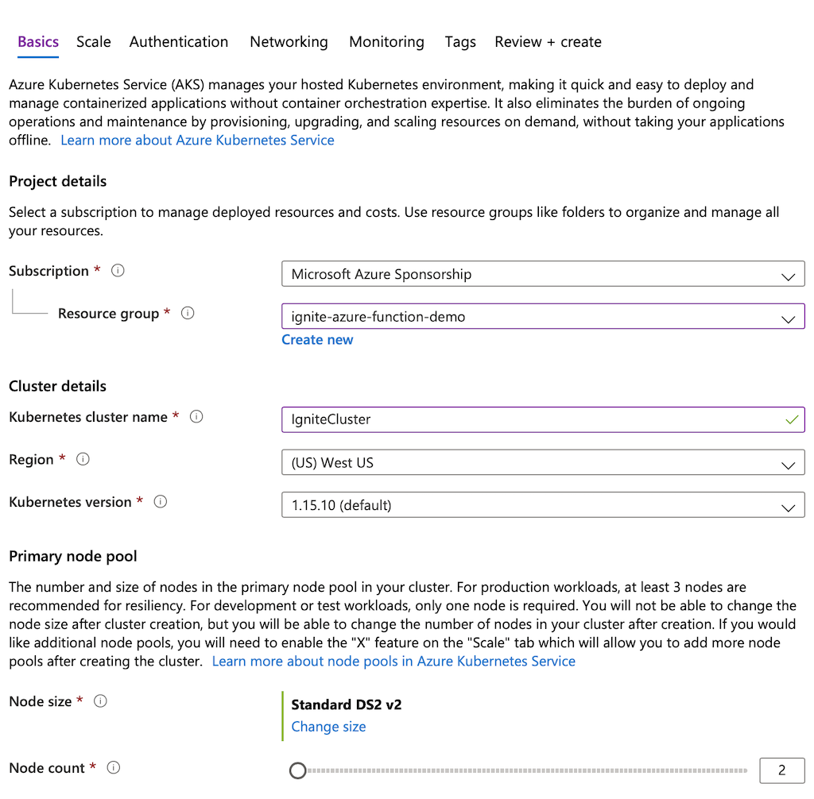
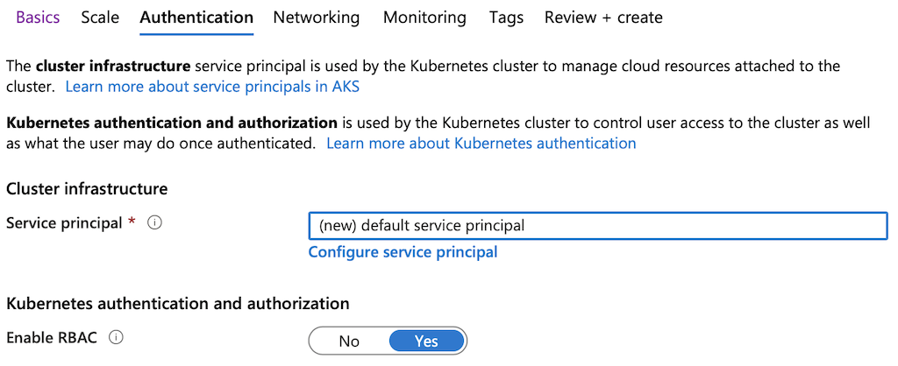
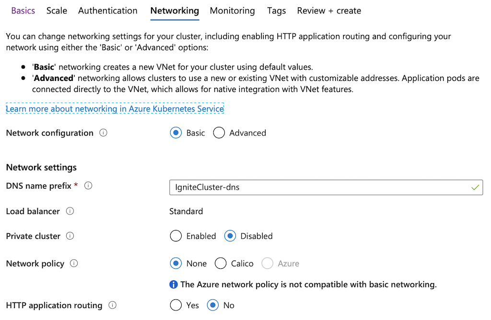
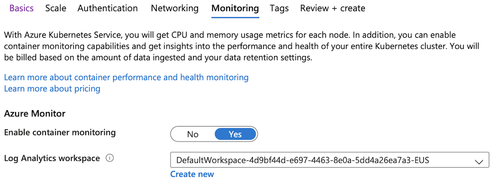
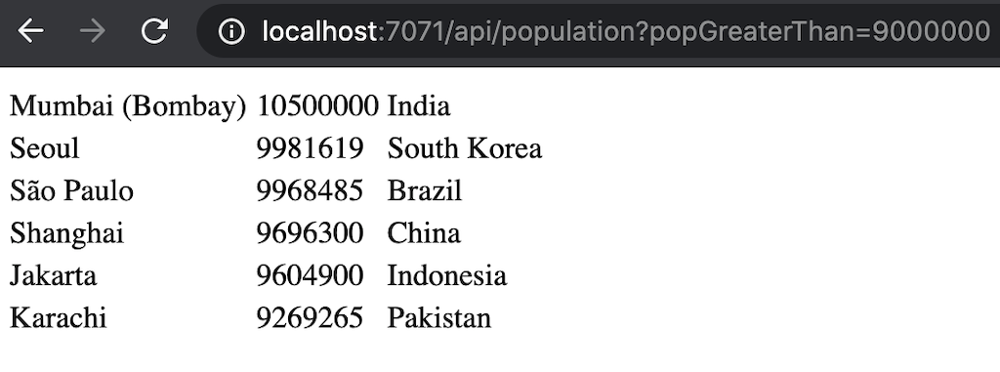

# Serverless Computing With Ignite and Azure Functions

## Introduction

This tutorial walks you through the process of creating an application that makes use of serverless and in-memory computing. Serverless computing is a new way of cloud-native application development and hosting, while in-memory computing is a software and data-processing technique that stores data sets in memory across a cluster of interconnected nodes. With serverless computing, you can focus on application logic creation, letting a cloud vendor provide, manage, and scale the needed infrastructure. In contrast, with in-memory computing, you can process your data 100-1000x faster than with disk-based databases.

You will build a serverless Azure Function that uses the Apache Ignite in-memory computing platform as a database and compute engine. The function will respond to several HTTP requests and use Ignite SQL with compute APIs to perform requested computations.

An Apache Ignite cluster will be deployed in and managed by Azure Kubernetes Service (AKS). Your Azure Function will be interacting with the cluster using the Java thin client and a REST endpoint open on the Ignite end.

By the end of the tutorial, you are going to finish this sample [GitHub project](https://github.com/GridGain-Demos/ignite-azure-function-tutorial) by adding a complete implementation of the Azure Function. Also, the project includes configuration files that will help to expedite Ignite deployment and the function deployment in Azure.

## What you Need

- A Microsoft Azure account with an active subscription.
- [Azure CLI](https://docs.microsoft.com/en-us/cli/azure/install-azure-cli?view=azure-cli-latest) and [kubectl](https://kubernetes.io/docs/tasks/tools/install-kubectl/) tools.
- [Apache Ignite 2.8](https://ignite.apache.org/download.cgi#binaries) or later version.
- The Java Developer Kit, version 8.
- [Apache Maven 3.0](https://maven.apache.org) or later version.
- Favourite IDE such as IntelliJ IDEA or Eclipse.

## Deploy Kubernetes Cluster With AKS

Kubernetes will manage the Ignite cluster. In this section you will deploy a 2-node Kubernetes cluster with [AKS](https://azure.microsoft.com/en-us/services/kubernetes-service/).

1. Go to [https://portal.azure.com/](https://portal.azure.com), locate `Kubernetes Service` in the marketplace and start defining the Kubernetes cluster's basic parameters.

1. Create a `Resource group` named `ignite-azure-function-demo`, set the cluster name to `IgniteCluster` and `Node count` to `2`. Change other settings only if you are sure that's needed.

   

1. Jump to the `Authentication` settings screen. Select your `Service principal` and ensure RBAC is enabled.

   

1. Go to the `Networking` tab and set `DNS name prefix` to `IgniteCluster-dns`. Leave other parameters unchanged unless it's required.

   

1. Enable monitoring feature of Azure by proceeding to the `Monitoring` screen.

   

1. Validate the configuration parameters on the `Review+create` screen and bootstrap Kubernetes by clicking on the `Create` button.

1. Once Azure finishes provisioning of the requested resources, open a command-line terminal and use the [Azure CLI](https://docs.microsoft.com/en-us/cli/azure/install-azure-cli?view=azure-cli-latest) tool to import the resource group credentials:

   ```bash
   az aks get-credentials --resource-group ignite-azure-function-demo --name IgniteCluster
   ```

1. Finally, use [kubectl](https://kubernetes.io/docs/tasks/tools/install-kubectl/) to confirm that the Kubernetes cluster is accessible from your environment:

   ```bash
   kubectl get nodes
   ```

   The command should produce an output similar to this:

   ```bash
   NAME                                STATUS   ROLES   AGE   VERSION
   aks-agentpool-41263829-vmss000000   Ready    agent   13m   v1.15.10
   aks-agentpool-41263829-vmss000001   Ready    agent   13m   v1.15.10
   ```

## Deploy Apache Ignite Cluster in Kubernetes

In this section you will learn to create a 2-node Ignite cluster within the Kubernetes environment and make it accessible through an instance of the Kubernetes Service.

1. Start with downloading the [Azure Functions With Apache Ignite GitHub project](https://github.com/GridGain-Demos/ignite-azure-function-tutorial) that comes with predefined configuration files and source code templates, which you will be using later while developing an Azure Function. The project includes several Kubernetes-specific configuration files located in the `sample_project_root/cfg` folder. Open that folder and create a unique namespace for the Ignite cluster:

   ```bash
   cd {sample_project_root}/cfg

   kubectl create namespace ignite-azure-function-demo
   ```

1. Create a service account:

   ```bash
   kubectl create sa ignite-azure-function-demo -n ignite-azure-function-demo
   ```

1. Create a cluster role and the role binding:

   ```bash
   kubectl create -f ignite-cluster-role.yaml
   ```

1. Proceed with the Ignite Service creation that will serve as a Kubernetes LoadBalancer letting Azure Function's logic interact with Ignite through open network ports and interfaces:

   ```bash
   kubectl create -f ignite-service.yaml
   ```

1. Deploy the 2-nodes Ignite cluster with the settings from `ignite-deployment.yaml` file:

   ```bash
   kubectl create -f ignite-deployment.yaml
   ```

1. Confirm that the cluster is up-and-running:

   ```bash
   kubectl get pods -n ignite-azure-function-demo
   ```

   The command should produce an output similar to the one below:

   ```bash
   NAME                             READY   STATUS    RESTARTS   AGE
   ignite-cluster-dfb6489c5-4wv57   1/1     Running   0          28s
   ignite-cluster-dfb6489c5-xpxdm   1/1     Running   0          28s
   ```

1. Find the external IP address that was given to the Ignite Service by Kubernetes. You can obtain it by taking the value of `EXTERNAL-IP` reported by the following command:

   ```bash
   kubectl get svc ignite-service --namespace=ignite-azure-function-demo
   ```

1. Check that Ignite is reachable outside of Kubernetes by opening the URL `http://YOUR-EXTERNAL-IP:8080/ignite?cmd=version` in your browser or by using `curl`:

   ```bash
   curl http://YOUR-EXTERNAL-IP:8080/ignite?cmd=version
   ```

   The response should be as follows, meaning that Ignite REST endpoints are open and ready to process the API requests:

   ```bash
   {"successStatus":0,"sessionToken":null,"error":null,"response":"2.8.0"}
   ```

## Load Data to Apache Ignite With JDBC Driver

Now that the cluster running and reachable, your next step is to load it with sample data. The sample project that you downloaded in the previous section includes the `sample_project_root/cfg/ignite_world_db.sql` file that creates a database of countries and cities. The database is simple and perfectly suited for experiments with various Ignite capabilities.

Check `ignite_world_db.sql` for the following key settings:

- Records of `City` table are co-located with `Country` table by setting the `affinityKey=CountryCode` parameter in the `CREATE TABLE City` statement. With [affinity co-location](../../architecture/data-modeling/affinity-colocation.md) in place, your Azure Function will be able to run high-performance SQL with JOINs and schedule compute tasks that iterate through related data of a particular cluster node.
- `CREATE TABLE` statements of all the tables set `CACHE_NAME` and `value_type` parameters to specific values. You need this to access the records with Ignite cache and key-value APIs.

Follow the steps below to load sample data using the Apache Ignite JDBC driver:

1. To get the driver, download the [Apache Ignite binary distribution](https://ignite.apache.org/download.cgi#binaries) of 2.8 or later version and unpackage it in a local directory. Go to the `bin` folder of that local directory:

   ```bash
   cd {ignite-binary-release}/bin/
   ```

1. Open a JDBC connection to your cluster by using the [SQLLine tool](../../gridgain8-development/tools/sqlline.md) shipped with Ignite (use `sqlline.bat` for Windows):

   ```bash
   ./sqlline.sh -u jdbc:ignite:thin://YOUR-EXTERNAL-IP/
   ```

1. Once the connection is established, load the database of countries and cities:

   ```bash
   !run {sample_project_root}/cfg/ignite_world_db.sql
   ```

1. Run the `!table` command to confirm the following three tables are created in Ignite:

   ```bash
   +--------------------------------+--------------------------------+------------+
   |           TABLE_CAT            |          TABLE_SCHEM           |            |
   +--------------------------------+--------------------------------+------------+
   | IGNITE                         | PUBLIC                         | CITY       |
   | IGNITE                         | PUBLIC                         | COUNTRY    |
   | IGNITE                         | PUBLIC                         | COUNTRYLAN |
   ```

1. Close the JDBC connection by executing the `!exit` command.

With this step finished, you are ready to develop an Azure Function that will serve a couple of requests and delegate their processing to the Ignite cluster managed by Azure Kubernetes Service.

## Develop Azure Function

Now you will develop an Azure Function that serves two types of HTTP requests. The function will send Ignite SQL queries via a [thin client](https://www.gridgain.com/docs/gridgain8/latest/developers-guide/thin-clients/java-thin-client) connection to process the first request. With the second request, you will learn how to use [Ignite REST APIs](../../gridgain8-development/rest-api.md) to trigger the execution of compute tasks.

Open the sample project in your favorite IDE, such as IntelliJ IDEA or Eclipse, and locate the `org.gridgain.demo.azurefunction.functions.AzurePopulationFunction` class, which is a source code template with a single method annotated with `@FunctionName("population")`. Once you finish this section, the method will embody the Azure Function's logic that processes HTTP requests.


Make sure the sample project as well as Maven use Java 1.8. Currently, Azure Functions do not support later versions of Java.


### Establish Thin Client Connection

1. Add the following fields to the `AzurePopulationFunction` class:

   ```java
   private static final Object monitor = new Object();

   private static volatile IgniteClient thinClient;

   //Set the address to the EXTERNAL-IP of the Ignite Kubernetes Service
   private static final String CLUSTER_IP = "YOUR-EXTERNAL-IP";
   ```

1. Initialize the `CLUSTER_IP` field with the external IP address of your Ignite Kubernetes Service.

1. Introduce the method that will be opening a single thin client connection. This instance will be reused for multiple invocations of the Azure Function:

   ```java
   private IgniteClient getThinClientConnection() {
       if (thinClient == null) {
           synchronized (monitor) {
               ClientConfiguration cfg = new ClientConfiguration().setAddresses(CLUSTER_IP + ":10800");

               thinClient = Ignition.startClient(cfg);
           }
       }

       return thinClient;
   }
   ```

### Retrieve Most Populated Cities

The function will process HTTP requests asking to return all the cities with population greater than a given number. Ignite SQL engine handles such queries by filtering out records that do not meet the search criteria as well as by joining, grouping, and ordering of the distributed data.

Add an implementation of the method to the `AzurePopulationFunction` class, which queries Ignite with SQL via the thin client connection:

```java
private HttpResponseMessage getCitiesPopulationGreaterThan(int population, HttpRequestMessage<Optional<String>> request) {
    SqlFieldsQuery sqlQuery = new SqlFieldsQuery("SELECT city.name, city.population, country.name " +
        "FROM city JOIN country ON city.countrycode = country.code WHERE city.population >= ? " +
        "GROUP BY country.name, city.name, city.population ORDER BY city.population DESC, city.name")
        .setArgs(population);

    List<List<?>> result = getThinClientConnection().query(sqlQuery).getAll();

    HttpResponseMessage.Builder responseBuilder = request.createResponseBuilder(HttpStatus.OK);

    responseBuilder.header("Content-Type", "text/html");

    StringBuilder response = new StringBuilder("<html><body><table>");

    for (List<?> row: result) {
        response.append("<tr>");

        for (Object column: row)
            response.append("<td>").append(column).append("</td>");

        response.append("</tr>");
    }

    response.append("</table></body></html>");

    return responseBuilder.body(response.toString()).build();
}
```

Once Ignite responds, the function will wrap result set's records into an HTML format.

### Calculate Average Population

Add another method to the `AzurePopulationFunction` class, which calculates the average population across all the cities of a given country:

```java
private HttpResponseMessage getAvgPopulationInCountry(String countryCode, HttpRequestMessage<Optional<String>> request) {
    CloseableHttpClient httpClient = HttpClients.createDefault();

    HttpGet httpGet = new HttpGet("http://" + CLUSTER_IP +
        ":8080/ignite?cmd=exe&name=org.gridgain.demo.azurefunction.compute.AvgCalculationTask&p1=" + countryCode);

    CloseableHttpResponse response = null;

    try {
        response = httpClient.execute(httpGet);

        HttpEntity entity1 = response.getEntity();

        StringWriter writer = new StringWriter();
        IOUtils.copy(entity1.getContent(), writer, StandardCharsets.US_ASCII);

        return request.createResponseBuilder(HttpStatus.OK).body(writer.toString()).build();

    } catch (IOException e) {
        e.printStackTrace();
        return request.createResponseBuilder(HttpStatus.BAD_GATEWAY).body(
            "Failed to execute the request: " + e.getMessage()).build();
    }
    finally {
        try {
            if (response != null)
                response.close();
        }
        catch (IOException e) {
            e.printStackTrace();
        }
    }
}
```

The method triggers the execution of `org.gridgain.demo.azurefunction.compute.AvgCalculationTask` compute task with the help of Ignite's [execute command](../../gridgain8-development/rest-api.md) supported by its REST API. [Ignite Compute APIs](../../gridgain8-development/distributed-computing/distributed-computing.md) are the right fit for such types of requests as long as they allow to run data-intensive or compute-intensive Java logic on specific cluster nodes with no or minimal data movement between the cluster and applications.

If you check the implementation of `AvgCalculationTask` located in the sample project, you will see that once triggered, the task will determine a cluster node that stores all the cities of the given country and will request only that node to traverse through the local data calculating the population average. This technique is known as [co-located data processing](https://ignite.apache.org/features/collocated-processing.html).


`AvgCalculationTask` compute task's class was added to the classpath of the Ignite server nodes when they were deployed in Kubernetes. The class is added to the pre-compiled `ignite-azure-function-demo-1.0-SNAPSHOT.jar` file that is referenced from `EXTERNAL_LIBS` parameter of `sample_project_root\cfg\ignite-deployment.yaml`.

If you decide to modify `AvgCalculationTask`, then rebuilt the project artifact with the `mvn clean package` command, upload the jar somewhere, and update the value of the `EXTERNAL_LIBS` parameter.


### Handle User Requests

Replace the `AzurePopulationFunction.run(...)` method implementation with the following logic:

```java
@FunctionName("population")
public HttpResponseMessage run(
        @HttpTrigger(name = "req", methods = {HttpMethod.GET, HttpMethod.POST}, authLevel = AuthorizationLevel.ANONYMOUS) HttpRequestMessage<Optional<String>> request,
        final ExecutionContext context) {
    context.getLogger().info("Java HTTP trigger processed a request.");

    // Determining a type of request
    String query = request.getQueryParameters().get("popGreaterThan");
    String paramValue = request.getBody().orElse(query);

    if (paramValue != null)
        //Getting all the cities with population greater or equal to the specified one.
        return getCitiesPopulationGreaterThan(Integer.valueOf(paramValue), request);

    query = request.getQueryParameters().get("avgInCountry");
    paramValue = request.getBody().orElse(query);

    if (paramValue != null)
        //Calculating average population in the country.
        return getAvgPopulationInCountry(paramValue, request);

    return request.createResponseBuilder(HttpStatus.BAD_REQUEST).body(
        "Not enough parameters are passed to complete your request").build();
}
```

Once deployed, the Azure Function will intercept queries at `/api/population` endpoint, and depending on the query, the parameters will call one of previously added class methods:

- If the `popGreaterThan` parameter is present in the query, then the function will execute the `AzurePopulationFunction.getCitiesPopulationGreaterThan(...)` method.
- Otherwise, the function expects to see the `avgInCountry` parameter to execute the logic of the `AzurePopulationFunction.getAvgPopulationInCountry(...)` method.

That's it. You've developed the Azure Function that works with Ignite as a in-memory database and compute engine. The next step is to test the implementation locally and deploy it to Azure.

### Complete Function Implementation

Below is a complete implementation of the `AzurePopulationFunction` class that you might want to compare with your version. Only the value of the `CLUSTER_IP` field should be different on your side.

```java
package org.gridgain.demo.azurefunction.functions;

import java.io.IOException;
import java.io.StringWriter;
import java.nio.charset.StandardCharsets;
import java.util.*;
import com.microsoft.azure.functions.annotation.*;
import com.microsoft.azure.functions.*;
import org.apache.commons.io.IOUtils;
import org.apache.http.HttpEntity;
import org.apache.http.client.methods.CloseableHttpResponse;
import org.apache.http.client.methods.HttpGet;
import org.apache.http.impl.client.CloseableHttpClient;
import org.apache.http.impl.client.HttpClients;
import org.apache.ignite.Ignition;
import org.apache.ignite.cache.query.SqlFieldsQuery;
import org.apache.ignite.client.IgniteClient;
import org.apache.ignite.configuration.ClientConfiguration;

/**
 * Azure Functions with HTTP Trigger.
 */
public class AzurePopulationFunction {

    private static final Object monitor = new Object();

    private static volatile IgniteClient thinClient;

    //Set the address to the EXTERNAL-IP of the Ignite Kubernetes Service
    private static final String CLUSTER_IP = "YOUR-EXTERNAL-IP";

    /**
     * This function listens at endpoint "/api/population" and processes two types of requests:
     *
     */
    @FunctionName("population")
    public HttpResponseMessage run(
            @HttpTrigger(name = "req", methods = {HttpMethod.GET, HttpMethod.POST}, authLevel = AuthorizationLevel.ANONYMOUS) HttpRequestMessage<Optional<String>> request,
            final ExecutionContext context) {
        context.getLogger().info("Java HTTP trigger processed a request.");

        // Determining a type of request
        String query = request.getQueryParameters().get("popGreaterThan");
        String paramValue = request.getBody().orElse(query);

        if (paramValue != null)
            //Getting all the cities with population greater or equal to the specified one.
            return getCitiesPopulationGreaterThan(Integer.valueOf(paramValue), request);

        query = request.getQueryParameters().get("avgInCountry");
        paramValue = request.getBody().orElse(query);

        if (paramValue != null)
            //Calculating average population in the country.
            return getAvgPopulationInCountry(paramValue, request);

        return request.createResponseBuilder(HttpStatus.BAD_REQUEST).body(
            "Not enough parameters are passed to complete your request").build();
    }

    private HttpResponseMessage getCitiesPopulationGreaterThan(int population, HttpRequestMessage<Optional<String>> request) {
        SqlFieldsQuery sqlQuery = new SqlFieldsQuery("SELECT city.name, city.population, country.name " +
            "FROM city JOIN country ON city.countrycode = country.code WHERE city.population >= ? " +
            "GROUP BY country.name, city.name, city.population ORDER BY city.population DESC, city.name")
            .setArgs(population);

        List<List<?>> result = getThinClientConnection().query(sqlQuery).getAll();

        HttpResponseMessage.Builder responseBuilder = request.createResponseBuilder(HttpStatus.OK);

        responseBuilder.header("Content-Type", "text/html");

        StringBuilder response = new StringBuilder("<html><body><table>");

        for (List<?> row: result) {
            response.append("<tr>");

            for (Object column: row)
                response.append("<td>").append(column).append("</td>");

            response.append("</tr>");
        }

        response.append("</table></body></html>");

        return responseBuilder.body(response.toString()).build();
    }

    private HttpResponseMessage getAvgPopulationInCountry(String countryCode, HttpRequestMessage<Optional<String>> request) {
        CloseableHttpClient httpClient = HttpClients.createDefault();

        HttpGet httpGet = new HttpGet("http://" + CLUSTER_IP +
            ":8080/ignite?cmd=exe&name=org.gridgain.demo.azurefunction.compute.AvgCalculationTask&p1=" + countryCode);

        CloseableHttpResponse response = null;

        try {
            response = httpClient.execute(httpGet);

            HttpEntity entity1 = response.getEntity();

            StringWriter writer = new StringWriter();
            IOUtils.copy(entity1.getContent(), writer, StandardCharsets.US_ASCII);

            return request.createResponseBuilder(HttpStatus.OK).body(writer.toString()).build();

        } catch (IOException e) {
            e.printStackTrace();
            return request.createResponseBuilder(HttpStatus.BAD_GATEWAY).body(
                "Failed to execute the request: " + e.getMessage()).build();
        }
        finally {
            try {
                if (response != null)
                    response.close();
            }
            catch (IOException e) {
                e.printStackTrace();
            }
        }
    }

    private IgniteClient getThinClientConnection() {
        if (thinClient == null) {
            synchronized (monitor) {
                ClientConfiguration cfg = new ClientConfiguration().setAddresses(CLUSTER_IP + ":10800");

                thinClient = Ignition.startClient(cfg);
            }
        }

        return thinClient;
    }
}
```

## Set Unique Azure Function Name

To avoid possible naming conflicts, open the `{sample_project_root}/pom.xml` file and adjust the value of the `<functionAppName>` parameter to `ignite-azure-function-demo-{your-name}-{some-random-number}` format. Otherwise, you may fail to deploy your function in case someone else has it running in Azure with the default name set in `pom.xml`.

## Test Azure Function Locally

Before deploying the function to Azure, you can confirm that it works as expected in your local development environment. To do that:

1. Open the terminal and go to the root of the sample project:

   ```bash
   cd {sample_project_root}
   ```

1. Build the package with Maven:

   ```bash
   mvn clean package -DskipTests
   ```

1. Deploy the function locally:

   ```bash
   mvn azure-functions:run
   ```


   Make sure the sample project as well as Maven use Java 1.8 to build the artifacts. Currently, Azure Functions do not support later versions of Java.


1. Look for a line similar to `population: [GET,POST] http://localhost:7071/api/population` in the output of the previous command.

1. Assuming that the function listens for incoming requests on port number 7071, open the following page in your browser window [http://localhost:7071/api/population?popGreaterThan=9000000](http://localhost:7071/api/population?popGreaterThan=9000000). The function will return all the cities with a population equal or more than 9 million people:

   

1. Next, see what is the average population of the cities in the United States by opening this URL - [http://localhost:7071/api/population?avgInCountry=USA](http://localhost:7071/api/population?avgInCountry=USA). Look for the following info in the response:

   ```bash
   Calculation Result [avgPopulation=286955, citiesCount=274, partition=354, nodeId=8c8c51aa-02fc-42fc-a488-9447eecb674b, nodeAddresses=[10.244.0.11, 127.0.0.1]]
   ```

   In addition to the average population (`avgPopulation`) and number of cities in the country (`citiesCount`), the response includes the `partition` number that keeps all the cities of the USA and some details (`nodeId` and `nodeAddresses`) about the cluster node that stores the primary copy of the partition.

You can experiment with the function by passing different values to `/api/population?popGreaterThan=?` and `/api/population?avgInCountry=?` URLs. The latter requires to pass a country code in the [ISO Alpha-3 format](https://www.nationsonline.org/oneworld/country_code_list.htm) (aka. three letter code).

## Deploy Function to Azure

Finally, you can now deploy the function to Azure. To do that:

1. Stay in the root directory of the sample project and log in with Azure from the terminal:

   ```bash
   az login
   ```

1. Build the package (skip this test if you completed the previous step of this tutorial by testing the function locally):

   ```bash
   mvn clean package -DskipTests
   ```

1. Start deploying the function by executing the following Maven task defined in `pom.xml` of the sample project:

   ```bash
   mvn azure-functions:deploy
   ```

   When the function is deployed, Azure will assign a public address to the function that should look like as follows (locate a similar line in the Maven output):

   ```bash
   [INFO] Successfully deployed the function app at https://ignite-azure-function-demo-20200417133129560.azurewebsites.net.
   ```

1. Open `https://YOUR-AZURE-FUNCTION-NAME.azurewebsites.net/api/population?popGreaterThan=9000000` in your browser to see the function working. Play with the function by passing different values to `popGreaterThan` and `avgInCountry` request parameters the way it was done in the previous section when you tested everything locally.

Congratulations! You've completed the tutorial and learned how to use serverless and in-memory computing together.

## Related

- [Configure Ignite Persistence](../../gridgain8-management/installation/kubernetes/azure-deployment.md#kubernetes-configuration) for your Azure Kubernetes Service deployment to keep full copy of records on disk and to enable fast restarts of the Ignite cluster.
