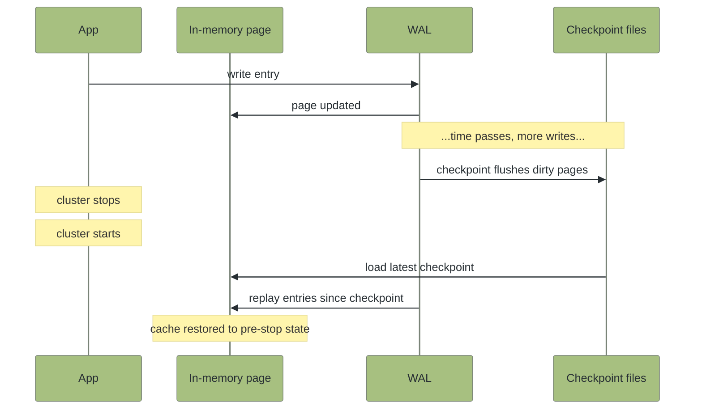

# Beyond Cache: The Persistence Problem

## Introduction

In [Cache-Aside Under Load](../cache-centric-foundations/cache-aside-under-load.md), MariaDB held the truth and the cache absorbed read pressure. Production ran two systems, and the cache could be wiped at any moment without losing data.

This tutorial inverts that arrangement. Native persistence makes the cache itself the durable store. Configure persistence on the data region, load 10 customers, stop the cluster, start it again, and read all 10 customers back. There is no parent database.

Native persistence answers a recovery problem that snapshot-based stores cannot solve cleanly. A periodic snapshot leaves a window between writes, and whatever happened in that window is gone after a crash. An append-only command log captures every write but grows without bound. The production answer in those systems is to pair the cache with a SQL store, or accept the recovery semantics.

Native persistence is page-level. Every write hits the Write-Ahead Log before the in-memory page changes, and periodic checkpoints flush dirty pages to disk. On restart, the cluster loads the latest checkpoint and replays the WAL forward. Recovery is WAL replay time, not snapshot interval.

This is the only tutorial in the path that changes the cluster image. Persistence is configured at startup. The engine does not support flipping the flag on a running cluster. You build a parallel `cache-cluster-persistent/` and a parallel Maven project alongside the in-memory ones from the rest of the path.

## Prerequisites

- **Completion of [Cache-Aside Under Load](../cache-centric-foundations/cache-aside-under-load.md).** That tutorial established the cache-as-accelerator architecture this tutorial inverts.
- **Docker Compose 2.23** or later.
- **Java 11** or later for the client runtime.
- **Maven 3.6** or later.
- **No other GridGain 8 cluster running on ports 47500, 47100, or 10800.** This tutorial uses the same port assignment as the rest of the path. Stop any cluster on those ports before starting the one this tutorial creates.

This tutorial creates a fresh `cache-cluster-persistent/` directory and a fresh `native-persistence/` Maven project. The `cache-cluster/` and previous Maven projects from the path stay where they are. Nothing is modified.

## What You Will Learn

- How a single boolean flag on the data region turns the cache into a durable store
- Why a fresh persistent cluster starts INACTIVE and what activation actually does
- What baseline topology pins and how the cluster auto-activates when the full baseline rejoins
- Where on disk the cache, the WAL, and the checkpoint files live, and what they look like after a restart
- When native persistence is the right answer and when CacheStore write-through still fits

## What You Will Build

A single-node persistent GridGain cluster running in Docker, configured with the data region's `persistenceEnabled` flag turned on. A small Maven project with three programs: one to activate the cluster and report the baseline, one to seed 10 customer rows, and one to verify those rows survive a stop and start of the container.

By the end, you will have stopped the cluster, started it again, and watched every entry the cache held before the stop come back without any reload from an external source.

## Configure the Persistent Cluster

The persistent cluster runs on the same image as the in-memory cluster from the path. The change is the configuration: a `dataStorageConfiguration` block that turns on `persistenceEnabled` for the default data region and points the WAL at a writable directory. The data region is the cluster's memory-and-disk topology unit. Caches reside in regions, and persistence is regional, not per-cache. One flag, one place, every cache that lands in this region inherits durability.

Create a `cache-cluster-persistent/` directory in your working tree. The two files below ship inline in this tutorial. Copy each into the new directory.

<details>
<summary><code>cache-cluster-persistent/docker-compose.yml</code></summary>


```yaml
name: gridgain8-persistent

services:
  node1:
    image: gridgain/enterprise:8.9.32
    platform: linux/amd64
    container_name: gridgain8-persistent-node1
    hostname: node1
    user: "0"
    ports:
      - "47500:47500"
      - "47100:47100"
      - "10800:10800"
    volumes:
      - ./ignite-config-persistent.xml:/config/ignite-config.xml:ro
      - ./gridgain-license.xml:/opt/gridgain/gridgain-license.xml:ro
      - db:/opt/gridgain/work
      - wal:/wal
    environment:
      CONFIG_URI: /config/ignite-config.xml
      JVM_OPTS: "-Xms512m -Xmx1g"

volumes:
  db:
  wal:
```


</details>

The GridGain 8 compose pins `user: "0"` so the container can write to the named volumes. Without it the container's default user (`uid=10000`) cannot create the per-node directories the WAL writer needs. The compose also mounts the same enterprise license file the rest of the path uses. Native persistence is included in GridGain 8.9.32 Enterprise with the standard license, no per-feature configuration required.

<details>
<summary><code>cache-cluster-persistent/ignite-config-persistent.xml</code></summary>


```xml
<?xml version="1.0" encoding="UTF-8"?>
<beans xmlns="http://www.springframework.org/schema/beans"
       xmlns:xsi="http://www.w3.org/2001/XMLSchema-instance"
       xsi:schemaLocation="http://www.springframework.org/schema/beans
       http://www.springframework.org/schema/beans/spring-beans.xsd">

    <bean class="org.apache.ignite.configuration.IgniteConfiguration">
        <property name="dataStorageConfiguration">
            <bean class="org.apache.ignite.configuration.DataStorageConfiguration">
                <property name="defaultDataRegionConfiguration">
                    <bean class="org.apache.ignite.configuration.DataRegionConfiguration">
                        <property name="name" value="default"/>
                        <property name="persistenceEnabled" value="true"/>
                    </bean>
                </property>
                <property name="walPath" value="/wal"/>
                <property name="walArchivePath" value="/wal/archive"/>
            </bean>
        </property>

        <property name="discoverySpi">
            <bean class="org.apache.ignite.spi.discovery.tcp.TcpDiscoverySpi">
                <property name="localPort" value="47500"/>
                <property name="localPortRange" value="1"/>
                <property name="ipFinder">
                    <bean class="org.apache.ignite.spi.discovery.tcp.ipfinder.vm.TcpDiscoveryVmIpFinder">
                        <property name="addresses">
                            <list>
                                <value>node1:47500</value>
                            </list>
                        </property>
                    </bean>
                </property>
            </bean>
        </property>

        <property name="communicationSpi">
            <bean class="org.apache.ignite.spi.communication.tcp.TcpCommunicationSpi">
                <property name="localPort" value="47100"/>
                <property name="localPortRange" value="1"/>
            </bean>
        </property>

        <property name="addressResolver">
            <bean class="org.apache.ignite.configuration.BasicAddressResolver">
                <constructor-arg>
                    <map>
                        <entry key="node1" value="127.0.0.1"/>
                    </map>
                </constructor-arg>
            </bean>
        </property>
    </bean>
</beans>
```


</details>

The four blocks each have a job. `dataStorageConfiguration` declares the persistent region and points the WAL at the `/wal` mount. `discoverySpi` and `communicationSpi` pin the discovery and communication ports so the host JVM client knows exactly where to connect. `addressResolver` rewrites the container's announced hostname (`node1`) to `127.0.0.1`. Without that rewrite, the server would tell the client to talk to its container-internal address (`172.18.0.2`), which the host JVM cannot reach.

GridGain 8 needs one more file. Copy the same `gridgain-license.xml` from the rest of the path into `cache-cluster-persistent/`.


**Checkpoint:** The `cache-cluster-persistent/` directory contains `docker-compose.yml`, `ignite-config-persistent.xml`, and (for GridGain 8) `gridgain-license.xml`.


Start the cluster.

```bash
docker compose -f cache-cluster-persistent/docker-compose.yml up -d
```

Read the startup logs and confirm the persistent default region was declared.

```bash
docker compose -f cache-cluster-persistent/docker-compose.yml logs node1 | grep -E "Data Regions|persistence|INACTIVE"
```

Expected output:

```
[INFO] Data Regions Started: 5
[INFO]     ^--   default region [type=default, persistence=true, lazyAlloc=true, ...]
[INFO] >>> Ignite cluster is in INACTIVE state (limited functionality available). Use control.(sh|bat) script or IgniteCluster.state(ClusterState.ACTIVE) to change the state.
```

Two things matter in this output. The `default region` has `persistence=true`, which means any cache that lands in the default region is backed by disk. The cluster is also INACTIVE. You have to activate it explicitly before the cache accepts writes.


**Checkpoint:** The default region shows `persistence=true` in the startup logs and the cluster reports `INACTIVE` state.


## Activate the Cluster

Persistent clusters start INACTIVE on first start. Activation is explicit and one-time per cluster lifecycle. Once activated, the cluster persists the activation decision across restarts. On subsequent starts the cluster auto-activates when all baseline nodes rejoin.

Create a fresh Maven project alongside `cache-cluster-persistent/`.

<details>
<summary><code>native-persistence/pom.xml</code></summary>


```xml
<?xml version="1.0" encoding="UTF-8"?>
<project xmlns="http://maven.apache.org/POM/4.0.0"
         xmlns:xsi="http://www.w3.org/2001/XMLSchema-instance"
         xsi:schemaLocation="http://maven.apache.org/POM/4.0.0 http://maven.apache.org/xsd/maven-4.0.0.xsd">
    <modelVersion>4.0.0</modelVersion>

    <groupId>com.example</groupId>
    <artifactId>native-persistence</artifactId>
    <version>1.0-SNAPSHOT</version>
    <packaging>jar</packaging>

    <properties>
        <maven.compiler.release>8</maven.compiler.release>
        <project.build.sourceEncoding>UTF-8</project.build.sourceEncoding>
        <gridgain.version>8.9.32</gridgain.version>
        <exec.mainClass>com.example.PersistenceConfig</exec.mainClass>
    </properties>

    <repositories>
        <repository>
            <id>GridGain External Repository</id>
            <url>https://www.gridgainsystems.com/nexus/content/repositories/external</url>
        </repository>
    </repositories>

    <dependencies>
        <dependency>
            <groupId>org.gridgain</groupId>
            <artifactId>gridgain-core</artifactId>
            <version>${gridgain.version}</version>
        </dependency>
        <dependency>
            <groupId>org.gridgain</groupId>
            <artifactId>ignite-spring</artifactId>
            <version>${gridgain.version}</version>
        </dependency>
        <dependency>
            <groupId>org.gridgain</groupId>
            <artifactId>ignite-slf4j</artifactId>
            <version>${gridgain.version}</version>
        </dependency>
        <dependency>
            <groupId>org.slf4j</groupId>
            <artifactId>slf4j-simple</artifactId>
            <version>1.7.36</version>
        </dependency>
    </dependencies>

    <build>
        <plugins>
            <plugin>
                <groupId>org.codehaus.mojo</groupId>
                <artifactId>exec-maven-plugin</artifactId>
                <version>3.2.0</version>
                <configuration>
                    <executable>java</executable>
                    <arguments>
                        <argument>--add-opens=java.base/jdk.internal.misc=ALL-UNNAMED</argument>
                        <argument>--add-opens=java.base/sun.nio.ch=ALL-UNNAMED</argument>
                        <argument>--add-opens=java.base/java.io=ALL-UNNAMED</argument>
                        <argument>--add-opens=java.base/java.nio=ALL-UNNAMED</argument>
                        <argument>--add-opens=java.base/java.net=ALL-UNNAMED</argument>
                        <argument>--add-opens=java.base/java.util=ALL-UNNAMED</argument>
                        <argument>--add-opens=java.base/java.util.concurrent=ALL-UNNAMED</argument>
                        <argument>--add-opens=java.base/java.util.concurrent.locks=ALL-UNNAMED</argument>
                        <argument>--add-opens=java.base/java.lang=ALL-UNNAMED</argument>
                        <argument>--add-opens=java.base/java.lang.invoke=ALL-UNNAMED</argument>
                        <argument>--add-opens=java.base/java.math=ALL-UNNAMED</argument>
                        <argument>--add-opens=java.sql/java.sql=ALL-UNNAMED</argument>
                        <argument>--add-opens=java.base/java.lang.reflect=ALL-UNNAMED</argument>
                        <argument>--add-opens=java.base/java.time=ALL-UNNAMED</argument>
                        <argument>--add-opens=java.base/java.text=ALL-UNNAMED</argument>
                        <argument>--add-opens=java.management/sun.management=ALL-UNNAMED</argument>
                        <argument>--add-opens=jdk.management/com.sun.management.internal=ALL-UNNAMED</argument>
                        <argument>-classpath</argument>
                        <classpath/>
                        <argument>${exec.mainClass}</argument>
                    </arguments>
                </configuration>
            </plugin>
        </plugins>
    </build>
</project>
```


GridGain 8 artifacts are not on Maven Central. The `<repositories>` block points Maven at the GridGain external Nexus.

</details>

The model class is a plain POJO. The lesson is durability, not schema.


```java
package com.example;

import java.io.Serializable;

/**
 * Customer POJO stored in the "Customer" cache with an Integer key.
 *
 * No QuerySqlField annotations on this model. Earlier tutorials in
 * the path teach SQL on the cache. This one teaches durability. The
 * cache only needs to round-trip the value, so a plain Serializable
 * POJO is enough. Persistence is regional, configured on the data
 * region the cache lands in, and is invisible at the model level.
 *
 * The cache key is a separate Integer (the customer id), not a field
 * on this class. The customerId field on the POJO duplicates the key
 * for print convenience.
 */
public class Customer implements Serializable {

    // Required because Customer implements Serializable. Under the
    // default BinaryMarshaller, BinaryObject metadata (field names and
    // types) drives cross-restart compatibility, not this value. The
    // declaration is kept for completeness and to silence IDE warnings.
    private static final long serialVersionUID = 1L;

    private Integer customerId;
    private String firstName;
    private String lastName;

    public Customer() {
    }

    public Customer(Integer customerId, String firstName, String lastName) {
        this.customerId = customerId;
        this.firstName = firstName;
        this.lastName = lastName;
    }

    public Integer getCustomerId() {
        return customerId;
    }

    public String getFirstName() {
        return firstName;
    }

    public String getLastName() {
        return lastName;
    }

    @Override
    public String toString() {
        return customerId + ": " + firstName + " " + lastName;
    }
}
```


The first program connects a thick client to the cluster, prints the current state, activates the cluster if it is INACTIVE, and reports the baseline.


```java
package com.example;

import org.apache.ignite.Ignite;
import org.apache.ignite.Ignition;
import org.apache.ignite.cluster.BaselineNode;
import org.apache.ignite.cluster.ClusterState;
import org.apache.ignite.configuration.IgniteConfiguration;
import org.apache.ignite.spi.discovery.tcp.TcpDiscoverySpi;
import org.apache.ignite.spi.discovery.tcp.ipfinder.vm.TcpDiscoveryVmIpFinder;

import java.util.Collection;
import java.util.Collections;

/**
 * One-time activation for a fresh persistent cluster.
 *
 * A persistent cluster does not start in a writable state. The
 * default region declares persistenceEnabled=true, but the cluster
 * itself begins INACTIVE. Writes are rejected and most cache
 * operations refuse to proceed. The operator (or a program like
 * this one) flips the cluster to ACTIVE exactly once, and the
 * decision is persisted. Subsequent restarts auto-activate when
 * every baseline node has rejoined.
 *
 * This program connects a thick client, prints the current state,
 * activates if needed, and reports the baseline. Running it again
 * on an already-active cluster is a no-op. The if-check makes the
 * activation idempotent.
 */
public class PersistenceConfig {

    public static void main(String[] args) {
        IgniteConfiguration cfg = new IgniteConfiguration();
        cfg.setClientMode(true);
        cfg.setIgniteInstanceName("native-persistence-config");

        TcpDiscoverySpi disco = new TcpDiscoverySpi();
        TcpDiscoveryVmIpFinder ipFinder = new TcpDiscoveryVmIpFinder();
        ipFinder.setAddresses(Collections.singletonList("127.0.0.1:47500"));
        disco.setIpFinder(ipFinder);
        cfg.setDiscoverySpi(disco);

        try (Ignite ignite = Ignition.start(cfg)) {
            // A fresh persistent cluster boots INACTIVE. Writes are
            // rejected until an operator (or a program like this) flips
            // it to ACTIVE. The activation decision persists across
            // restarts, so the if-check makes the call idempotent.
            ClusterState before = ignite.cluster().state();
            System.out.println("Initial cluster state: " + before);

            if (before == ClusterState.INACTIVE) {
                System.out.println("Activating cluster...");
                ignite.cluster().state(ClusterState.ACTIVE);
            }

            ClusterState after = ignite.cluster().state();
            System.out.println("Cluster state: " + after);

            // currentBaselineTopology() is the canonical set of nodes
            // the cluster expects to own persistent partitions. It is
            // null until first activation establishes it from the live
            // nodes. consistentId is the stable identifier used across
            // restarts. The on-disk directory is node00-<consistentId>.
            Collection<BaselineNode> baseline = ignite.cluster().currentBaselineTopology();
            if (baseline == null || baseline.isEmpty()) {
                System.out.println("Baseline: <not set>");
            } else {
                System.out.println("Baseline nodes (" + baseline.size() + "):");
                for (BaselineNode node : baseline) {
                    System.out.println("  consistentId=" + node.consistentId());
                }
            }
        }

        System.exit(0);
    }
}
```


Run the program. Compile first because `exec:exec` does not trigger compilation on its own.

```bash
mvn -f native-persistence/pom.xml -q compile
mvn -f native-persistence/pom.xml -q exec:exec
```

Expected output:

```
Initial cluster state: INACTIVE
Activating cluster...
Cluster state: ACTIVE
Baseline nodes (1):
  consistentId=51ea4b16-5490-4beb-a543-f0ff4fdb11c5
```

The `consistentId` value differs on your machine. The rest is identical.


**Checkpoint:** The cluster transitioned from INACTIVE to ACTIVE and reported one baseline node.


## Seed and Verify

Add a second class that creates the `Customer` cache and loads 10 rows. The cache API is the same as it was in the in-memory tutorials; persistence is invisible at the application level, so the calls below look like ordinary `cache.put` operations.

Create this file alongside `PersistenceConfig.java` and `Customer.java`. It is a separate `public static void main`, runnable independently.


```java
package com.example;

import org.apache.ignite.Ignite;
import org.apache.ignite.IgniteCache;
import org.apache.ignite.Ignition;
import org.apache.ignite.cache.CacheMode;
import org.apache.ignite.cluster.ClusterState;
import org.apache.ignite.configuration.CacheConfiguration;
import org.apache.ignite.configuration.IgniteConfiguration;
import org.apache.ignite.spi.discovery.tcp.TcpDiscoverySpi;
import org.apache.ignite.spi.discovery.tcp.ipfinder.vm.TcpDiscoveryVmIpFinder;

import java.util.Collections;

/**
 * Creates the Customer cache and loads 10 rows.
 *
 * The cache API is the same as it was in the in-memory tutorials.
 * Persistence is invisible at the application level. The calls to
 * cache.put look identical to a non-persistent cache. The behavior
 * change happens below the API surface. Each put hits the WAL
 * synchronously before the in-memory page is updated, so the entry
 * is durable the moment put returns.
 *
 * Run order matters: PersistenceConfig must run first to activate
 * the cluster. The check at the top of main turns the dependency
 * into a clear error rather than a stuck cache operation.
 */
public class SeedPersistentData {

    private static final String CACHE_NAME = "Customer";

    public static void main(String[] args) {
        // Same client configuration as PersistenceConfig. The seed
        // program is a separate JVM, so it goes through the same
        // discovery handshake when it starts.
        IgniteConfiguration cfg = new IgniteConfiguration();
        cfg.setClientMode(true);
        cfg.setIgniteInstanceName("native-persistence-seed");

        TcpDiscoverySpi disco = new TcpDiscoverySpi();
        TcpDiscoveryVmIpFinder ipFinder = new TcpDiscoveryVmIpFinder();
        ipFinder.setAddresses(Collections.singletonList("127.0.0.1:47500"));
        disco.setIpFinder(ipFinder);
        cfg.setDiscoverySpi(disco);

        try (Ignite ignite = Ignition.start(cfg)) {
            // A fresh persistent cluster starts INACTIVE. Cache writes
            // against an INACTIVE cluster fail with an opaque message.
            // Fail fast with a clearer one.
            if (ignite.cluster().state() != ClusterState.ACTIVE) {
                throw new IllegalStateException(
                        "Cluster is not ACTIVE. Run PersistenceConfig first.");
            }

            // Persistence sits on the data region, not on the cache
            // configuration. This cache inherits durability from the
            // default region declared in ignite-config-persistent.xml.
            // The cache configuration itself lands on disk after the
            // first getOrCreateCache call (cache-Customer/cache_data.dat).
            CacheConfiguration<Integer, Customer> cacheCfg = new CacheConfiguration<>(CACHE_NAME);
            cacheCfg.setCacheMode(CacheMode.PARTITIONED);

            IgniteCache<Integer, Customer> cache = ignite.getOrCreateCache(cacheCfg);
            System.out.println("Customer cache created");

            // put writes return once the WAL records the entry. The
            // in-memory page receives the update at the same time. The
            // next checkpoint flushes the dirty page to disk.
            cache.put(1, new Customer(1, "Luis", "Goncalves"));
            cache.put(2, new Customer(2, "Leonie", "Kohler"));
            cache.put(3, new Customer(3, "Francois", "Tremblay"));
            cache.put(4, new Customer(4, "Bjorn", "Hansen"));
            cache.put(5, new Customer(5, "Frantisek", "Wichterlova"));
            cache.put(6, new Customer(6, "Helena", "Hola"));
            cache.put(7, new Customer(7, "Astrid", "Gruber"));
            cache.put(8, new Customer(8, "Daan", "Peeters"));
            cache.put(9, new Customer(9, "Kara", "Nielsen"));
            cache.put(10, new Customer(10, "Eduardo", "Martins"));

            System.out.println("Loaded " + cache.size() + " customers");

            System.out.println("Sample reads:");
            System.out.println("  " + cache.get(1));
            System.out.println("  " + cache.get(5));
            System.out.println("  " + cache.get(10));
        }

        System.exit(0);
    }
}
```


Run it.

```bash
mvn -f native-persistence/pom.xml -q compile
mvn -f native-persistence/pom.xml -q exec:exec -Dexec.mainClass=com.example.SeedPersistentData
```

Expected output:

```
Customer cache created
Loaded 10 customers
Sample reads:
  1: Luis Goncalves
  5: Frantisek Wichterlova
  10: Eduardo Martins
```


**Checkpoint:** The cache loaded 10 customers and three sample reads returned the expected names.


The cache is now durable. Every put hit the WAL before the in-memory page changed. The next step proves it.

## Kill, Restart, Verify

Stop the container. `docker compose stop` halts the running node without removing the container or the volumes. The data files stay on disk where they are.

```bash
docker compose -f cache-cluster-persistent/docker-compose.yml stop
```

Confirm the volumes survived.

```bash
docker volume ls | grep persistent
```

Expected output:

```
local     gridgain8-persistent_db
local     gridgain8-persistent_wal
```

Start the container again. The same image picks up the same files.

```bash
docker compose -f cache-cluster-persistent/docker-compose.yml start
```

Read the post-start logs. The cluster comes back up INACTIVE for a fraction of a second, then auto-activates because all baseline nodes are online.

```bash
docker compose -f cache-cluster-persistent/docker-compose.yml logs --tail=20 node1 | grep -E "Topology|baseline"
```

Expected output:

```
[INFO] Topology snapshot [ver=1, locNode=ec6fbed4, servers=1, clients=0, state=INACTIVE, ...]
[INFO]   ^-- Baseline [id=0, size=1, online=1, offline=0]
[INFO]   ^-- All baseline nodes are online, will start auto-activation
```

The `^-- Baseline [id=0, size=1, online=1, offline=0]` line is the cluster reading its persisted baseline from disk. The cluster recognizes the single node it expected, sees that node has rejoined, and activates without a manual call. Multi-node clusters work the same way once every baseline node has rejoined. If a node is missing, the cluster waits.

Run the third program. It connects, reads the state, and reads every customer back from the cache.


```java
package com.example;

import org.apache.ignite.Ignite;
import org.apache.ignite.IgniteCache;
import org.apache.ignite.Ignition;
import org.apache.ignite.cluster.ClusterState;
import org.apache.ignite.configuration.IgniteConfiguration;
import org.apache.ignite.spi.discovery.tcp.TcpDiscoverySpi;
import org.apache.ignite.spi.discovery.tcp.ipfinder.vm.TcpDiscoveryVmIpFinder;

import java.util.Collections;

/**
 * Verifies the cache survived a stop and start of the cluster.
 *
 * This program should look unremarkable. It reads the state, looks
 * up the cache, and prints every entry. None of the three operations
 * involve a reload, a warm-up, or a database. The cluster came back
 * up and the data was already there.
 *
 * Two failure modes have explicit checks. The cluster might not be
 * ACTIVE yet. Auto-activation runs after all baseline nodes rejoin,
 * so if the only node is still starting up, state is briefly INACTIVE.
 * The cache might be missing if the previous seed run did not happen
 * or the volumes were destroyed between runs. Both failures produce a
 * clear exit message instead of a stack trace.
 */
public class VerifyAfterRestart {

    private static final String CACHE_NAME = "Customer";

    public static void main(String[] args) {
        IgniteConfiguration cfg = new IgniteConfiguration();
        cfg.setClientMode(true);
        cfg.setIgniteInstanceName("native-persistence-verify");

        TcpDiscoverySpi disco = new TcpDiscoverySpi();
        TcpDiscoveryVmIpFinder ipFinder = new TcpDiscoveryVmIpFinder();
        ipFinder.setAddresses(Collections.singletonList("127.0.0.1:47500"));
        disco.setIpFinder(ipFinder);
        cfg.setDiscoverySpi(disco);

        try (Ignite ignite = Ignition.start(cfg)) {
            // After restart the server reads its persisted baseline and
            // auto-activates once every baseline node has rejoined. On a
            // single-node cluster the local node is the whole baseline,
            // so auto-activation completes within a second of startup.
            ClusterState state = ignite.cluster().state();
            System.out.println("Cluster state after restart: " + state);

            if (state != ClusterState.ACTIVE) {
                System.out.println("Cluster did not auto-activate. Restart may still be in progress.");
                System.exit(1);
            }

            // Use cache(name) rather than getOrCreateCache so a missing
            // cache surfaces the failure instead of being masked by a
            // freshly-created empty one.
            IgniteCache<Integer, Customer> cache = ignite.cache(CACHE_NAME);
            if (cache == null) {
                System.out.println("Cache '" + CACHE_NAME + "' not found.");
                System.exit(1);
            }

            System.out.println("Customer count: " + cache.size());

            // Any id that returns null is a gap. The WAL record or
            // checkpoint page for that put did not make it to disk.
            for (int id = 1; id <= 10; id++) {
                Customer c = cache.get(id);
                if (c == null) {
                    System.out.println("  customer " + id + ": MISSING");
                } else {
                    System.out.println("  " + c);
                }
            }
        }

        System.exit(0);
    }
}
```


```bash
mvn -f native-persistence/pom.xml -q compile
mvn -f native-persistence/pom.xml -q exec:exec -Dexec.mainClass=com.example.VerifyAfterRestart
```

Expected output:

```
Cluster state after restart: ACTIVE
Customer count: 10
  1: Luis Goncalves
  2: Leonie Kohler
  3: Francois Tremblay
  4: Bjorn Hansen
  5: Frantisek Wichterlova
  6: Helena Hola
  7: Astrid Gruber
  8: Daan Peeters
  9: Kara Nielsen
  10: Eduardo Martins
```

The cache survived. No reload from a database, no cache warm step. The cluster came back up and the data was already there.


**Checkpoint:** All 10 customers came back with the same field values they had before the stop.


Look at what is on disk. The next commands inspect the data and WAL directories from inside the container.

```bash
docker compose -f cache-cluster-persistent/docker-compose.yml exec node1 \
  ls -la /opt/gridgain/work/db/
```

Expected output:

```
drwxr-xr-x  binary_meta
-rw-r--r--  lock
drwxr-xr-x  marshaller
drwxr-xr-x  node00-51ea4b16-5490-4beb-a543-f0ff4fdb11c5
```

The `node00-<consistentId>/` directory is the per-node persistent state. Look inside it.

```bash
docker compose -f cache-cluster-persistent/docker-compose.yml exec node1 \
  sh -c 'ls -la /opt/gridgain/work/db/node00-*'
```

Expected output:

```
drwxr-xr-x  TxLog
drwxr-xr-x  cache-Customer
drwxr-xr-x  cache-ignite-sys-cache
drwxr-xr-x  cp
-rw-r--r--  lock
-rw-r--r--  maintenance_tasks.mntc
drwxr-xr-x  metastorage
```

`cache-Customer/` is the directory for the cache the seed program created. `cp/` is the checkpoint directory. The cluster writes a checkpoint binary every few minutes by default. `metastorage/` holds cluster-wide configuration. Inspect the cache directory.

```bash
docker compose -f cache-cluster-persistent/docker-compose.yml exec node1 \
  sh -c 'ls -la /opt/gridgain/work/db/node00-*/cache-Customer'
```

Expected output:

```
-rw-r--r--   5367  cache_data.dat
-rw-r--r--  24576  index.bin
-rw-r--r--  45056  part-1.bin
-rw-r--r--  45056  part-2.bin
-rw-r--r--  45056  part-3.bin
-rw-r--r--  45056  part-4.bin
-rw-r--r--  45056  part-5.bin
-rw-r--r--  45056  part-6.bin
-rw-r--r--  45056  part-7.bin
-rw-r--r--  45056  part-8.bin
-rw-r--r--  45056  part-9.bin
-rw-r--r--  45056  part-10.bin
```

Three artifact types make up the cache directory:

- **`cache_data.dat`**: cache metadata (configuration, types, indexes declared on the cache).
- **`index.bin`**: the cache's indexes.
- **`part-N.bin`**: one partition's data per file. The cluster preallocates each partition file at 45KB regardless of how many rows it holds.

With 10 customers spread across 10 partitions, every partition file has roughly one row in it.

The WAL lives on the second volume.

```bash
docker compose -f cache-cluster-persistent/docker-compose.yml exec node1 sh -c 'ls -la /wal/node00-*'
```

Expected output:

```
-rw-r--r--  67108864  0000000000000000.wal
-rw-r--r--  67108864  0000000000000001.wal
-rw-r--r--  67108864  0000000000000002.wal
-rw-r--r--  67108864  0000000000000003.wal
-rw-r--r--  67108864  0000000000000004.wal
-rw-r--r--  67108864  0000000000000005.wal
-rw-r--r--  67108864  0000000000000006.wal
-rw-r--r--  67108864  0000000000000007.wal
-rw-r--r--  67108864  0000000000000008.wal
-rw-r--r--  67108864  0000000000000009.wal
```

10 active WAL segments, each preallocated at 64MB. The WAL is sparse-allocated, so the apparent size overstates the actual disk consumption. The archive directory is empty:

```bash
docker compose -f cache-cluster-persistent/docker-compose.yml exec node1 sh -c 'ls -la /wal/archive/node00-*'
```

Expected output:

```
total 8
drwxr-xr-x  .
drwxr-xr-x  ..
```

The archive fills only when the active WAL rotates. With 10 customer puts the active segment never filled, so nothing rotated. On a busy cluster the archive grows and the cluster trims it according to `walArchiveMaxSize`.

The diagram below shows the lifecycle these files participate in: every write hits the WAL, periodic checkpoints flush dirty pages to disk, and on restart the cluster loads the latest checkpoint and replays the WAL forward from that point.




**Checkpoint:** The on-disk artifacts include `cache-Customer/` with 10 partition files, an `index.bin`, and 10 active WAL segments. The cache survived restart because these files persisted across the stop and start.


## Going Further: Multi-Node Persistence

Single-node persistence proves the durability story cleanly. Multi-node persistence introduces a second concern. The baseline expects every node it activated with. If a baseline node is missing on restart, the cluster does not auto-activate. The operator either waits for the missing node to rejoin, removes it from the baseline manually, or enables auto-adjust mode (`cluster().baselineAutoAdjustEnabled(true)`) so the cluster reshapes the baseline as nodes join and leave.

Multi-node persistence deserves its own guide. Until that guide ships, the official docs cover the failure modes in detail at [Baseline Topology](../../architecture/baseline-topology.md).

## Summary

Two takeaways carry forward.

**Persistence is one boolean on the data region, and the application code does not change.** The `Customer` cache reads and writes the same way it would on an in-memory cluster. What changes is the operational lifecycle: persistent clusters have state, have baseline topology, and produce on-disk artifacts that survive process death.

**Recovery is page-level, not snapshot-level.** Every write hits the WAL before the in-memory page is updated. On restart, the cluster loads the latest checkpoint and replays the WAL forward. The recovery window is WAL replay time, not snapshot interval.

The deeper reframing is architectural. Cache-aside paired the cache with a database because the cache was volatile. Native persistence collapses the two roles. The application talks to one system, and that system handles speed and durability together. For evaluators considering removing a relational database from a hot path, this is the proof-of-concept tutorial.

Three topics belong in adjacent content, each its own guide:

- **Multi-node baseline mechanics**, including auto-adjust and recovery from missing baseline nodes.
- **Data region sizing** and `setMaxSize` tuning.
- **Snapshot APIs** (`Ignite.snapshot()`) for point-in-time backups, useful when the recovery model needs a coarser granularity than WAL replay.

Stop the cluster cleanly when finished:

```bash
docker compose -f cache-cluster-persistent/docker-compose.yml down
```

Use `down -v` instead of `down` if you want to remove the named volumes. Keeping the volumes preserves the data for the next time you restart the cluster.

## What's Next

The next tutorial in the path, [Distributed Primitives: The Coordination Problem](distributed-data-structures.md), takes the cluster past storage and shows it as a coordination layer: distributed locks, atomic counters, and queues that span the cluster.

## Related

- [Cache-Aside Under Load](../cache-centric-foundations/cache-aside-under-load.md) is the architecture this tutorial inverts. The cache acts as a read-through accelerator while MariaDB holds the truth.
- [Compute Where the Data Lives](colocated-compute.md) shows another way the cluster grows beyond a key-value store: by running Java on the nodes that own the data.
