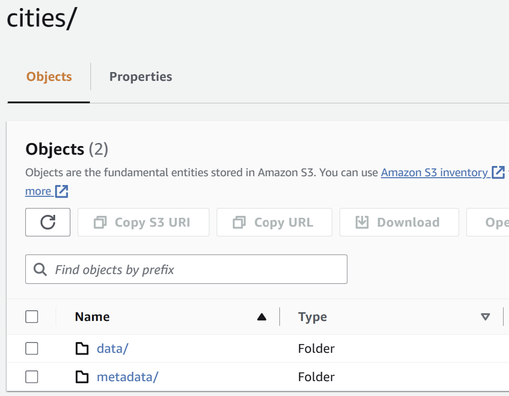
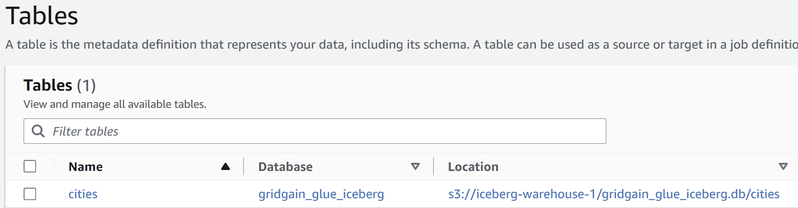
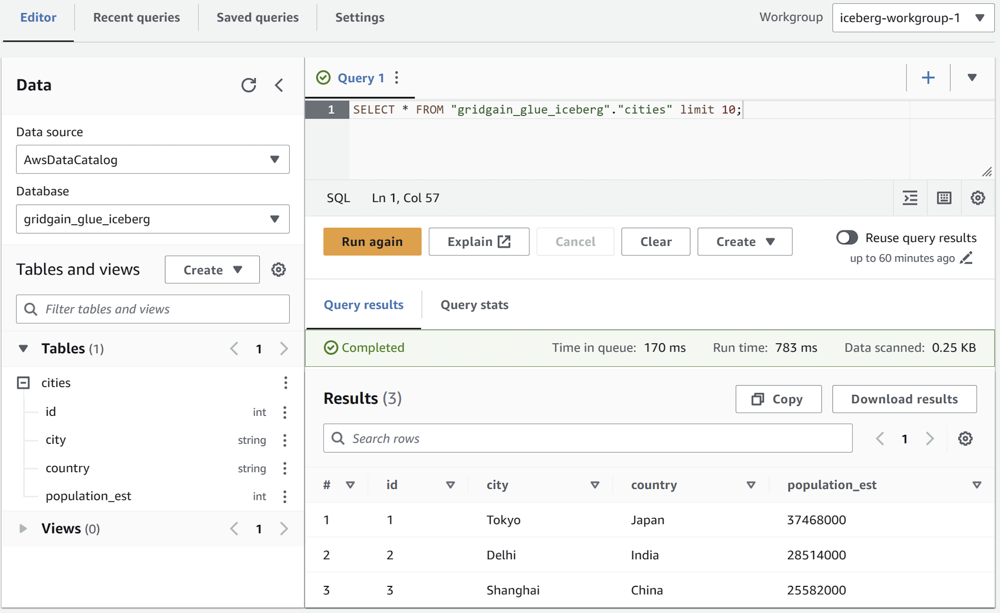

# How to Export Data to Apache Iceberg on AWS

## Prerequisites

- An [enabled](../gridgain8-development/project-setup.md#enabling-modules) `gridgain-bulkload` module.
- An up and running [GridGain node](../gridgain8-get-started/what-is-gridgain.md).
- A valid [AWS account](https://aws.amazon.com/account/).
- Brief knowledge of the [COPY command](../reference/sql/operational-commands.md#copy-into).

## Overview

GridGain offers batch data export/import with the `COPY FROM <source> INTO <target>` command, which supports a variety of data formats and sources/destinations.



The batch export/import functionality is available only in the GridGain Enterprise and Ultimate editions, starting from version 8.9.



This guide explains how to:

- Export data from GridGain as an [Apache Iceberg](https://iceberg.apache.org/) table to Amazon services - [AWS Glue](https://aws.amazon.com/glue/) - and store it in [Amazon S3](https://aws.amazon.com/s3/).
  - Apache Iceberg is an open table format for huge analytic datasets.
  - AWS Glue is a fully managed ETL (extract, transform, and load) service.
- Query the exported data using [Amazon Athena](https://aws.amazon.com/athena/) - an interactive query service that enables analyzing data directly in AWS Glue and Amazon S3 with the standard SQL queries.
- Import data from AWS to GridGain.

## Prepare the AWS Environment



This guide uses AWS's `us-east-1` region for all services.



1. Create [AWS access keys](https://docs.aws.amazon.com/console/iam/self-accesskeys).
2. Create [an S3 bucket](https://docs.aws.amazon.com/AmazonS3/latest/userguide/create-bucket-overview.html) named `s3://iceberg-warehouse-1/`. Accept the default values for all settings.
3. Create an [AWS Glue database](https://docs.aws.amazon.com/glue/latest/dg/start-data-catalog.html) named `gridgain_glue_iceberg`.
4. Create an AWS Athena workgroup named `iceberg-workgroup-1`, with `s3://iceberg-warehouse-1/athena/` as the [query result location](https://docs.aws.amazon.com/athena/latest/ug/querying.html).



Apache Iceberg's [GlueCatalog](https://iceberg.apache.org/javadoc/latest/org/apache/iceberg/aws/glue/GlueCatalog.html) class requires that names match the `[a-z0-9_]` pattern (lowercase alphanumeric with underscores, names are dot-separated; for example, `db_name.table_name`). It can be disabled by setting the `glue.skip-name-validation` property to `true`. If you skip the database name and table name validations, there is no guarantee that all downstream systems would [support the names](https://iceberg.apache.org/docs/latest/aws/#skip-name-validation).





After you have finished with the guide, don't forget to destroy the environment you had created.



## Create the Table

Create a simple table in GridGain:

```sql
CREATE TABLE cities(id int primary key, city varchar, country varchar, population_est int);

INSERT INTO cities(id, city, country, population_est)
VALUES
(1, 'Tokyo', 'Japan', 37468000),
(2, 'Delhi', 'India', 28514000),
(3, 'Shanghai', 'China', 25582000);
```

## Batch-Export the Table to AWS Glue

The AWS Glue data catalog is a persistent technical metadata store. The data is stored in AWS S3.

### Command

Export data from the GridGain table to the AWS cloud using the [COPY command](../reference/sql/operational-commands.md#copy-into):

```sql
COPY FROM cities(id, city, country, population_est)
INTO 's3://iceberg-warehouse-1/'
FORMAT ICEBERG
PROPERTIES(
    'table-identifier'='gridgain_glue_iceberg.cities',
    'io-impl'='org.apache.iceberg.aws.s3.S3FileIO',
    'catalog-impl'='org.apache.iceberg.aws.glue.GlueCatalog',
    's3.client-region'='eu-east-1',
    's3.access-key-id'='YOUR_ACCESS_KEY',
    's3.secret-access-key'='YOUR_SECRET_KEY'
);
```

AWS-specific properties:

- The AWS Client region requires `s3.client-region` to be explicitly passed as an export property.
- The AWS Client credentials [can be defined as](https://docs.aws.amazon.com/sdk-for-java/latest/developer-guide/credentials-chain.html):
  - Bulk export properties `s3.access-key-id`, `s3.secret-access-key`, and `s3.session-token`.
  - Environment variables `AWS_ACCESS_KEY_ID`, `AWS_SECRET_ACCESS_KEY`, and `AWS_SESSION_TOKEN`.
  - Java system properties `aws.accessKeyId`, `aws.secretKey`, and `aws.sessionToken`.

## Examine the Export Results

When the export is complete:

1. Examine the "destination" S3 bucket:

   

2. Note that a new AWS Glue table has been created, and it refers to S3:

   

3. Query the exported data with Amazon Athena (using the previously created workgroup) [read more](https://docs.aws.amazon.com/athena/latest/ug/querying-iceberg.html). The query should pick up the new table created in AWS Glue:

   

## Batch-Import an Apache Iceberg Table to GridGain

To import an Apache Iceberg table from AWS Glue (Amazon S3) to GridGain.

1. Create a "destination" GridGain table (for example, using [DDL](../reference/sql/ddl.md)). For this guide's purposes, you can reuse an existing GridGain table - just clean it up first:

   ```sql
   DELETE FROM CITIES;
   ```

2. Swap `FROM` and `INTO` keywords in the command you have used to upload the data to the cloud:

   ```sql
   COPY INTO cities(id, city, country, population_est)
   FROM 's3://iceberg-warehouse-1/'
   FORMAT ICEBERG
   PROPERTIES(
       'table-identifier'='gridgain_glue_iceberg.cities',
       'io-impl'='org.apache.iceberg.aws.s3.S3FileIO',
       'catalog-impl'='org.apache.iceberg.aws.glue.GlueCatalog',
       's3.client-region'='eu-central-1',
       's3.access-key-id'='YOUR_ACCESS_KEY',
       's3.secret-access-key'='YOUR_SECRET_KEY'
   );
   ```

3. After the import is complete, verify that new entries have appeared in the destination table:

   ```sql
   SELECT * FROM cities;
   ```

   The response should look as follows:

   ```sql
   +------+-------------+-------------+--------------+
   |  ID  |     CITY    |   COUNTRY   |POPULATION_EST|
   +------+-------------+-------------+--------------+
   | 1    | Tokyo       | Japan       | 37468000     |
   | 2    | Delhi       | India       | 28514000     |
   | 3    | Shanghai    | China       | 25582000     |
   +------+-------------+-------------+--------------+
   ```

## Conclusion

You have successfully completed the guide. You have learned how to bulk-upload Apache Iceberg tables to an AWS Glue catalog (with data residing in Amazon S3) and bulk-download data from AWS Glue / Amazon S3 to GridGain.

## Related

- [COPY command reference](../reference/sql/operational-commands.md#copy-into) - The GridGain SQL command used for batch export and import.
- [Apache Iceberg documentation](https://iceberg.apache.org/) - The open table format for huge analytic datasets.
