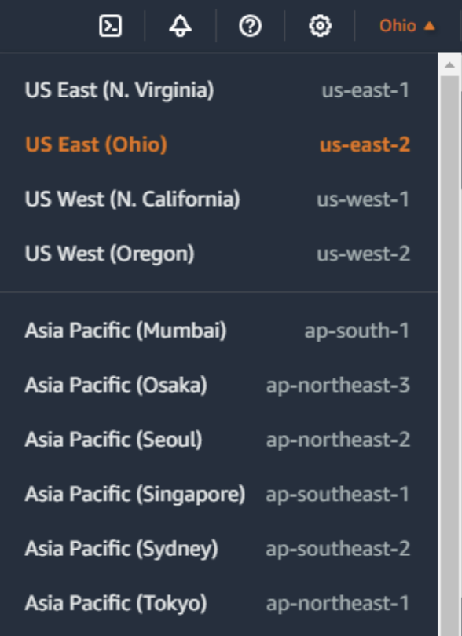
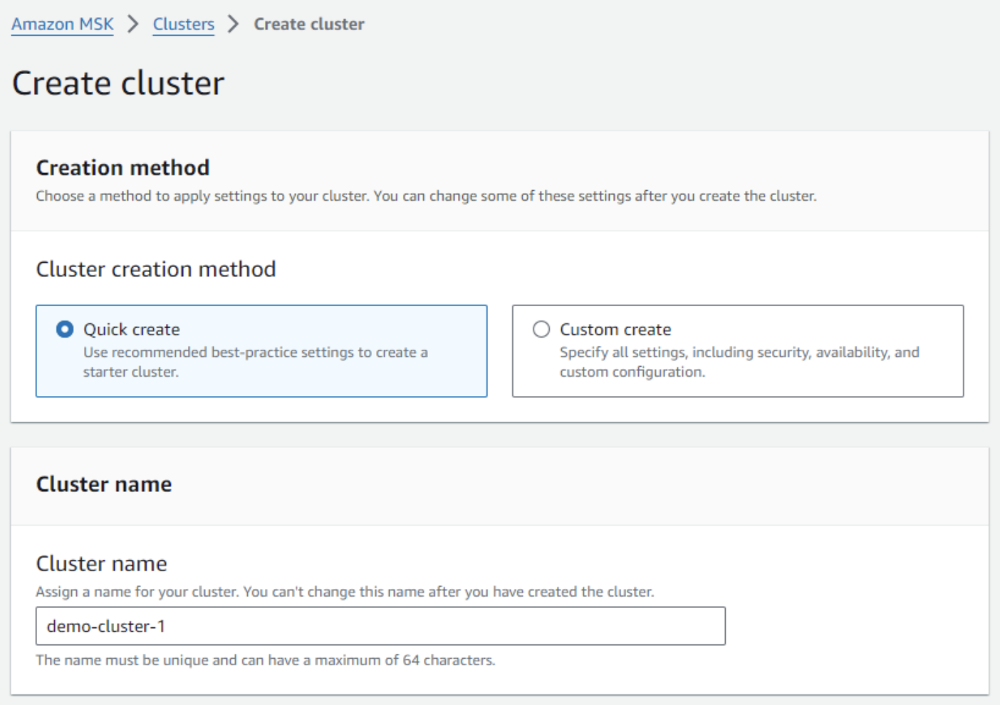
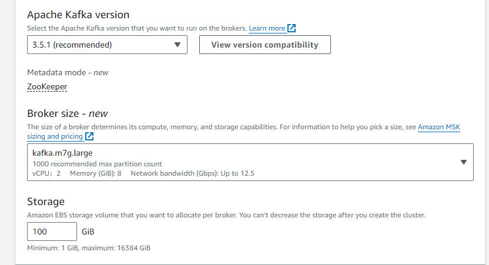
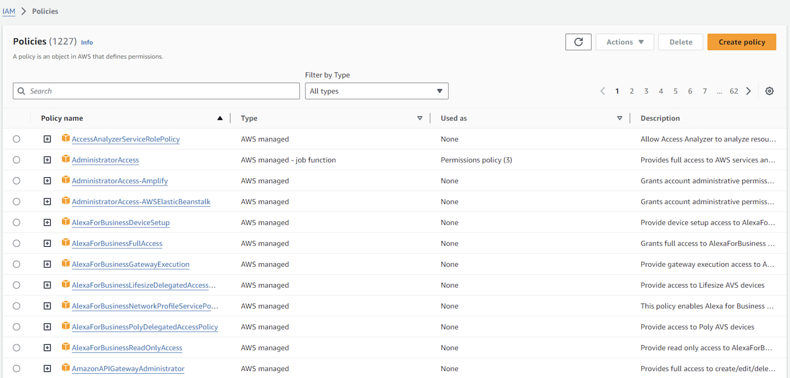
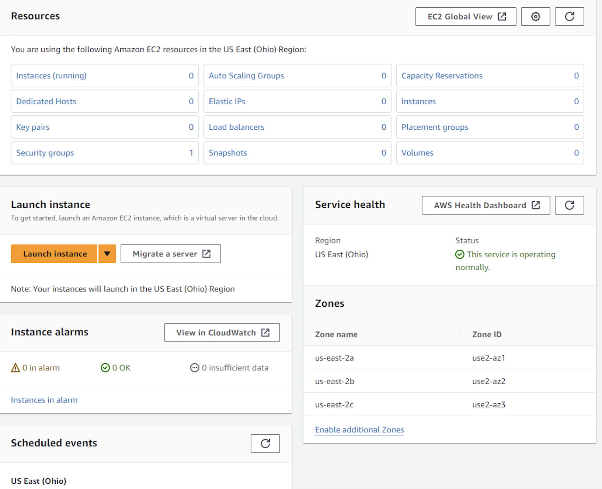
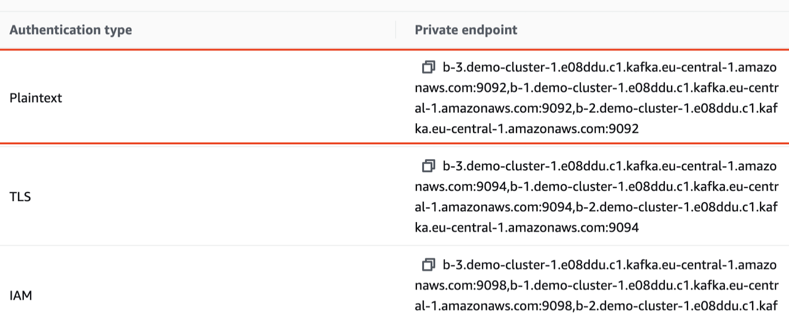
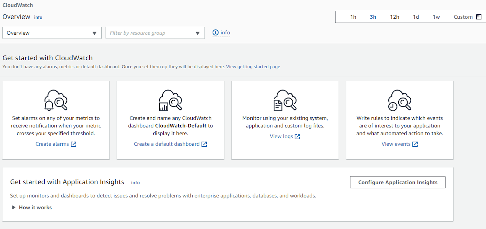
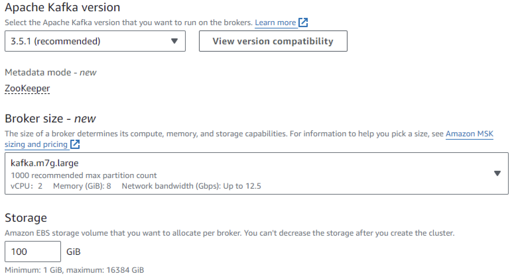
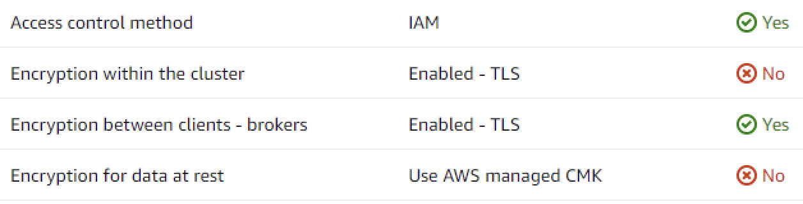

# How to run the GridGain Kafka Connector on Amazon MSK

## Prerequisites

- An AWS account with access to the [AWS Management Console](https://aws.amazon.com/console/)
- A **GridGain Enterprise Edition or Ultimate Edition** cluster on AWS, installed with the [Installation Guide](../../gridgain8-management/installation/aws/manual-install-on-ec2.md)
- The [**GridGain Kafka Connector**](certified-kafka-connector.md) package

## Overview

[GridGain]({gridgain9}/), derived from the open-source [Apache Ignite](https://ignite.apache.org/docs/latest/) platform, is a leading in-memory computing and data management platform.

[Apache Kafka](https://kafka.apache.org/) is an open-source, distributed event streaming platform that can process and store large amounts of real-time data.

GridGain offers two options to integrate with Kafka:

- *Streaming*, where you write your own custom code using the [Kafka Streamer](../apache-ignite-extensions.md)
- [GridGain Kafka Connector](certified-kafka-connector.md), which is a no-code, configuration-driven, scalable, resilient, DevOps-friendly, certified solution

This guide presents the second option - GridGain Kafka Connector. It demonstrates Kafka running on Amazon MSK with the GridGain Kafka Connector running on EC2. The GridGain Kafka Connector sources and sinks data between MSK and a GridGain cluster running in AWS. This is a basic guide intended to get you started with Amazon MSK. For detailed configurations and advanced topics, refer to the [official AWS documentation](https://docs.aws.amazon.com/msk/latest/developerguide/getting-started.html).


AWS MSK offers an option to run your connector as a plug-in that is completely managed by MSK. However, this is beyond this guide's scope.


## Step 1: Set up Your Environment

1. Navigate to the [AWS Management Console](https://aws.amazon.com/console/).
2. Sign in with your AWS credentials.
3. Select your region (make sure you're in the correct AWS region, the one where you want to create your MSK cluster).

   

## Step 2: Create an MSK Cluster

1. In the AWS Management Console, search for MSK and select **Amazon Managed Streaming for Apache Kafka**.

   The [Amazon MSK Console](https://docs.aws.amazon.com/msk/latest/developerguide/getting-started.html) opens.
2. Click **Create cluster**.

   
3. In **Creation method**, select:
   - **Quick create** to use default settings, or
   - **Custom create** to define custom settings.
4. **Cluster name**: Enter a name for your cluster.

   
5. **Apache Kafka version**: Select the version of Apache Kafka you want to use.
6. In **Broker configuration**:
   1. From **Instance type**, select the instance type for your Kafka brokers.
   2. Specify the **Number of brokers** for your cluster.
   3. Specify the **Storage volume per broker**.
7. In **Networking**:
   1. **VPC**: Select the VPC where the cluster will be launched.
   2. **Subnets**: Select subnets for the brokers.
   3. **Security groups**: Select security groups for the brokers.
   4. Select the **Monitoring** option (e.g., JMX Exporter or Prometheus).
   5. Optionally, add **Tags** to your cluster to facilitate cluster management.
8. Review your settings and click **Create cluster**.

## Step 3: Create an IAM Role

1. Open the IAM Console.

   
2. Select **MSK** as the trusted entity.
3. Attach the `AmazonMSKFullAccess` policy.
4. Name the role and create it.

## Step 4: Create a Client Machine

1. Launch an EC2 Instance:
   1. Open the [EC2 Console](https://console.aws.amazon.com/ec2/).

      
   2. Choose **Amazon Linux 2 AMI**.
   3. Select the instance type.
   4. Configure instance details, add storage, and tag your instance.
   5. Configure the security group to allow SSH (port 22) and Kafka ports (9092, 2181).
2. Use your key pair to SSH into the instance.

## Step 5: Configure Clients and Connect to the Cluster

1. Ensure your client machines (EC2 instances) are in the same VPC as the MSK cluster (or have network access to that VPC).
2. Install Apache Kafka Tools on your client machine. For example:

   ```bash
   wget https://archive.apache.org/dist/kafka/2.7.0/kafka_2.12-2.7.0.tgz
   tar -xzf kafka_2.12-2.7.0.tgz
   cd kafka_2.12-2.7.0
   ```
3. In the MSK console, go to your cluster details page and copy the Bootstrap servers.

   
4. Use the Kafka Tools to create a topic:

   ```bash
   bin/kafka-topics.sh --create --bootstrap-server <Bootstrap-Servers> --replication-factor 3 --partitions 1 --topic MyFirstTopic
   ```
5. Use Kafka Producer to send messages to the topic:

   ```bash
   bin/kafka-console-producer.sh --broker-list <Bootstrap-Servers> --topic MyFirstTopic
   ```
6. Type a few messages and press [Enter].
7. Use Kafka Consumer to read messages from the topic:

   ```bash
   bin/kafka-console-consumer.sh --bootstrap-server <Bootstrap-Servers> --topic MyFirstTopic --from-beginning
   ```

This verifies that the MSK setup works as intended.

Next, you'll use the GridGain Kafka Connector instead of the Kafka Producer/Consumer to sink data into GridGain caches.

## Step 6: Set up GridGain on AWS

Set up a GridGain Enterprise Edition or Ultimate Edition instance on AWS using the [Installation Guide](../../gridgain8-management/installation/aws/manual-install-on-ec2.md).

## Step 7: Configure the GridGain Kafka Connector

1. Download the GridGain Enterprise Edition or Ultimate Edition package:
2. [Extract the package and prepare it](quick-start.md#step-1-prepare-connector-package).
3. Create two Connector Property files: `gridgain-kafka-connect-source.properties` and `gridgain-kafka-connect-sink.properties`.
   - Example Source Properties:

     ```properties
     name=gridgain-kafka-connect-source
     connector.class=org.gridgain.kafka.source.IgniteSourceConnector
     igniteCfg=IGNITE_CONFIG_PATH/ignite-server-source.xml
     ```
   - Example Sink Properties:

     ```properties
     name=gridgain-kafka-connect-sink
     topics=topic1,topic2,topic3
     connector.class=org.gridgain.kafka.sink.IgniteSinkConnector
     igniteCfg=IGNITE_CONFIG_PATH/ignite-server-sink.xml
     ```
4. In `$KAFKA_HOME/config/connect-distributed.properties`, enter the Bootstrap servers you have copied in [Step 5: Configure clients and connect to the cluster](#step-5-configure-clients-and-connect-to-the-cluster).

   ```properties
   bootstrap.servers=<Bootstrap-Servers>
   ```
5. To deploy the connector, transfer the property files and the GridGain Kafka Connector package to your EC2 instances.
6. Start the connector:
   1. SSH into your EC2 instance and navigate to the Kafka installation directory.
   2. Run the following commands:

      ```bash
      $KAFKA_HOME/bin/connect-distributed.sh \
          $KAFKA_HOME/config/connect-distributed.properties \
          gridgain-kafka-connect-source.properties \
          gridgain-kafka-connect-sink.properties
      ```
7. Verify that the intended data appears in the cache:
   1. Insert some messages into the Kafka topic.
   2. Query the cache to make sure the data from the Kafka topic was inserted into the cache.

## Step 8: Monitor and Manage Your Cluster

1. Open the [Cloud Watch Console](https://console.aws.amazon.com/cloudwatch/).
2. Monitor your cluster's metrics, such as the like broker health, CPU utilization, etc.

   
3. Adjust the number of brokers or the storage volume as needed.

   
4. Manage security settings, such as IAM roles and policies, encryption in transit, and client authentication.

   

## Step 9: Clean up

1. Optionally, delete the topics you have created:

   ```bash
   bin/kafka-topics.sh --delete --bootstrap-server <Bootstrap-Servers> --topic MyFirstTopic
   ```
2. In the Amazon MSK console, navigate to your cluster and click **Delete**.

## Related

- [GridGain Kafka Connector](certified-kafka-connector.md) - The certified, configuration-driven connector used in this guide.
- [Kafka Streamer](../apache-ignite-extensions.md) - The alternative code-based streaming integration.
