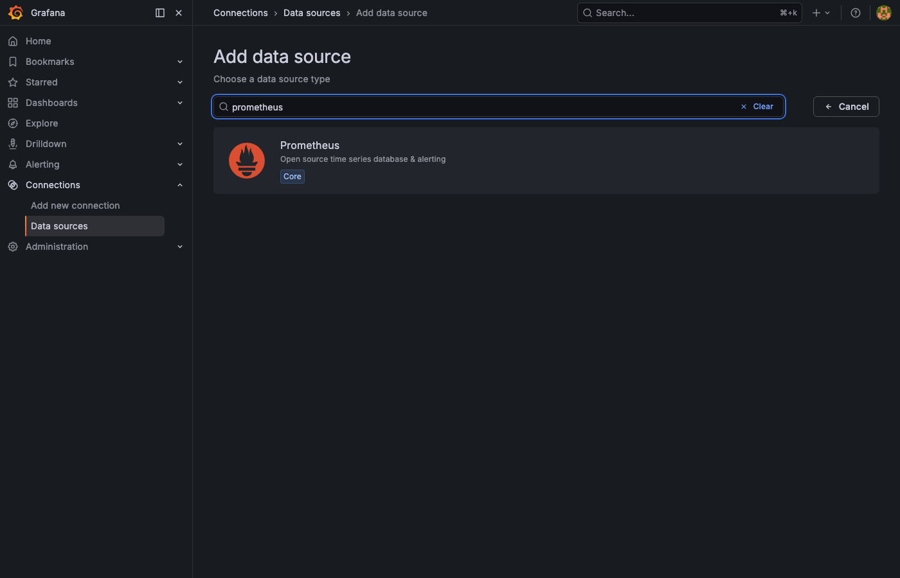
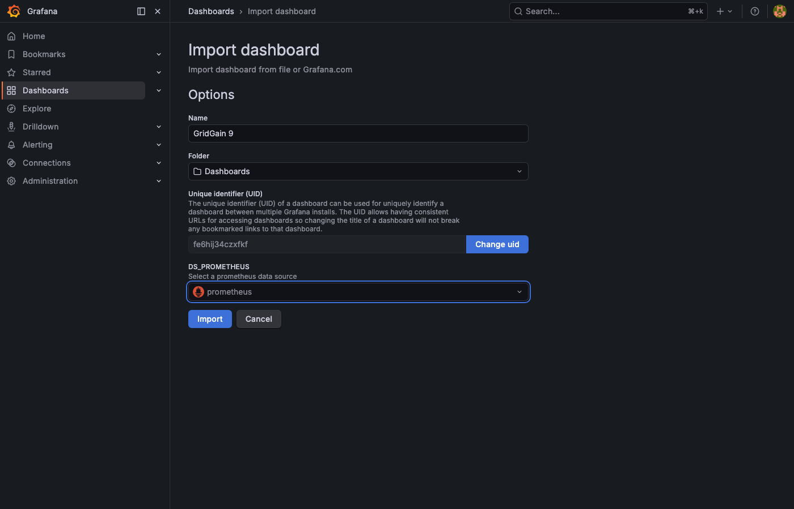
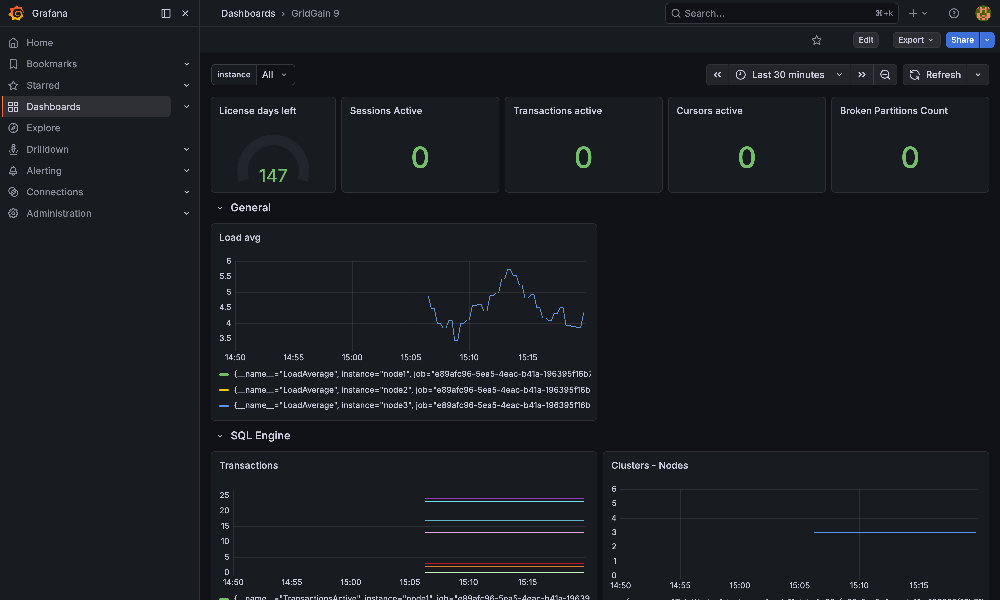

# How to Monitor GridGain 9 With Prometheus and Grafana

## Prerequisites

- **GridGain 9.0.13** or later
- [**Grafana OSS**](https://grafana.com/docs/grafana/latest/setup-grafana/) 11.5.0
- [**Prometheus**](https://prometheus.io/download/) server 3.1.0

## Overview

GridGain offers built-in support for monitoring its performance using tools like Prometheus and Grafana. This guide walks you through setting up GridGain to send metrics to Prometheus via the OpenTelemetry (OTLP) protocol, and configuring Grafana to visualize these metrics.

The integration process has three steps:

1. [Configure GridGain](#configure-gridgain)
2. [Configure the Prometheus server](#configure-the-prometheus-server)
3. [Configure Grafana](#configure-grafana)

## Configure GridGain

To export metrics from your GridGain cluster, you need to modify the cluster configuration via the [CLI tool](../using-the-cli-tool.md).

1. Open the CLI and connect to any node in the cluster.
2. Specify the `exporterName` as the name for your OTLP endpoint and the `endpoint` as the address of your Prometheus server.
3. Run the `cluster config update` command with the modified configuration as an argument. The updated configuration is automatically applied across the cluster.

   ```bash
   cluster config update ignite.metrics.exporters.test: {exporterName:otlp, endpoint:"http://localhost:9090/api/v1/otlp/v1/metrics", protocol:"http/protobuf"}
   ```

4. After successfully running the command, you see a `Cluster configuration was updated successfully` message, and GridGain automatically starts sending metrics to the specified endpoint.

If it is your first time setting up a GridGain cluster, check the corresponding [documentation section](../cluster-configuration.md) for more details.

## Configure the Prometheus Server

GridGain 9 comes with a built-in OTLP provider that lets you export the cluster's metrics. These metrics can then be collected and processed by [Prometheus](https://prometheus.io/download/) without any extra configuration steps.

All you need to do is start your Prometheus server with the `--web.enable-otlp-receiver` option to receive metrics:




```bash
./prometheus --config.file=./prometheus.yml --web.enable-otlp-receiver
```





```bash
prometheus.exe --config.file=./prometheus.yml --web.enable-otlp-receiver
```





By default, Prometheus starts on port `9090`. Check [http://localhost:9090](http://localhost:9090) to verify it is up and running.

For further instructions and how-to guidance, see the [Prometheus documentation](https://prometheus.io/docs/prometheus/latest/getting_started/).

## Configure Grafana

Finally, you set up [Grafana](https://grafana.com/docs/grafana/latest/setup-grafana/) to monitor and display your metrics.

1. Download and install Grafana.
2. Once installed, start Grafana:




   ```bash
   ./grafana-server
   ```





   ```bash
   grafana-server.exe
   ```





   By default, Grafana is available at http://localhost:3000/login.

3. Use the default login credentials: `admin` / `admin`. You must change them after your first login for security reasons.
4. Navigate to **Connections**/**Data sources** and select **Add data source**.
5. Add Prometheus as the data source.

   

Once configured, Grafana starts receiving GridGain metrics from Prometheus. For a more detailed installation guide and how-to guidance, refer to the [official documentation](https://grafana.com/docs/grafana/latest/setup-grafana/).

### Importing a Sample Dashboard

To help you quickly start collecting and visualizing GridGain metrics, we have prepared a pre-configured sample dashboard that you can import into Grafana. This dashboard provides a structured view of key cluster metrics, making it easier to monitor performance in real time.

<!-- TODO (missing asset): Step 1 says "Download the sample dashboard JSON file", but there is no file or link, in this repository or in the devhub original (the GridGain 8 guide has the same gap). The GridGain-Demos/gridgain-observation repository holds only a New Relic dashboard. Provide the GridGain 9 dashboard JSON (and link it), or reword the step. Checked on GridGain 9.1.28 with Prometheus 3.1.0 and Grafana 11.5.0 over the Grafana HTTP API: admin/admin login, adding the Prometheus data source, querying GridGain metrics (for example ActiveCount, one series per node) and importing a dashboard all work. The UI screens and the original dashboard's panel queries were not checked. Delete this comment when resolved. -->

1. Download the sample dashboard JSON file.
2. Go to **Dashboards** → **Create Dashboard**, click **Import Dashboard**, and upload the file.

   

3. After a successful import, Grafana displays your cluster metrics.

   

Now that your dashboard is set up, you have a comprehensive view of your GridGain metrics, enabling efficient monitoring, analysis, and performance tuning. To dive deeper into metrics and monitoring in GridGain, visit the corresponding [documentation section](configuring-metrics.md).

## Related

- [Configuring Metrics](configuring-metrics.md) - Reference for the metrics subsystem and available exporters.
- [Prometheus getting started](https://prometheus.io/docs/prometheus/latest/getting_started/) - Set up and configure the Prometheus server.
