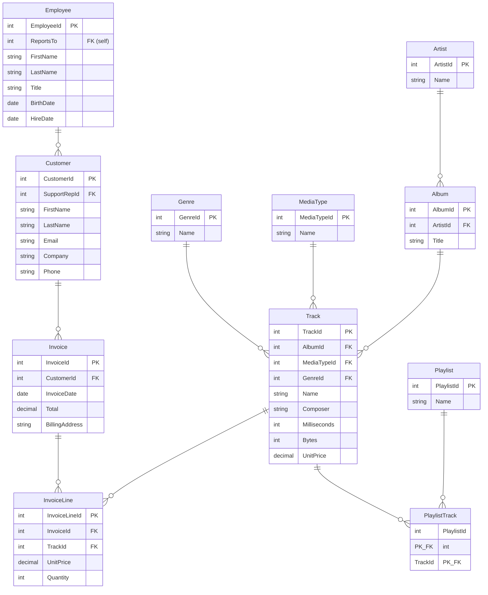
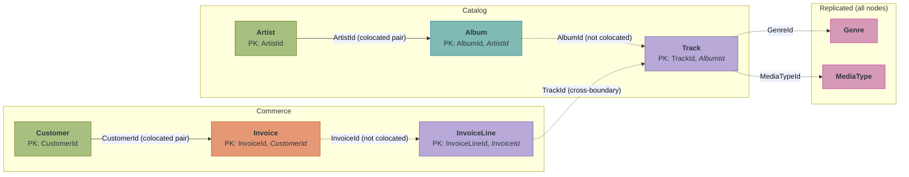

# Design a Schema for Distributed SQL


## Introduction

In a single-node database, schema design is about data integrity. You normalize to reduce redundancy, add indexes to speed queries, and move on. Where data physically lives never matters because it all lives on one machine.

A distributed database changes that equation. Every table is split into partitions spread across multiple nodes, and a JOIN is only local if the joined rows happen to be on the same node. When they are not, data moves across the network. If that sounds like sharding, it is. GridGain 9 hash-shards every table, and the design choices you make in DDL control which queries stay local and which pay the network cost. This tutorial walks through that decision process using the Music Store schema.

## Prerequisites

- **A running 3-node cluster with the Music Store dataset** from [Start Your Local GridGain 9 Development Cluster](../distributed-sql-foundations/start-local-cluster.md)
- **Completed the Foundations path:** [Create Tables and Query Data with SQL](../distributed-sql-foundations/query-music-store-sql.md) and [Use Transactions in GridGain 9](../distributed-sql-foundations/use-transactions.md)

<details>
<summary>Returning to these tutorials? Verify your environment.</summary>

Check that the cluster is running and the Music Store data is loaded:

```bash
docker exec gridgain9-node1 /opt/gridgain9cli/bin/gridgain9 sql \
  "SELECT COUNT(*) AS tracks FROM Track;"
```

**Expected result: 3503.** If the query succeeds, your environment is ready.

**If the containers are stopped**, restart them from the directory containing your `docker-compose.yml`:

```bash
docker compose up -d
```

Data persists across restarts. Wait 15-30 seconds for the nodes to rejoin, then re-run the check above.

**If the cluster was destroyed** (`docker compose down`), start the containers and re-initialize:

```bash
docker compose up -d
```

Wait 10 seconds for the nodes to start, then load the license and initialize the cluster:

```bash
LICENSE=$(jq -Rs . gridgain-license.json)
```

```bash
curl -X POST http://localhost:10300/management/v1/cluster/init \
  -H "Content-Type: application/json" \
  -d '{"metaStorageNodes":["node1","node2","node3"],"cmgNodes":[],"clusterName":"my-cluster","license":'"$LICENSE"'}'
```

Download the schema and data files:

* [music-store-schema.sql](../../.gitbook/assets/music-store-schema.sql)
* [music-store-data.sql](../../.gitbook/assets/music-store-data.sql)

Copy the files into the container and load them:

```bash
docker cp music-store-schema.sql gridgain9-node1:/tmp/
docker cp music-store-data.sql gridgain9-node1:/tmp/
docker exec gridgain9-node1 /opt/gridgain9cli/bin/gridgain9 sql --file /tmp/music-store-schema.sql
docker exec gridgain9-node1 /opt/gridgain9cli/bin/gridgain9 sql --file /tmp/music-store-data.sql
```

The schema loader prints "Updated 0 rows" for each DDL statement. The data loader prints row counts per batch. Both commands emit jline reflection warnings that are cosmetic and safe to ignore.

Re-run the check above to verify 3503 tracks are loaded.

</details>

## What You Will Learn

You will work through a repeatable five-step process for designing a distributed SQL schema, apply it to the Music Store domain, then apply it independently to a new domain fragment. Along the way you will learn:

- How sharding and colocation determine query performance in a distributed cluster
- How to analyze a domain model and decide which tables to colocate from access patterns
- How to choose between partitioned and replicated distribution zones
- How to express these decisions in SQL DDL with `CREATE ZONE`, `COLOCATE BY`, and composite primary keys
- How to verify your design using system views and EXPLAIN plans

## The Distributed SQL Shift

In a single-node RDBMS, the primary key exists for one purpose: **uniqueness**. Where a row physically lives on disk is an implementation detail you never think about.

In a sharded database, the primary key takes on a second role: it controls which node stores the row. The assignment happens in three steps:

1. The engine hashes a designated column (the *shard key*) on the row being written.
2. The hash maps the row to one of a fixed number of **partitions**.
3. Each partition lives on a specific node, so the hash transitively picks the node.

Primary key design is no longer just about uniqueness. It directly determines where data lives in the cluster, and that changes the rules for every operation:

| Concept | Single-Node RDBMS | Distributed SQL (GridGain) |
|---|---|---|
| Primary key | Uniqueness constraint | Uniqueness + partition routing |
| JOIN | Always local (single disk) | Local only if data is colocated |
| Foreign key | Enforced referential integrity | Not supported; colocation and application logic replace the FK role |
| Table placement | All on one disk | Assigned to a distribution zone |
| Replication | Backup for high availability | Active replicas; more replicas improve reads but slow writes |

The critical row is **JOIN**. A join is local only when the joined rows land on the same node. When they do not, the database shuffles data across the network. Your RDBMS schema will not break if you move it to a distributed cluster. Every query still returns correct results. But without colocation, every join pays a network cost, and that cost grows linearly with data volume.

GridGain 9 gives you two separate mechanisms to control this. **Distribution zones** control *where* data lives: how many partitions, how many replicas, which storage engine. **`COLOCATE BY`** controls *which* data lives together: which rows from different tables share the same partition. Most distributed databases conflate these into a single mechanism. Keeping them separate is what makes the design process clear.

<details>
<summary>New to sharding? Here is the short version.</summary>

A sharded database splits each table into pieces (called *shards* or *partitions*) and distributes them across multiple nodes. Each row is assigned to a shard by hashing a designated column (the *shard key*). Queries that include the shard key route to one node. Queries that omit it must check every node. Joins between two tables are local only if both tables are sharded on the same key and the joined rows land on the same node.

</details>

<details>
<summary>Coming from another sharded database? Here is the terminology mapping.</summary>

| Sharding concept | GridGain term | DDL keyword |
|---|---|---|
| Shard | Partition | `PARTITIONS` in `CREATE ZONE` |
| Shard key | Colocation column | `COLOCATE BY` in `CREATE TABLE` |
| Sharding configuration | Distribution zone | `CREATE ZONE` |
| Co-sharding (related tables on the same shard) | Colocation | `COLOCATE BY` with a shared column |

</details>

## Analyze the Domain

Now that you understand what colocation does and why it matters, the next question is how to decide what gets colocated with what. Schema design for us starts with queries, not tables. The process for translating access patterns into a distributed schema has five steps:

1. **Identify access patterns** to find which tables are queried together
2. **Find root entities** that anchor each hot path
3. **Build colocated pairs** by giving each child the parent's colocation column
4. **Accept cross-boundary tradeoffs** where colocation stops
5. **Identify reference data** that benefits from full replication

The rest of this step walks through each one with the Music Store. Here is the data model you have been querying since the first tutorial:



The PK and FK markers show primary keys and foreign key references. In a single-node database, these relationships are enforced by the engine and every join is local. The five-step process below determines which of these joins stay local when the tables are distributed across a cluster.

### Identifying Access Patterns

The question is not "what entities do I have?" but "how does my application access them?" The Music Store has two hot paths:

**Catalog browsing:** "Show me an artist and all their albums and tracks." This traverses Artist to Album to Track.

**Purchase history:** "Show me a customer's invoices and line items." This traverses Customer to Invoice to InvoiceLine.

Each of these paths touches three tables that are frequently joined together. Colocation can keep some of those joins local, but as the next sections show, it does not keep all three levels of a path on one partition. Choosing which joins to keep local is the design decision.

### Finding the Root Entities

Every hot path has a root entity that anchors the hierarchy. **Artist** is the root of catalog browsing, and **Customer** is the root of purchase history. Every other table in the path relates back to one of these roots through parent-child relationships. Album and Invoice are also placed with their roots. Track and InvoiceLine are related to the root only logically, not by placement.

### Building Colocated Pairs


Two tables are *colocated* when rows that share a value in their colocation columns always land on the same partition. A child table that colocates by its parent's colocation column forms a *colocated pair* with the parent.
Other distributed databases call this interleaved tables, colocation groups, or simply parent-child sharding.


A row's partition is decided only by hashing **that row's own** colocation columns. It is not derived from where the parent row lives. That has two consequences:

- **Colocated pairs.** If a child table colocates by the same column value that the parent uses to place its rows, parent and child rows with that value share a partition, and the join between them is local. Album colocates by `ArtistId`, and Artist is placed by `ArtistId`, so an artist and all of that artist's albums share a partition. Invoice colocates by `CustomerId`, and Customer is placed by `CustomerId`, so a customer and all of that customer's invoices share a partition. Playlist and PlaylistTrack form a pair on `PlaylistId` in the same way.
- **Grouping without placement.** Track colocates by `AlbumId`. All tracks of one album share a partition with each other, and with any other table colocated by the same `AlbumId` value. But Album is placed by `ArtistId`, not `AlbumId`, so a Track is **not** placed with its Album row, and not with its Artist. In the same way, InvoiceLine colocates by `InvoiceId`, so all lines of one invoice are grouped together, but they are not placed with the Invoice row (placed by `CustomerId`) or the Customer.

**Colocation does not chain through a middle table.** To place a grandchild with the root, the grandchild would need its own copy of the root's colocation column (for example, `ArtistId` in Track), and this schema does not have one.



Solid arrows are colocated pairs: rows with the same colocation value share a partition, so the join is local. Dashed arrows are relationships where rows are not placed together: Album to Track and Invoice to InvoiceLine (the child is grouped by its own column, which its parent is not placed by), and the cross-boundary references from InvoiceLine to Track. Joins across a dashed arrow move data across the network. The italicized column in each composite PK is the colocation column. Reference tables (pink) are the exception: they are replicated to every node, so joins to them never cause data movement even though their arrows are dashed. Track and InvoiceLine are purple because they are only grouped, not placed with their parent rows.


The colocation column (shard key) must be part of the primary key. This is a hard constraint, and it is the same constraint other sharded databases enforce. The next step explores what this means for your table definitions.


### Accepting Cross-boundary Tradeoffs

A table can only colocate by one column.

Track colocates by `AlbumId` and InvoiceLine colocates by `InvoiceId`. Neither value is shared with the other table, so a query like "what genre does customer #1 buy most?" has to join across tables that are not placed together, and the database must move data between nodes to complete the join. The same is true one level up: joining Album to Track on `AlbumId` also moves data, because Track rows are placed by `AlbumId` while Album rows are placed by `ArtistId`.

That is the fundamental tradeoff. You cannot colocate everything, so you pick the hot paths and optimize those. The Music Store keeps Artist with Album and Customer with Invoice local, and groups tracks by album and invoice lines by invoice so that "all tracks of this album" and "all lines of this invoice" are single-partition lookups. Joins that cross those boundaries still work, just at higher latency.

### Identifying Reference Data

Some tables are small, rarely updated, and joined by many queries. The Music Store has two: **Genre** (25 rows) and **MediaType** (5 rows). These are lookup tables. Rather than colocating them with one table (which would not help queries that start from another table), replicate them so every node has a local copy. Any join with Genre or MediaType is always local, regardless of which table initiated the query.

### Verifying Against the Cluster

Query the system views to see how the Music Store schema implements these decisions:

```bash
docker exec gridgain9-node1 /opt/gridgain9cli/bin/gridgain9 sql \
  "SELECT TABLE_NAME, ZONE_NAME, TABLE_COLOCATION_COLUMNS FROM SYSTEM.TABLES WHERE SCHEMA_NAME = 'PUBLIC' ORDER BY TABLE_NAME;"
```

```text
TABLE_NAME    | ZONE_NAME            | TABLE_COLOCATION_COLUMNS
--------------+----------------------+-------------------------
ALBUM         | MUSICSTORE           | ARTISTID
ARTIST        | MUSICSTORE           | ARTISTID
CUSTOMER      | MUSICSTORE           | CUSTOMERID
EMPLOYEE      | MUSICSTORE           | EMPLOYEEID
GENRE         | MUSICSTOREREPLICATED | GENREID
INVOICE       | MUSICSTORE           | CUSTOMERID
INVOICELINE   | MUSICSTORE           | INVOICEID
MEDIATYPE     | MUSICSTOREREPLICATED | MEDIATYPEID
PLAYLIST      | MUSICSTORE           | PLAYLISTID
PLAYLISTTRACK | MUSICSTORE           | PLAYLISTID
TRACK         | MUSICSTORE           | ALBUMID
```

`ZONE_NAME` shows which zone owns each table, and `TABLE_COLOCATION_COLUMNS` shows the column that determines partition assignment. Genre and MediaType are in `MUSICSTOREREPLICATED` (full replication), while everything else is in `MUSICSTORE` (partitioned). The colocation columns match the design: Album uses `ARTISTID` (the same as Artist), Invoice uses `CUSTOMERID` (the same as Customer), and Track uses `ALBUMID`, which no other table in this schema uses for placement.


**Checkpoint:** The SYSTEM.TABLES query returns 11 rows. Genre and MediaType show MUSICSTOREREPLICATED as their zone. All other tables show MUSICSTORE. The colocation columns match the pairs and groupings described above.


## Composite Primary Keys

If you have worked with other sharded databases, you have likely seen the same constraint that applies here:

1. The colocation column (shard key) must be part of the primary key.
2. Album's primary key is `(AlbumId, ArtistId)` rather than just `(AlbumId)` because `ArtistId` is the colocation column.
3. Without `ArtistId` in the PK, a primary key lookup cannot route to a single partition and would need to scan all of them.

This changes three tables in the Music Store:

- **Album** PK: `(AlbumId, ArtistId)` instead of `(AlbumId)`. ArtistId is the colocation column.
- **Track** PK: `(TrackId, AlbumId)` instead of `(TrackId)`. AlbumId is the colocation column.
- **Invoice** PK: `(InvoiceId, CustomerId)` instead of `(InvoiceId)`. CustomerId is the colocation column.

Query the system views to see the PK and colocation ordinals:

```bash
docker exec gridgain9-node1 /opt/gridgain9cli/bin/gridgain9 sql \
  "SELECT TABLE_NAME, COLUMN_NAME, PK_COLUMN_ORDINAL, COLOCATION_COLUMN_ORDINAL FROM SYSTEM.TABLE_COLUMNS WHERE TABLE_NAME IN ('ARTIST','ALBUM','TRACK','INVOICE') AND PK_COLUMN_ORDINAL IS NOT NULL ORDER BY TABLE_NAME, PK_COLUMN_ORDINAL;"
```

```text
TABLE_NAME | COLUMN_NAME | PK_COLUMN_ORDINAL | COLOCATION_COLUMN_ORDINAL
-----------+-------------+-------------------+--------------------------
ALBUM      | ALBUMID     | 0                 | null
ALBUM      | ARTISTID    | 1                 | 0
ARTIST     | ARTISTID    | 0                 | 0
INVOICE    | INVOICEID   | 0                 | null
INVOICE    | CUSTOMERID  | 1                 | 0
TRACK      | TRACKID     | 0                 | null
TRACK      | ALBUMID     | 1                 | 0
```

The `PK_COLUMN_ORDINAL` and `COLOCATION_COLUMN_ORDINAL` columns are zero-indexed positions. A value of 0 means "first," 1 means "second," and `null` means the column does not participate in that role.

Look at the Album rows. `ALBUMID` has PK ordinal 0 (it is the first column in the primary key) but its colocation ordinal is `null`, meaning it plays no role in partition routing. `ARTISTID` has PK ordinal 1 (second column in the PK) and colocation ordinal 0 (the first, and in this case only, colocation column). The takeaway: it is the colocation column, not the leading PK column, that determines which partition stores the row.

### How Composite Keys Affect Query Routing

Because the colocation column controls partition routing, different `WHERE` clauses produce fundamentally different query plans. Run all three variations to see this in practice:

```bash
docker exec gridgain9-node1 /opt/gridgain9cli/bin/gridgain9 sql \
  "EXPLAIN PLAN FOR SELECT * FROM Album WHERE AlbumId = 5 AND ArtistId = 1;"
```

```text
KeyValueGet
    table: PUBLIC.ALBUM
    fieldNames: [ALBUMID, ARTISTID, TITLE]
    key: [5, 1]
    est: (rows=1)
```

A `KeyValueGet`: no partition scan, no table scan, just a direct read from the one partition that owns the row.

Now query by the colocation column alone:

```bash
docker exec gridgain9-node1 /opt/gridgain9cli/bin/gridgain9 sql \
  "EXPLAIN PLAN FOR SELECT * FROM Album WHERE ArtistId = 1;"
```

```text
Exchange
    distribution: single
    est: (rows=1)
  TableScan
      table: PUBLIC.ALBUM
      predicate: =(ARTISTID, 1)
      fieldNames: [ALBUMID, ARTISTID, TITLE]
      est: (rows=1)
```

Colocation column only. The query routes to the single partition that stores `ArtistId = 1`. GridGain 9 uses a `TableScan` within that partition. The routing behavior is what matters: one partition, not all of them.

Now query by a non-colocation PK column:

```bash
docker exec gridgain9-node1 /opt/gridgain9cli/bin/gridgain9 sql \
  "EXPLAIN PLAN FOR SELECT * FROM Album WHERE AlbumId = 5;"
```

```text
Exchange
    distribution: single
    est: (rows=1)
  TableScan
      table: PUBLIC.ALBUM
      predicate: =(ALBUMID, 5)
      fieldNames: [ALBUMID, ARTISTID, TITLE]
      est: (rows=1)
```

GridGain 9 produces a `TableScan` here. The planner cannot route to a single partition because `AlbumId` alone does not identify one, so the scan fans out to every partition. There is no secondary index on `AlbumId` to help.

The contrast between the second and third queries is the core lesson. Both filter by a single PK column, but the `ArtistId` query routes to one partition while the `AlbumId` query scans all of them. The difference is entirely determined by which column is the colocation column.

### The Cost of Composite Keys

Composite keys enable colocation, but they widen every reference. Track's PK becomes `(TrackId, AlbumId)` instead of `(TrackId)`, and InvoiceLine's becomes `(InvoiceLineId, InvoiceId)` instead of `(InvoiceLineId)`. Any table that references Album must carry both columns for a point lookup. The tradeoff is real, but it is not GridGain-specific. Every distributed SQL database pays this cost in some form. The benefit, colocated joins that execute locally without network hops, is what makes the wider keys worthwhile.


**Checkpoint:** All three EXPLAIN plans execute without errors. The full PK query shows KeyValueGet. The colocation-column query routes to a single partition. The non-colocation query shows TableScan across all partitions.


## Distribution Zones

A distribution zone is a named configuration that bundles replication and partitioning settings. When you write `ZONE MusicStore` in a `CREATE TABLE` statement, you are binding that table to the zone's policies for how many partitions to create, how many replicas to maintain, and which storage engine to use.

The Music Store uses two zones:

| Zone | Partitions | Replicas | Tables | Purpose |
|---|---|---|---|---|
| MusicStore | 25 | 2 | Artist, Album, Track, Customer, Invoice, InvoiceLine, Employee, Playlist, PlaylistTrack | Transactional data. Partitioned across nodes. 2 replicas balance write performance with fault tolerance. |
| MusicStoreReplicated | 25 | 3 | Genre, MediaType | Reference data. 3 replicas on a 3-node cluster means every node has a full copy. Joins with these tables never cross the network. |

Query the zone configuration:

```bash
docker exec gridgain9-node1 /opt/gridgain9cli/bin/gridgain9 sql \
  "SELECT ZONE_NAME, ZONE_PARTITIONS, ZONE_REPLICAS, IS_DEFAULT_ZONE FROM SYSTEM.ZONES ORDER BY ZONE_NAME;"
```

```text
ZONE_NAME            | ZONE_PARTITIONS | ZONE_REPLICAS | IS_DEFAULT_ZONE
---------------------+-----------------+---------------+----------------
MUSICSTORE           | 25              | 2             | false
MUSICSTOREREPLICATED | 25              | 3             | false
```

GridGain creates the `Default` zone (1 replica) the first time you create a table without a `ZONE` clause, so it does not appear in this list yet. The Music Store schema specifies zones explicitly on every table, so the default zone stays unused. If you omit the `ZONE` clause from `CREATE TABLE`, the table goes into the default zone automatically, and the zone then appears in `SYSTEM.ZONES`.

Now verify how partitions are distributed across nodes. This query aggregates partition state by node and zone:

```bash
docker exec gridgain9-node1 /opt/gridgain9cli/bin/gridgain9 sql \
  "SELECT NODE_NAME, ZONE_NAME, COUNT(*) AS PARTITIONS, SUM(ESTIMATED_ROWS) AS TOTAL_ROWS FROM SYSTEM.LOCAL_ZONE_PARTITION_STATES WHERE ZONE_NAME IN ('MUSICSTORE','MUSICSTOREREPLICATED') GROUP BY NODE_NAME, ZONE_NAME ORDER BY ZONE_NAME, NODE_NAME;"
```

```text
NODE_NAME | ZONE_NAME            | PARTITIONS | TOTAL_ROWS
----------+----------------------+------------+-----------
node1     | MUSICSTORE           | 18         | 13099
node2     | MUSICSTORE           | 17         | 9755
node3     | MUSICSTORE           | 15         | 8300
node1     | MUSICSTOREREPLICATED | 25         | 30
node2     | MUSICSTOREREPLICATED | 25         | 30
node3     | MUSICSTOREREPLICATED | 25         | 30
```

MusicStore partitions are distributed across nodes (18/17/15), with a slight imbalance that is normal for rendezvous hashing with 25 partitions across 3 nodes. MusicStoreReplicated shows 25 partitions on every node: 3 replicas across 3 nodes means full replication, so every node has a complete copy of Genre and MediaType.


Partition counts per node and row estimates vary by cluster. The pattern is consistent: MusicStore partitions are distributed, MusicStoreReplicated partitions are on every node.


### The Decision Framework

Use this framework when choosing between partitioned and replicated zones:

- **Replicate when:** The table is small (hundreds of rows), rarely updated, and frequently joined by tables that colocate by different columns. Genre and MediaType fit this profile.
- **Partition when:** The table is large or growing, frequently updated, and has relationships that benefit from colocation or grouping. Artist, Album, Track, Customer, Invoice, InvoiceLine all fit this profile.


Tables are permanently bound to their zone. You cannot move a table to a different zone after creation. If you need different replication or partitioning for a table, you must drop and recreate it. Choose your zone assignment carefully.


### DDL Walkthrough

Walk through the DDL that creates the Music Store schema. Each clause maps to a design decision:

```sql
-- Zone: where data lives, how it's replicated
CREATE ZONE IF NOT EXISTS MusicStore
    WITH REPLICAS=2, PARTITIONS=25, STORAGE_PROFILES='default';

-- Root entity: Artist is the colocation anchor for Album
CREATE TABLE IF NOT EXISTS Artist (
    ArtistId INT NOT NULL,
    Name VARCHAR(120) NOT NULL,
    PRIMARY KEY (ArtistId)
) ZONE MusicStore;
-- ArtistId is both PK and colocation column (default when only one PK column)

-- Child entity: Album colocates by ArtistId
CREATE TABLE IF NOT EXISTS Album (
    AlbumId INT NOT NULL,
    ArtistId INT NOT NULL,
    Title VARCHAR(160) NOT NULL,
    PRIMARY KEY (AlbumId, ArtistId)
) COLOCATE BY (ArtistId) ZONE MusicStore;
-- ArtistId in the PK because it's the colocation column

-- Secondary index: supports joins and lookups by ArtistId within a partition
CREATE INDEX IF NOT EXISTS IFK_AlbumArtistId ON Album (ArtistId);

-- Track colocates by AlbumId: all tracks of one album share a partition,
-- but not with the Album row (Album is placed by ArtistId)
CREATE TABLE IF NOT EXISTS Track (
    TrackId INT NOT NULL,
    AlbumId INT,
    Name VARCHAR(200) NOT NULL,
    MediaTypeId INT NOT NULL,
    GenreId INT,
    Composer VARCHAR(220),
    Milliseconds INT NOT NULL,
    Bytes INT,
    UnitPrice DECIMAL(10,2) NOT NULL,
    PRIMARY KEY (TrackId, AlbumId)
) COLOCATE BY (AlbumId) ZONE MusicStore;
```

The reference data zone uses full replication:

```sql
-- Reference zone: full replication for small lookup tables
CREATE ZONE IF NOT EXISTS MusicStoreReplicated
    WITH REPLICAS=3, PARTITIONS=25, STORAGE_PROFILES='default';

CREATE TABLE IF NOT EXISTS Genre (
    GenreId INT NOT NULL,
    Name VARCHAR(120),
    PRIMARY KEY (GenreId)
) ZONE MusicStoreReplicated;

CREATE TABLE IF NOT EXISTS MediaType (
    MediaTypeId INT NOT NULL,
    Name VARCHAR(120),
    PRIMARY KEY (MediaTypeId)
) ZONE MusicStoreReplicated;
```

Read the DDL clause by clause: `ZONE` picks the placement policy, `COLOCATE BY` declares the routing key, the composite PK ensures the routing key is available for lookups, and `REPLICAS` controls fault tolerance. Each line is a design decision expressed as SQL.


Without an explicit `COLOCATE BY`, the engine uses the entire primary key to choose which partition stores each row. For Album with PK `(AlbumId, ArtistId)`, that means two albums by the same artist can end up on different partitions because their `AlbumId` values differ. The colocated pair breaks: Artist and Album are no longer guaranteed to share a partition, and the join between them may cross the network.

Adding `COLOCATE BY (ArtistId)` fixes this. It tells the engine to partition Album rows by `ArtistId` alone, ignoring `AlbumId`. Every album by Artist 1 lands on the same partition as the Artist 1 row, which is what makes the join local. Always specify `COLOCATE BY` on child tables.



**Checkpoint:** The SYSTEM.ZONES query shows MusicStore with 2 replicas and MusicStoreReplicated with 3 replicas. The partition distribution query shows MusicStoreReplicated on all 3 nodes (25/25/25).


## Apply the Process

The Music Store has a third relationship: Playlist and PlaylistTrack. Apply the five-step process to this domain fragment.

**Step 1: Identify the access pattern.** "Show me all tracks in a playlist." This traverses Playlist to PlaylistTrack to Track.

**Step 2: Find the root entity.** Playlist is the root.

**Step 3: Build the colocated pair.** PlaylistTrack should colocate by `PlaylistId` so that all entries in a playlist are stored on the same partition as the playlist itself.

**Step 4: Accept cross-boundary tradeoffs.** PlaylistTrack references Track, which is placed by `AlbumId`. The join from PlaylistTrack to Track crosses a colocation boundary. This is acceptable because the primary access pattern ("show me the tracks in this playlist") colocates the playlist with its membership list, and the track details can be fetched in a second query if needed.

**Step 5: Reference data?** No. Playlists are user-created and can grow to any size.

Now write the DDL. Before looking at the solution below, write the CREATE TABLE statements for Playlist and PlaylistTrack based on the analysis above. Consider:

- What is the primary key for Playlist?
- What is the primary key for PlaylistTrack? (Remember: the colocation column must be in the PK.)
- Which zone should these tables use?
- Does PlaylistTrack need a `COLOCATE BY` clause?

<details>
<summary>Solution: Playlist pair DDL</summary>

```sql
-- Root entity: Playlist is the anchor of the pair
-- Simple PK because PlaylistId is both the identity and the colocation column
CREATE TABLE IF NOT EXISTS Playlist (
    PlaylistId INT NOT NULL,
    Name VARCHAR(120),
    PRIMARY KEY (PlaylistId)
) ZONE MusicStore;

-- Child entity: PlaylistTrack colocates by PlaylistId
-- Composite PK (PlaylistId, TrackId) because the colocation column must be in the PK
-- COLOCATE BY (PlaylistId) ensures all entries for the same playlist share a partition
CREATE TABLE IF NOT EXISTS PlaylistTrack (
    PlaylistId INT NOT NULL,
    TrackId INT NOT NULL,
    PRIMARY KEY (PlaylistId, TrackId)
) COLOCATE BY (PlaylistId) ZONE MusicStore;
-- Track is placed by AlbumId, so PlaylistTrack-to-Track joins cross a colocation boundary
```

This is exactly how the Music Store schema defines these tables. Query `SYSTEM.TABLES` to confirm:

```bash
docker exec gridgain9-node1 /opt/gridgain9cli/bin/gridgain9 sql \
  "SELECT TABLE_NAME, ZONE_NAME, TABLE_COLOCATION_COLUMNS FROM SYSTEM.TABLES WHERE TABLE_NAME IN ('PLAYLIST','PLAYLISTTRACK');"
```

```text
TABLE_NAME    | ZONE_NAME  | TABLE_COLOCATION_COLUMNS
--------------+------------+-------------------------
PLAYLIST      | MUSICSTORE | PLAYLISTID
PLAYLISTTRACK | MUSICSTORE | PLAYLISTID
```

</details>


**Checkpoint:** You wrote DDL for the Playlist pair that matches the existing schema: Playlist with a simple PK, PlaylistTrack with a composite PK and COLOCATE BY (PlaylistId), both in the MusicStore zone.


## Colocated vs Cross-Boundary Joins

So far, every query has touched a single table. Joins are where colocation pays off, because the planner can execute a join locally when both tables share a partition, or must shuffle data between nodes when they do not.

### Colocated Join: Artist to Album

Artist and Album form a colocated pair: both are placed by `ArtistId`. A join filtered by `ArtistId` should execute within a single partition:

```bash
docker exec gridgain9-node1 /opt/gridgain9cli/bin/gridgain9 sql \
  "EXPLAIN PLAN FOR SELECT a.Name, al.Title FROM Artist a JOIN Album al ON a.ArtistId = al.ArtistId WHERE a.ArtistId = 1;"
```

```text
Exchange
    distribution: single
    est: (rows=347)
  Project
      fieldNames: [NAME, TITLE]
      est: (rows=347)
    MergeJoin
        predicate: =(ARTISTID$0, ARTISTID)
        type: inner
        est: (rows=347)
      IndexScan
          table: PUBLIC.ALBUM
          index: IFK_ALBUMARTISTID
          type: SORTED
          collation: [ARTISTID ASC]
          est: (rows=347)
      Sort
          collation: [ARTISTID ASC]
          est: (rows=1)
        TableScan
            table: PUBLIC.ARTIST
            predicate: =(ARTISTID, 1)
            est: (rows=1)
```

A `MergeJoin` between `Album` (IndexScan on `IFK_ALBUMARTISTID`) and `Artist`. The single `Exchange` at the top collects results to the coordinator, but there is no Exchange between the join inputs. Both tables are colocated by `ArtistId`, so the join executes locally on one node without moving data.

The pair stops at two tables. If you extend the same query with `JOIN Track t ON al.AlbumId = t.AlbumId`, the plan gains an `Exchange` between the Artist-Album join and the Track join (its distribution is Track in the MUSICSTORE zone by `[ALBUMID]`), because Album rows are placed by `ArtistId` and Track rows by `AlbumId`. Colocation does not carry the Artist placement through Album to Track.

### Cross-boundary Join: Customer to Track

A query that joins Customer through Invoice and InvoiceLine to Track crosses colocation boundaries and requires data movement:

```bash
docker exec gridgain9-node1 /opt/gridgain9cli/bin/gridgain9 sql \
  "EXPLAIN PLAN FOR SELECT c.FirstName, t.Name FROM Customer c JOIN Invoice i ON c.CustomerId = i.CustomerId JOIN InvoiceLine il ON i.InvoiceId = il.InvoiceId JOIN Track t ON il.TrackId = t.TrackId WHERE c.CustomerId = 1;"
```

```text
Project
    fieldNames: [FIRSTNAME, NAME]
    est: (rows=1)
  MergeJoin
      predicate: =(CUSTOMERID, CUSTOMERID$0)
      est: (rows=1)
    Exchange                          <-- data movement
        distribution: single
      Sort
        TableScan
            table: PUBLIC.CUSTOMER
            predicate: =(CUSTOMERID, 1)
            est: (rows=1)
    HashJoin
        predicate: =(INVOICEID, INVOICEID$0)
        est: (rows=1)
      Exchange                        <-- data movement
          distribution: single
        IndexScan
            table: PUBLIC.INVOICE
            index: IFK_INVOICECUSTOMERID
            est: (rows=1)
      MergeJoin
          predicate: =(TRACKID, TRACKID$0)
          est: (rows=1)
        Exchange                      <-- data movement
            distribution: single
          IndexScan
              table: PUBLIC.INVOICELINE
              index: IFK_INVOICELINETRACKID
              est: (rows=1)
        Exchange                      <-- data movement
            distribution: single
          Sort
            TableScan
                table: PUBLIC.TRACK
                est: (rows=1)
```

This plan shows four `Exchange` nodes (marked with arrows), each representing data moving between nodes. The planner joins Customer to the rest of the query rather than to Invoice first, so the local Customer-Invoice pair is not visible in this plan. The structural lesson is that joining tables that are not placed by the same column value forces data movement, and the InvoiceLine and Track inputs both need Exchanges for that reason.

Of the tables in this query, only Customer and Invoice are a colocated pair (by `CustomerId`). InvoiceLine is grouped by `InvoiceId`, so it is not placed with its Invoice or Customer, and Track is grouped by `AlbumId`, so the InvoiceLine-to-Track join has no shared placement either. Colocation does not chain from Customer through Invoice to InvoiceLine, and the planner must shuffle data to complete these joins.

Compare the two plans:

| | Colocated (Artist-Album) | Cross-boundary (Customer-Track) |
|---|---|---|
| Exchange nodes | 1 (result collection only) | 4 (data movement) |
| Join execution | Local on one node | Data shuffled between nodes |
| Performance at scale | Constant (single partition) | Degrades linearly with data volume |

At the Music Store's current scale, both queries return instantly, so the difference is academic. The next step loads production-volume data where it stops being academic.


**Checkpoint:** The colocated EXPLAIN plan shows no Exchange operators between the join inputs. The cross-boundary plan shows four Exchange operators, so data moves between nodes to complete the join.


## Verify at Scale

With 59 customers and 2,240 invoice lines, every query runs fast regardless of how the schema is designed. To see schema design decisions make a real difference, load a dataset that simulates production volume in the commerce tables.

Download the commerce data generator and run it against your cluster. The generator uses the Data Streamer API to load 3.4 million rows in well under a minute (about 17 seconds in our test run):

* [commerce-data-generator.jar](../../.gitbook/assets/commerce-data-generator.jar)

```bash
java -jar commerce-data-generator.jar --customers 50000
```

The JAR connects to `localhost:10800` by default. If your cluster uses a different address, add `--host node1:10800`. The generator reads existing TrackIds from the Chinook catalog, so the Music Store schema must be loaded first.

When it finishes, the cluster will contain approximately 50,000 customers, 518,000 invoices, and 2.85 million invoice lines alongside the existing Music Store catalog.


This dataset simulates two years of customer activity for a music store. In a production deployment, this data arrives continuously from order processing pipelines via Kafka Connect or the Data Streamer API. The schema design determines whether those writes are colocated (fast, single-partition) and whether dashboard queries serve results from a single partition. The Data Streamer tutorial covers the Data Streamer API for high-throughput ingestion.


### Verify the Partition Distribution at Scale

```bash
docker exec gridgain9-node1 /opt/gridgain9cli/bin/gridgain9 sql \
  "SELECT NODE_NAME, ZONE_NAME, COUNT(*) AS PARTITIONS, SUM(ESTIMATED_ROWS) AS TOTAL_ROWS FROM SYSTEM.LOCAL_ZONE_PARTITION_STATES WHERE ZONE_NAME = 'MUSICSTORE' GROUP BY NODE_NAME, ZONE_NAME ORDER BY NODE_NAME;"
```

```text
NODE_NAME | ZONE_NAME  | PARTITIONS | TOTAL_ROWS
----------+------------+------------+-----------
node1     | MUSICSTORE | 17         | 2336317
node2     | MUSICSTORE | 17         | 2332161
node3     | MUSICSTORE | 16         | 2195536
```

3.4 million rows distributed across three nodes. The EXPLAIN plans for the Album table do not change at this scale (the Album table itself is the same size), but the commerce queries that join across millions of rows show the real impact of colocation. Run a colocated commerce query and a cross-boundary aggregation side by side to see the timing difference.

### Colocated Commerce Query

All invoices for a specific customer, joining only the colocated Customer-Invoice pair:

```bash
docker exec gridgain9-node1 /opt/gridgain9cli/bin/gridgain9 sql \
  "SELECT c.FirstName, c.LastName, COUNT(i.InvoiceId) AS OrderCount, SUM(i.Total) AS TotalSpent FROM Customer c JOIN Invoice i ON c.CustomerId = i.CustomerId WHERE c.CustomerId = 1001 GROUP BY c.FirstName, c.LastName;"
```

```text
FIRSTNAME | LASTNAME | ORDERCOUNT | TOTALSPENT
----------+----------+------------+-----------
Raj       | Garcia   | 3          | 51.48
```

Because Customer and Invoice are colocated by `CustomerId`, the entire join executes on a single partition without touching the network. On a 3-node cluster with 50,000 customers, this returned in about 35 ms in our test run (measured with the CLI's `--timed` flag).

### Cross-boundary Aggregation

Top-selling tracks by artist across the entire commerce dataset. This joins InvoiceLine through Track, Album, and Artist. None of these joins is between colocated tables except Album to Artist:

```bash
docker exec gridgain9-node1 /opt/gridgain9cli/bin/gridgain9 sql \
  "SELECT ar.Name AS Artist, t.Name AS Track, COUNT(*) AS TimesSold FROM InvoiceLine il JOIN Track t ON il.TrackId = t.TrackId JOIN Album al ON t.AlbumId = al.AlbumId JOIN Artist ar ON al.ArtistId = ar.ArtistId GROUP BY ar.Name, t.Name ORDER BY TimesSold DESC LIMIT 10;"
```

```text
ARTIST      | TRACK                     | TIMESSOLD
------------+---------------------------+----------
Iron Maiden | Hallowed Be Thy Name      | 4222
Iron Maiden | The Trooper               | 4056
Iron Maiden | The Number Of The Beast   | 4047
Iron Maiden | 2 Minutes To Midnight     | 4037
Iron Maiden | Fear Of The Dark          | 3363
Iron Maiden | Wrathchild                | 3248
Iron Maiden | Iron Maiden               | 3244
Iron Maiden | The Evil That Men Do      | 3237
Deep Purple | Smoke On The Water        | 2587
Iron Maiden | Afraid To Shoot Strangers | 2526
```

Nine of the top 10 tracks are Iron Maiden. The Chinook catalog has 213 Iron Maiden tracks (more than any other artist), and the generator's random invoice lines reference real TrackIds, so Iron Maiden songs appear in more invoices by sheer weight of catalog presence.

More interesting than the results is the time it took. This query joins InvoiceLine to Track to Album to Artist, and every step except Album to Artist crosses a colocation boundary. The database shuffled 2.85 million InvoiceLine rows across the network to join them with the catalog tables. In our test run on a 3-node cluster this took about 1.2 seconds, more than 30 times the colocated commerce query. Absolute times depend on your hardware and the order of the rows the generator produces, so your top-10 list and timings will differ, but the gap between the two queries should be just as clear. At production volumes (hundreds of millions of rows), it becomes the dominant factor in query latency, because cross-boundary joins degrade linearly with data while colocated joins stay constant.


**Checkpoint:** The partition distribution query shows over 2 million rows per node. The colocated commerce query returns in tens of milliseconds. The cross-boundary aggregation shows Iron Maiden dominating the results but takes noticeably longer.


## Common Anti-Patterns

Before designing your own schema, review these common mistakes:

| Anti-Pattern | Why It Fails | Fix |
|---|---|---|
| Porting an RDBMS schema unchanged | No colocation. All joins cross the network. | Analyze access patterns and add `COLOCATE BY`. |
| Simple PK on child tables | Cannot colocate by a column that is not in the PK. | Composite PK that includes the colocation column. |
| Omitting `COLOCATE BY` | Defaults to all PK columns. Requires the full PK in `WHERE` for single-partition routing. | Always specify `COLOCATE BY` explicitly. |
| One zone for everything | Reference data and transactional data have different replication needs. | Separate zones: partitioned for transactional, replicated for reference. |
| Not verifying the design | Incorrect colocation is invisible until production load. | Query `SYSTEM.TABLES` and `SYSTEM.ZONES` after every schema change. |

## Summary

Schema design in distributed SQL is performance design. The DDL you write decides where data lands, and where data lands decides how fast your queries run.

The five-step process applies to any domain:
1. **Identify access patterns** to find which tables are queried together
2. **Find root entities** that anchor each hot path
3. **Build colocated pairs** by giving each child the parent's colocation column
4. **Accept cross-boundary tradeoffs** where colocation stops
5. **Identify reference data** that benefits from full replication

Each of those decisions maps to a DDL clause: `CREATE ZONE` for placement and replication, `COLOCATE BY` for the routing key, and composite primary keys for partition assignment. System views let you verify the design after the fact, and the scale test showed the payoff: colocated queries stay on one partition while cross-boundary queries pay for every row they shuffle across the network.

**What's next:**
- [Implement Schema with Java Annotations](schema-java-annotations.md) expresses the same design as code, with compile-time validation and automatic DDL generation.
- [Choose the Right Data Access Pattern](data-access-patterns.md) shows how your schema design shapes which API view (KeyValueView, RecordView, or SQL) is the right choice for each operation.
- [Stream Data with the Data Streamer API](../data-pipeline-apis/data-streaming.md) builds on this schema to load data at high throughput, where colocated writes matter for ingestion performance.
