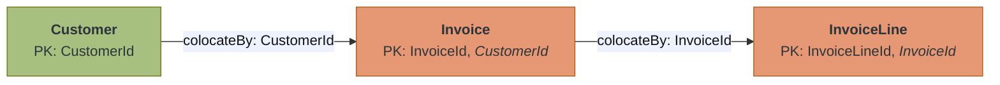
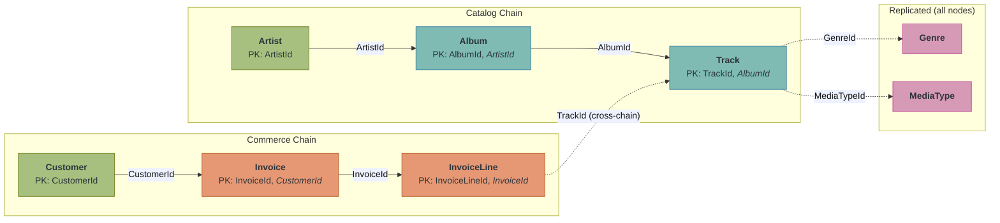
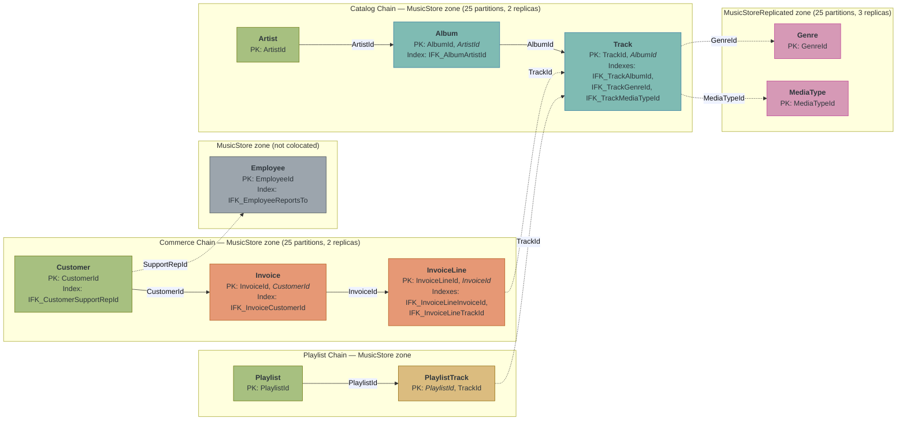

# Implement Schema With Java Annotations

## Introduction

In the previous tutorial, you designed the Music Store schema in SQL DDL. That is the universal path. Every GridGain user, regardless of programming language, can create schemas with SQL. This tutorial adds a second path for Java developers. You define the same Music Store entities as annotated Java classes, and the catalog API reads the annotations at runtime and generates the exact DDL you wrote by hand.

Both paths produce identical schemas. The difference is where the design decisions live and what you get in return. DDL integrates with your operations workflow: migration tools, DBA-managed scripts, language-independent deployments. Annotations integrate with your Java development workflow: schema decisions visible in your IDE, type-safe data access through the same classes that defined the tables, and refactoring safety when column names change.

## Prerequisites

- **A running 3-node cluster with the Music Store dataset** from [Start Your Local GridGain 9 Development Cluster](../distributed-sql-foundations/start-local-cluster.md)
- **Completed** [Design a Schema for Distributed SQL](schema-distributed-sql.md)
- **Java 17+** and a Java IDE (IntelliJ IDEA, VS Code with Java extensions, or similar)

<details>
<summary>Returning to these tutorials? Verify your environment.</summary>

Check that the cluster is running and the Music Store data is loaded:

```bash
docker exec gridgain9-node1 /opt/gridgain9cli/bin/gridgain9 sql \
  "SELECT COUNT(*) AS tracks FROM Track;"
```

**Expected result: 3503.** If the query succeeds, your environment is ready.

**If the containers are stopped**, restart them from the directory containing your `docker-compose.yml`:

```bash
docker compose up -d
```

Data persists across restarts. Wait 15-30 seconds for the nodes to rejoin, then re-run the check above.

**If the cluster was destroyed** (`docker compose down`), start the containers and re-initialize:

```bash
docker compose up -d
```

Wait 10 seconds for the nodes to start, then load the license and initialize the cluster:

```bash
LICENSE=$(jq -Rs . gridgain-license.json)
```

```bash
curl -X POST http://localhost:10300/management/v1/cluster/init \
  -H "Content-Type: application/json" \
  -d '{"metaStorageNodes":["node1","node2","node3"],"cmgNodes":[],"clusterName":"my-cluster","license":'"$LICENSE"'}'
```

Download the schema and data files:

* [music-store-schema.sql](../../.gitbook/assets/music-store-schema.sql)
* [music-store-data.sql](../../.gitbook/assets/music-store-data.sql)

Copy the files into the container and load them:

```bash
docker cp music-store-schema.sql gridgain9-node1:/tmp/
docker cp music-store-data.sql gridgain9-node1:/tmp/
docker exec gridgain9-node1 /opt/gridgain9cli/bin/gridgain9 sql --file /tmp/music-store-schema.sql
docker exec gridgain9-node1 /opt/gridgain9cli/bin/gridgain9 sql --file /tmp/music-store-data.sql
```

The schema loader prints "Updated 0 rows" for each DDL statement. The data loader prints row counts per batch. Both commands emit jline reflection warnings that are cosmetic and safe to ignore.

Re-run the check above to verify 3503 tracks are loaded.

</details>

## What You Will Learn

You define the full Music Store schema as annotated Java classes and create all tables from those annotations with a single API. Along the way you learn:

- How six annotations (`@Table`, `@Zone`, `@Id`, `@Column`, `@ColumnRef`, `@Index`) express all distributed schema design decisions
- How the catalog API generates `CREATE ZONE`, `CREATE TABLE`, and `CREATE INDEX` DDL automatically
- How annotations relate to the catalog: annotations create the schema, the catalog owns it at runtime
- Which schema features annotations cannot express and how to supplement with SQL DDL

## Create the Project

Create a new Maven project in your IDE named `music-store-schema`. Replace the generated `pom.xml` with the following:

```xml
<?xml version="1.0" encoding="UTF-8"?>
<project xmlns="http://maven.apache.org/POM/4.0.0"
         xmlns:xsi="http://www.w3.org/2001/XMLSchema-instance"
         xsi:schemaLocation="http://maven.apache.org/POM/4.0.0
         http://maven.apache.org/xsd/maven-4.0.0.xsd">
    <modelVersion>4.0.0</modelVersion>

    <groupId>com.example</groupId>
    <artifactId>music-store-schema</artifactId>
    <version>1.0-SNAPSHOT</version>

    <properties>
        <maven.compiler.source>17</maven.compiler.source>
        <maven.compiler.target>17</maven.compiler.target>
        <project.build.sourceEncoding>UTF-8</project.build.sourceEncoding>
    </properties>

    <dependencies>
        <dependency>
            <groupId>org.gridgain</groupId>
            <artifactId>ignite-client</artifactId>
            <!-- Use the latest GridGain 9 version -->
            <version>9.1.28</version>
        </dependency>
    </dependencies>

    <repositories>
        <repository>
            <id>GridGain External Repository</id>
            <url>https://www.gridgainsystems.com/nexus/content/repositories/external</url>
        </repository>
    </repositories>
</project>
```

The `ignite-client` dependency includes the annotation API (`org.apache.ignite.catalog.annotations`) and the catalog DSL that translates annotations into DDL. No additional dependencies are needed.

Create two packages in `src/main/java`: `com.example.schema` for application classes and `com.example.schema.model` for entity classes. In IntelliJ, right-click `src/main/java` and select **New > Package**. In VS Code, right-click the `java` folder and create the directory path manually.

The project structure at this point:

```text
music-store-schema/
├── pom.xml
└── src/
    └── main/
        └── java/
            └── com/
                └── example/
                    └── schema/
                        └── model/
```


**Checkpoint:** The project compiles with no errors. Your IDE resolves the GridGain dependency and shows the `org.apache.ignite.catalog.annotations` package in the external libraries.


## Drop the Existing Schema

The Music Store schema currently exists as SQL-created tables from the previous tutorials. You recreate it from annotations, so the existing tables need to go first.

Create `DropSchema.java` in the `com.example.schema` package:


```java
package com.example.schema;

import java.util.logging.Level;
import java.util.logging.Logger;

import org.apache.ignite.client.IgniteClient;
import org.apache.ignite.tx.Transaction;

/**
 * Drops all Music Store tables and zones via SQL DDL.
 *
 * The catalog API also has dropTable() and dropZone(). This class uses
 * SQL DDL, which works the same way from the CLI.
 *
 * Tables are dropped in reverse dependency order (leaves first, roots last).
 * DROP TABLE cascades to indexes automatically, so no separate index drops
 * are needed.
 */
public class DropSchema {

    // Reverse dependency order: drop leaves before roots.
    // PlaylistTrack before Playlist, InvoiceLine before Invoice before Customer,
    // Track before Album before Artist.
    private static final String[] TABLES = {
        "PlaylistTrack", "Playlist",
        "InvoiceLine", "Invoice",
        "Track", "Album",
        "Customer", "Employee",
        "Genre", "MediaType",
        "Artist"
    };

    // Zones can only be dropped after all their tables are gone.
    private static final String[] ZONES = {
        "MusicStore", "MusicStoreReplicated"
    };

    public static void main(String[] args) {
        // Suppress GridGain client internal logging
        Logger.getLogger("org.apache.ignite").setLevel(Level.WARNING);

        System.out.println("=== Drop Music Store Schema ===\n");

        try (IgniteClient client = IgniteClient.builder()
                .addresses("127.0.0.1:10800")
                .build()) {

            // (Transaction) null: explicit cast keeps the call unambiguous across versions
            // to avoid ambiguity with overloaded execute() methods
            for (String table : TABLES) {
                client.sql().execute((Transaction) null,
                    "DROP TABLE IF EXISTS " + table);
                System.out.println("Dropped table: " + table);
            }

            for (String zone : ZONES) {
                client.sql().execute((Transaction) null,
                    "DROP ZONE IF EXISTS " + zone);
                System.out.println("Dropped zone:  " + zone);
            }

            System.out.println("\nSchema dropped.");

        } catch (Exception e) {
            System.err.println("Failed: " + e.getMessage());
            e.printStackTrace();
        }

        System.exit(0);
    }
}
```


Run `DropSchema` from your IDE. In IntelliJ, click the green arrow in the gutter next to `main()`. In VS Code, click **Run** above the method signature. The output confirms each table and zone is removed:

```text
=== Drop Music Store Schema ===

Dropped table: PlaylistTrack
Dropped table: Playlist
Dropped table: InvoiceLine
Dropped table: Invoice
Dropped table: Track
Dropped table: Album
Dropped table: Customer
Dropped table: Employee
Dropped table: Genre
Dropped table: MediaType
Dropped table: Artist
Dropped zone:  MusicStore
Dropped zone:  MusicStoreReplicated

Schema dropped.
```

Tables are dropped in reverse dependency order: leaves before parents, children before roots. The zones are dropped last, after all tables that reference them are gone. `DROP TABLE` cascades to indexes automatically, so the secondary indexes you saw in the previous tutorial are removed with their tables.

<details>
<summary>Prefer the CLI? Run these SQL statements instead.</summary>

The same DDL operations work from the CLI. The catalog API also provides `dropTable()` and `dropZone()`. SQL DDL does the same and works regardless of which tool you use.

```bash
docker exec gridgain9-node1 /opt/gridgain9cli/bin/gridgain9 sql \
  "DROP TABLE IF EXISTS PlaylistTrack;
   DROP TABLE IF EXISTS Playlist;
   DROP TABLE IF EXISTS InvoiceLine;
   DROP TABLE IF EXISTS Invoice;
   DROP TABLE IF EXISTS Track;
   DROP TABLE IF EXISTS Album;
   DROP TABLE IF EXISTS Customer;
   DROP TABLE IF EXISTS Employee;
   DROP TABLE IF EXISTS Genre;
   DROP TABLE IF EXISTS MediaType;
   DROP TABLE IF EXISTS Artist;
   DROP ZONE IF EXISTS MusicStore;
   DROP ZONE IF EXISTS MusicStoreReplicated;"
```

</details>

Annotations are a creation-time mechanism. They generate DDL and execute it against the cluster. After `createTable()` runs, the distributed catalog owns the schema. The annotations themselves are not stored in the cluster or re-evaluated at runtime. The next step recreates the same schema from a different source (Java classes instead of DDL files), and both paths produce the same catalog entries.


**Checkpoint:** All 11 tables and both zones are dropped. Running `SELECT COUNT(*) FROM Artist` returns an error because the table no longer exists.


## Define Single-Key Entities

Start with two single-key entities: Artist (catalog root) and Genre (reference data). Together they introduce the four core annotations and demonstrate zone selection as an annotation-level decision.

Create `Artist.java` in the `com.example.schema.model` package:


```java
package com.example.schema.model;

import org.apache.ignite.catalog.annotations.Column;
import org.apache.ignite.catalog.annotations.Id;
import org.apache.ignite.catalog.annotations.Table;
import org.apache.ignite.catalog.annotations.Zone;

/**
 * Root entity in the catalog colocation chain.
 *
 * ArtistId is both the primary key and the colocation column.
 * All albums by the same artist land on the same partition.
 */
// @Table maps this class to a distributed table.
// @Zone declares the distribution zone and triggers CREATE ZONE IF NOT EXISTS
// before the CREATE TABLE. No manual zone creation needed.
@Table(
    zone = @Zone(value = "MusicStore", storageProfiles = "default",
                 partitions = 25, replicas = 2)
)
public class Artist {

    // @Id marks this field as part of the primary key.
    // @Column maps to a SQL column. nullable = false is required on @Id fields
    // because PK columns cannot be nullable (the @Column default is true).
    // Integer maps to SQL INT.
    @Id
    @Column(value = "ArtistId", nullable = false)
    private Integer artistId;

    // length = 120 generates VARCHAR(120). Without length, the column
    // would be unbounded VARCHAR.
    @Column(value = "Name", nullable = false, length = 120)
    private String name;

    // Default no-arg constructor required for RecordView POJO mapping
    public Artist() {}

    public Artist(Integer artistId, String name) {
        this.artistId = artistId;
        this.name = name;
    }

    public Integer getArtistId() { return artistId; }
    public void setArtistId(Integer artistId) { this.artistId = artistId; }
    public String getName() { return name; }
    public void setName(String name) { this.name = name; }
}
```


Four annotations define the entire table:

| Annotation | What it expresses | DDL equivalent |
|---|---|---|
| `@Table` | Maps this class to a distributed table named "Artist" | `CREATE TABLE Artist (...)` |
| `@Zone` | Assigns to MusicStore zone with 25 partitions, 2 replicas | `CREATE ZONE IF NOT EXISTS MusicStore WITH ...` + `ZONE MusicStore` |
| `@Id` | Marks ArtistId as the primary key | `PRIMARY KEY (ArtistId)` |
| `@Column` | Maps each field to a column with type, nullability, and length constraints | `ArtistId INT NOT NULL`, `Name VARCHAR(120) NOT NULL` |

The `@Zone` annotation on `@Table` does double duty. When `createTable()` runs, it generates a `CREATE ZONE IF NOT EXISTS` statement before the `CREATE TABLE`. Zone creation is automatic. You do not need to create zones separately the way you did with SQL DDL in the previous tutorial.


The `@Column` annotation defaults to `nullable = true`. Primary key columns cannot be nullable. Every field marked `@Id` that also has `@Column` must set `nullable = false` explicitly, or `createTable()` fails at runtime with: *Primary key cannot contain nullable column*.

To see this yourself, temporarily remove `nullable = false` from Artist's `ArtistId` field and run `CreateSchema` later in the tutorial. The error message names the column and the constraint. This is a runtime check, not a compile-time check: the annotations compile regardless of the nullable value, but the catalog rejects the generated DDL. Make it a habit to always set `nullable = false` on `@Id` columns.


Genre is a reference table: 25 rows, rarely updated, joined by queries from both chains. In the previous tutorial, you placed it in the `MusicStoreReplicated` zone (3 replicas on a 3-node cluster, so every node has a full copy). The annotation expresses the same decision.

Create `Genre.java`:


```java
package com.example.schema.model;

import org.apache.ignite.catalog.annotations.Column;
import org.apache.ignite.catalog.annotations.Id;
import org.apache.ignite.catalog.annotations.Table;
import org.apache.ignite.catalog.annotations.Zone;

/**
 * Reference data in the MusicStoreReplicated zone.
 *
 * 3 replicas on a 3-node cluster means every node has a full copy.
 * Joins with Genre are always local regardless of which chain
 * initiates the query.
 */
// Different zone from Artist: MusicStoreReplicated with replicas = 3.
// createTable() generates a separate CREATE ZONE for this zone.
@Table(
    zone = @Zone(value = "MusicStoreReplicated",
                 storageProfiles = "default",
                 partitions = 25, replicas = 3)
)
public class Genre {

    @Id
    @Column(value = "GenreId", nullable = false)
    private Integer genreId;

    // Name is nullable here (no nullable = false). @Column defaults to
    // nullable = true. Only @Id fields need explicit nullable = false
    // to satisfy the PK constraint.
    @Column(value = "Name", length = 120)
    private String name;

    public Genre() {}

    public Genre(Integer genreId, String name) {
        this.genreId = genreId;
        this.name = name;
    }

    public Integer getGenreId() { return genreId; }
    public void setGenreId(Integer genreId) { this.genreId = genreId; }
    public String getName() { return name; }
    public void setName(String name) { this.name = name; }
}
```


The only structural difference from Artist is the zone: `MusicStoreReplicated` with `replicas = 3`. The catalog API generates a separate `CREATE ZONE IF NOT EXISTS MusicStoreReplicated` statement with its own configuration. Two Java classes, two zones, each with the replication strategy that matches its workload.

Here is how each annotation maps to the DDL that `createTable()` generates and executes. The left column is what you wrote in the Java class; the right column is the equivalent SQL clause from the previous tutorial:

| Java annotation | Generated DDL |
|---|---|
| `@Zone(value = "MusicStore", partitions = 25, replicas = 2)` | `CREATE ZONE IF NOT EXISTS MusicStore WITH PARTITIONS=25, REPLICAS=2, STORAGE_PROFILES='default'` |
| `@Table` on Artist | `CREATE TABLE IF NOT EXISTS PUBLIC.ARTIST (...) ZONE MUSICSTORE` |
| `@Id` + `@Column(value = "ArtistId", nullable = false)` | `ARTISTID INT32 NOT NULL, PRIMARY KEY (ARTISTID)` |
| `@Column(value = "Name", nullable = false, length = 120)` | `NAME STRING NOT NULL` with length 120 |
| `@Zone(value = "MusicStoreReplicated", replicas = 3)` | `CREATE ZONE IF NOT EXISTS MusicStoreReplicated WITH REPLICAS=3, ...` |
| `@Table` on Genre | `CREATE TABLE IF NOT EXISTS PUBLIC.GENRE (...) ZONE MUSICSTOREREPLICATED` |

Every clause is one you wrote by hand in the previous tutorial. The annotations express the same decisions as Java declarations instead of SQL statements.

Verify that the annotations produce the right tables by creating them on the cluster. Create `CreateCatalogEntities.java` in the `com.example.schema` package:


```java
package com.example.schema;

import java.util.logging.Level;
import java.util.logging.Logger;

import org.apache.ignite.client.IgniteClient;

import com.example.schema.model.Artist;
import com.example.schema.model.Genre;

/** Creates Artist and Genre to verify the annotation-to-DDL pipeline. */
public class CreateCatalogEntities {
    public static void main(String[] args) {
        Logger.getLogger("org.apache.ignite").setLevel(Level.WARNING);

        try (IgniteClient client = IgniteClient.builder()
                .addresses("127.0.0.1:10800").build()) {

            client.catalog().createTable(Artist.class);
            System.out.println("Created: Artist");

            client.catalog().createTable(Genre.class);
            System.out.println("Created: Genre");

        } catch (Exception e) {
            System.err.println("Failed: " + e.getMessage());
        }
        System.exit(0);
    }
}
```


Run `CreateCatalogEntities`, then verify the zones from the CLI:

```bash
docker exec gridgain9-node1 /opt/gridgain9cli/bin/gridgain9 sql \
  "SELECT ZONE_NAME, ZONE_PARTITIONS, ZONE_REPLICAS FROM SYSTEM.ZONES WHERE ZONE_NAME IN ('MUSICSTORE','MUSICSTOREREPLICATED') ORDER BY ZONE_NAME;"
```

```text
ZONE_NAME            | ZONE_PARTITIONS | ZONE_REPLICAS
---------------------+-----------------+--------------
MUSICSTORE           | 25              | 2
MUSICSTOREREPLICATED | 25              | 3
```

Two `createTable()` calls produced two zones and two tables. The `@Zone` annotation on each class triggered `CREATE ZONE IF NOT EXISTS` automatically.


**Checkpoint:** Both Artist and Genre are created on the cluster. SYSTEM.ZONES shows MusicStore with 2 replicas and MusicStoreReplicated with 3 replicas.


## Express Colocation as Code

Artist and Genre are independent entities with single-field primary keys. The catalog colocation chain (Album and Track) introduces composite keys, colocation declarations, and secondary indexes. These three concepts were separate DDL clauses in the previous tutorial.

The catalog chain links three tables through colocation columns. Each arrow represents the `colocateBy` relationship: the child table's rows are placed on the same partition as the parent.


The italicized column in each PK is the colocation column. Artist (green) is the chain root. Album and Track (teal) are colocated children. You are about to express these relationships as `@Id` fields and `colocateBy` annotations.

Create `Album.java`:


```java
package com.example.schema.model;

import org.apache.ignite.catalog.annotations.Column;
import org.apache.ignite.catalog.annotations.ColumnRef;
import org.apache.ignite.catalog.annotations.Id;
import org.apache.ignite.catalog.annotations.Index;
import org.apache.ignite.catalog.annotations.Table;
import org.apache.ignite.catalog.annotations.Zone;

/**
 * Intermediate entity in the catalog colocation chain.
 *
 * Colocates with Artist by ArtistId. All albums for the same artist
 * share a partition with the Artist row, making Artist-Album joins local.
 *
 * Composite PK (AlbumId, ArtistId) because the colocation column
 * must be part of the primary key.
 */
// colocateBy declares the partition routing column. Generates COLOCATE BY (ArtistId).
// indexes declares secondary indexes. Generates CREATE INDEX for join support.
// @ColumnRef serves both roles: naming the colocation column and naming indexed columns.
@Table(
    zone = @Zone(value = "MusicStore", storageProfiles = "default",
                 partitions = 25, replicas = 2),
    colocateBy = @ColumnRef("ArtistId"),
    indexes = @Index(value = "IFK_AlbumArtistId",
                     columns = @ColumnRef("ArtistId"))
)
public class Album {

    // First PK column. Not the colocation column. A WHERE clause on
    // AlbumId alone cannot route to a single partition.
    @Id
    @Column(value = "AlbumId", nullable = false)
    private Integer albumId;

    // Second PK column AND the colocation column. All albums by the same
    // artist land on the same partition as the Artist row. This field
    // must be @Id because colocation columns must be part of the PK.
    @Id
    @Column(value = "ArtistId", nullable = false)
    private Integer artistId;

    @Column(value = "Title", nullable = false, length = 160)
    private String title;

    public Album() {}

    public Album(Integer albumId, Integer artistId, String title) {
        this.albumId = albumId;
        this.artistId = artistId;
        this.title = title;
    }

    public Integer getAlbumId() { return albumId; }
    public void setAlbumId(Integer albumId) { this.albumId = albumId; }
    public Integer getArtistId() { return artistId; }
    public void setArtistId(Integer artistId) { this.artistId = artistId; }
    public String getTitle() { return title; }
    public void setTitle(String title) { this.title = title; }
}
```


Album introduces three concepts that were separate DDL clauses in the previous tutorial. Here they converge on a single class because you already understand the design reasoning. The annotation-to-DDL table shows how each maps:

| Annotation | What it expresses | DDL equivalent |
|---|---|---|
| Two `@Id` fields | Composite primary key | `PRIMARY KEY (AlbumId, ArtistId)` |
| `colocateBy = @ColumnRef("ArtistId")` | Partition routing by ArtistId | `COLOCATE BY (ArtistId)` |
| `indexes = @Index(...)` | Secondary index for join support | `CREATE INDEX IF NOT EXISTS IFK_AlbumArtistId ON Album (ArtistId)` |

The `@ColumnRef` annotation serves two roles on the same class:

- **In `colocateBy`** it names the partition routing column that pairs each row with its parent.
- **In `indexes`** it names the columns that make up a secondary index.

The annotation-to-DDL mapping for Album shows all three new concepts:

| Java annotation | Generated DDL |
|---|---|
| `@Id` on AlbumId + `@Id` on ArtistId | `PRIMARY KEY (ALBUMID, ARTISTID)` |
| `colocateBy = @ColumnRef("ArtistId")` | `COLOCATE BY (ARTISTID)` |
| `indexes = @Index(value = "IFK_AlbumArtistId", columns = @ColumnRef("ArtistId"))` | `CREATE INDEX IF NOT EXISTS IFK_ALBUMARTISTID ON PUBLIC.ALBUM (ARTISTID ASC)` |

Compare these with the DDL you wrote in the previous tutorial. The composite PK, `COLOCATE BY`, zone assignment, and secondary index are the same clauses. You can verify what the annotations actually created by querying the system views from the CLI after running `CreateSchema` in a later step.

Complete the catalog chain with Track. Create `Track.java`:


```java
package com.example.schema.model;

import java.math.BigDecimal;

import org.apache.ignite.catalog.annotations.Column;
import org.apache.ignite.catalog.annotations.ColumnRef;
import org.apache.ignite.catalog.annotations.Id;
import org.apache.ignite.catalog.annotations.Index;
import org.apache.ignite.catalog.annotations.Table;
import org.apache.ignite.catalog.annotations.Zone;

/**
 * Leaf entity in the catalog colocation chain.
 *
 * Colocates with Album by AlbumId. The full chain
 * (Artist -> Album -> Track) lands on the same partition,
 * making three-table catalog joins local.
 *
 * Multiple indexes support different query patterns:
 * - IFK_TrackAlbumId: joins within the catalog chain
 * - IFK_TrackGenreId: genre-based filtering (crosses to replicated zone)
 * - IFK_TrackMediaTypeId: media type filtering (crosses to replicated zone)
 */
// Multiple @Index entries in an array: each generates a separate CREATE INDEX.
// One index per query pattern the application needs.
@Table(
    zone = @Zone(value = "MusicStore", storageProfiles = "default",
                 partitions = 25, replicas = 2),
    colocateBy = @ColumnRef("AlbumId"),
    indexes = {
        @Index(value = "IFK_TrackAlbumId",
               columns = @ColumnRef("AlbumId")),
        @Index(value = "IFK_TrackGenreId",
               columns = @ColumnRef("GenreId")),
        @Index(value = "IFK_TrackMediaTypeId",
               columns = @ColumnRef("MediaTypeId"))
    }
)
public class Track {

    @Id
    @Column(value = "TrackId", nullable = false)
    private Integer trackId;

    // Colocation column for the catalog chain. Same pattern as Album.ArtistId:
    // @Id because colocation columns must be part of the PK.
    @Id
    @Column(value = "AlbumId", nullable = false)
    private Integer albumId;

    @Column(value = "Name", nullable = false, length = 200)
    private String name;

    // Non-nullable: every track has a media type
    @Column(value = "MediaTypeId", nullable = false)
    private Integer mediaTypeId;

    // Nullable (the @Column default). Not every track has a genre assigned.
    @Column(value = "GenreId")
    private Integer genreId;

    // Nullable: not every track has a credited composer
    @Column(value = "Composer", length = 220)
    private String composer;

    @Column(value = "Milliseconds", nullable = false)
    private Integer milliseconds;

    @Column(value = "Bytes")
    private Integer bytes;

    // BigDecimal maps to DECIMAL(10,2). precision = total digits,
    // scale = digits after the decimal point. Use BigDecimal for
    // monetary values to avoid floating-point rounding.
    @Column(value = "UnitPrice", nullable = false,
            precision = 10, scale = 2)
    private BigDecimal unitPrice;

    public Track() {}

    public Integer getTrackId() { return trackId; }
    public void setTrackId(Integer trackId) { this.trackId = trackId; }
    public Integer getAlbumId() { return albumId; }
    public void setAlbumId(Integer albumId) { this.albumId = albumId; }
    public String getName() { return name; }
    public void setName(String name) { this.name = name; }
    public Integer getMediaTypeId() { return mediaTypeId; }
    public void setMediaTypeId(Integer mediaTypeId) { this.mediaTypeId = mediaTypeId; }
    public Integer getGenreId() { return genreId; }
    public void setGenreId(Integer genreId) { this.genreId = genreId; }
    public String getComposer() { return composer; }
    public void setComposer(String composer) { this.composer = composer; }
    public Integer getMilliseconds() { return milliseconds; }
    public void setMilliseconds(Integer milliseconds) { this.milliseconds = milliseconds; }
    public Integer getBytes() { return bytes; }
    public void setBytes(Integer bytes) { this.bytes = bytes; }
    public BigDecimal getUnitPrice() { return unitPrice; }
    public void setUnitPrice(BigDecimal unitPrice) { this.unitPrice = unitPrice; }
}
```


Track demonstrates three things beyond what Album covered:

- **Multiple indexes** in an array: `indexes = { @Index(...), @Index(...), @Index(...) }`. Each serves a different query pattern.
- **`BigDecimal` with precision and scale:** `@Column(precision = 10, scale = 2)` generates `DECIMAL(10,2)` for monetary values.
- **Nullable vs non-nullable fields:** `GenreId`, `Composer`, and `Bytes` are nullable (default). `TrackId`, `AlbumId`, `Name`, `MediaTypeId`, `Milliseconds`, and `UnitPrice` are explicitly `nullable = false`.

The two classes form the catalog colocation chain: Album (colocated by ArtistId) and Track (colocated by AlbumId). In the previous tutorial, you saw this chain as DDL clauses. Here it is expressed as `@Id` fields and `colocateBy` annotations across two Java classes.

Create both tables on the cluster to verify the colocation annotations. Add Album and Track to your creation class, or create a new one:

```java
client.catalog().createTable(Album.class);
System.out.println("Created: Album");

client.catalog().createTable(Track.class);
System.out.println("Created: Track");
```

Then verify the composite PKs and colocation columns from the CLI:

```bash
docker exec gridgain9-node1 /opt/gridgain9cli/bin/gridgain9 sql \
  "SELECT TABLE_NAME, COLUMN_NAME, PK_COLUMN_ORDINAL, COLOCATION_COLUMN_ORDINAL FROM SYSTEM.TABLE_COLUMNS WHERE TABLE_NAME IN ('ALBUM','TRACK') AND PK_COLUMN_ORDINAL IS NOT NULL ORDER BY TABLE_NAME, PK_COLUMN_ORDINAL;"
```

```text
TABLE_NAME | COLUMN_NAME | PK_COLUMN_ORDINAL | COLOCATION_COLUMN_ORDINAL
-----------+-------------+-------------------+--------------------------
ALBUM      | ALBUMID     | 0                 | null
ALBUM      | ARTISTID    | 1                 | 0
TRACK      | TRACKID     | 0                 | null
TRACK      | ALBUMID     | 1                 | 0
```

The same PK and colocation ordinals from the previous tutorial. `ARTISTID` is PK ordinal 1 and colocation ordinal 0 on Album. `ALBUMID` is PK ordinal 1 and colocation ordinal 0 on Track. The `@Id` field order in the Java class determined the PK column order, and `colocateBy` set the colocation assignment.

Verify the indexes:

```bash
docker exec gridgain9-node1 /opt/gridgain9cli/bin/gridgain9 sql \
  "SELECT TABLE_NAME, INDEX_NAME, INDEX_TYPE, INDEX_COLUMNS FROM SYSTEM.INDEXES WHERE TABLE_NAME IN ('ALBUM','TRACK') AND INDEX_NAME LIKE 'IFK%' ORDER BY TABLE_NAME, INDEX_NAME;"
```

```text
TABLE_NAME | INDEX_NAME           | INDEX_TYPE | INDEX_COLUMNS
-----------+----------------------+------------+----------------
ALBUM      | IFK_ALBUMARTISTID    | SORTED     | ARTISTID ASC
TRACK      | IFK_TRACKALBUMID     | SORTED     | ALBUMID ASC
TRACK      | IFK_TRACKGENREID     | SORTED     | GENREID ASC
TRACK      | IFK_TRACKMEDIATYPEID | SORTED     | MEDIATYPEID ASC
```

Four SORTED indexes, one per `@Index` annotation. Album has one index for the colocation join. Track has three: one for the catalog chain join (`AlbumId`), two for cross-references to the replicated zone tables (`GenreId`, `MediaTypeId`).


**Checkpoint:** Album and Track are created on the cluster. The PK ordinals show composite keys with the colocation column at ordinal 1. The SYSTEM.INDEXES query shows all four secondary indexes generated from `@Index` annotations.


## Define the Commerce Chain

The commerce colocation chain follows the same structure as the catalog chain, with a different root entity and different colocation columns:



Customer (green) is the chain root. Invoice and InvoiceLine (orange) are colocated children. The same annotation patterns apply: composite `@Id` for the colocation column, `colocateBy` for partition routing, `@Index` for join support.

Create `Customer.java`:


```java
package com.example.schema.model;

import org.apache.ignite.catalog.annotations.Column;
import org.apache.ignite.catalog.annotations.ColumnRef;
import org.apache.ignite.catalog.annotations.Id;
import org.apache.ignite.catalog.annotations.Index;
import org.apache.ignite.catalog.annotations.Table;
import org.apache.ignite.catalog.annotations.Zone;

/**
 * Root entity in the commerce colocation chain.
 *
 * CustomerId is both the primary key and the colocation column.
 * All invoices for the same customer land on the same partition.
 */
@Table(
    zone = @Zone(value = "MusicStore", storageProfiles = "default",
                 partitions = 25, replicas = 2),
    indexes = @Index(value = "IFK_CustomerSupportRepId",
                     columns = @ColumnRef("SupportRepId"))
)
public class Customer {

    // Single @Id: CustomerId is both PK and colocation column.
    // Same root-entity pattern as Artist.
    @Id
    @Column(value = "CustomerId", nullable = false)
    private Integer customerId;

    // Required fields: nullable = false
    @Column(value = "FirstName", nullable = false, length = 40)
    private String firstName;

    @Column(value = "LastName", nullable = false, length = 20)
    private String lastName;

    // Optional fields: no nullable = false, so @Column's default (true) applies.
    // The annotation default matches the business rule for optional fields.
    @Column(value = "Company", length = 80)
    private String company;

    @Column(value = "Address", length = 70)
    private String address;

    @Column(value = "City", length = 40)
    private String city;

    @Column(value = "State", length = 40)
    private String state;

    @Column(value = "Country", length = 40)
    private String country;

    @Column(value = "PostalCode", length = 10)
    private String postalCode;

    @Column(value = "Phone", length = 24)
    private String phone;

    @Column(value = "Fax", length = 24)
    private String fax;

    @Column(value = "Email", nullable = false, length = 60)
    private String email;

    @Column(value = "SupportRepId")
    private Integer supportRepId;

    public Customer() {}

    public Integer getCustomerId() { return customerId; }
    public void setCustomerId(Integer customerId) { this.customerId = customerId; }
    public String getFirstName() { return firstName; }
    public void setFirstName(String firstName) { this.firstName = firstName; }
    public String getLastName() { return lastName; }
    public void setLastName(String lastName) { this.lastName = lastName; }
    public String getCompany() { return company; }
    public void setCompany(String company) { this.company = company; }
    public String getAddress() { return address; }
    public void setAddress(String address) { this.address = address; }
    public String getCity() { return city; }
    public void setCity(String city) { this.city = city; }
    public String getState() { return state; }
    public void setState(String state) { this.state = state; }
    public String getCountry() { return country; }
    public void setCountry(String country) { this.country = country; }
    public String getPostalCode() { return postalCode; }
    public void setPostalCode(String postalCode) { this.postalCode = postalCode; }
    public String getPhone() { return phone; }
    public void setPhone(String phone) { this.phone = phone; }
    public String getFax() { return fax; }
    public void setFax(String fax) { this.fax = fax; }
    public String getEmail() { return email; }
    public void setEmail(String email) { this.email = email; }
    public Integer getSupportRepId() { return supportRepId; }
    public void setSupportRepId(Integer supportRepId) { this.supportRepId = supportRepId; }
}
```


Customer has more fields than Artist, but the annotation structure is the same:

- **Single `@Id`** for the primary key (CustomerId is both PK and colocation column)
- **Required fields** like FirstName, LastName, and Email use `nullable = false`
- **Optional fields** like Company, Address, and Phone use the `@Column` default of `nullable = true`

Create `Invoice.java`:


```java
package com.example.schema.model;

import java.math.BigDecimal;
import java.time.LocalDate;

import org.apache.ignite.catalog.annotations.Column;
import org.apache.ignite.catalog.annotations.ColumnRef;
import org.apache.ignite.catalog.annotations.Id;
import org.apache.ignite.catalog.annotations.Index;
import org.apache.ignite.catalog.annotations.Table;
import org.apache.ignite.catalog.annotations.Zone;

/**
 * Intermediate entity in the commerce colocation chain.
 *
 * Colocates with Customer by CustomerId. All invoices for the same
 * customer share a partition, making Customer-Invoice joins local.
 */
@Table(
    zone = @Zone(value = "MusicStore", storageProfiles = "default",
                 partitions = 25, replicas = 2),
    colocateBy = @ColumnRef("CustomerId"),
    indexes = @Index(value = "IFK_InvoiceCustomerId",
                     columns = @ColumnRef("CustomerId"))
)
public class Invoice {

    @Id
    @Column(value = "InvoiceId", nullable = false)
    private Integer invoiceId;

    // Colocation column: same pattern as Album.ArtistId.
    // All invoices for the same customer share a partition.
    @Id
    @Column(value = "CustomerId", nullable = false)
    private Integer customerId;

    // LocalDate maps to SQL DATE. The Java type determines the SQL column type.
    // Using String here would generate VARCHAR, and loading DATE values from
    // the Music Store data file would fail with a type mismatch.
    @Column(value = "InvoiceDate", nullable = false)
    private LocalDate invoiceDate;

    @Column(value = "BillingAddress", length = 70)
    private String billingAddress;

    @Column(value = "BillingCity", length = 40)
    private String billingCity;

    @Column(value = "BillingState", length = 40)
    private String billingState;

    @Column(value = "BillingCountry", length = 40)
    private String billingCountry;

    @Column(value = "BillingPostalCode", length = 10)
    private String billingPostalCode;

    @Column(value = "Total", nullable = false, precision = 10, scale = 2)
    private BigDecimal total;

    public Invoice() {}

    public Integer getInvoiceId() { return invoiceId; }
    public void setInvoiceId(Integer invoiceId) { this.invoiceId = invoiceId; }
    public Integer getCustomerId() { return customerId; }
    public void setCustomerId(Integer customerId) { this.customerId = customerId; }
    public LocalDate getInvoiceDate() { return invoiceDate; }
    public void setInvoiceDate(LocalDate invoiceDate) { this.invoiceDate = invoiceDate; }
    public String getBillingAddress() { return billingAddress; }
    public void setBillingAddress(String billingAddress) { this.billingAddress = billingAddress; }
    public String getBillingCity() { return billingCity; }
    public void setBillingCity(String billingCity) { this.billingCity = billingCity; }
    public String getBillingState() { return billingState; }
    public void setBillingState(String billingState) { this.billingState = billingState; }
    public String getBillingCountry() { return billingCountry; }
    public void setBillingCountry(String billingCountry) { this.billingCountry = billingCountry; }
    public String getBillingPostalCode() { return billingPostalCode; }
    public void setBillingPostalCode(String billingPostalCode) { this.billingPostalCode = billingPostalCode; }
    public BigDecimal getTotal() { return total; }
    public void setTotal(BigDecimal total) { this.total = total; }
}
```


Invoice introduces two type mappings beyond `Integer` and `String`:

- **`LocalDate` maps to SQL `DATE`** for InvoiceDate. The type mapping matters: using `String` instead of `LocalDate` generates `VARCHAR`, and loading data with `DATE` values would fail with a type mismatch.
- **`BigDecimal` with precision and scale** for Total, the same pattern as Track's UnitPrice.

Create `InvoiceLine.java`:


```java
package com.example.schema.model;

import java.math.BigDecimal;

import org.apache.ignite.catalog.annotations.Column;
import org.apache.ignite.catalog.annotations.ColumnRef;
import org.apache.ignite.catalog.annotations.Id;
import org.apache.ignite.catalog.annotations.Index;
import org.apache.ignite.catalog.annotations.Table;
import org.apache.ignite.catalog.annotations.Zone;

/**
 * Leaf entity in the commerce colocation chain.
 *
 * Colocates with Invoice by InvoiceId. The full commerce chain
 * (Customer -> Invoice -> InvoiceLine) lands on the same partition.
 *
 * Two indexes serve different purposes:
 * - IFK_InvoiceLineInvoiceId: joins within the commerce chain
 * - IFK_InvoiceLineTrackId: joins to the catalog chain (cross-chain)
 *
 * The TrackId index speeds up scans within each partition, but it does
 * not change colocation. Track lives on a different partition because
 * it belongs to the catalog chain. Cross-chain joins still move data.
 */
@Table(
    zone = @Zone(value = "MusicStore", storageProfiles = "default",
                 partitions = 25, replicas = 2),
    colocateBy = @ColumnRef("InvoiceId"),
    indexes = {
        @Index(value = "IFK_InvoiceLineInvoiceId",
               columns = @ColumnRef("InvoiceId")),
        @Index(value = "IFK_InvoiceLineTrackId",
               columns = @ColumnRef("TrackId"))
    }
)
public class InvoiceLine {

    @Id
    @Column(value = "InvoiceLineId", nullable = false)
    private Integer invoiceLineId;

    // Colocation column: links InvoiceLine to Invoice on the same partition.
    // The full commerce chain (Customer -> Invoice -> InvoiceLine) is colocated.
    @Id
    @Column(value = "InvoiceId", nullable = false)
    private Integer invoiceId;

    // TrackId references the catalog chain, not the commerce chain.
    // IFK_InvoiceLineTrackId indexes this field to speed within-partition scans,
    // but Track itself lives on a different partition. The index helps locally;
    // the cross-chain join still moves data between nodes.
    @Column(value = "TrackId", nullable = false)
    private Integer trackId;

    @Column(value = "UnitPrice", nullable = false,
            precision = 10, scale = 2)
    private BigDecimal unitPrice;

    @Column(value = "Quantity", nullable = false)
    private Integer quantity;

    public InvoiceLine() {}

    public Integer getInvoiceLineId() { return invoiceLineId; }
    public void setInvoiceLineId(Integer invoiceLineId) { this.invoiceLineId = invoiceLineId; }
    public Integer getInvoiceId() { return invoiceId; }
    public void setInvoiceId(Integer invoiceId) { this.invoiceId = invoiceId; }
    public Integer getTrackId() { return trackId; }
    public void setTrackId(Integer trackId) { this.trackId = trackId; }
    public BigDecimal getUnitPrice() { return unitPrice; }
    public void setUnitPrice(BigDecimal unitPrice) { this.unitPrice = unitPrice; }
    public Integer getQuantity() { return quantity; }
    public void setQuantity(Integer quantity) { this.quantity = quantity; }
}
```


InvoiceLine has two indexes that serve different purposes:

| Index | Purpose | What it helps | What it does not change |
|---|---|---|---|
| `IFK_InvoiceLineInvoiceId` | Within-chain join support | Joins with Invoice (same partition, colocated) | - |
| `IFK_InvoiceLineTrackId` | Cross-chain join support | Scans within each partition for TrackId matches | Colocation. Track lives on a different partition. |

An index speeds up the scan *within* each partition. It does not move data between partitions. The `IFK_InvoiceLineTrackId` index makes the scan faster on every node, and the cross-chain query from the previous tutorial still requires Exchange operators to shuffle data between nodes because Track and InvoiceLine are on different partitions. Indexes and colocation solve different problems.

The full Music Store schema has two colocation chains, two reference tables, and one cross-chain reference:



Solid arrows are colocation relationships (data on the same partition). Dashed arrows are cross-chain references (data on different partitions, joins require network). The reference tables (pink) are replicated to every node, so their dashed arrows never cause data movement. The InvoiceLine-to-Track dashed arrow is the cross-chain join that the previous tutorial showed requiring Exchange operators.

<details>
<summary>Music Store schema reference: all tables, zones, colocation chains, and indexes</summary>



| Color | Role | Examples |
|---|---|---|
| Green | Chain root (single PK, colocation anchor) | Artist, Customer, Playlist |
| Teal | Catalog chain children (colocated with Artist) | Album, Track |
| Orange | Commerce chain children (colocated with Customer) | Invoice, InvoiceLine |
| Yellow | Playlist chain child (colocated with Playlist) | PlaylistTrack |
| Pink | Replicated reference data (every node has a copy) | Genre, MediaType |
| Gray | Independent entity (not part of a colocation chain) | Employee |

| Arrow | Meaning |
|---|---|
| Solid | Colocation: rows share a partition. Joins are local. |
| Dashed | Cross-chain or cross-zone reference: rows on different partitions. Joins move data. |

</details>


**Checkpoint:** All seven entity classes (Artist, Album, Track, Genre, Customer, Invoice, InvoiceLine) compile with no errors.


### What Annotations Cannot Express

Not every SQL feature has an annotation equivalent. The gaps are in standard SQL constraints, not in the distributed-specific features:

| Feature | SQL DDL | Annotations | Workaround |
|---|---|---|---|
| Table structure (columns, types, PKs) | Yes | Yes | - |
| Composite primary keys | Yes | Yes | - |
| Colocation (`COLOCATE BY`) | Yes | Yes | - |
| Distribution zones (full config) | Yes | Yes | - |
| Secondary indexes | Yes | Yes | - |
| Default values | Yes | No | `columnDefinition` escape hatch |

Annotations cover the distributed-specific decisions: zones, colocation, composite keys, indexes. GridGain 9.1 SQL has no foreign key, CHECK, or UNIQUE constraints and no generated columns, so there is nothing to supplement for those. Default values go through the `columnDefinition` escape hatch.

`IgniteCatalog` also accepts `TableDefinition` builders for teams that prefer programmatic schema construction or need to generate schemas dynamically. Annotations and builders are two input paths into the same catalog system.

## Create the Schema From Annotations

You have seven entity classes covering both colocation chains and the reference data zone. The Music Store has four more tables that apply the same patterns: a second reference table, an independent entity with a self-referencing hierarchy, and the playlist chain from the previous tutorial's exercise.

Create `MediaType.java` in the `com.example.schema.model` package. MediaType is the second reference table, using the same replicated zone as Genre:


```java
package com.example.schema.model;

import org.apache.ignite.catalog.annotations.Column;
import org.apache.ignite.catalog.annotations.Id;
import org.apache.ignite.catalog.annotations.Table;
import org.apache.ignite.catalog.annotations.Zone;

// Same zone as Genre: MusicStoreReplicated with replicas = 3.
// Both reference tables are fully replicated across all nodes.
@Table(
    zone = @Zone(value = "MusicStoreReplicated",
                 storageProfiles = "default",
                 partitions = 25, replicas = 3)
)
public class MediaType {

    @Id
    @Column(value = "MediaTypeId", nullable = false)
    private Integer mediaTypeId;

    @Column(value = "Name", length = 120)
    private String name;

    public MediaType() {}

    public Integer getMediaTypeId() { return mediaTypeId; }
    public void setMediaTypeId(Integer mediaTypeId) { this.mediaTypeId = mediaTypeId; }
    public String getName() { return name; }
    public void setName(String name) { this.name = name; }
}
```


Employee is the only Music Store entity that is not part of a colocation chain. It has a single PK and a self-referencing hierarchy through `ReportsTo`. Create `Employee.java`:


```java
package com.example.schema.model;

import java.time.LocalDate;

import org.apache.ignite.catalog.annotations.Column;
import org.apache.ignite.catalog.annotations.ColumnRef;
import org.apache.ignite.catalog.annotations.Id;
import org.apache.ignite.catalog.annotations.Index;
import org.apache.ignite.catalog.annotations.Table;
import org.apache.ignite.catalog.annotations.Zone;

// Not part of a colocation chain (no colocateBy). Employee is an
// independent entity in the MusicStore zone. The index on ReportsTo
// supports manager hierarchy lookups (self-referencing relationship).
@Table(
    zone = @Zone(value = "MusicStore", storageProfiles = "default",
                 partitions = 25, replicas = 2),
    indexes = @Index(value = "IFK_EmployeeReportsTo",
                     columns = @ColumnRef("ReportsTo"))
)
public class Employee {

    @Id
    @Column(value = "EmployeeId", nullable = false)
    private Integer employeeId;

    @Column(value = "LastName", nullable = false, length = 20)
    private String lastName;

    @Column(value = "FirstName", nullable = false, length = 20)
    private String firstName;

    @Column(value = "Title", length = 30)
    private String title;

    // Self-referencing FK: points to another Employee's PK.
    // Nullable because the top-level manager has no ReportsTo.
    @Column(value = "ReportsTo")
    private Integer reportsTo;

    // LocalDate maps to SQL DATE, same type mapping as Invoice.InvoiceDate.
    @Column(value = "BirthDate")
    private LocalDate birthDate;

    @Column(value = "HireDate")
    private LocalDate hireDate;

    @Column(value = "Address", length = 70)
    private String address;

    @Column(value = "City", length = 40)
    private String city;

    @Column(value = "State", length = 40)
    private String state;

    @Column(value = "Country", length = 40)
    private String country;

    @Column(value = "PostalCode", length = 10)
    private String postalCode;

    @Column(value = "Phone", length = 24)
    private String phone;

    @Column(value = "Fax", length = 24)
    private String fax;

    @Column(value = "Email", length = 60)
    private String email;

    public Employee() {}

    public Integer getEmployeeId() { return employeeId; }
    public void setEmployeeId(Integer employeeId) { this.employeeId = employeeId; }
    public String getLastName() { return lastName; }
    public void setLastName(String lastName) { this.lastName = lastName; }
    public String getFirstName() { return firstName; }
    public void setFirstName(String firstName) { this.firstName = firstName; }
    public String getTitle() { return title; }
    public void setTitle(String title) { this.title = title; }
    public Integer getReportsTo() { return reportsTo; }
    public void setReportsTo(Integer reportsTo) { this.reportsTo = reportsTo; }
    public LocalDate getBirthDate() { return birthDate; }
    public void setBirthDate(LocalDate birthDate) { this.birthDate = birthDate; }
    public LocalDate getHireDate() { return hireDate; }
    public void setHireDate(LocalDate hireDate) { this.hireDate = hireDate; }
    public String getAddress() { return address; }
    public void setAddress(String address) { this.address = address; }
    public String getCity() { return city; }
    public void setCity(String city) { this.city = city; }
    public String getState() { return state; }
    public void setState(String state) { this.state = state; }
    public String getCountry() { return country; }
    public void setCountry(String country) { this.country = country; }
    public String getPostalCode() { return postalCode; }
    public void setPostalCode(String postalCode) { this.postalCode = postalCode; }
    public String getPhone() { return phone; }
    public void setPhone(String phone) { this.phone = phone; }
    public String getFax() { return fax; }
    public void setFax(String fax) { this.fax = fax; }
    public String getEmail() { return email; }
    public void setEmail(String email) { this.email = email; }
}
```


Playlist and PlaylistTrack form the third colocation chain, the one you analyzed in the previous tutorial's exercise. Playlist is the root entity. Create `Playlist.java`:


```java
package com.example.schema.model;

import org.apache.ignite.catalog.annotations.Column;
import org.apache.ignite.catalog.annotations.Id;
import org.apache.ignite.catalog.annotations.Table;
import org.apache.ignite.catalog.annotations.Zone;

// Root of the playlist chain. Same single-key pattern as Artist and Customer.
// PlaylistTrack colocates by PlaylistId to keep playlist membership local.
@Table(
    zone = @Zone(value = "MusicStore", storageProfiles = "default",
                 partitions = 25, replicas = 2)
)
public class Playlist {

    @Id
    @Column(value = "PlaylistId", nullable = false)
    private Integer playlistId;

    @Column(value = "Name", length = 120)
    private String name;

    public Playlist() {}

    public Integer getPlaylistId() { return playlistId; }
    public void setPlaylistId(Integer playlistId) { this.playlistId = playlistId; }
    public String getName() { return name; }
    public void setName(String name) { this.name = name; }
}
```


PlaylistTrack is a junction table with a composite PK and colocation by PlaylistId, the same pattern as Album (composite PK, colocateBy) but for a many-to-many relationship. Create `PlaylistTrack.java`:


```java
package com.example.schema.model;

import org.apache.ignite.catalog.annotations.Column;
import org.apache.ignite.catalog.annotations.ColumnRef;
import org.apache.ignite.catalog.annotations.Id;
import org.apache.ignite.catalog.annotations.Table;
import org.apache.ignite.catalog.annotations.Zone;

// Junction table: many-to-many between Playlist and Track.
// Colocates by PlaylistId so "all tracks in playlist X" is a
// single-partition query. The TrackId side crosses into the
// catalog chain, same cross-chain pattern as InvoiceLine.TrackId.
@Table(
    zone = @Zone(value = "MusicStore", storageProfiles = "default",
                 partitions = 25, replicas = 2),
    colocateBy = @ColumnRef("PlaylistId")
)
public class PlaylistTrack {

    // Colocation column and first PK field.
    // All entries for the same playlist share a partition.
    @Id
    @Column(value = "PlaylistId", nullable = false)
    private Integer playlistId;

    // Second PK field. Together with PlaylistId, forms a composite PK
    // that uniquely identifies a track's membership in a playlist.
    @Id
    @Column(value = "TrackId", nullable = false)
    private Integer trackId;

    public PlaylistTrack() {}

    public Integer getPlaylistId() { return playlistId; }
    public void setPlaylistId(Integer playlistId) { this.playlistId = playlistId; }
    public Integer getTrackId() { return trackId; }
    public void setTrackId(Integer trackId) { this.trackId = trackId; }
}
```


All 11 entity classes are in place. Create `CreateSchema.java` in the `com.example.schema` package to build the schema from annotations:


```java
package com.example.schema;

import java.util.logging.Level;
import java.util.logging.Logger;

import org.apache.ignite.catalog.IgniteCatalog;
import org.apache.ignite.client.IgniteClient;
import org.apache.ignite.sql.ResultSet;
import org.apache.ignite.sql.SqlRow;
import org.apache.ignite.table.Table;
import org.apache.ignite.tx.Transaction;

import com.example.schema.model.*;

/**
 * Creates the complete Music Store schema from annotated Java classes.
 *
 * Each createTable() call reads annotations, generates DDL
 * (CREATE ZONE IF NOT EXISTS, CREATE TABLE, CREATE INDEX),
 * and executes it against the cluster.
 */
public class CreateSchema {

    public static void main(String[] args) {
        Logger.getLogger("org.apache.ignite").setLevel(Level.WARNING);

        System.out.println("=== Create Music Store Schema ===\n");

        try (IgniteClient client = IgniteClient.builder()
                .addresses("127.0.0.1:10800")
                .build()) {

            // client.catalog() returns the IgniteCatalog API.
            // createTable() reads @Table annotations, generates DDL, and executes it.
            // Each call returns a Table object: the same object you get from
            // client.tables().table("Artist"). The annotated class serves double duty:
            // schema definition at creation time, POJO mapping at runtime.
            IgniteCatalog catalog = client.catalog();

            // Catalog chain: Artist (root) -> Album -> Track
            // The first createTable() also creates the MusicStore zone from @Zone.
            System.out.println("--- Catalog chain ---");
            Table artistTable = catalog.createTable(Artist.class);
            System.out.println("Created: Artist");

            // Album's @Zone references the same "MusicStore" zone.
            // CREATE ZONE IF NOT EXISTS is a no-op since Artist already created it.
            Table albumTable = catalog.createTable(Album.class);
            System.out.println("Created: Album       (colocateBy: ArtistId)");

            Table trackTable = catalog.createTable(Track.class);
            System.out.println("Created: Track       (colocateBy: AlbumId)");

            // Reference data: Genre and MediaType in MusicStoreReplicated zone.
            // First call creates the zone (replicas = 3). Second is a no-op for zone.
            System.out.println("\n--- Reference data ---");
            Table genreTable = catalog.createTable(Genre.class);
            System.out.println("Created: Genre       (MusicStoreReplicated)");

            Table mediaTypeTable = catalog.createTable(MediaType.class);
            System.out.println("Created: MediaType   (MusicStoreReplicated)");

            // Commerce chain: Customer (root) -> Invoice -> InvoiceLine
            // Same colocation pattern as the catalog chain, different root entity.
            System.out.println("\n--- Commerce chain ---");
            Table customerTable = catalog.createTable(Customer.class);
            System.out.println("Created: Customer");

            Table invoiceTable = catalog.createTable(Invoice.class);
            System.out.println("Created: Invoice     (colocateBy: CustomerId)");

            Table invoiceLineTable = catalog.createTable(InvoiceLine.class);
            System.out.println("Created: InvoiceLine (colocateBy: InvoiceId)");

            // Remaining tables
            System.out.println("\n--- Remaining tables ---");
            catalog.createTable(Employee.class);
            System.out.println("Created: Employee");

            catalog.createTable(Playlist.class);
            System.out.println("Created: Playlist");

            catalog.createTable(PlaylistTrack.class);
            System.out.println("Created: PlaylistTrack (colocateBy: PlaylistId)");

            // Verify
            System.out.println("\n=== Verification ===\n");

            System.out.println("--- Zones ---");
            try (ResultSet<SqlRow> rs = client.sql().execute(
                    (Transaction) null,
                    "SELECT ZONE_NAME, ZONE_PARTITIONS, ZONE_REPLICAS "
                    + "FROM SYSTEM.ZONES "
                    + "WHERE ZONE_NAME IN ('MUSICSTORE','MUSICSTOREREPLICATED') "
                    + "ORDER BY ZONE_NAME")) {
                while (rs.hasNext()) {
                    SqlRow row = rs.next();
                    System.out.printf("%-24s  partitions: %s  replicas: %s%n",
                        row.stringValue("ZONE_NAME"),
                        row.intValue("ZONE_PARTITIONS"),
                        row.intValue("ZONE_REPLICAS"));
                }
            }

            System.out.println("\n--- Tables ---");
            try (ResultSet<SqlRow> rs = client.sql().execute(
                    (Transaction) null,
                    "SELECT TABLE_NAME, ZONE_NAME, "
                    + "TABLE_COLOCATION_COLUMNS "
                    + "FROM SYSTEM.TABLES "
                    + "WHERE SCHEMA_NAME = 'PUBLIC' "
                    + "ORDER BY TABLE_NAME")) {
                while (rs.hasNext()) {
                    SqlRow row = rs.next();
                    System.out.printf("%-16s  zone: %-24s  colocateBy: %s%n",
                        row.stringValue("TABLE_NAME"),
                        row.stringValue("ZONE_NAME"),
                        row.stringValue("TABLE_COLOCATION_COLUMNS"));
                }
            }

            System.out.println("\nAll 11 tables created from annotations.");

        } catch (Exception e) {
            System.err.println("Failed: " + e.getMessage());
            e.printStackTrace();
        }

        System.exit(0);
    }
}
```


Run `CreateSchema`. The output shows each table created and verifies the schema against the system views:

```text
=== Create Music Store Schema ===

--- Catalog chain ---
Created: Artist
Created: Album       (colocateBy: ArtistId)
Created: Track       (colocateBy: AlbumId)

--- Reference data ---
Created: Genre       (MusicStoreReplicated)
Created: MediaType   (MusicStoreReplicated)

--- Commerce chain ---
Created: Customer
Created: Invoice     (colocateBy: CustomerId)
Created: InvoiceLine (colocateBy: InvoiceId)

--- Remaining tables ---
Created: Employee
Created: Playlist
Created: PlaylistTrack (colocateBy: PlaylistId)

=== Verification ===

--- Zones ---
MUSICSTORE                partitions: 25  replicas: 2
MUSICSTOREREPLICATED      partitions: 25  replicas: 3

--- Tables ---
ALBUM              zone: MUSICSTORE               colocateBy: ARTISTID
ARTIST             zone: MUSICSTORE               colocateBy: ARTISTID
CUSTOMER           zone: MUSICSTORE               colocateBy: CUSTOMERID
EMPLOYEE           zone: MUSICSTORE               colocateBy: EMPLOYEEID
GENRE              zone: MUSICSTOREREPLICATED      colocateBy: GENREID
INVOICE            zone: MUSICSTORE               colocateBy: CUSTOMERID
INVOICELINE        zone: MUSICSTORE               colocateBy: INVOICEID
MEDIATYPE          zone: MUSICSTOREREPLICATED      colocateBy: MEDIATYPEID
PLAYLIST           zone: MUSICSTORE               colocateBy: PLAYLISTID
PLAYLISTTRACK      zone: MUSICSTORE               colocateBy: PLAYLISTID
TRACK              zone: MUSICSTORE               colocateBy: ALBUMID

All 11 tables created from annotations.
```

Verify independently from the CLI using the same queries from the previous tutorial:

```bash
docker exec gridgain9-node1 /opt/gridgain9cli/bin/gridgain9 sql \
  "SELECT TABLE_NAME, ZONE_NAME, TABLE_COLOCATION_COLUMNS FROM SYSTEM.TABLES WHERE SCHEMA_NAME = 'PUBLIC' ORDER BY TABLE_NAME;"
```

```text
TABLE_NAME    | ZONE_NAME            | TABLE_COLOCATION_COLUMNS
--------------+----------------------+-------------------------
ALBUM         | MUSICSTORE           | ARTISTID
ARTIST        | MUSICSTORE           | ARTISTID
CUSTOMER      | MUSICSTORE           | CUSTOMERID
EMPLOYEE      | MUSICSTORE           | EMPLOYEEID
GENRE         | MUSICSTOREREPLICATED | GENREID
INVOICE       | MUSICSTORE           | CUSTOMERID
INVOICELINE   | MUSICSTORE           | INVOICEID
MEDIATYPE     | MUSICSTOREREPLICATED | MEDIATYPEID
PLAYLIST      | MUSICSTORE           | PLAYLISTID
PLAYLISTTRACK | MUSICSTORE           | PLAYLISTID
TRACK         | MUSICSTORE           | ALBUMID
```

This is the same query and the same output from the previous tutorial. The zone assignments and colocation columns are identical regardless of whether the tables were created via SQL DDL or Java annotations.

```bash
docker exec gridgain9-node1 /opt/gridgain9cli/bin/gridgain9 sql \
  "SELECT ZONE_NAME, ZONE_PARTITIONS, ZONE_REPLICAS, IS_DEFAULT_ZONE FROM SYSTEM.ZONES ORDER BY ZONE_NAME;"
```

```text
ZONE_NAME            | ZONE_PARTITIONS | ZONE_REPLICAS | IS_DEFAULT_ZONE
---------------------+-----------------+---------------+----------------
Default              | 25              | 1             | true
MUSICSTORE           | 25              | 2             | false
MUSICSTOREREPLICATED | 25              | 3             | false
```

Both zones match the `@Zone` annotations: MusicStore with 2 replicas and MusicStoreReplicated with 3 replicas. The `Default` zone (pre-created by the cluster) is unused because every entity class specifies a zone explicitly.

Now look at the return type of each `createTable()` call. It returns a `Table` object, the same object you get from `client.tables().table("Artist")`. That means `Artist.java` is not just a schema definition you throw away after table creation. It is also the POJO you pass to `table.recordView(Artist.class)` for typed data access. One class carries two responsibilities: schema definition (zones, colocation, indexes) and runtime data mapping.

This has three practical consequences:

- **Type-safe operations.** `recordView(Artist.class)` returns `Artist` objects, not `Tuple`. The compiler catches field name and type mismatches at compile time. With Tuple-based access, a typo in `tuple.stringValue("Nme")` is a runtime error.
- **`@Id` defines the key/value split.** The `@Id` fields you declared on each entity determine the key portion for `KeyValueView`. Album's composite PK `(AlbumId, ArtistId)` means `KeyValueView` needs both fields for a point lookup. The annotations drive the API contract.
- **Refactoring safety.** Rename a field in the POJO and the compiler finds every reference across the application. With column names in strings, renaming means searching for string literals and hoping you found them all.

Try this in your IDE: open `Album.java` and look at the `@Table` annotation. Without reading any DDL or querying any system view, you can see that Album colocates by `ArtistId`, lives in the `MusicStore` zone, and has a secondary index on `ArtistId`. Now use **Find Usages** (or **Search for Symbol**) on the string `"ArtistId"` across the model package. You find it in `Artist.java` as the `@Id` field (the colocation root) and in `Album.java` in both `colocateBy` and `indexes`. Track does not reference `ArtistId` at all because it colocates by `AlbumId` instead. The colocation chain Artist to Album to Track is navigable through your IDE's search without opening a DDL file.

When someone changes a colocation column or adds an index in a pull request, the change appears alongside the application code that depends on it.

The next tutorial, [Choose the Right Data Access Pattern](data-access-patterns.md), uses these same entity classes with `RecordView`, `KeyValueView`, and SQL to show how composite primary keys and colocation columns determine which API view works for each operation.


The annotations defined the schema, and the catalog now owns it. If a DBA alters a table via SQL (adds a column, changes a type), the annotations become stale, but `SYSTEM` views and the Table API still reflect reality.

Treat annotations as a deployment artifact and the catalog as the runtime source of truth. This is why the verification step matters: system views confirm what the catalog actually contains, regardless of how the tables were created.

Note that `createTable()` generates `CREATE TABLE IF NOT EXISTS`, so running `CreateSchema` against a cluster that already has these tables does nothing for them. It does not alter an existing table that differs from the annotations. Run `DropSchema` first if you need to recreate the schema.



**Checkpoint:** All 11 tables are created. The SYSTEM.ZONES query shows MusicStore with 2 replicas and MusicStoreReplicated with 3 replicas. The SYSTEM.TABLES query shows the same zone assignments and colocation columns as the SQL-created schema from the previous tutorial.


## Reload and Verify

The annotation-created tables are structurally identical to the SQL-created ones, so the same data files work without modification. Download the data file and load it:

* [music-store-data.sql](../../.gitbook/assets/music-store-data.sql)

```bash
docker cp music-store-data.sql gridgain9-node1:/tmp/
docker exec gridgain9-node1 /opt/gridgain9cli/bin/gridgain9 sql \
  --file /tmp/music-store-data.sql
```

The data loader prints row counts per batch. When it finishes, verify the partition distribution:

```bash
docker exec gridgain9-node1 /opt/gridgain9cli/bin/gridgain9 sql \
  "SELECT NODE_NAME, ZONE_NAME, COUNT(*) AS PARTITIONS, SUM(ESTIMATED_ROWS) AS TOTAL_ROWS FROM SYSTEM.LOCAL_ZONE_PARTITION_STATES WHERE ZONE_NAME IN ('MUSICSTORE','MUSICSTOREREPLICATED') GROUP BY NODE_NAME, ZONE_NAME ORDER BY ZONE_NAME, NODE_NAME;"
```

```text
NODE_NAME | ZONE_NAME            | PARTITIONS | TOTAL_ROWS
----------+----------------------+------------+-----------
node1     | MUSICSTORE           | 18         | 13099
node2     | MUSICSTORE           | 17         | 9755
node3     | MUSICSTORE           | 15         | 8300
node1     | MUSICSTOREREPLICATED | 25         | 30
node2     | MUSICSTOREREPLICATED | 25         | 30
node3     | MUSICSTOREREPLICATED | 25         | 30
```


Partition counts per node and row estimates vary by cluster. The pattern is consistent: MusicStore partitions are distributed across nodes, MusicStoreReplicated partitions are on every node.


The partition distribution matches what you saw in the previous tutorial. MusicStore partitions are spread across nodes, and MusicStoreReplicated shows every partition on every node (3 replicas, 3 nodes). The same data files loaded without modification. The same partition distribution resulted. The annotation-created schema is structurally identical to the SQL-created one.

Run a colocated commerce query to confirm the data is queryable:

```bash
docker exec gridgain9-node1 /opt/gridgain9cli/bin/gridgain9 sql \
  "SELECT c.FirstName, c.LastName, COUNT(i.InvoiceId) AS OrderCount FROM Customer c JOIN Invoice i ON c.CustomerId = i.CustomerId WHERE c.CustomerId = 1 GROUP BY c.FirstName, c.LastName;"
```

```text
FIRSTNAME | LASTNAME   | ORDERCOUNT
----------+------------+-----------
Luís      | Gonçalves  | 7
```

The colocated Customer-Invoice join executes on a single partition, the same behavior you verified in the previous tutorial with the SQL-created schema.


**Checkpoint:** The data loader completes without errors. The partition distribution shows MusicStore data spread across nodes and MusicStoreReplicated fully replicated. The colocated commerce query returns 7 orders for customer 1.


## Summary

The Music Store schema is now defined in 11 Java classes instead of DDL files. The annotation-created schema is structurally identical to the SQL-created one from the previous tutorial: same zones, same colocation columns, same partition distribution, same query behavior.

The classes deliver two things at once. As schema definitions, they make distributed design decisions visible in your IDE, reviewable in pull requests, and versioned in git. A schema change is a code change that goes through the same review process as application logic. As runtime POJOs, they provide type-safe data access through `RecordView` and `KeyValueView`, compile-time field checking instead of string-based column names, and refactoring safety when column names change.

Six annotations express all distributed schema design decisions:

- **`@Table`** maps a class to a distributed table and bundles zone, colocation, and index declarations
- **`@Zone`** configures distribution: partitions, replicas, storage profile. Zone creation is automatic.
- **`@Id`** marks primary key fields. Colocation columns must be `@Id`. These fields also define the key portion for `KeyValueView`.
- **`@Column`** maps fields to columns with type, nullability, and length constraints
- **`@ColumnRef`** references columns for colocation (`colocateBy`) and indexes
- **`@Index`** declares secondary indexes for join and query support

The catalog API generates the same DDL you wrote by hand in the previous tutorial: CREATE ZONE, CREATE TABLE, CREATE INDEX. After creation, the catalog owns the schema. Default values, which annotations cannot express directly, can be set with the `columnDefinition` escape hatch.

Both paths produce identical schemas. The choice depends on your team's workflow. Annotations are the stronger choice when your team works in Java and uses `RecordView` or `KeyValueView` for data access, because the same class defines the schema and maps the data. DDL is the stronger choice for multi-language teams, DBA-managed schemas, or workflows that rely on migration tools like Flyway or Liquibase. Many teams use both: annotations for application-managed tables, DDL for shared infrastructure tables.

**What's next:**

The entity classes you built are not finished artifacts. They are the data access layer for every operation your application performs. [Choose the Right Data Access Pattern](data-access-patterns.md) passes these same classes to `RecordView`, `KeyValueView`, and SQL, and shows how the composite primary keys and colocation columns you declared determine which API view works for each operation. Album's composite PK `(AlbumId, ArtistId)` means `KeyValueView` needs both fields for a point lookup, but SQL can query by `ArtistId` alone. The schema design decisions from the previous tutorial, now embedded in your Java code, shape the application you build on top of them.
