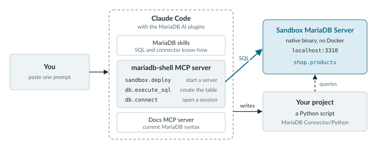

# AI Tools

The shop's search box now finds the desk lamp when a customer asks for "something to light my desk", and a coding agent wrote most of the code behind it. That's the first of two jobs agents do with MariaDB. One helps you build, on your machine, against a sandbox server. The other acts on live data in production, such as a support bot that looks up an order, and it needs access you can control and audit. These pages cover the tools for both, plus the retrieval pipelines that sit between your data and a language model.

Vector search itself isn't on this list, because it's built into MariaDB Server. Its reference stays with the [server documentation]({server}/reference/sql-structure/vectors).

## Build With a Coding Agent

A coding agent writes better MariaDB code when it knows MariaDB and can try its SQL before you run it. The MariaDB AI plugins give it both. Skills are MariaDB reference material that the agent reads when a task needs it, such as how `ALTER TABLE` behaves or how vector indexes work. The `mariadb-shell` MCP server is a live connection the agent drives through tool calls, so it can start a sandbox server, create tables, and check its own queries.

<figure><picture><source srcset=".gitbook/assets/ai-tools-agent-setup-dark.svg" media="(prefers-color-scheme: dark)"></picture><figcaption><p>Everything the agent builds runs against a sandbox server that you can delete afterward.</p></figcaption></figure>

Install the plugin for your agent:



```bash
claude plugin marketplace add mariadb/ai-plugins
claude plugin install dev@mariadb
```



```bash
codex plugin marketplace add mariadb/ai-plugins
codex plugin add dev@mariadb
```



```bash
pi install git:github.com/mariadb/ai-plugins
```



```bash
hermes plugins install mariadb/ai-plugins#hermes/dev-plugin --enable
```



The `mariadb-shell` MCP server starts out allowed to reach nothing. Before the agent works against your own databases, run `mariadb-shell -- mcp setup` once per machine to choose the connections and folders it may use. Add the docs MCP server too, so the agent reads current MariaDB syntax instead of guessing from older training data:

```bash
claude mcp add --transport http mariadb-docs \
  https://mariadb.com/docs/~gitbook/mcp
```

[AI Plugins and Skills](ai-plugins-and-skills.md) covers the three plugin variants and what each one installs, and the [plugin repository](https://github.com/mariadb/ai-plugins) has setup steps for OpenCode.

## Give Agents Access to Live Data

A coding agent on your laptop can do almost anything to a sandbox. An agent that answers customers can't, so it reaches the database through an MCP server that decides what it may see and do. MariaDB has four, and the right one depends on where your databases run.

| MCP server | Where it runs | Use it for |
| --- | --- | --- |
| `mariadb-shell` MCP server | On your machine, started by the MariaDB AI plugins | Development with a coding agent, including sandbox servers |
| Open-source MCP server | Wherever you host it, from the `MariaDB/mcp` project | SQL and vector search against your own MariaDB servers |
| MariaDB Enterprise MCP Server | Your infrastructure, as part of MariaDB Enterprise Platform | One governed endpoint for production agents, with authentication and access control |
| MariaDB Cloud MCP Server | Alongside MariaDB Cloud | Launching and querying MariaDB Cloud databases from tools such as Cursor and Claude Desktop |

[Choose an MCP Server](choose-an-mcp-server.md) compares them in more detail.

## Retrieve and Generate

Retrieval-augmented generation (RAG) answers a question by first finding the right passages in your own data, then handing them to a language model. MariaDB AI RAG runs that whole pipeline on your infrastructure, from parsing and chunking documents to hybrid search and the generated answer. If your application already uses LangChain, LangChain MariaDB lets it keep its vectors and chat history in MariaDB instead of a separate store.

## Keep Going

<table data-view="cards"><thead><tr><th></th><th></th><th data-hidden data-card-target data-type="content-ref"></th></tr></thead><tbody><tr><td><strong>AI Plugins and Skills</strong></td><td>What the <code>dev</code>, <code>sql</code>, and <code>contributor</code> plugins install, and which agents they support.</td><td><a href="ai-plugins-and-skills.md">ai-plugins-and-skills.md</a></td></tr><tr><td><strong>Choose an MCP Server</strong></td><td>Compare the four MariaDB MCP servers by where they run and what they expose.</td><td><a href="choose-an-mcp-server.md">choose-an-mcp-server.md</a></td></tr><tr><td><strong>MariaDB Enterprise MCP Server</strong></td><td>Give production agents one authenticated, governed endpoint to your databases.</td><td><a href="mariadb-enterprise-mcp-server/README.md">mariadb-enterprise-mcp-server</a></td></tr><tr><td><strong>MariaDB Cloud MCP Server</strong></td><td>Launch and query MariaDB Cloud databases from your AI tools.</td><td><a href="{mariadb-cloud}/cloud-ai/mcp-server">mcp-server</a></td></tr><tr><td><strong>MariaDB AI RAG</strong></td><td>Run document ingestion, embedding, hybrid search, and answer generation on your own infrastructure.</td><td><a href="mariadb-ai-rag/README.md">mariadb-ai-rag</a></td></tr><tr><td><strong>LangChain MariaDB</strong></td><td>Use MariaDB as the vector store and chat history store for a LangChain application.</td><td><a href="langchain-mariadb/README.md">langchain-mariadb</a></td></tr></tbody></table>
