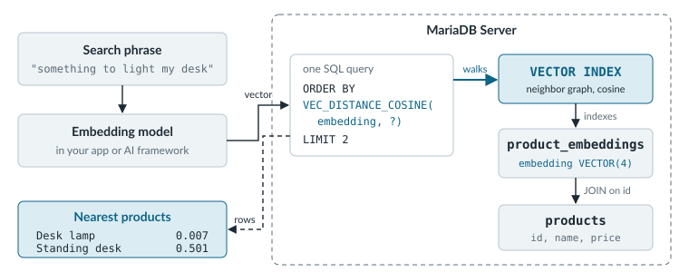

# AI

The shop sells the three products from the landing page: a desk lamp, a standing desk, and a notebook. A customer opens the shop and types "something to light my desk" into the search box. The search runs the query that every shop starts with, a `LIKE` match on the product name:

```sql
SELECT name FROM shop.products WHERE name LIKE '%light%';
```

It returns an empty set. The shop sells exactly what the customer wants, but the product is called "Desk lamp", and the word "light" appears nowhere in it. Keyword matching compares letters, so it can't see that a lamp is a light.

Semantic search compares meanings instead. An embedding model, which is an AI model that turns text into a list of numbers called a vector, places "something to light my desk" and "Desk lamp" close together because they mean similar things. MariaDB Server stores those vectors in the same database as the `products` table and finds the nearest ones in SQL.

<figure><picture><source srcset=".gitbook/assets/ai-semantic-search-dark.svg" media="(prefers-color-scheme: dark)"></picture><figcaption><p>The embedding model runs in your application, so the database only ever compares numbers, and one query returns both the matches and their names.</p></figcaption></figure>

Vector search is built into MariaDB Community Server from 11.7 and MariaDB Enterprise Server from 11.4.5-3, so there's no plugin or extension to install.

## Add Semantic Search



### Create a Vector Table

Create a table that holds one `VECTOR` value per product, with a `VECTOR INDEX` built for cosine distance, which measures how closely two vectors point in the same direction.

```sql
CREATE TABLE shop.product_embeddings (
  product_id INT PRIMARY KEY,
  embedding  VECTOR(4) NOT NULL,
  VECTOR INDEX (embedding) DISTANCE=cosine
);
```

The indexed column must be `NOT NULL`, and a table can have only one vector index. [CREATE TABLE with Vectors]({server}/reference/sql-structure/vectors/create-table-with-vectors) covers the `M` and `DISTANCE` options.



### Insert the Vectors

The `VEC_FromText` function turns a JSON array of numbers into a vector value. Every row needs the same number of dimensions as the column, which is four here so the numbers stay readable. A real embedding model produces hundreds or thousands, for example `VECTOR(768)`, and your application code writes them. The ids 1 to 3 are the desk lamp, the standing desk, and the notebook from [step 2 on the landing page](README.md#create-some-data).

```sql
INSERT INTO shop.product_embeddings (product_id, embedding) VALUES
  (1, VEC_FromText('[0.91, 0.12, 0.30, 0.05]')),
  (2, VEC_FromText('[0.20, 0.88, 0.35, 0.10]')),
  (3, VEC_FromText('[0.15, 0.10, 0.20, 0.95]'));
```

The [VEC\_FromText reference]({server}/reference/sql-functions/vector-functions/vec_fromtext) shows the binary format it produces, which is four bytes per dimension.



### Find the Nearest Products

The vector in this query stands in for the customer's phrase after the same model embeds it. Sort by the `VEC_DISTANCE_COSINE` function and stop at a `LIMIT`, because that `ORDER BY ... LIMIT` shape is what lets the optimizer walk the vector index. The join to the `products` table brings back names in the same query.

```sql
SELECT p.name,
       VEC_DISTANCE_COSINE(e.embedding, VEC_FromText('[0.85, 0.20, 0.25, 0.10]')) AS distance
FROM shop.product_embeddings AS e
JOIN shop.products AS p ON p.id = e.product_id
ORDER BY distance
LIMIT 2;
```

```
+---------------+---------------------+
| name          | distance            |
+---------------+---------------------+
| Desk lamp     | 0.00688833819260537 |
| Standing desk |  0.5012322990863076 |
+---------------+---------------------+
```

A smaller distance means a closer match. [Using the vector index efficiently]({server}/reference/sql-structure/vectors/vector-overview#using-the-vector-index-efficiently) lists the query patterns that fall back to a full table scan.



The customer who typed "something to light my desk" now sees the desk lamp first, and the notebook doesn't show up at all.

## Build With a Coding Agent

The steps above use made-up vectors. Wiring in a real embedding model, backfilling every product, and keeping the vectors current when a description changes is application code, and a coding agent can write most of it with you if it knows MariaDB.

The [MariaDB AI plugins](https://github.com/mariadb/ai-plugins) give Claude Code, Codex, Pi, Hermes Agent, and OpenCode a set of MariaDB skills, including one for vectors, plus a local sandbox server where the agent can try its SQL before you run it. Add the docs MCP server from the [landing page](README.md#keep-your-agent-in-the-docs) as well, so the agent reads the current `VECTOR` syntax instead of guessing from older training data. Ask it to add an embedding column for product descriptions, and it can check its own work against the reference. [AI Tools]({ai-tools}) covers both kinds of agent work: coding agents that build with you, and production agents that reach live data over MCP.

## Keep Going

<table data-view="cards"><thead><tr><th></th><th></th><th data-hidden data-card-target data-type="content-ref"></th></tr></thead><tbody><tr><td><strong>AI Tools</strong></td><td>Set up a coding agent that knows MariaDB, and choose an MCP server for agents that work on production data.</td><td><a href="{ai-tools}">ai-tools</a></td></tr><tr><td><strong>Vector Overview</strong></td><td>Read about the <code>VECTOR</code> data type, the HNSW-based vector index, and the distance functions before you design a production schema.</td><td><a href="{server}/reference/sql-structure/vectors/vector-overview">vector-overview</a></td></tr><tr><td><strong>Hybrid Search</strong></td><td>Merge vector matches and full-text keyword matches into one ranking with reciprocal rank fusion.</td><td><a href="{server}/reference/sql-structure/vectors/optimizing-hybrid-search-query-with-reciprocal-rank-fusion-rrf">optimizing-hybrid-search-query-with-reciprocal-rank-fusion-rrf</a></td></tr><tr><td><strong>Framework Integrations</strong></td><td>Use MariaDB as the vector store for LangChain, LlamaIndex, Spring AI, and other frameworks.</td><td><a href="{server}/reference/sql-structure/vectors/vector-framework-integrations">vector-framework-integrations</a></td></tr><tr><td><strong>MariaDB Enterprise MCP Server</strong></td><td>Give agents access to production databases with the authentication and permissions you set.</td><td><a href="{tools}/enterprise/mariadb-enterprise-mcp-server/introduction">introduction</a></td></tr><tr><td><strong>Vector Search Workshop</strong></td><td>Build semantic search step by step in Python with LangChain and MariaDB.</td><td><a href="https://github.com/mariadb-developers/vector-search-workshop">vector-search-workshop</a></td></tr><tr><td><strong>RAG Demo in Java</strong></td><td>Run retrieval augmented generation on MariaDB vector search with the OpenAI API.</td><td><a href="https://github.com/mariadb-developers/mariadb-rag-demo-java">mariadb-rag-demo-java</a></td></tr></tbody></table>
