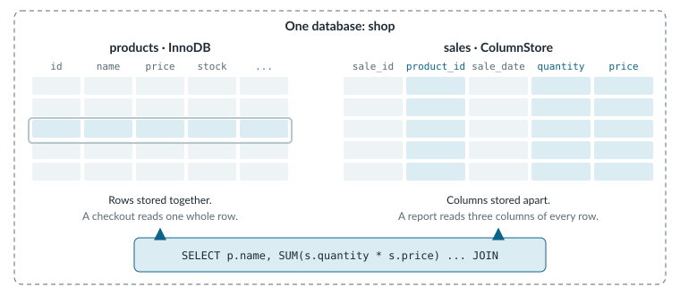

# Analytics

The shop has been taking orders for a few months, and every Monday someone asks the same question: which products earned the most last week? The first answer is a `GROUP BY` against the order tables, and it works fine until the data grows. Then the report starts scanning millions of rows on the same tables that checkout writes to, and both of them slow down.

The tables aren't the problem. Their layout is. InnoDB, the default storage engine, keeps each row together on disk, which is exactly right for a checkout that reads or writes one order. A report wants the opposite. It reads two or three columns from every row and ignores the rest.

<figure><picture><source srcset=".gitbook/assets/analytics-two-engines-dark.svg" media="(prefers-color-scheme: dark)"></picture><figcaption><p>Each table picks the storage engine that fits how it's read, and one query can join them.</p></figcaption></figure>

MariaDB ColumnStore stores each column on its own, so a report reads only the columns it names. Because every table in MariaDB Server chooses its own storage engine, the sales history can move to ColumnStore while products and orders stay on InnoDB, all in the same `shop` database. ColumnStore is open source and ships with MariaDB Community Server and MariaDB Enterprise Server.


To follow along, you need a server with ColumnStore installed. On MariaDB Community Server, install the `mariadb-plugin-columnstore` package (`MariaDB-columnstore-engine` on RHEL) from the MariaDB repository. For MariaDB Enterprise Server, the [single-node install guide]({analytics}/mariadb-columnstore/management/deployment/install-guide/singlenode-localstorage) walks through the setup.


## Give the Monday Report Its Own Engine



### Create a ColumnStore Table for Sales

Add a `sales` table to the `shop` database with `ENGINE=ColumnStore`. ColumnStore tables don't use primary keys or indexes the way InnoDB tables do, because the engine scans compressed columns instead of looking up rows.

```sql
CREATE TABLE shop.sales (
  sale_id    INT,
  product_id INT,
  sale_date  DATE,
  quantity   INT,
  price      DECIMAL(8,2)
) ENGINE=ColumnStore;
```

The [ColumnStore quickstart]({analytics}/mariadb-columnstore/columnstore-quickstart-guides/mariadb-columnstore-guide) explains how the engine stores and compresses each column.



### Load a Week of Sales

The `cpimport` tool ships with ColumnStore and writes straight to the column files, skipping the SQL layer, which makes it the fastest way to load history. It reads pipe-delimited text by default, so write a small file on the server host and load it.

```bash
printf '1|1|2026-09-01|2|39.00\n2|2|2026-09-01|1|249.00\n3|3|2026-09-02|10|4.50\n4|1|2026-09-03|3|39.00\n' > sales.txt

sudo cpimport shop sales sales.txt
```

Reports keep running while the load is in progress. When your order history already lives in an InnoDB table, an `INSERT INTO shop.sales SELECT ...` statement run outside a transaction becomes the same bulk load. [Data Loading with cpimport]({analytics}/mariadb-columnstore/clients-and-tools/data-import/mariadb-enterprise-columnstore-data-loading-with-cpimport) covers the file formats and options.



### Answer the Monday Question

Revenue per product needs the sales figures from ColumnStore and the product names from InnoDB. One `SELECT` reads both.

```sql
SELECT p.name, SUM(s.quantity * s.price) AS revenue
FROM shop.sales AS s
JOIN shop.products AS p ON p.id = s.product_id
GROUP BY p.name
ORDER BY revenue DESC;
```

ColumnStore reaches the InnoDB table through a cross-engine connection that you set up once with the `mcsSetConfig CrossEngineSupport` commands in [Start and Configure ColumnStore]({analytics}/mariadb-columnstore/management/deployment/install-guide/singlenode-localstorage/step-3-start-and-configure-enterprise-columnstore).



With the sales history on ColumnStore, the Monday report reads a few compressed columns and leaves checkout alone. When the sales history outgrows one server, MariaDB Exa spreads the same kind of query across a cluster as part of MariaDB Enterprise Platform.

## Keep Going

<table data-view="cards"><thead><tr><th></th><th></th><th data-hidden data-card-target data-type="content-ref"></th></tr></thead><tbody><tr><td><strong>Choose a Storage Engine</strong></td><td>Match each table to how your application reads and writes it.</td><td><a href="{server}/server-usage/storage-engines/choosing-the-right-storage-engine">choosing-the-right-storage-engine</a></td></tr><tr><td><strong>ColumnStore Hardware</strong></td><td>Size memory, disk, and CPU cores before you pick machines, since scan speed depends on all of them.</td><td><a href="{analytics}/mariadb-columnstore/columnstore-quickstart-guides/mariadb-columnstore-hardware-guide">mariadb-columnstore-hardware-guide</a></td></tr><tr><td><strong>HTAP Quickstart App</strong></td><td>A Docker walkthrough on GitHub that loads flight data into InnoDB and ColumnStore tables and joins across them.</td><td><a href="https://github.com/mariadb-developers/mariadb-htap-quickstart">mariadb-htap-quickstart</a></td></tr><tr><td><strong>Load Data With INSERT ... SELECT</strong></td><td>Copy rows from InnoDB tables into ColumnStore with plain SQL.</td><td><a href="{analytics}/mariadb-columnstore/clients-and-tools/data-import/mariadb-enterprise-columnstore-data-loading-with-insert-select">mariadb-enterprise-columnstore-data-loading-with-insert-select</a></td></tr><tr><td><strong>Deploy MariaDB Exa</strong></td><td>Run the largest analytical workloads on a separate cluster.</td><td><a href="{analytics}/mariadb-exa/deployment">deployment</a></td></tr><tr><td><strong>HTAP on MariaDB Cloud</strong></td><td>Pair a transactional MariaDB Cloud service with MariaDB Exa for analytics on the same data.</td><td><a href="{mariadb-cloud}/quickstart/htap-mariadb-exa">htap-mariadb-exa</a></td></tr></tbody></table>
