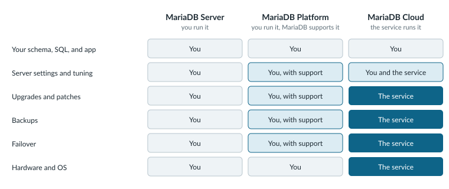

# Deployment

The shop works on your laptop. The `shop.products` table answers the Python query, the checkout page renders, and next week real customers start placing orders. From that moment, someone has to patch the server, take the backups, and get paged when a disk fails at 3 a.m.

Before you pick a machine, decide how much of that work you want. Every option runs the same MariaDB Server underneath, so the `products` table, your SQL, and your Python code move with you if you change your mind later. What changes is who handles the layers below your schema.

<figure><picture><source srcset=".gitbook/assets/deployment-who-runs-what-dark.svg" media="(prefers-color-scheme: dark)"></picture><figcaption><p>The top row never changes hands, so the choice is only about the operations work under your schema.</p></figcaption></figure>

A team that already runs Linux servers often starts with MariaDB Community Server and owns every row of the left column. MariaDB Enterprise Platform keeps the same work in your hands, with MariaDB support to call when an upgrade or a failover goes wrong. And when nobody on the team wants the pager, MariaDB Cloud takes backups and hardware off your plate, applies upgrades in a maintenance window you schedule, and fails over for you when the service runs with replicas.

<table data-view="cards"><thead><tr><th></th><th></th><th data-hidden data-card-target data-type="content-ref"></th></tr></thead><tbody><tr><td><strong>MariaDB Community Server</strong></td><td>Run the open source server yourself, on hardware or cloud instances you already operate.</td><td><a href="readme/community-server.md">community-server.md</a></td></tr><tr><td><strong>MariaDB Enterprise Platform</strong></td><td>Run MariaDB Enterprise Server with MaxScale, clustering, and analytics, tested together and backed by a support contract.</td><td><a href="readme/enterprise-platform.md">enterprise-platform.md</a></td></tr><tr><td><strong>MariaDB Cloud</strong></td><td>Hand hardware, upgrades, backups, and failover to the managed service and keep your attention on the shop.</td><td><a href="readme/cloud.md">cloud.md</a></td></tr></tbody></table>

## Install the Server

If you chose to run it yourself, the next job is a server that starts on boot and gets updates from a known source. Pick the tab that matches where the shop will run.



Distribution packages often trail the current MariaDB release by a few versions. The `mariadb_repo_setup` script points the `apt` package manager at MariaDB's own repository instead. Download it, check it against the checksum on the repository setup page (replace `<checksum>` below), and run it:

```bash
curl -LsSO https://r.mariadb.com/downloads/mariadb_repo_setup
echo "<checksum> mariadb_repo_setup" | sha256sum -c -
chmod +x mariadb_repo_setup
sudo ./mariadb_repo_setup
```

Then install the server, the client, and the `mariadb-backup` tool:

```bash
sudo apt update
sudo apt install mariadb-server mariadb-client mariadb-backup
sudo systemctl status mariadb
```

The package starts the `mariadb` service during the install, so the status check only confirms that it's running. To stay on one release series, run the setup script with `--mariadb-server-version="mariadb-11.8"`. [MariaDB Package Repository Setup and Usage]({server}/server-management/install-and-upgrade-mariadb/mariadb-package-repository-setup-and-usage) lists the checksums and every script option.



Distribution packages often trail the current MariaDB release by a few versions. The `mariadb_repo_setup` script points the `dnf` package manager at MariaDB's own repository instead. Download it, check it against the checksum on the repository setup page (replace `<checksum>` below), and run it:

```bash
curl -LsSO https://r.mariadb.com/downloads/mariadb_repo_setup
echo "<checksum> mariadb_repo_setup" | sha256sum -c -
chmod +x mariadb_repo_setup
sudo ./mariadb_repo_setup
```

Then install the packages and start the service, which also enables it on boot:

```bash
sudo dnf install MariaDB-server MariaDB-client MariaDB-backup
sudo systemctl enable --now mariadb
```

Packages from the MariaDB repository use capitalized names (`MariaDB-server`), unlike the distribution's own `mariadb-server` package. To stay on one release series, run the setup script with `--mariadb-server-version="mariadb-11.8"`. [MariaDB Package Repository Setup and Usage]({server}/server-management/install-and-upgrade-mariadb/mariadb-package-repository-setup-and-usage) lists the checksums and every script option.



The official image already carries the server, so you skip the repository setup. One `docker run` command starts MariaDB Server and creates the `shop` database and its application user:

```bash
docker run --detach --name mariadb \
  --publish 3306:3306 \
  --env MARIADB_ROOT_PASSWORD=changeme \
  --env MARIADB_DATABASE=shop \
  --env MARIADB_USER=app \
  --env MARIADB_PASSWORD=app-secret \
  --volume mariadb-data:/var/lib/mysql \
  mariadb:lts
```

The `mariadb-data` volume keeps the data directory when you replace the container, so an image upgrade doesn't take the `products` table with it. On first start, the image gives the `app` user full privileges on the `shop` database. [Docker Official Image Environment Variables]({server}/server-management/automated-mariadb-deployment-and-administration/docker-and-mariadb/mariadb-server-docker-official-image-environment-variables) lists the rest.



The MariaDB Enterprise Kubernetes Operator is part of MariaDB Enterprise Platform, and it pulls images with your customer credentials. Set those up first, then install the operator from its two Helm charts:

```bash
helm repo add mariadb-enterprise-operator https://operator.mariadb.com
helm install mariadb-enterprise-operator-crds \
  mariadb-enterprise-operator/mariadb-enterprise-operator-crds
helm install mariadb-enterprise-operator \
  mariadb-enterprise-operator/mariadb-enterprise-operator \
  -f values.yaml
```

The `values.yaml` file names the `mariadb-enterprise` pull secret. Next, store the database password in a Kubernetes `Secret`, then describe the server as a `MariaDB` custom resource and apply it with `kubectl apply -f mariadb.yaml`:

```bash
kubectl create secret generic mariadb --from-literal=password=app-secret
```

```yaml
apiVersion: enterprise.mariadb.com/v1alpha1
kind: MariaDB
metadata:
  name: mariadb
spec:
  rootPasswordSecretKeyRef:
    name: mariadb
    key: password
  imagePullSecrets:
    - name: mariadb-enterprise
  username: app
  passwordSecretKeyRef:
    name: mariadb
    key: password
  database: shop
  storage:
    size: 1Gi
  replicas: 1
```

[Install the operator with Helm]({tools}/mariadb-enterprise-operator/installation/helm) covers the `values.yaml` file, and the [standalone topology]({tools}/mariadb-enterprise-operator/topologies/standalone) page covers the rest of the `MariaDB` resource.



[The installation guide]({server}/mariadb-quickstart-guides/installing-mariadb-server-guide) also covers Windows and macOS.

## Secure the Server

A fresh package install trusts too much. The `mariadb-secure-installation` script asks you to set a root password, then removes root accounts reachable from other hosts, anonymous users, and the `test` database:

```bash
sudo mariadb-secure-installation
```

The shop code should never connect as root, because a bug in a checkout query would then have the power to drop every table. Connect with `sudo mariadb` and create an account that can only read and write rows in the `shop` database, and only from the subnet your application servers use:

```sql
CREATE USER 'app'@'10.0.0.%' IDENTIFIED BY 'app-secret';
GRANT SELECT, INSERT, UPDATE, DELETE ON shop.* TO 'app'@'10.0.0.%';
```

The Docker and Kubernetes tabs already created the `app` user with full rights on the `shop` database, so there you narrow its privileges if you need to. [CREATE USER]({server}/reference/sql-statements/account-management-sql-statements/create-user) and [GRANT]({server}/reference/sql-statements/account-management-sql-statements/grant) cover host patterns, roles, and TLS requirements.

Point the Python code at the new host as the `app` user, and the shop is ready for its first real customer.

## Keep Going

<table data-view="cards"><thead><tr><th></th><th></th><th data-hidden data-card-target data-type="content-ref"></th></tr></thead><tbody><tr><td><strong>Install From Packages</strong></td><td>Install MariaDB Server on Linux, Windows, or macOS, and check the service afterward.</td><td><a href="{server}/mariadb-quickstart-guides/installing-mariadb-server-guide">installing-mariadb-server-guide</a></td></tr><tr><td><strong>Run in Docker</strong></td><td>Run the official MariaDB image with volumes, configuration files, and initialization scripts.</td><td><a href="{server}/server-management/automated-mariadb-deployment-and-administration/docker-and-mariadb/installing-and-using-mariadb-via-docker">installing-and-using-mariadb-via-docker</a></td></tr><tr><td><strong>Kubernetes With Helm</strong></td><td>Install, upgrade, and remove the MariaDB Enterprise Kubernetes Operator charts.</td><td><a href="{tools}/mariadb-enterprise-operator/installation/helm">helm</a></td></tr><tr><td><strong>Launch on MariaDB Cloud</strong></td><td>Start a Serverless or Provisioned database from the MariaDB Cloud portal.</td><td><a href="{mariadb-cloud}/quickstart/using-the-portal">using-the-portal</a></td></tr><tr><td><strong>MariaDB Cloud With Terraform</strong></td><td>Provision and change MariaDB Cloud databases as infrastructure as code.</td><td><a href="{mariadb-cloud}/quickstart/launch-db-using-the-terraform-provider">launch-db-using-the-terraform-provider</a></td></tr><tr><td><strong>MariaDB Enterprise Manager</strong></td><td>Monitor and administer many servers from one console once the shop runs on more than one.</td><td><a href="{tools}/mariadb-enterprise-manager">mariadb-enterprise-manager</a></td></tr></tbody></table>
