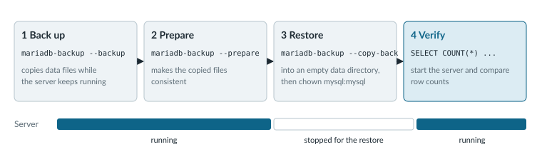

# Operations

It's late on a Friday when the disk under the shop's database server fails. The application is down, customers see errors, and the only question that matters is whether the data comes back. If a `mariadb-backup` job ran last night, the answer is yes, up to the moment that backup ran. If nobody has ever restored one of those backups, the answer is a hope.

The `mariadb-backup` tool copies the data files while MariaDB Server keeps running, so the nightly backup never takes the shop offline. A restore copies those files back instead of replaying every SQL statement, which keeps recovery fast even when the tables are large. The only time the server has to stop is while the files go back into place.

<figure><picture><source srcset=".gitbook/assets/operations-backup-restore-dark.svg" media="(prefers-color-scheme: dark)"></picture><figcaption><p>Customers lose access only during the third stage, so the length of an outage depends on how fast the files copy back.</p></figcaption></figure>

## Get Friday's Data Back

Run these steps on a test server before the Friday that needs them. A restore you have practiced once takes minutes. A restore you are reading about for the first time during an outage takes much longer.



### Take Last Night's Backup

The `mariadb-backup` tool connects to MariaDB Server as a user of its own, so create that user with the privileges the tool needs. Then point the tool at an empty target directory, which it creates if the directory doesn't exist yet.

```sql
CREATE USER 'mariadb-backup'@'localhost' IDENTIFIED BY 'mypassword';
GRANT RELOAD, PROCESS, LOCK TABLES, BINLOG MONITOR ON *.* TO 'mariadb-backup'@'localhost';
```

```bash
mariadb-backup --backup \
   --target-dir=/var/mariadb/backup/ \
   --user=mariadb-backup --password=mypassword
```

The [mariadb-backup overview]({server}/server-usage/backup-and-restore/mariadb-backup/mariadb-backup-overview) lists the privileges for older versions and for options such as `--galera-info`.



### Prepare the Files and Put Them Back

The tool copied the data files at slightly different moments while the shop kept taking writes, so the prepare step makes them consistent first. Then stop the server, move the damaged data directory (`/var/lib/mysql` by default) out of the way, copy the backup in, and give the files to the `mysql` user that MariaDB Server runs as.

```bash
mariadb-backup --prepare --target-dir=/var/mariadb/backup/

sudo systemctl stop mariadb
sudo mv /var/lib/mysql /var/lib/mysql.old
sudo mkdir /var/lib/mysql

sudo mariadb-backup --copy-back --target-dir=/var/mariadb/backup/
sudo chown -R mysql:mysql /var/lib/mysql/
```

Prepare the backup with the same version of the `mariadb-backup` tool that took it. [Full backup and restore]({server}/server-usage/backup-and-restore/mariadb-backup/full-backup-and-restore-with-mariadb-backup) covers the `--move-back` alternative and restoring with `rsync`.



### Check That the Shop Is Whole

Start the server and count the rows in a table whose contents you know. The `shop.products` table from the landing page should return 3, the same count it had when the backup ran.

```bash
sudo systemctl start mariadb
sudo mariadb -e "SELECT COUNT(*) FROM shop.products;"
```

When the counts match, the application can reconnect, and you can remove the old data directory at `/var/lib/mysql.old`. To keep nightly backups small between full copies, see [incremental backup and restore]({server}/server-usage/backup-and-restore/mariadb-backup/incremental-backup-and-restore-with-mariadb-backup).



The shop is back, with everything up to last night's backup. Orders placed after that backup ran are the part a single server can't give back.

## When One Server Isn't Enough

A replica, a second server that keeps its own copy of the data, covers both the outage and the lost orders. It applies each change from the primary server's binary log, usually within seconds, so a failed disk on the primary costs only the changes the replica hadn't applied yet, not a day of orders. MariaDB MaxScale sits between the application and the servers and spreads read queries across both, which is also where the shop starts getting faster. With [automatic failover]({maxscale}/mariadb-maxscale-tutorials/automatic-failover-with-mariadb-monitor) turned on in its monitor, MaxScale also promotes the replica when the primary fails. The [MariaDB Platform](readme/enterprise-platform.md) page shows how these pieces fit together.

## Keep Going

<table data-view="cards"><thead><tr><th></th><th></th><th data-hidden data-card-target data-type="content-ref"></th></tr></thead><tbody><tr><td><strong>Galera Cluster Quickstart</strong></td><td>Set up synchronous replication where every node can take writes.</td><td><a href="{galera}/galera-cluster-quickstart-guides/mariadb-galera-cluster-guide">mariadb-galera-cluster-guide</a></td></tr><tr><td><strong>MaxScale Quickstart</strong></td><td>Put MaxScale in front of your servers to route queries and handle failover for the application.</td><td><a href="{maxscale}/maxscale-quickstart-guides/maxscale-beginner-guide">maxscale-beginner-guide</a></td></tr><tr><td><strong>High Availability on MariaDB Cloud</strong></td><td>Get a replicated topology with automatic failover on the managed service.</td><td><a href="{mariadb-cloud}/high-availability-dr/ha-and-replicated-topology">ha-and-replicated-topology</a></td></tr><tr><td><strong>Benchmarking</strong></td><td>Measure the shop under a realistic load before and after each tuning change.</td><td><a href="{server}/ha-and-performance/benchmarking">benchmarking</a></td></tr><tr><td><strong>Backup and Restore Overview</strong></td><td>Compare logical dumps, physical backups, and point-in-time recovery to pick a schedule.</td><td><a href="{server}/server-usage/backup-and-restore">backup-and-restore</a></td></tr><tr><td><strong>MariaDB Enterprise Manager</strong></td><td>Monitor and administer a fleet of MariaDB servers from one console.</td><td><a href="{tools}/mariadb-enterprise-manager">mariadb-enterprise-manager</a></td></tr></tbody></table>
