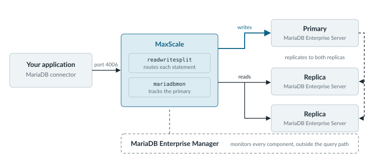

# MariaDB Platform

The shop outgrew its first server. During last month's sale, product pages sent thousands of reads a minute to the one machine that also took every order, and checkout slowed while the catalog loaded. A week later that server rebooted for a kernel update, and for four minutes nobody could buy anything. Both problems trace back to the same cause, because the Python script from the [landing page](../README.md) talks to exactly one server.

More servers fix the load, and replicas give you a copy to fall back on. The hard part is the application. It shouldn't need to know which server is the primary today, or which replica is free. MariaDB Enterprise Platform is how teams run this stage themselves: MariaDB Enterprise Server plus a set of components that MariaDB tests together and supports as one product. The first component most teams add is MariaDB MaxScale, a database proxy that sits between the application and the servers.

<figure><picture><source srcset="../.gitbook/assets/platform-request-path-dark.svg" media="(prefers-color-scheme: dark)"></picture><figcaption><p>The application only ever sees port 4006, so servers can join, fail, or change roles without a code change.</p></figcaption></figure>

MaxScale runs two modules that do the work. The `mariadbmon` monitor checks every server every few seconds and knows which one is the primary. The `readwritesplit` router uses that knowledge to send each `INSERT` or `UPDATE` to the primary and spread each `SELECT` across the replicas. MariaDB Enterprise Manager stays outside the query path, so it watches the whole deployment without adding a hop to any request.

## Put MaxScale in Front

The steps below build the first node of that diagram on Debian or Ubuntu: one MariaDB Enterprise Server with MaxScale in front of it. On RHEL, Rocky Linux, or AlmaLinux, use `dnf install` in place of `apt install`. The replicas come later, without a change to the application.



### Install MariaDB Enterprise Server

Copy your Customer Download Token from [the customer download page](https://customers.mariadb.com/downloads/token/). The `mariadb_es_repo_setup` script uses the token to configure the MariaDB Enterprise Server, MaxScale, and Enterprise Tools repositories in one pass.

```bash
curl -LsSO https://dlm.mariadb.com/enterprise-release-helpers/mariadb_es_repo_setup
chmod +x mariadb_es_repo_setup
sudo ./mariadb_es_repo_setup --token="CUSTOMER_DOWNLOAD_TOKEN" --apply \
   --mariadb-server-version="11.8"

sudo apt update
sudo apt install mariadb-server mariadb-backup
```

[MariaDB Package Repository Setup and Usage]({server}/server-management/install-and-upgrade-mariadb/mariadb-package-repository-setup-and-usage) shows how to verify the script's checksum before you run it, and lists the other options it takes.



### Configure MaxScale

Install MaxScale from the repository that the script configured with `sudo apt install maxscale`. MaxScale needs its own database account to monitor the server and read user accounts, so open the `mariadb` client with `sudo mariadb` and create one:

```sql
CREATE USER 'maxscale' IDENTIFIED BY 'maxscale_passwd';
GRANT ALL PRIVILEGES ON *.* TO 'maxscale';
```

The broad grant keeps the test setup short. Now describe the deployment in the `/etc/maxscale.cnf` file. It names the server, attaches the `mariadbmon` monitor to it, builds a `readwritesplit` service on that monitor, and opens a listener on port 4006 for the application:

```ini
[server1]
type=server
address=127.0.0.1
port=3306

[MariaDB-Monitor]
type=monitor
module=mariadbmon
servers=server1
user=maxscale
password=maxscale_passwd
monitor_interval=2s

[Read-Write-Service]
type=service
router=readwritesplit
cluster=MariaDB-Monitor
user=maxscale
password=maxscale_passwd

[Read-Write-Listener]
type=listener
service=Read-Write-Service
port=4006
```

The [MaxScale beginner guide]({maxscale}/maxscale-quickstart-guides/maxscale-beginner-guide) explains each section and shows how to add replicas to the deployment.



### Check the Topology

Start MaxScale, then ask the `maxctrl` command-line client which servers it tracks. The last command sends a query through port 4006 to prove the path works end to end.

```bash
sudo systemctl start maxscale
maxctrl list servers

mariadb -h127.0.0.1 -P4006 -umaxscale -p -e "SELECT @@server_id"
```

The `server1` row should show the state `Master, Running`. If it shows `Down`, the log at `/var/log/maxscale/maxscale.log` says why. Point the shop's Python script at port 4006, with an account whose host pattern allows connections from MaxScale, and the application is done changing. The [ReadWriteSplit router]({maxscale}/reference/maxscale-routers/maxscale-readwritesplit) reference covers how reads move to replicas once you add them.



The next sale still sends thousands of product reads, but now each new replica takes a share of them, and the shop's code never learns their names.

The other components wait until the shop needs them. When a replica that lags a second behind isn't acceptable, because two warehouses update the same stock counts, you reach for [Galera Cluster]({galera}/galera-cluster-quickstart-guides/mariadb-galera-cluster-guide), where a commit returns only after every node in the cluster has received the write. When the Monday revenue report starts to slow checkout, you add a MariaDB ColumnStore table, and when that history outgrows one server, MariaDB Exa spreads it across a cluster (the [Analytics](../analytics.md) page follows that path). When the product catalog takes more reads than replicas can serve fast enough, GridGain keeps hot data in memory as the in-memory caching layer. When the number of servers passes what one person can watch by hand, MariaDB Enterprise Manager puts every server and MaxScale instance in one console. When the shop moves to Kubernetes, the MariaDB Enterprise Kubernetes Operator runs MariaDB Enterprise Server and MaxScale as custom resources. The [platform overview]({platform}/mariadb-platform-quickstart-guides/mariadb-overview-guide) shows how all of them connect.

## Keep Going

<table data-view="cards"><thead><tr><th></th><th></th><th data-hidden data-card-target data-type="content-ref"></th></tr></thead><tbody><tr><td><strong>Add Replicas to MaxScale</strong></td><td>Grow the one-server setup into a primary with replicas behind the read/write split service.</td><td><a href="{maxscale}/maxscale-quickstart-guides/maxscale-beginner-guide">maxscale-beginner-guide</a></td></tr><tr><td><strong>Galera Cluster Quickstart</strong></td><td>Set up synchronous replication where every node can take writes.</td><td><a href="{galera}/galera-cluster-quickstart-guides/mariadb-galera-cluster-guide">mariadb-galera-cluster-guide</a></td></tr><tr><td><strong>Secure the Deployment</strong></td><td>Lock down accounts, network access, and encryption before real orders arrive.</td><td><a href="{platform}/mariadb-platform-quickstart-guides/security">security</a></td></tr><tr><td><strong>Production Habits</strong></td><td>Plan backups and change management so a busy week doesn't turn into an outage.</td><td><a href="{platform}/mariadb-platform-quickstart-guides/mariadb-best-practices-guide">mariadb-best-practices-guide</a></td></tr><tr><td><strong>MariaDB Enterprise Manager</strong></td><td>Monitor and administer your servers and MaxScale instances from one console.</td><td><a href="{tools}/mariadb-enterprise-manager">mariadb-enterprise-manager</a></td></tr><tr><td><strong>Kubernetes Operator</strong></td><td>Install the operator with Helm and run MariaDB Enterprise Server and MaxScale as custom resources.</td><td><a href="{tools}/mariadb-enterprise-operator/installation/helm">helm</a></td></tr></tbody></table>
