# Document Knowledge Bases

A document knowledge base indexes files so that applications can retrieve passages or generated answers from them. This page shows how to create one, add documents, test it, and call it from an application.

<figure><figcaption><p>How a document knowledge base ingests documents and answers requests.</p></figcaption></figure>

## Create a Knowledge Base

1. In the MariaDB Cloud portal, select **AI Retrieval**.
2. Select **Create Knowledge Base**, or **Create Document Knowledge Base** on the first-use page. Choose **Document Knowledge Base** as the type.
3. Enter a **Name**. The **Description** is optional.
4. Under **Cloud Provider & Region**, select **AWS** and a region.
5. Under **Vector Store Configuration**, select one of these options:
   * **Use existing service** lists the Provisioned and Serverless MariaDB services in the same cloud and region that run MariaDB 11.8 or later.
   * **Auto-provision new service** creates a MariaDB Serverless instance for you. Enter a **Service Name** that starts with a letter and contains only lowercase letters, numbers, and hyphens.
6. Optionally, open **Advanced Options** to change the models and the reranker.
7. Select **Create Knowledge Base**.

<figure>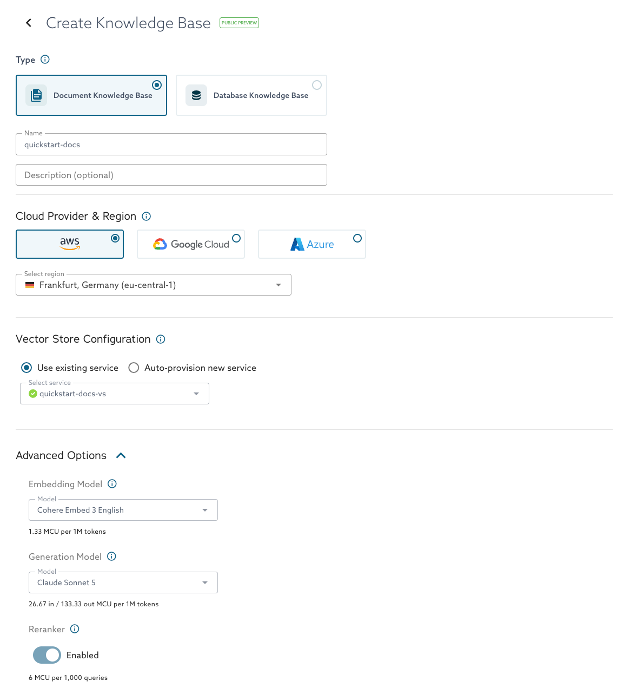<figcaption><p>The Create Knowledge Base page</p></figcaption></figure>

The knowledge base shows the status **Provisioning**, which usually takes a few minutes. When the status changes to **Ready**, you can add documents.

<figure>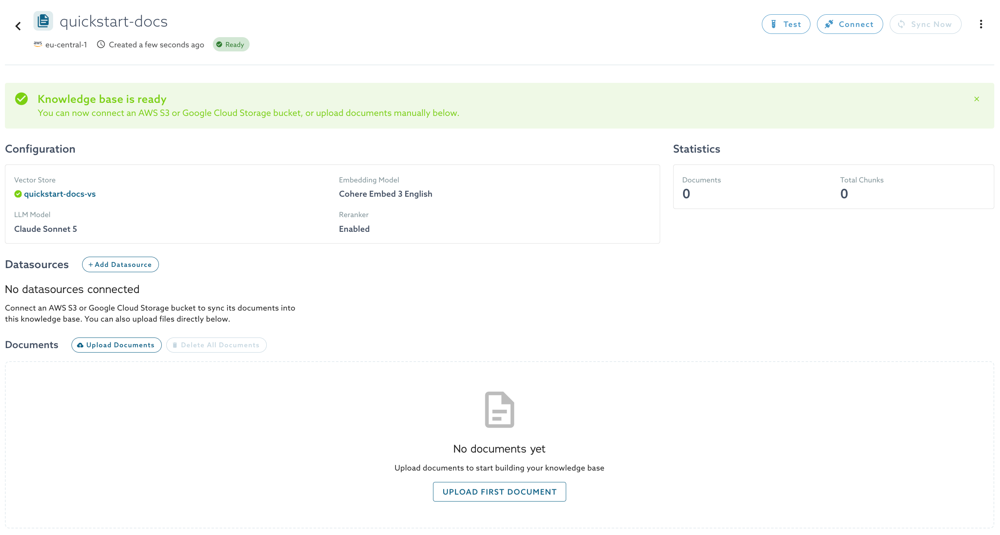<figcaption><p>A new knowledge base that is ready for documents</p></figcaption></figure>

### Advanced Options

| Option           | Description                                                                                                                                                                                                                                                        |
| ---------------- | ------------------------------------------------------------------------------------------------------------------------------------------------------------------------------------------------------------------------------------------------------------------ |
| Embedding Model  | Converts text into the vectors that semantic search uses.                                                                                                                                                                                                          |
| Generation Model | The default model that generates answers for Retrieve & Generate requests. A request can select a different model.                                                                                                                                                 |
| Reranker         | Re-scores the retrieved chunks with a reranking model, at the cost of slightly higher latency. It is on by default. When it is on, reranking applies to every retrieval. When it is off, a request can still turn it on. The reranker is billed per 1,000 queries. |


After you create a knowledge base, you can edit only its name and description. To use a different embedding model, generation model, or reranker setting for all requests, create a new knowledge base. A single request can still select a different generation model or turn reranking on or off.


## Add Documents

You can add documents in two ways. Upload files from your computer, or connect an Amazon S3 or Google Cloud Storage bucket and sync it.

### Upload Files

1. Open the knowledge base and select **Upload Documents**.
2. Drag files into the dialog, or select **Browse Files**. You can add up to 5 files of these types: PDF, DOCX, PPTX, MD, TXT, HTML, and JSON. Each file can be up to 50 MB.
3. Select **Next**.
4. Choose a **Parsing Strategy** and a **Chunking Strategy**. See [Parsing and Chunking](parsing-and-chunking.md).
5. Select **Upload**.

<figure>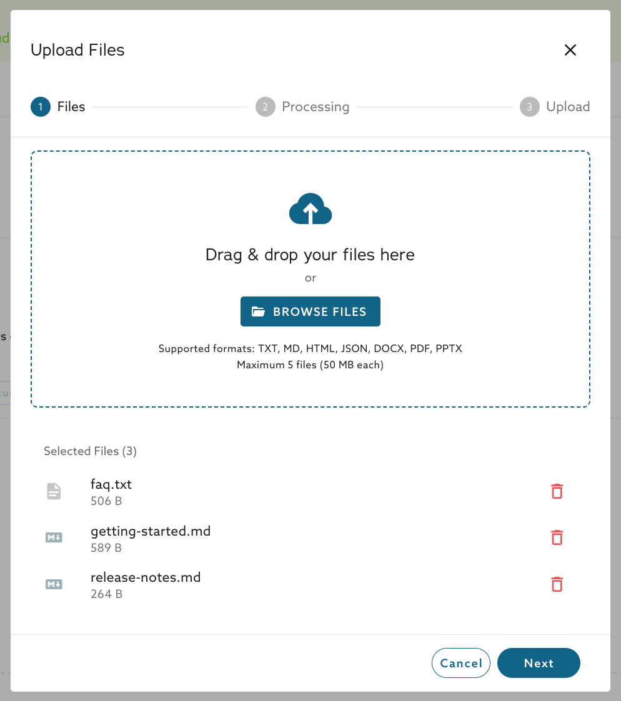<figcaption><p>The Files step of the Upload Files dialog</p></figcaption></figure>

<figure>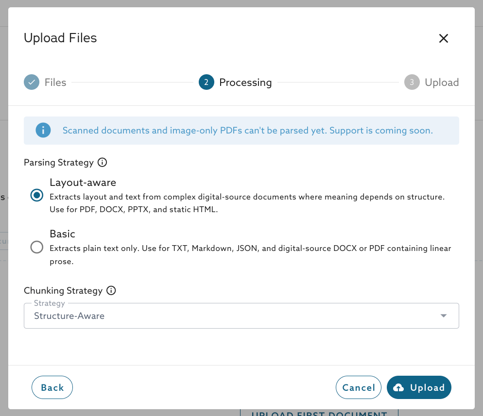<figcaption><p>The Processing step of the Upload Files dialog</p></figcaption></figure>

The files appear in the **Documents** table. The **Status** column shows where each document is in the pipeline. A document starts as **Queued**, shows **Download** while AI Retrieval processes it, and ends as **Ingested**, or as **Failed** if processing does not succeed.

| Status   | Meaning                                                                                                                                           |
| -------- | ------------------------------------------------------------------------------------------------------------------------------------------------- |
| Queued   | The document is waiting to be processed.                                                                                                          |
| Download | AI Retrieval is processing the file. The status can stay on **Download** while the document is parsed, chunked, and embedded.                     |
| Ingested | The document is indexed. The **Chunks** column shows how many chunks it produced.                                                                 |
| Failed   | Processing did not succeed. A warning icon next to the status shows the error message.                                                            |
| Retrying | Processing met an error, and AI Retrieval retries the document automatically. A warning icon shows the error message.                             |

The status can lag behind the actual state of a document, and a document can show a different status until you reload the page. See [Troubleshooting](document-knowledge-bases.md#troubleshooting).

### Monitor Ingestion

The **Documents** table shows the status of each document, and the **Chunks** column shows how many chunks it produced. For a data source, select **View Sync History** to see each sync.

To monitor ingestion from an application, register a webhook with the ingestion API. AI Retrieval then notifies your endpoint when a document is ingested and when an ingestion job completes or fails.

### Connect a Storage Bucket

A data source connects a bucket to the knowledge base. AI Retrieval reads the documents in the bucket when you sync the data source.

1. Open the knowledge base and select **Add Datasource**.
2.  On the **Connect** step, enter the following values.

    | Field                        | Description                                                                                                                                    |
    | ---------------------------- | ---------------------------------------------------------------------------------------------------------------------------------------------- |
    | Name                         | 3 to 63 characters. It must start and end with a letter or number, and it can contain letters, numbers, spaces, hyphens, and underscores.      |
    | Cloud Provider               | **AWS** for Amazon S3, or **Google Cloud** for Google Cloud Storage.                                                                           |
    | Storage Path                 | The bucket, for example `s3://my_bucket`, or `gs://my_bucket` for Google Cloud Storage. The `s3://` prefix is optional.                        |
    | Prefix                       | Optional. Limits the scan to objects whose keys begin with this value, for example `documents/2026/`. Leave it empty to scan the whole bucket. |
    | Access Key ID and Access Key | The credentials of an AWS identity that can read the bucket.                                                                                   |
    | Region                       | The region of the bucket.                                                                                                                      |
3. Select **Test Connection** to check the values.
4. Select **Next**, choose the parsing and chunking strategies for the data source, and select **Add**.
5. On the **Sync** step, select **Sync** to ingest the documents now, or **Later**.

<figure>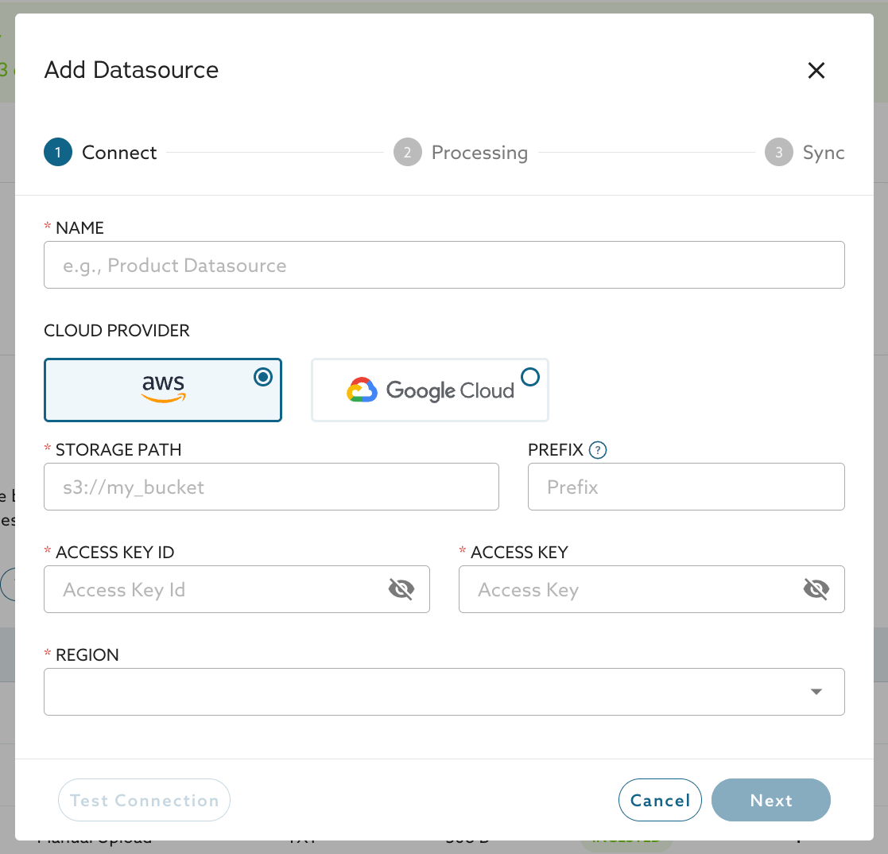<figcaption><p>The Connect step of the Add Datasource dialog</p></figcaption></figure>

<figure>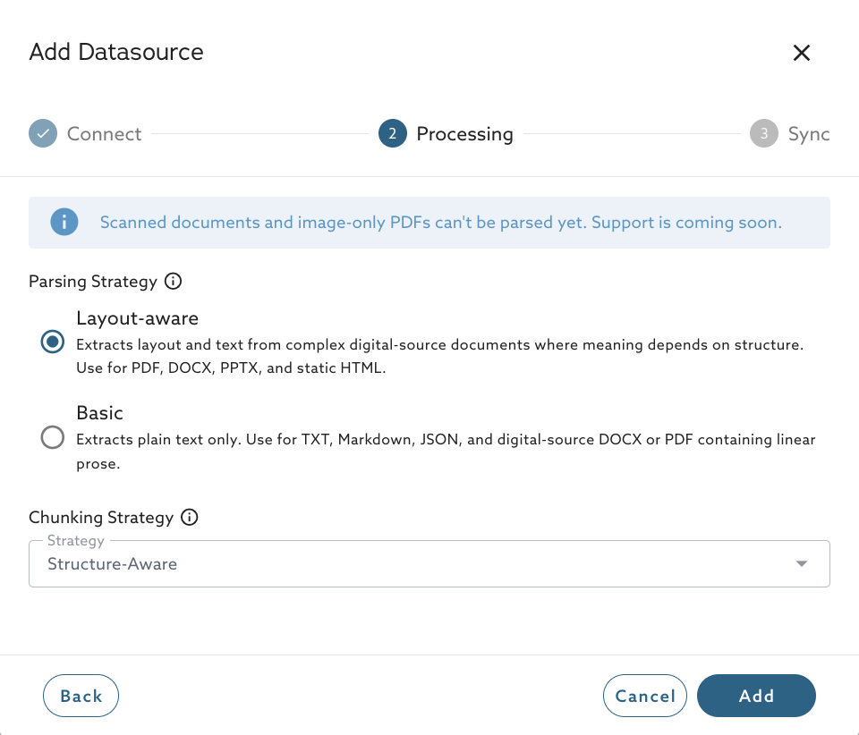<figcaption><p>The Processing step of the Add Datasource dialog</p></figcaption></figure>

The credentials need these permissions on the bucket:

* `s3:ListBucket` on the bucket, which **Test Connection** also uses.
* `s3:GetObject` on the objects that you want to ingest.

For Google Cloud Storage, the dialog asks for a service account key in JSON format instead of access keys. The service account needs these permissions on the bucket:

* `storage.buckets.get`, which **Test Connection** uses.
* `storage.objects.list` on the bucket.
* `storage.objects.get` on the objects that you want to ingest.

<figure>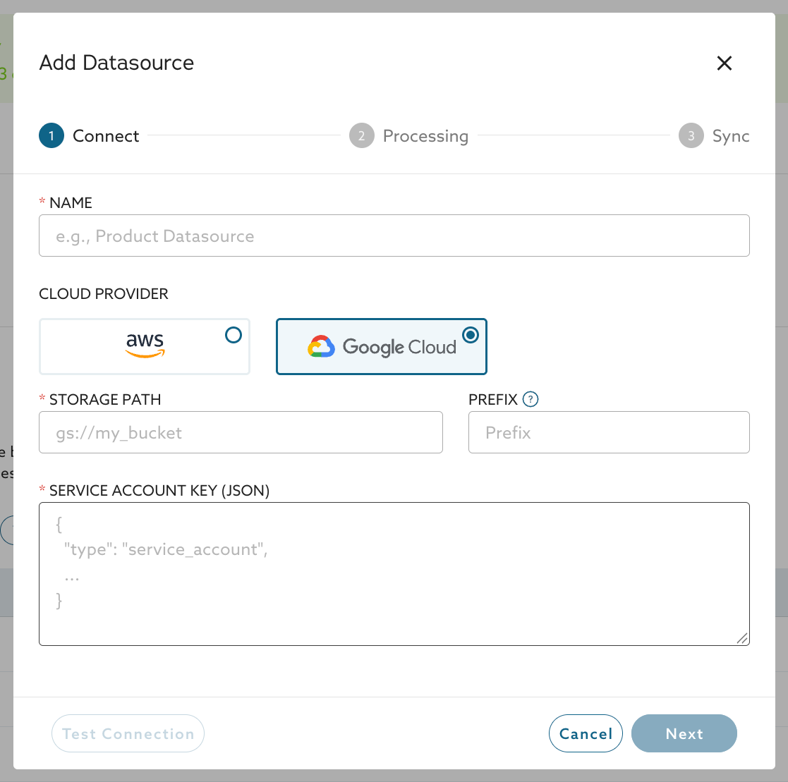<figcaption><p>The Connect step with Google Cloud selected</p></figcaption></figure>

AI Retrieval does not ingest the documents of a data source automatically. Removing a file from the bucket does not remove its document from the knowledge base, so delete the document in the knowledge base. If you delete a document in the knowledge base while its file is still in the bucket, the next sync ingests the file again. Select **Sync Now**, or **Sync** in the data source list, whenever you add files to the bucket. To review earlier syncs, select **View Sync History**.

## Parsing and Chunking Strategies

A parsing strategy controls how AI Retrieval reads a file. A chunking strategy controls how it splits the text for indexing. The defaults are **Layout-aware** parsing and **Structure-aware** chunking. For the options, the chunk size and overlap fields, and guidance on choosing, see [Parsing and Chunking](parsing-and-chunking.md).

## Test a Knowledge Base

1. Open the knowledge base and select **Test**.
2. Select the **Retrieve** tab, or the **Retrieve & Generate** tab.
3. Enter a question, and select **Test Query**.

The **Retrieve** tab shows the matching chunks with the file name, the chunk text, and the chunk ID. The **Retrieve & Generate** tab shows the generated answer, with numbers such as `[1]` that refer to the chunks it used. The **Request & Response** panel shows the HTTP request that the portal sent and the response. Select **Copy as cURL** to reuse the request in a terminal.

<figure>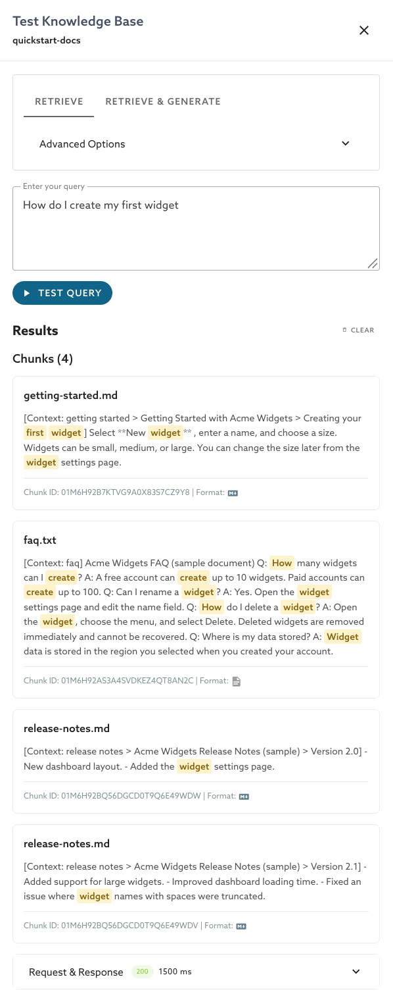<figcaption><p>Results on the Retrieve tab</p></figcaption></figure>

The portal highlights the words of your question in the results. The highlighting does not show why a chunk matched.

Open **Advanced Options** to change how a test runs.

| Option           | Default                | Description                                                                                                    |
| ---------------- | ---------------------- | -------------------------------------------------------------------------------------------------------------- |
| Top K Results    | 5                      | The number of chunks to retrieve. The portal accepts 1 to 100.                                                 |
| Retrieval Method | Hybrid                 | Hybrid, Semantic, or Full text.                                                                                |
| Documents        | All documents          | Limits the search to specific documents.                                                                       |
| Temperature      | 0.3                    | A value from 0 to 2. Lower values give more focused answers.                                                   |
| Top P            | 1                      | A value from 0 to 1. The model considers only the most likely tokens whose probabilities add up to this value. |
| Max Tokens       | 8192                   | A value from 64 to 8192. The maximum length of the generated answer.                                           |
| Reranker         | Knowledge base setting | Reorders the retrieved chunks with a reranking model. The choice applies to this test only.                    |
| Rerank Top K     | Top K                  | A value from 1 to 50. The number of chunks to keep after reranking. It appears when the reranker is on.        |

The Retrieve & Generate tab also has a **Generation Model** list. Temperature, Top P, Max Tokens, and the model apply only to generated answers.

<figure>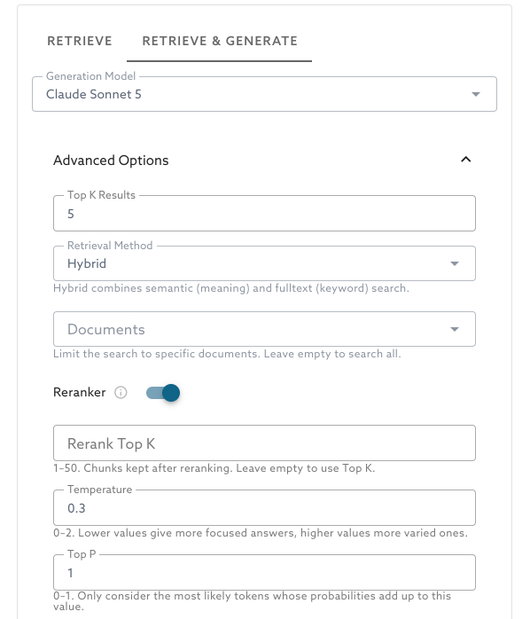<figcaption><p>Advanced Options of the Retrieve &#x26; Generate tab</p></figcaption></figure>

<figure>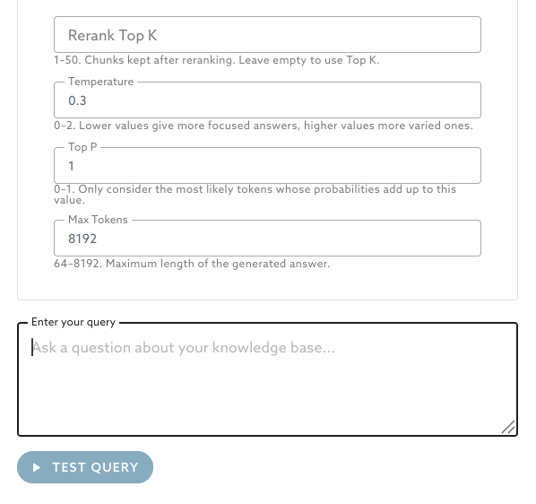<figcaption><p>The remaining Advanced Options</p></figcaption></figure>

## Connect Your Application

Applications call the knowledge base through a REST API and authenticate with an API key. Send the key as a bearer token in the `Authorization` header, or in the `X-API-Key` header.

### Create an API Key

1. In the **Connect** dialog of the knowledge base, select **Manage API keys**. You can also open your user profile and expand **API Keys**.
2. Select **Create New**.
3. Enter a name of up to 60 characters, and select **Create**.
4. Copy the key and store it safely. MariaDB Cloud shows the key only once.

<figure>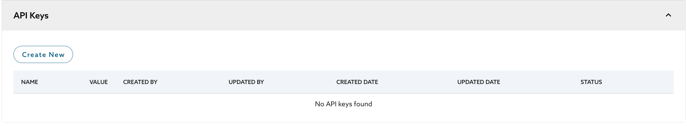<figcaption><p>The API Keys section of the user profile</p></figcaption></figure>

<figure>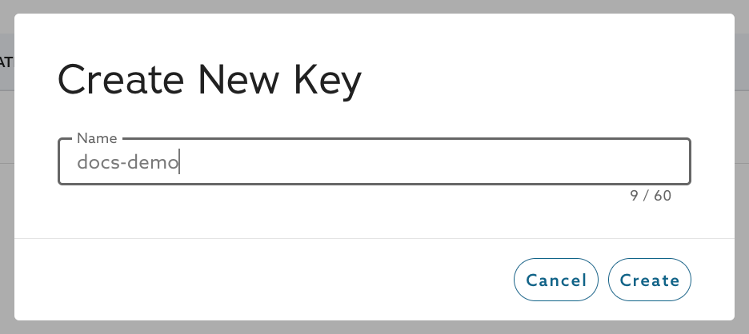<figcaption><p>The Create New Key dialog</p></figcaption></figure>

An API key belongs to your user account, not to a single knowledge base. To stop a key from working, select **Revoke** in the actions menu of its row. Select **Delete** to remove it.

### Send a Request

Select **Connect** on the knowledge base to see its endpoint and examples in cURL, Python, and JavaScript. The host depends on the region of the knowledge base, so copy the endpoint from the dialog. In the examples on this page, `ENDPOINT` stands for that host, and `KB_ID` for the ID of the knowledge base. The endpoint has this form:

```
https://ENDPOINT/ai/v1/knowledge-bases/KB_ID/retrieve-chunks
```

| Endpoint                                | Result                                      |
| --------------------------------------- | ------------------------------------------- |
| `…/retrieve-chunks`                     | The most relevant chunks.                   |
| `…/retrieve-chunks-and-generate`        | A generated answer with citations.          |
| `…/retrieve-chunks-and-generate/stream` | The generated answer as a stream of events. |

The following request retrieves chunks:

```bash
curl -X POST "https://ENDPOINT/ai/v1/knowledge-bases/KB_ID/retrieve-chunks" \
  -H "Authorization: Bearer API_KEY" \
  -H "Content-Type: application/json" \
  -d '{
    "query": "How many widgets can I create?",
    "retrieval_method": "hybrid",
    "top_k": 10
  }'
```

The request body accepts these fields.

| Field                       | Applies to | Description                                                                                            |
| --------------------------- | ---------- | ------------------------------------------------------------------------------------------------------ |
| `query`                     | All        | Required. The question, from 1 to 4096 characters.                                                     |
| `retrieval_method`          | All        | `hybrid` (default), `semantic`, or `fulltext`.                                                         |
| `top_k`                     | All        | The number of chunks to retrieve, from 1 to 100. The default is 10.                                    |
| `document_ids`              | All        | Limits the search to these document IDs.                                                               |
| `enable_rerank`             | All        | Turns reranking on or off for this request. The default is the knowledge base setting.                 |
| `rerank_top_k`              | All        | The number of chunks to keep after reranking, from 1 to 50. The default is `top_k`.                    |
| `min_similarity`            | All        | A value from 0 to 1. Semantic matches must exceed it. The default is 0.5. Full-text matches ignore it. |
| `llm_provider`, `llm_model` | Generate   | The model for this request. The default is the knowledge base setting.                                 |
| `temperature`               | Generate   | A value from 0 to 2. The default is 0.3.                                                               |
| `top_p`                     | Generate   | A value from 0 to 1. The default is 1.                                                                 |
| `max_tokens`                | Generate   | A value from 64 to 8192. The default is 8192.                                                          |
| `enable_citations`          | Generate   | Returns citations. The default is `true`.                                                              |

A `retrieve-chunks` response contains the `chunks` array. Each chunk has `chunk_id`, `document_id`, `chunk_text`, `chunk_index`, `score`, `document_name`, `file_name`, and `file_format`. The response also reports `total_chunks`, `retrieval_method`, and `reranking_enabled`.

A generate response contains the `answer`, a `citations` array, `chunks_retrieved`, `chunks_used`, and `timings`. Each citation has a `citation_id` that matches a number such as `[1]` in the answer, the `chunk_id`, the `document_id`, the `document_name`, and a preview of the chunk text.

The stream endpoint sends server-sent events. A `token` event carries part of the answer. The `final` event carries the complete answer and the citations. A `done` event ends the stream, and an `error` event reports a failure.

If your organization exceeds a request limit, the API returns HTTP status 429.

See [Service Quotas](service-quotas.md) for the limits.

## Manage Documents

Select the actions menu (⋮) in a document row to view its chunks, delete it, or, for a document that shows an error, retry it. Select **Delete All Documents** to remove every document from the knowledge base. Use **Search by file name** to find a document. The search covers only the documents on the current page.

## Troubleshooting

### A Document Stays Queued or Retrying

A document can stay in **Queued** or **Retrying** for a long time. The warning icon next to **Retrying** shows the error message, which can read **Internal processing error**. AI Retrieval retries a document that stops making progress automatically, up to three times, but only after a timeout of several hours. It does not retry a document that shows **Failed**.

* Check whether the content is already searchable. Run a query in the **Test** drawer. The status can lag behind the actual state.
* For a document that shows **Failed** or **Retrying** with a warning icon, select **Retry** in its actions menu (⋮). If the document still does not reach **Ingested**, delete it and upload it again.
* If you ingest many large documents from a bucket, give the sync time. A file that times out is retried once at the end of the sync, and you can run the sync again.
* A vector store on a small Serverless instance can slow ingestion down.
* Contact MariaDB Support if the problem continues.

### Test Connection Fails

| Problem                                | Likely cause                                                                    |
| -------------------------------------- | ------------------------------------------------------------------------------- |
| The bucket is not found                | The bucket name is wrong, or it does not exist in the region that you selected. |
| The credentials are not valid          | The access key ID or the access key is wrong.                                   |
| Access is denied                       | The credentials lack the `s3:ListBucket` permission on the bucket.              |
| The storage provider cannot be reached | A network problem, or a wrong region.                                           |

### A Document Produces No Text

Scanned documents are not supported yet. A PDF that contains only images of pages is ingested with 0 chunks, and no error is shown. Use a PDF that contains selectable text. Images inside documents are skipped.

<sub>_This page is: Copyright © 2026 MariaDB. All rights reserved._</sub>


