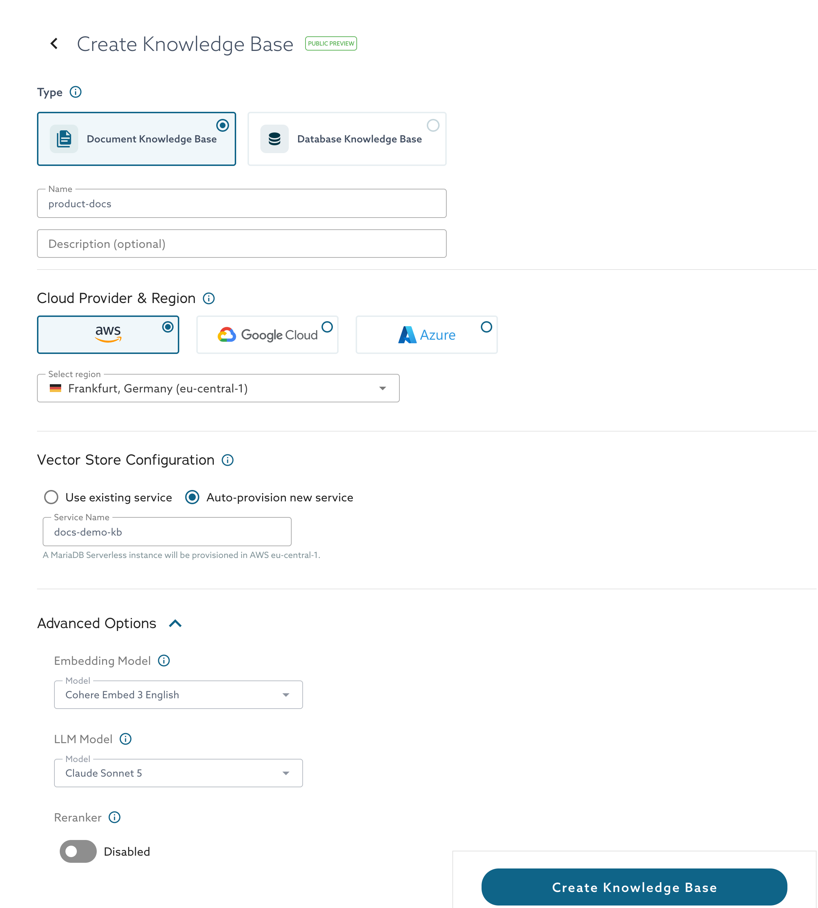
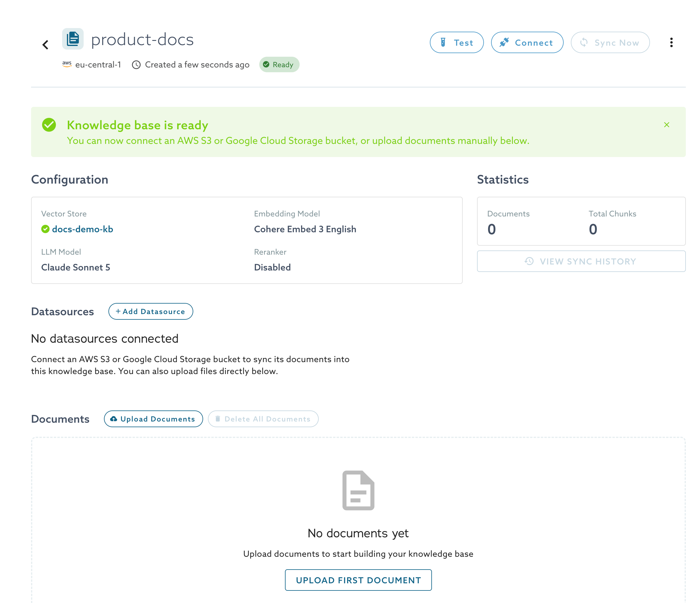
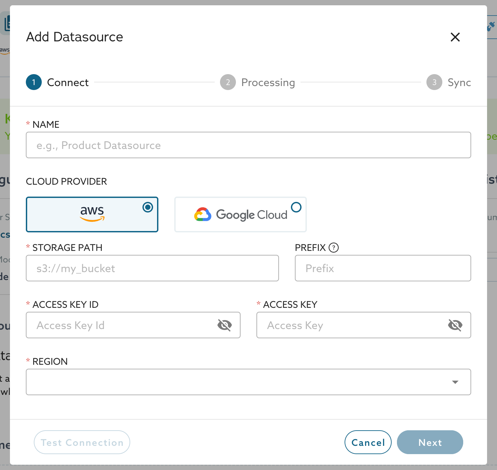
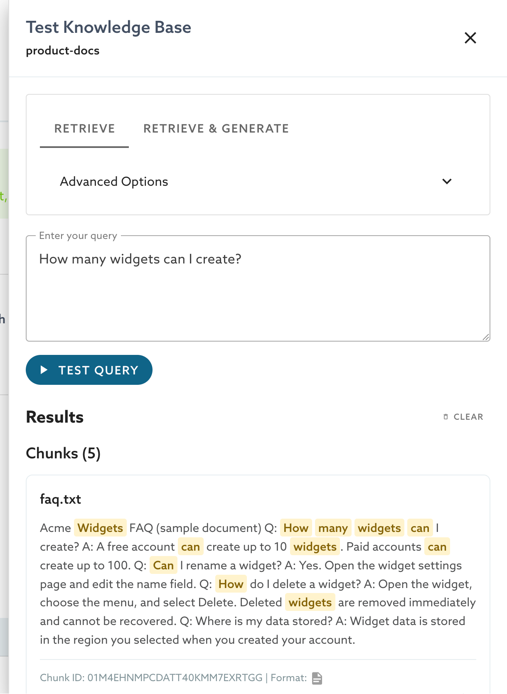
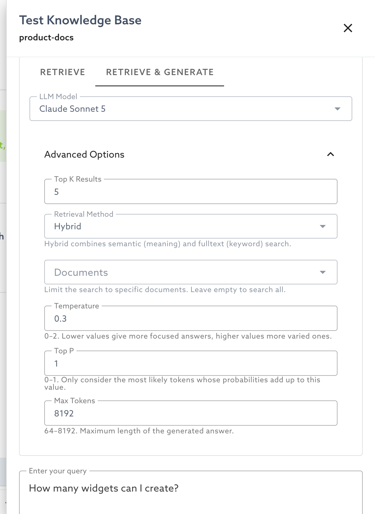
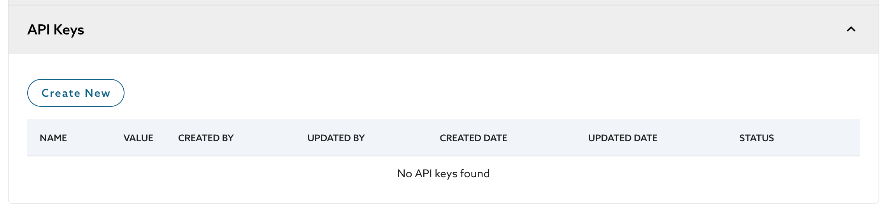
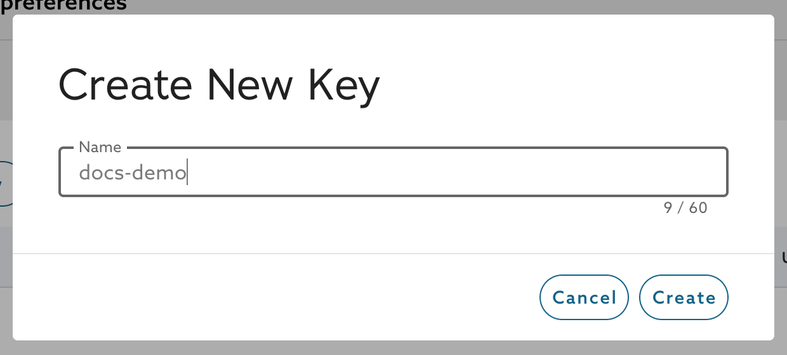

<!-- DRAFT for DOCS-6592. Hidden until the Public Preview launch. Open items are marked TODO. -->

# Document Knowledge Bases

A document knowledge base indexes files so that applications can retrieve passages or generated answers from them. This page shows how to create one, add documents, test it, and call it from an application.

## Create a Knowledge Base

1. In the MariaDB Cloud portal, select **AI Retrieval**.
2. Select **Create Knowledge Base**, or **Create Document Knowledge Base** on the first-use page. Choose **Document Knowledge Base** as the type.
3. Enter a **Name**. The **Description** is optional.
4. Under **Cloud Provider & Region**, select **AWS** and a region.
5. Under **Vector Store Configuration**, select one of these options:
   * **Use existing service** lists the MariaDB services in the same cloud and region that run MariaDB 11.8 or later.
   * **Auto-provision new service** creates a MariaDB Serverless instance for you. Enter a **Service Name** that starts with a letter and contains only lowercase letters, numbers, and hyphens.
6. Optionally, open **Advanced Options** to change the models and the reranker.
7. Select **Create Knowledge Base**.

<figure><figcaption><p>The Create Knowledge Base page</p></figcaption></figure>

<!-- TODO: recapture this screenshot in the production environment. The model names in it can change. -->

The knowledge base shows the status **Provisioning**, which usually takes a few minutes. When the status changes to **Ready**, you can add documents.

<figure><figcaption><p>A new knowledge base that is ready for documents</p></figcaption></figure>

### Advanced Options

| Option | Description |
| --- | --- |
| Embedding Model | Converts text into the vectors that semantic search uses. |
| LLM Model | The default model that generates answers for Retrieve & Generate requests. A request can select a different model. |
| Reranker | Re-scores the retrieved chunks to improve their order, at the cost of slightly higher latency. It is off by default. When it is on, reranking applies to every retrieval. When it is off, a request can still turn it on. |

<!-- TODO: confirm whether the reranker is a paid add-on (the portal tooltip says so) and whether it will be on by default at launch. -->


After you create a knowledge base, you can edit only its name and description. To use a different embedding model, LLM, or reranker setting, create a new knowledge base.


<!-- TODO: confirm in the Edit Knowledge Base dialog. The API accepts only name and description changes. -->

## Add Documents

You can add documents in two ways. Upload files from your computer, or connect an Amazon S3 or Google Cloud Storage bucket and sync it.

### Upload Files

1. Open the knowledge base and select **Upload Documents**.
2. Drag files into the dialog, or select **Browse Files**. You can add up to 5 files, and each file can be up to 50 MB.
3. Select **Next**.
4. Choose a **Parsing Strategy** and a **Chunking Strategy**. See [Parsing and Chunking Strategies](document-knowledge-bases.md#parsing-and-chunking-strategies).
5. Select **Upload**.

<figure><figcaption><p>The Files step of the Upload Files dialog</p></figcaption></figure>

<figure><figcaption><p>The Processing step of the Upload Files dialog</p></figcaption></figure>

The files appear in the **Documents** table. The **Status** column shows the stage that each document has reached. A document starts as **Queued**, then moves through download, parsing, chunking, embedding, and storage. It ends as **Ingested**.

| Status | Meaning |
| --- | --- |
| Queued | The document is waiting to be processed. |
| Download | AI Retrieval is fetching the file. |
| Ingested | The document is indexed. The **Chunks** column shows how many chunks it produced. |
| Retrying | Processing met an error. A warning icon shows the error message. |

<!-- TODO: confirm the portal labels of the stages after Download, and the label of a document that fails. The ingestion service defines the stages queued, download, parse, chunk, cleanse, enrich_metadata, embed, and store. -->

The status can lag behind the actual state of a document. See [Troubleshooting](document-knowledge-bases.md#troubleshooting).

### Connect a Storage Bucket

A data source connects a bucket to the knowledge base. AI Retrieval reads the documents in the bucket when you sync the data source.

1. Open the knowledge base and select **Add Datasource**.
2. On the **Connect** step, enter the following values.

   | Field | Description |
   | --- | --- |
   | Name | 3 to 63 characters. It must start and end with a letter or number, and it can contain letters, numbers, spaces, hyphens, and underscores. |
   | Cloud Provider | **AWS** for Amazon S3, or **Google Cloud** for Google Cloud Storage. |
   | Storage Path | The bucket, for example `s3://my_bucket`. The `s3://` prefix is optional. |
   | Prefix | Optional. Limits the scan to objects whose keys begin with this value, for example `documents/2026/`. Leave it empty to scan the whole bucket. |
   | Access Key ID and Access Key | The credentials of an AWS identity that can read the bucket. |
   | Region | The region of the bucket. |

3. Select **Test Connection** to check the values.
4. Select **Next**, and then choose the parsing and chunking strategies for the data source.
5. On the **Sync** step, select **Sync** to ingest the documents now, or **Later**.

<figure><figcaption><p>The Connect step of the Add Datasource dialog</p></figcaption></figure>

The credentials need these permissions on the bucket:

* `s3:ListBucket` on the bucket, which **Test Connection** also uses.
* `s3:GetObject` on the objects that you want to ingest.

For Google Cloud Storage, the dialog asks for a service account key in JSON format instead of access keys.

<!-- TODO: capture the Google Cloud Storage version of the dialog and the Processing step of the data source dialog, and document the permissions that a service account needs. -->

AI Retrieval does not ingest the documents of a data source automatically. Select **Sync Now**, or **Sync** in the data source list, whenever you add files to the bucket. To review earlier syncs, select **View Sync History**.

## Parsing and Chunking Strategies

A parsing strategy controls how AI Retrieval reads a file. A chunking strategy controls how it splits the text for indexing. The strategy that you choose affects how well retrieval finds the right passage.

| Parsing Strategy | Description |
| --- | --- |
| Layout-aware (default) | Extracts text and layout from complex digital documents. It captures headings, reading order, tables, and lists. |
| Basic | Extracts plain text only. It also handles text-based formats such as Markdown, HTML, and JSON. |

| Chunking Strategy | Description |
| --- | --- |
| Structure-aware (default) | Keeps tables, code blocks, and formulas as their own chunks and preserves the section context of each chunk. |
| Fixed-sized | Splits text into chunks of the token size that you set. |
| Sentence-based | Splits text at sentence boundaries and keeps each sentence whole within a chunk. |
| Recursive | Splits along paragraphs first, then sentences, then words, and keeps larger units intact until the size limit is reached. |
| Semantic | Groups sentences into chunks by meaning, so that related content stays together. |

<figure><figcaption><p>The chunking strategies</p></figcaption></figure>

## Test a Knowledge Base

1. Open the knowledge base and select **Test**.
2. Select the **Retrieve** tab, or the **Retrieve & Generate** tab.
3. Enter a question, and select **Test Query**.

The **Retrieve** tab shows the matching chunks with the file name, the chunk text, and the chunk ID. The **Retrieve & Generate** tab shows the generated answer, with numbers such as `[1]` that refer to the chunks it used. The **Request & Response** panel shows the HTTP request that the portal sent and the response. Select **Copy as cURL** to reuse the request in a terminal.

<figure><figcaption><p>Results on the Retrieve tab</p></figcaption></figure>

The portal highlights the words of your question in the results. The highlighting does not show why a chunk matched.

Open **Advanced Options** to change how a test runs.

| Option | Default | Description |
| --- | --- | --- |
| Top K Results | 5 | The number of chunks to retrieve. The portal accepts 1 to 100. |
| Retrieval Method | Hybrid | Hybrid, Semantic, or Full text. |
| Documents | All documents | Limits the search to specific documents. |
| Temperature | 0.3 | A value from 0 to 2. Lower values give more focused answers. |
| Top P | 1 | A value from 0 to 1. The model considers only the most likely tokens whose probabilities add up to this value. |
| Max Tokens | 8192 | A value from 64 to 8192. The maximum length of the generated answer. |

The Retrieve & Generate tab also has an **LLM Model** list. Temperature, Top P, Max Tokens, and the model apply only to generated answers.

<figure><figcaption><p>Advanced Options of the Retrieve & Generate tab</p></figcaption></figure>

## Connect Your Application

Applications call the knowledge base through a REST API and authenticate with an API key.

### Create an API Key

1. In the **Connect** dialog of the knowledge base, select **Manage API keys**. You can also open your user profile and expand **API Keys**.
2. Select **Create New**.
3. Enter a name of up to 60 characters, and select **Create**.
4. Copy the key and store it safely. MariaDB Cloud shows the key only once.

<figure><figcaption><p>The API Keys section of the user profile</p></figcaption></figure>

<figure><figcaption><p>The Create New Key dialog</p></figcaption></figure>

An API key belongs to your user account, not to a single knowledge base. To stop a key from working, select **Revoke** in the actions menu of its row. Select **Delete** to remove it.

<!-- TODO: confirm the key scope and the roles that can create keys. -->

### Send a Request

Select **Connect** on the knowledge base to see its endpoint and examples in cURL, Python, and JavaScript. The endpoint has this form:

```
https://ENDPOINT/retrieval/v1/knowledgebases/KB_ID/retrieve-chunks
```

<!-- TODO: replace ENDPOINT with the production host when it is known, and confirm that Authorization: Bearer is the supported header. -->

| Endpoint | Result |
| --- | --- |
| `…/retrieve-chunks` | The most relevant chunks. |
| `…/retrieve-chunks-and-generate` | A generated answer with citations. |
| `…/retrieve-chunks-and-generate/stream` | The generated answer as a stream of events. |

The following request retrieves chunks:

```bash
curl -X POST "https://ENDPOINT/retrieval/v1/knowledgebases/KB_ID/retrieve-chunks" \
  -H "Authorization: Bearer API_KEY" \
  -H "Content-Type: application/json" \
  -d '{
    "query": "How many widgets can I create?",
    "retrieval_method": "hybrid",
    "top_k": 10
  }'
```

The request body accepts these fields.

| Field | Applies to | Description |
| --- | --- | --- |
| `query` | All | Required. The question, from 1 to 4096 characters. |
| `retrieval_method` | All | `hybrid` (default), `semantic`, or `fulltext`. |
| `top_k` | All | The number of chunks to retrieve, from 1 to 100. The default is 10. |
| `document_ids` | All | Limits the search to these document IDs. |
| `enable_rerank` | All | Turns reranking on or off for this request. The default is the knowledge base setting. |
| `rerank_top_k` | All | The number of chunks to keep after reranking, from 1 to 50. The default is `top_k`. |
| `min_similarity` | All | A value from 0 to 1. Semantic matches must exceed it. The default is 0.5. Full-text matches ignore it. |
| `llm_provider`, `llm_model` | Generate | The model for this request. The default is the knowledge base setting. |
| `temperature` | Generate | A value from 0 to 2. The default is 0.3. |
| `top_p` | Generate | A value from 0 to 1. The default is 1. |
| `max_tokens` | Generate | A value from 64 to 8192. The default is 8192. |
| `enable_citations` | Generate | Returns citations. The default is `true`. |

<!-- TODO: Vijay stated a top_k limit of 150 on 2026-10-02. The API schema and the portal use 100. Confirm before publishing. -->

A `retrieve-chunks` response contains the `chunks` array. Each chunk has `chunk_id`, `document_id`, `chunk_text`, `chunk_index`, `score`, `document_name`, `file_name`, and `file_format`. The response also reports `total_chunks`, `retrieval_method`, and `reranking_enabled`.

A generate response contains the `answer`, a `citations` array, `chunks_retrieved`, `chunks_used`, and `timings`. Each citation has a `citation_id` that matches a number such as `[1]` in the answer, the `chunk_id`, the `document_id`, the `document_name`, and a preview of the chunk text.

The stream endpoint sends server-sent events. A `token` event carries part of the answer. The `final` event carries the complete answer and the citations. A `done` event ends the stream, and an `error` event reports a failure.

If your organization uses up its daily request quota, the API returns HTTP status 429.

<!-- TODO: document the quota values after the product team confirms them. The product requirements list 2 requests per second, but the code enforces a daily quota per organization. -->

## Manage Documents

Select the actions menu (⋮) in a document row to view its chunks or delete it. Select **Delete All Documents** to remove every document from the knowledge base. Use **Search by file name** to find a document.

## Troubleshooting

### A Document Stays Queued or Retrying

A document can stay in **Queued** or **Retrying** for a long time. The warning icon next to **Retrying** shows the error message, which can read **Internal processing error**.

* Check whether the content is already searchable. Run a query in the **Test** drawer. The status can lag behind the actual state.
* Delete the document, and upload it again.
* Contact MariaDB Support if the problem continues.

The **Retry** action in the actions menu is not available. Selecting it returns the error "Retry functionality is temporarily disabled while the ingestion pipeline is being stabilized."

<!-- TODO: re-verify the Retry behavior before the launch. Retry returns HTTP 501 in the ingestion service as of 2026-10-08, and the automatic retry loop is disabled. -->

### Test Connection Fails

| Problem | Likely cause |
| --- | --- |
| The bucket is not found | The bucket name is wrong, or it does not exist in the region that you selected. |
| The credentials are not valid | The access key ID or the access key is wrong. |
| Access is denied | The credentials lack the `s3:ListBucket` permission on the bucket. |
| The storage provider cannot be reached | A network problem, or a wrong region. |

### A Document Produces No Text

AI Retrieval cannot parse scanned documents. If a PDF contains only images of pages, it produces no chunks. Use a PDF that contains selectable text.

<sub>_This page is: Copyright © 2026 MariaDB. All rights reserved._</sub>
