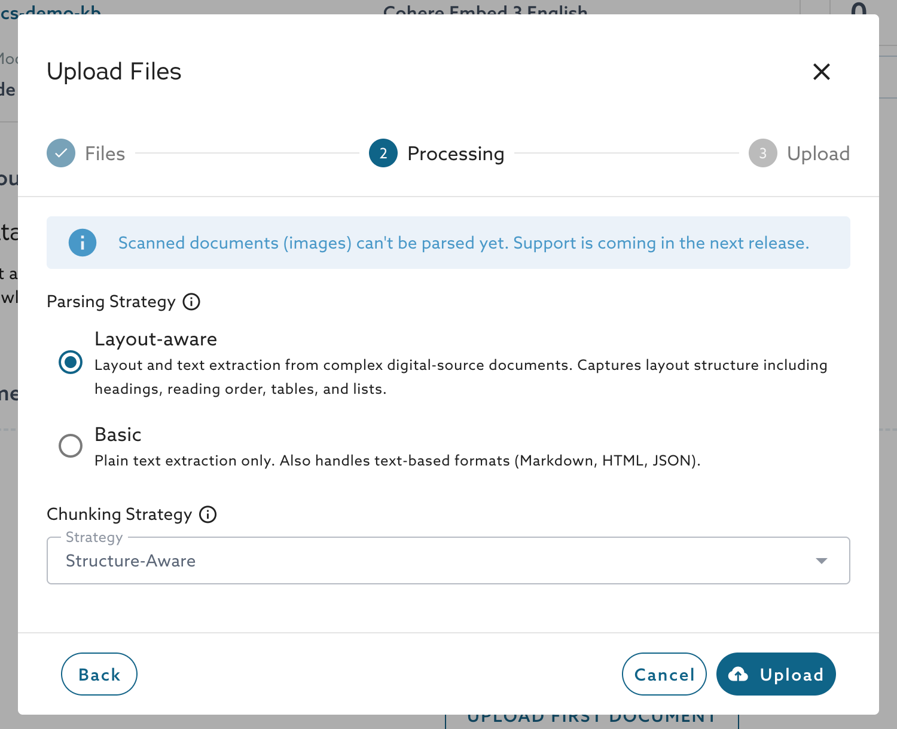
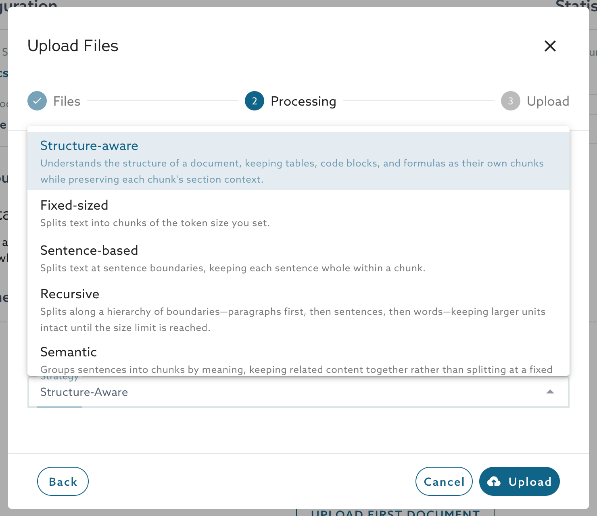
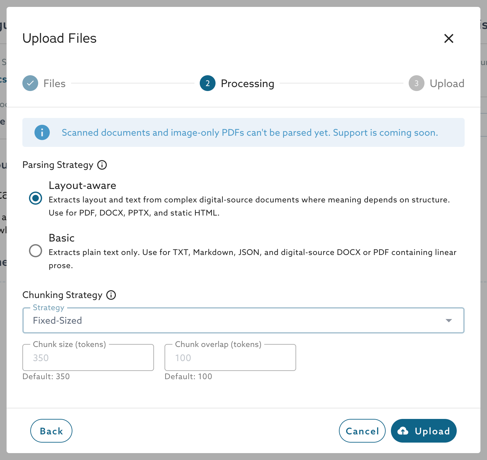

<!-- DRAFT for DOCS-6592. Hidden until the Public Preview launch. Moved out of document-knowledge-bases.md at Egor Ustinov's request on 2026-10-20, with guidance added. Open items are marked TODO. -->

# Parsing and Chunking

When AI Retrieval ingests a document, it first parses the file to extract its text, and then splits the text into chunks. AI Retrieval creates an embedding for each chunk and stores it in the vector store. A retrieval request returns chunks, so how a document is parsed and chunked decides which passages a question can find.

You choose a parsing strategy and a chunking strategy in the **Processing** step when you upload files, and again when you add a data source. The defaults are **Layout-aware** parsing and **Structure-aware** chunking.

<figure><figcaption>
The Processing step
</figcaption></figure>

<!-- TODO: this screenshot shows "Basic" because the test environment has not picked up the rename to "Base" (MCDEV-1484). Recapture it when the environment shows Base. Egor noted that the parser selector may be removed from the portal; ask him before the launch. -->

## Choose a Parsing Strategy

| Parsing strategy | What it does | Use it for |
| --- | --- | --- |
| Layout-aware (default) | Extracts the layout and the text of complex digital documents, where the meaning depends on the structure. | PDF, DOCX, PPTX, and static HTML files with headings, tables, lists, or several columns. |
| Base | Extracts plain text only. | TXT, Markdown, and JSON files, and digital DOCX or PDF files that contain linear prose. |

Both strategies read digital documents only. Scanned documents, which are PDFs that contain only images of pages, are not supported yet. Layout-aware parsing uses OCR to detect the layout of a page, not to read scanned pages.

Which strategy to choose:

* Keep **Layout-aware** when a document has tables, a heading structure, or a page layout that carries meaning. Use it with the **Structure-aware** chunking strategy, which relies on the document structure that Layout-aware parsing extracts.
* Choose **Base** for files that are plain text already. It does not add anything for a text or Markdown file.

<!-- Billing: Layout-aware parsing consumes 48 MCUs per 1,000 pages and Base 6; see usage-and-billing.md. -->

## Choose a Chunking Strategy

| Chunking strategy | How it splits the text | Options |
| --- | --- | --- |
| Structure-aware (default) | Follows the structure of the document. Keeps tables, code blocks, and formulas as their own chunks and keeps the section context of each chunk. | None. |
| Fixed-sized | Splits the text into chunks of the token size that you set. | Chunk size, chunk overlap |
| Sentence-based | Splits the text at sentence boundaries, so each sentence stays whole within a chunk. | Chunk size, chunk overlap |
| Recursive | Splits along paragraphs first, then sentences, then words. Keeps larger units intact until the size limit is reached. | Chunk size |
| Semantic | Groups sentences into chunks by meaning, so related content stays together. | Chunk size |

<figure><figcaption>
The chunking strategies
</figcaption></figure>

Which strategy to choose:

* Start with **Structure-aware**. It needs no tuning, and tables and code stay in one piece.


Use **Structure-aware** chunking with **Layout-aware** parsing. With **Base** parsing, Structure-aware chunking has no document structure to follow and falls back to the **Recursive** strategy.

* Choose **Recursive** for prose that is organized in paragraphs, such as articles and manuals, when you want a size limit that you control.
* Choose **Sentence-based** when a chunk should never end in the middle of a sentence.
* Choose **Fixed-sized** when you need chunks of a predictable size.
* Choose **Semantic** when a document changes topic without clear headings.

## Set the Chunk Size and Overlap

Every strategy except **Structure-aware** shows a **Chunk size (tokens)** field. **Fixed-sized** and **Sentence-based** also show a **Chunk overlap (tokens)** field.

<figure><figcaption>
The chunk size and overlap fields
</figcaption></figure>

| Setting | Default | Limits |
| --- | --- | --- |
| Chunk size | 350 tokens | At least 128 tokens. Cohere embedding models accept at most 350 tokens. |
| Chunk overlap | 100 tokens | Smaller than the chunk size. |

Guidance:

* A small chunk matches a question more precisely but carries less context. A large chunk carries more context but can mix several topics, which makes it match less precisely.
* The overlap repeats the end of one chunk at the start of the next. A larger overlap keeps a sentence that falls on a boundary readable in both chunks, but it creates more chunks to store and to embed.
* Chunk size has no upper limit other than the limit of the embedding model.
* When the reranker is on, it reads only the first 512 tokens of each chunk and ignores the rest, so a larger chunk is ranked on its beginning only. Keep the chunk size at 512 tokens or below when you use the reranker.

<!-- Source: skysql-ui-client ChunkingFields.vue and src/utils/chunking.ts @ 5356829b; ai-retrieval-cloud chunk_rules.py @ 5393bced; chunking/registry.py and parsers/registry.py @ a66a013d. -->

<!-- Vijay reviewed the strategy guidance, the chunk size limits, and the Structure-aware fallback on 2026-10-22 (DOCS-6592 comment 1144074). -->

<!-- TODO: confirm that changing the strategies applies only to documents that you ingest afterwards, and say so. -->

## Next Steps


[document-knowledge-bases.md](document-knowledge-bases.md)


_This page is: Copyright © 2026 MariaDB. All rights reserved._
