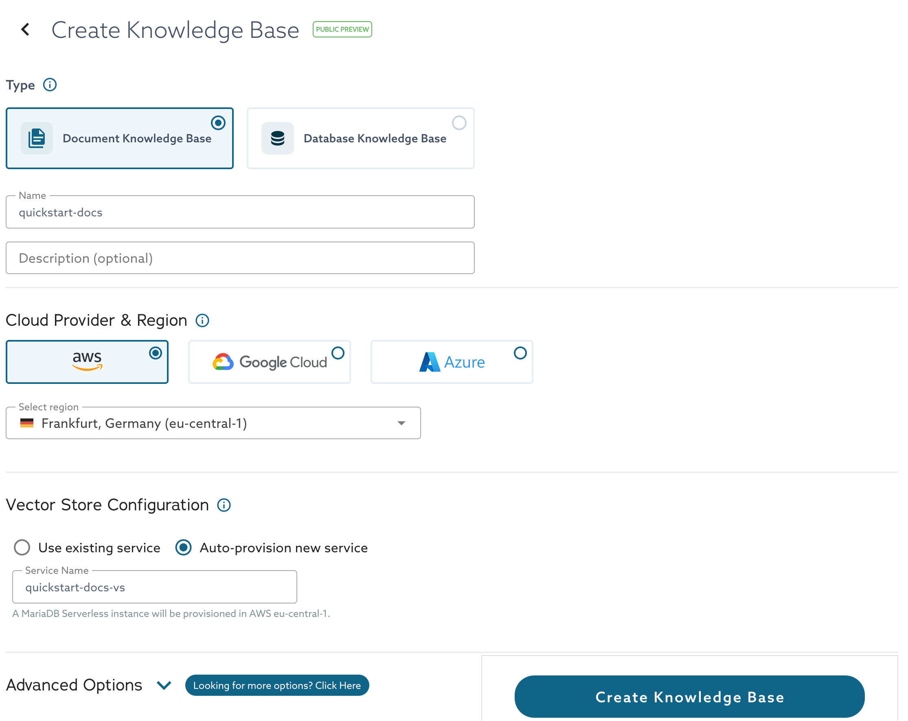
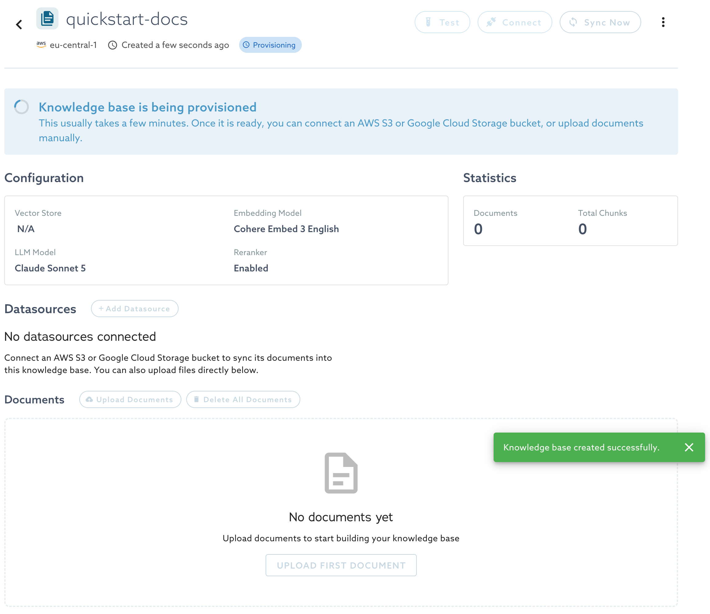
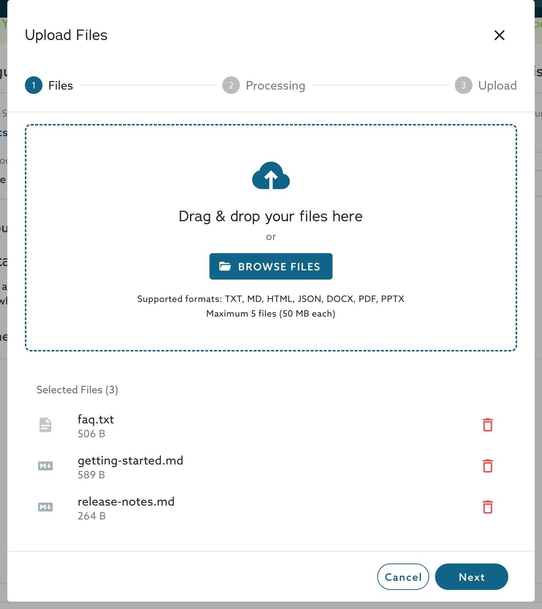
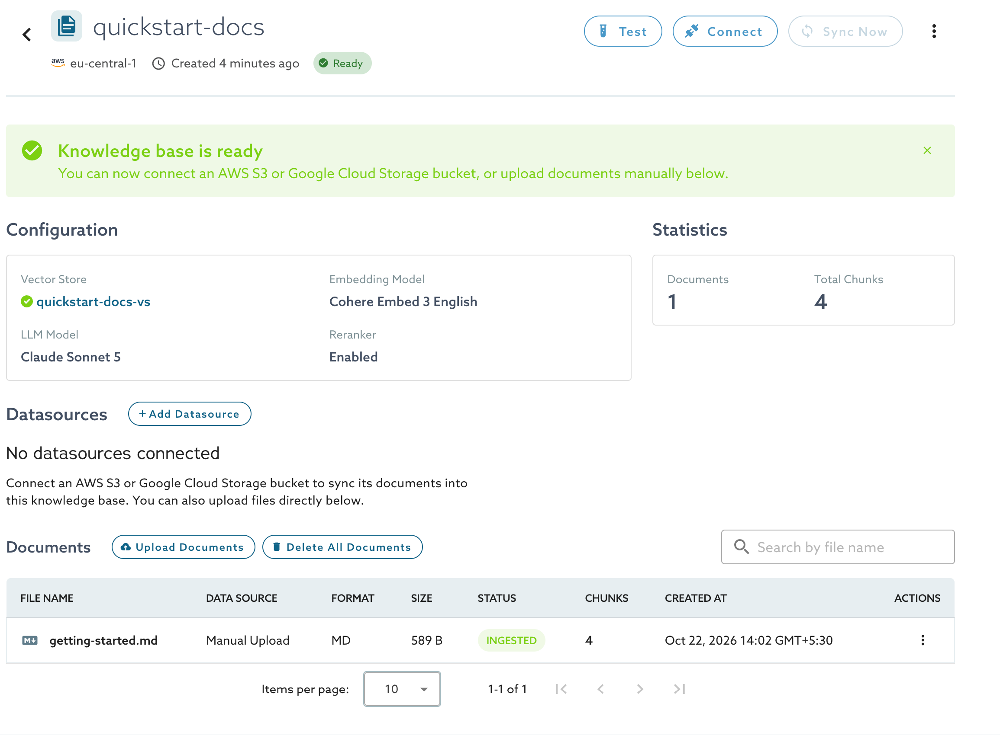
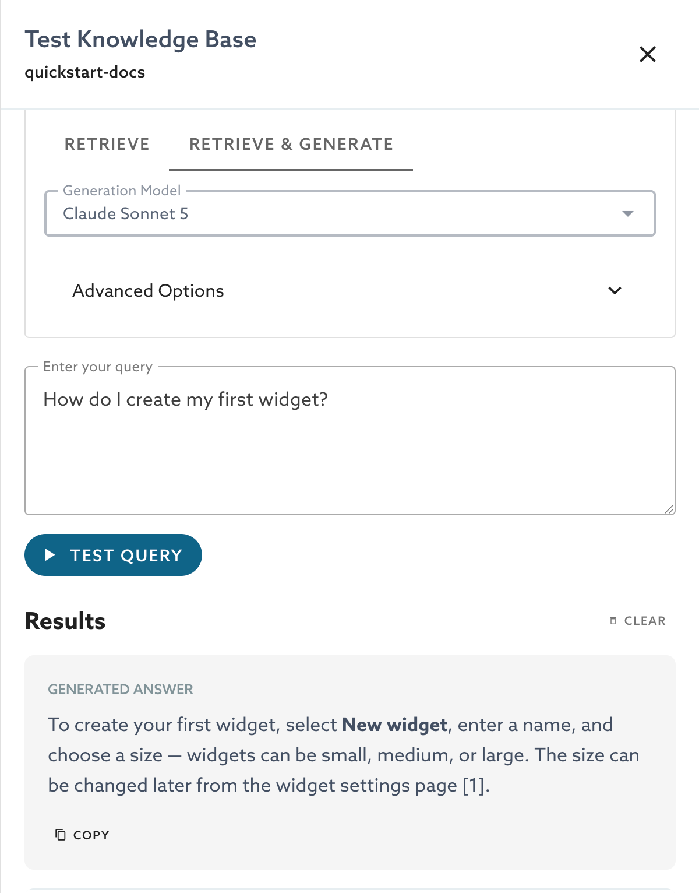

<!-- DRAFT for DOCS-6592. Hidden until the Public Preview launch. One page with two sections, as Egor Ustinov asked on 2026-10-20: defaults only, no model names, no data sources. Built from the recording of that call and from the guide. Open items are marked TODO. -->

# Quickstart

This quickstart creates a knowledge base with the default settings and runs a first query. It has two sections: one for a document knowledge base, which answers questions about files that you upload, and one for a database knowledge base, which answers questions about the data in a MariaDB service. For every option and the reasons behind the defaults, see [Document Knowledge Bases](document-knowledge-bases.md) and the other pages in this section.

## Before You Begin

* You need a MariaDB Cloud account and a role that can create knowledge bases. The Viewer role cannot.
* Knowledge bases run on AWS.

## Create a Document Knowledge Base

1. In the portal, select **AI Retrieval** in the navigation, and then **Create Knowledge Base**.
2. For **Type**, select **Document Knowledge Base**.
3. Enter a **Name**.
4. Leave **AWS** and the region as they are.
5. Under **Vector Store Configuration**, select **Auto-provision new service**. MariaDB Cloud creates a MariaDB Serverless service to store the vectors.
6. Select **Create Knowledge Base**.

<figure><figcaption>
The Create Knowledge Base form with the default settings
</figcaption></figure>

The knowledge base shows the status **Provisioning**. This usually takes a few minutes.

<figure><figcaption>
A knowledge base that is being provisioned
</figcaption></figure> When the status is **Ready**, the knowledge base is ready for documents.

The knowledge base uses the default embedding model and generation model, and the reranker is on. You do not need to change them to continue.

### Upload a Document

1. On the knowledge base page, select **Upload Documents**.
2. Select a file, such as a PDF, a Word document, or a Markdown file, and select **Next**. A file can be up to 50 MB.
3. Leave the parsing and chunking options as they are, and select **Upload**.

<figure><figcaption>
The Files step of the Upload Files dialog
</figcaption></figure>

The document appears in the **Documents** list. Wait until its status is **Ingested**. The **Chunks** column then shows how many chunks the document produced.

<figure><figcaption>
A document with the status Ingested
</figcaption></figure>

### Run a Query

1. Select **Test**.
2. On the **Retrieve & Generate** tab, enter a question about your document, and select **Test Query**.

The answer cites the chunks of your document that it uses. The **Retrieve** tab shows the matching chunks without a generated answer.

<figure><figcaption>
A generated answer with a citation
</figcaption></figure>

To call the knowledge base from an application, see [Connect Your Application](document-knowledge-bases.md#connect-your-application).

## Create a Database Knowledge Base

A database knowledge base reads the tables of a MariaDB service that already holds your data.

1. Select **AI Retrieval** in the navigation, and then **Create Knowledge Base**.
2. For **Type**, select **Database Knowledge Base**.
3. Enter a **Name**.
4. Under **Datasource**, select your service. The hostname, the port, and the default user are filled in.
5. Enter the **Schema** that holds your tables.
6. Select **Create Knowledge Base**.
7. On the knowledge base page, select **Sync Now**. The sync reads the tables that the user can see and builds the semantic map, which AI Retrieval uses to turn a question into a query.
8. When the sync finishes, select **Test**, and ask a question about your data.

For access requirements, such as the IP allowlist and restricting what the knowledge base can read, see [Access and Security](access-and-security.md).

<!-- TODO: the database knowledge base UI is not merged yet (Egor, 2026-10-20), so these steps follow the test environment form in the recording: Datasource service, Hostname (FQDN), Port, Schema, Username, Password, Always include tables, Never include tables. Re-check every step, the sync button name, and the test steps against the final UI, and add screenshots then. -->
<!-- TODO: say where the IP address to allow is shown once Egor answers (see access-and-security.md). -->
<!-- TODO: Egor said a demo database will be available as a datasource. Mention it here when it ships. -->

## Next Steps


[document-knowledge-bases.md](document-knowledge-bases.md)



[parsing-and-chunking.md](parsing-and-chunking.md)



[access-and-security.md](access-and-security.md)


_This page is: Copyright © 2026 MariaDB. All rights reserved._
