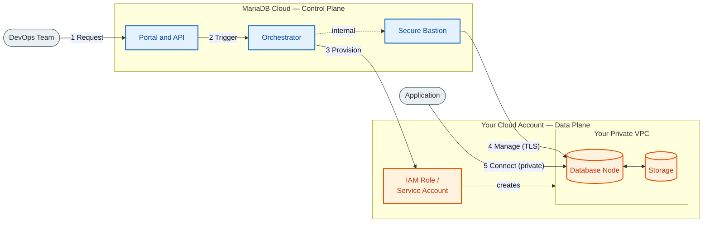
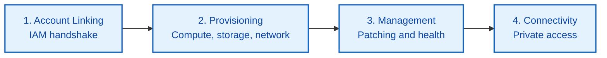
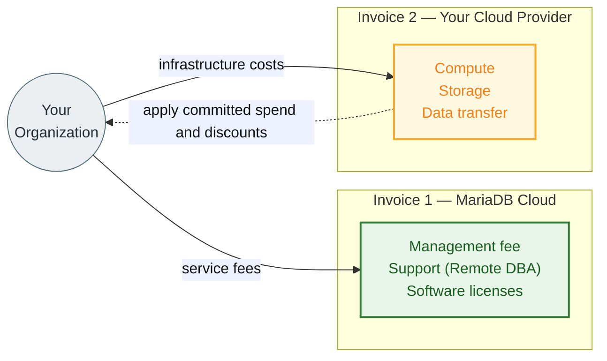
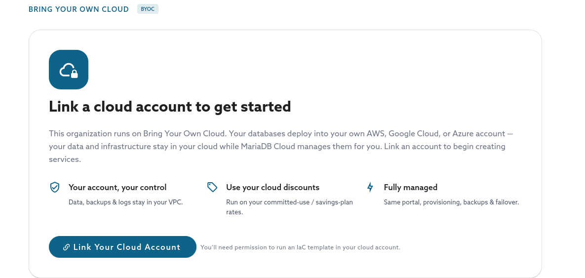
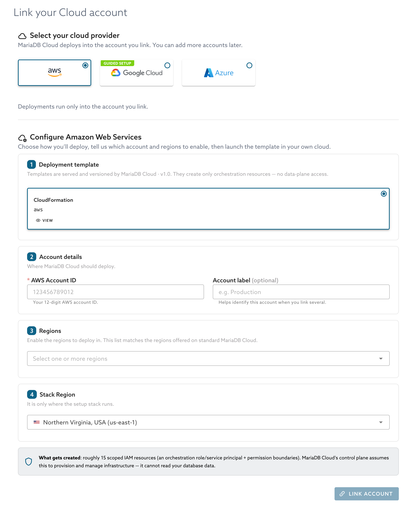
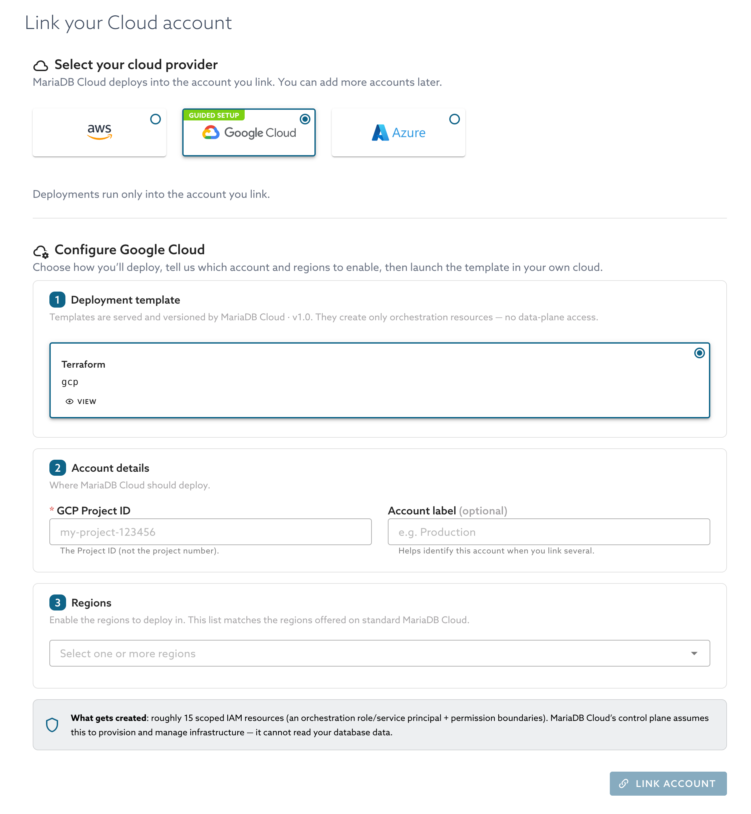
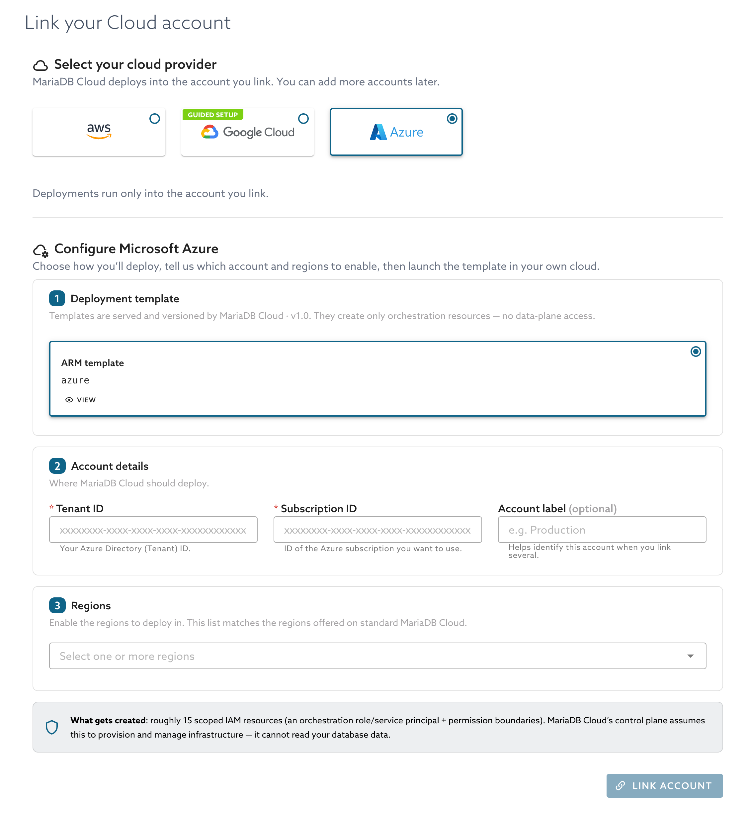
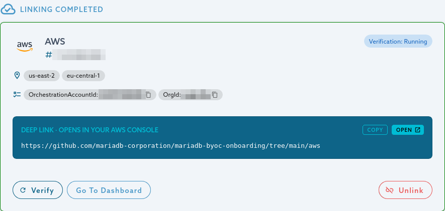
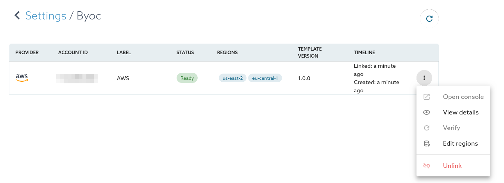

# Bring Your Own Cloud (BYOC)

Bring Your Own Cloud (BYOC) allows large enterprises to deploy fully managed MariaDB Cloud databases directly within their own public cloud infrastructure. This deployment model offers the operational simplicity of a managed service while satisfying strict requirements for data sovereignty, compliance, and cloud cost optimization.

With BYOC, the Control Plane (UI, API, Monitoring) remains in MariaDB Cloud, while the Data Plane (Compute, Storage, Backups) resides entirely in your cloud account.



## How it works

A BYOC environment is a secure, isolated set of resources within your own cloud provider account (Azure, AWS, or Google Cloud) that is managed by MariaDB Cloud.



1. Account Linking: You authorize MariaDB Cloud to access your specific cloud subscription via a secure IAM role or Service Principal with least-privilege permissions.
2. Resource Provisioning: When you create a service, MariaDB Cloud orchestrates the deployment of Virtual Machines, Storage, and Networking directly into your account.
3. Management: MariaDB Cloud monitors health, performs backups, and applies patches automatically, just like a standard managed service.
4. Connectivity: Your applications connect to the database locally within your cloud network (VPC/VNet), ensuring low latency and high security without exposing data to the public internet.


### Why use BYOC?

BYOC is designed for enterprise organizations with specific regulatory or infrastructure requirements:

* Compliance & Data Sovereignty: Since data never leaves your cloud account, you maintain absolute control over data residency. This simplifies meeting strict regulatory standards such as HIPAA, PCI-DSS, and GDPR.
* Cloud Cost Optimization: You pay your cloud provider directly for the underlying infrastructure. This allows you to burn down existing committed spend (e.g., Azure MACC, AWS EDP) and leverage your negotiated enterprise discounts.
* Network Security: Database nodes are deployed into a private VPC/VNet. You can enforce your own security group rules, routing policies, and network isolation without complex peering arrangements.
* Advanced Workloads (PowerPlus): Enables the PowerPlus tier, allowing for advanced topologies like Galera Clusters to run in your own environment.

### Who is eligible for BYOC?

BYOC is an enterprise-grade feature with specific commercial and technical prerequisites:

* Service Tier: Your organization must be on the Power or PowerPlus tier.
* Support Plan: You must have Standard Support with the Remote DBA add-on enabled.
* Contract: Available to customers with annual contracts or minimum spend commitments.
* Approval: MariaDB must enable BYOC for your organization. See [Get started](#get-started).


BYOC is in Public Preview and is available on Amazon Web Services, Google Cloud, and Microsoft Azure. Features and behavior may change before general availability.


### BYOC Pricing and Billing

The BYOC setup splits your costs into two separate components. This model ensures transparency and allows you to apply your own cloud credits or reserved instance savings to the infrastructure portion of the cost.



1. MariaDB Cloud Invoice: You receive a bill from MariaDB for the management fee, software licensing, and support.
2. Cloud Provider Invoice: You receive a bill directly from your cloud provider for the consumed infrastructure resources (Compute, Storage, Network).

### Get started

BYOC is enabled for each organization. To start, request access, link your cloud account, and verify the link.

#### Request BYOC

1. In the Cloud Portal, select **BYOC** in the left menu, and then select **Request BYOC**.
2. MariaDB Sales contacts you to confirm that your organization is eligible. After MariaDB approves the request, **BYOC** in the left menu opens the account linking flow.

#### Link your cloud account

<figure><figcaption><p>The Dashboard of an approved organization with no linked account</p></figcaption></figure>

<figure><figcaption><p>The Link your Cloud account page, with AWS selected</p></figcaption></figure>

1. On the Dashboard, select **Link Your Cloud Account**. You can also select **Link account** from the **BYOC** menu at the top of the page.
2. Select your cloud provider: **AWS**, **Google Cloud**, or **Azure**. Google Cloud is marked **Guided Setup**. You can link one account for each cloud. A cloud that already has a linked account is marked **Already Linked**.
3. Under **Deployment template**, review the template. Select **View** to read it before you run it.
4. Under **Account details**, enter the details for your provider. See the table that follows these steps. Optionally, enter an **Account label** to help identify the account when you link several.
5. Under **Regions**, select the regions to enable. The list matches the regions offered on standard MariaDB Cloud. For AWS, also choose a **Stack Region**, as described in the table.
6. Select **Link account**. The portal shows the values to use with the template, such as your organization ID. Each value has a copy button.
7. Select **Open console**. For AWS and Azure, this opens your cloud's folder in the public [mariadb-byoc-onboarding](https://github.com/mariadb-corporation/mariadb-byoc-onboarding) repository on GitHub. For Google Cloud, it opens Cloud Shell. Then deploy the template in your own cloud account, as described in the table.

| Cloud | Account details you enter | What you run |
| ----- | ------------------------- | ------------ |
| Amazon Web Services | The 12-digit AWS account ID. The **Stack Region** is only where the setup stack runs, and it defaults to Northern Virginia (`us-east-1`). | Deploy the CloudFormation template from the repository with the AWS CLI or the AWS console. The repository also has a Terraform module with the same resources. Enter the `OrchestrationAccountId` and `OrgId` values that the portal shows as the template parameters. You need permission to create IAM roles and policies, for example the `AdministratorAccess` policy. |
| Google Cloud | The project ID. Use the project ID, not the project number. | **Open console** opens Cloud Shell with a guided tutorial that runs Terraform in your project. The tutorial asks for `project_id`, `allowed_regions`, `orchestration_project_id`, and `org_id`. The portal shows these values so that you can copy them. The tutorial takes about 20 minutes. You need the Owner role on the project, or the narrower set of roles that the repository lists. |
| Microsoft Azure | The tenant ID and the subscription ID. | First, create the MariaDB Cloud service principal in your tenant by using Azure Cloud Shell or the Azure CLI (commands follow the table). Then deploy the ARM template from the repository with the Azure CLI, the Azure portal, or PowerShell. The template parameters are `organizationId`, `regions`, and `servicePrincipalObjectId`, which is the object ID that the second command returns. You need the Owner or User Access Administrator role at the subscription level. |

The form is the same for every cloud except the account details and the template. The following figures show Google Cloud and Azure.

<figure><figcaption><p>The Link your Cloud account page, with Google Cloud selected</p></figcaption></figure>

<figure><figcaption><p>The Link your Cloud account page, with Azure selected</p></figcaption></figure>

For Azure, replace `<service_principal_id>` with the MariaDB Cloud service principal ID that you receive during onboarding:

```bash
az ad sp create --id <service_principal_id>
az ad sp show --id <service_principal_id> --query id -o tsv
```

<!-- TODO: MCDEV-5268 (open, 2026-10-12) reports an incorrect servicePrincipalObjectId in the Azure onboarding account. Re-check the Azure parameter and where the portal shows the service principal ID before relying on the Azure row. -->

The template creates only the orchestration resources that MariaDB Cloud needs: an IAM role or service principal with scoped permissions. It does not grant access to your database data.

<!-- TODO: confirm with Security/SRE that the template statement matches the shipped templates. The wording comes from the portal copy (linkAccount.templateSubtitle, linkAccount.whatGetsCreated). -->

#### Verify the link

After the template finishes, select **Verify**. MariaDB Cloud checks that it can use your account, and the check runs in the background. The page updates by itself. The status is **Pending** until you select **Verify**, and then it changes to **Verification: Running**, **Verification: Passed**, and **Ready**.

<figure><figcaption><p>An account while verification is running</p></figcaption></figure>

If verification fails, the page shows the reason. Fix the problem, and then select **Retry Verification**.

When the status is **Ready**, create services as usual. A service that you create on a linked cloud deploys into your account, in one of the regions that you enabled.

### Manage linked accounts

Select **Settings** → **BYOC** to see your linked accounts. The table lists each account's provider, account ID, label, status, enabled regions, template version, and when it was linked. Use the actions menu on a row to open the cloud console, view details, verify the account, edit regions, or unlink the account. **Open console** and **Verify** are available only until the account is **Ready**.

<figure><figcaption><p>The linked accounts table and a row actions menu</p></figcaption></figure>

The **BYOC** menu at the top of the page shows how many accounts are linked. Select it to see the accounts, to open **View all accounts**, or to select **Link account**.

* **Edit regions:** You can change the enabled regions for AWS accounts only. For Azure and Google Cloud, adding a region requires running the template again. You can't remove a region that still has services.
* **Unlink:** MariaDB Cloud refuses to unlink an account while services still run in it. Unlinking removes the account from MariaDB Cloud, but it does not delete the resources that the template created in your cloud account. Remove those resources in your cloud account yourself. You can link the same cloud again later.

### Limitations

* You can link one account for each cloud.
* BYOC supports Provisioned services only. Serverless is not available with BYOC.

<sub>_This page is: Copyright © 2026 MariaDB. All rights reserved._</sub>
