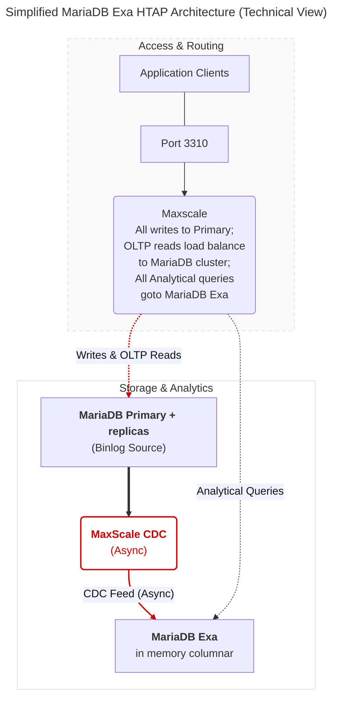

# HTAP using MariaDB Exa

MariaDB Exa adds **hybrid transactional/analytical processing (HTAP)** to MariaDB Cloud. You get MariaDB for **OLTP** and the in-memory **columnar** MariaDB Exa engine (powered by Exasol) behind one intelligent entry point—without standing up a separate analytics database, ETL pipelines, or custom CDC wiring.


**Technical preview**

HTAP using MariaDB Exa is not intended for production use. This feature is available on Power and PowerPlus tiers only, and it is enabled per organization on request. See [Requesting access to MariaDB Exa](htap-mariadb-exa.md#requesting-access-to-mariadb-exa).


## Architecture overview

The MariaDB Exa layout separates transactional and analytical workloads so heavy reporting does not contend with production OLTP traffic.

### Simplified technical view



### Core components

#### **MaxScale smart router**

The entry point on **port 3310**. It acts as the routing layer: sends writes to the primary and splits reads between MariaDB Server (InnoDB) and the MariaDB Exa engine based on workload and performance characteristics.

#### **MariaDB Server**

The **OLTP** (online transactional processing) engine. All write operations and point lookups run here.

#### **MariaDB Exa (analytical engine)**

A high-performance, in-memory **columnar** database for **OLAP** (online analytical processing) workloads.

#### **MaxScale CDC**

An out-of-band, asynchronous pipeline that reads MariaDB binary logs through MaxScale and streams changes into the MariaDB Exa side of the topology. It runs in its own pod next to the Exasol node.

### Data propagation and consistency

#### **Write path**

All writes (`INSERT`, `UPDATE`, `DELETE`) go to the MariaDB **primary** on **port 3306**.

#### **Asynchronous replication**

Data reaches Exa through the binary log and MaxScale CDC. That path is **out of band** and **asynchronous** relative to the transactional database.

#### **Replication lag**

Under heavy write load, the CDC pipeline can build a backlog. Lag is typically on the order of **seconds** but can reach **several minutes** during spikes.

#### **No causal reads across engines**

The intelligent router is **not lag-aware** and does **not** guarantee read-your-own-writes between MariaDB and Exa. For immediate consistency on data you just wrote, use the **MariaDB transactional ports** (see [Connectivity and smart routing](htap-mariadb-exa.md#connectivity-and-smart-routing)).

## Requesting access to MariaDB Exa

MariaDB Exa is not self-service. It is enabled for your organization on request, and you can launch an Exa service only after the MariaDB Cloud team enables it.

1. [Log in to the MariaDB Cloud portal](https://cloud.mariadb.com/).
2. Click **Create New Service** and select **MariaDB Provisioned**.
3. Under **Add-ons**, click the **Analytics (HTAP)** card. While Exa is not enabled for your organization, the card is labeled **On Request**.
4. In the **Analytics (HTAP) Capability** dialog, click **Submit**. The portal confirms that your request was submitted and that the team will be in touch.

Each user can submit one request. If you submit again, the portal shows *HTAP request already submitted for this organization*.

On the Foundation tier, the **Analytics (HTAP)** card opens the tier upgrade dialog instead of the request dialog. Upgrade to Power or PowerPlus first.

## Launching a MariaDB Exa HTAP cluster

### Via MariaDB Cloud portal (UI)

Exa must already be enabled for your organization. See [Requesting access to MariaDB Exa](htap-mariadb-exa.md#requesting-access-to-mariadb-exa).

1. [Log in to the MariaDB Cloud portal](https://cloud.mariadb.com/).
2. Click **Create New Service** to open the **Provision Cloud Database** page.
3. Select **MariaDB Provisioned**.
4. Under **High Availability**, select **Semi-sync**. The **Analytics (HTAP)** add-on requires Semi-sync HA.
5. Under **Add-ons**, select **Analytics (HTAP)**. The card is labeled **Tech Preview**.

<figure><figcaption><p>Add-ons</p></figcaption></figure>

6. Select your cloud provider and region.
7. Under **Instance Resources**, pick the instance size for the MariaDB nodes. In the **Exa** group, pick the Exa node size and storage capacity separately. The minimum size for the Exa node is **4 vCPU / 32 GB RAM**. Size the Exa node RAM for your analytical working set, and the MariaDB nodes for your transactional load.
8. Under **Advanced Options**, set the **MariaDB Exa Storage Type** and, where the provider supports it, the Exa IOPS and throughput. If you don't set them, Exa uses the MariaDB volume settings. You can't change the Exa storage type after the service is created.
9. Review the cost estimate in the footer: it includes the Exa node. **CDC is included** in the service; there is **no** separate charge for CDC processing. Exa compute, storage, IOPS, and throughput are metered separately from MariaDB. See [Billing](../cloud-usage/billing.md).
10. Deploy the service. Naming and remaining steps follow the standard flow. Provisioning usually takes about **5–10 minutes**.

For all options on this page, see [Launch Page](../cloud-usage/launch-page.md).

### Via MariaDB Cloud REST API

For **API keys**, client IP **allow list**, checking service **`ready`** status, and fetching **credentials**, follow [Launch DB using the REST API](launch-db-using-the-rest-api.md). The [MariaDB Cloud REST API reference](../reference/rest-api-reference.md) and [API docs](https://apidocs.skysql.com/) cover the full request model.

**HTAP / Exa flag** — On `POST /provisioning/v1/services`, set **`"analytics": true`**. That provisions the Exa analytics node (the **Analytics (HTAP)** add-on in the portal) on top of the replicated **es-replica** topology. Other fields match your **Power** or **PowerPlus** tier, provider, region, and sizing.

* **Access:** `"analytics": true` takes effect only when Exa is enabled for your organization. Otherwise the API ignores it and creates the service without the Exa node. See [Requesting access to MariaDB Exa](htap-mariadb-exa.md#requesting-access-to-mariadb-exa).
* **Architecture:** `architecture` must be `amd64`. The API rejects any other value with a validation error (HTTP 400).
* **Tier:** the API rejects the request with a validation error (HTTP 400) for any tier other than `power` or `powerplus`.
* **Exa node size:** set `analytics_node_pool` with a `size` (for example `sky-4x32`) and `nodes` set to `1`. The minimum Exa size is 4 vCPU / 32 GB RAM. Each service has one Exasol node.
* **Exa storage:** set `analytics_storage_volume` with `size` (GB) and, where the provider supports it, `volume_type`, `iops`, and `throughput`. If you omit it, Exa uses the MariaDB volume configuration.

Example (adjust `tier`, `region`, `availability_zone`, `size`, `version` and add **`allow_list`** or other required keys per the launch guide):

```bash
curl --location 'https://api.skysql.com/provisioning/v1/services' \
  --header 'Content-Type: application/json' \
  --header "X-API-Key: ${API_KEY}" \
  --data '{
  "tier": "power",
  "service_type": "transactional",
  "topology": "es-replica",
  "provider": "aws",
  "region": "us-east-2",
  "availability_zone": "us-east-2b",
  "name": "htap-test",
  "nodes": 1,
  "size": "sky-4x32",
  "architecture": "amd64",
  "storage": 100,
  "version": "11.4.10-7.1-standard",
  "ssl_enabled": true,
  "analytics": true
}'
```


On Azure, set `volume_type` in `analytics_storage_volume` explicitly, for example `StandardSSD_LRS`. If you omit it, the Exa disk takes the MariaDB disk type, which the Exa node can't use, and the Exasol pod fails to start.


After the service is **ready**, use the service response (or the same steps as the quickstart) for hostnames and ports, and map them to [Connectivity and smart routing](htap-mariadb-exa.md#connectivity-and-smart-routing) (**3306** / **3307** / **3310** / **3311**).

## Scaling MariaDB Exa

You scale the Exa node and its storage separately from the MariaDB nodes.

* **Exa node size:** in the portal, open the service, then click **Manage** → **Scale Exa nodes vertically** and select another size. Through the REST API, send `POST /provisioning/v1/services/{service_id}/analytics-node-pool` with the new `size`.
* **Exa storage:** in the portal, click **Manage** → **Scale Exa storage** and change the size, IOPS, or throughput. Through the REST API, send `PATCH /provisioning/v1/services/{service_id}/analytics-storage` with `size`, `iops`, or `throughput`. The request returns an error if the service has no Exa volume, and it returns HTTP 425 while the storage is in a cooldown period after a recent change.

You can't change the Exa storage type, and you can't reduce the Exa storage size.

## Monitoring, alerts, and logs

* **Monitoring:** the service's monitoring includes an **Exasol** dashboard for the Exa node. See [Service Monitoring Panels](../cloud-usage/service-monitoring-panels.md#mariadb-exa-exasol).
* **Alerts:** MariaDB Cloud raises service-level alerts for Exasol memory pressure. See [Service Monitoring Panels](../cloud-usage/service-monitoring-panels.md#mariadb-exa-alerts).
* **Logs:** the portal log viewer offers an **Exasol Log** type.

## Connectivity and smart routing

MariaDB Cloud exposes dedicated ports so you can choose **how** each client connects: strict transactional access, read-only replicas, intelligent routing, or direct analytical access.

| Port     | Service type               | Target engine and use case                                                                                                                                            |
| -------- | -------------------------- | --------------------------------------------------------------------------------------------------------------------------------------------------------------------- |
| **3306** | Transactional (read-write) | Standard read/write to MariaDB. Use for OLTP and when you need **read-your-own-writes** on the transactional engine. Reads are load balanced across all OLTP servers. |
| **3307** | Transactional (read-only)  | Read-only traffic across MariaDB **replicas** (load balanced).                                                                                                        |
| **3310** | Intelligent router         | **Smart router** entry point. Sends work to the engine (MariaDB or Exa) the router selects for efficiency.                                                            |
| **3311** | Direct Exa                 | Connect directly to the **analytical engine**, bypassing router logic, using the MariaDB protocol.                                                                    |

## How smart routing (port 3310) works

On **port 3310**, MaxScale chooses an engine using **racing**: it learns which backend answers each _query pattern_ fastest and routes repeat traffic accordingly.

### Canonicalization

MaxScale **strips constants** from the query so it can recognize a **pattern**—for example, `WHERE id = 5` collapses to the same pattern as `WHERE id = ?` for routing purposes.

### Racing

The **first** time a pattern appears, MaxScale **executes** the query on **both** MariaDB Enterprise Server and MariaDB Exa **simultaneously**.

The Racing Logic:

1. Discovery: For a new query pattern, MaxScale fires the query at both engines.
2. Evaluation: MaxScale tracks the execution time for both.
3. Optimization: The "loser" query is killed to save resources, and the "winner" is cached as the preferred route for that pattern.

### First responder wins

Whichever engine **returns first** for that pattern is recorded; later queries with the **same** pattern are sent to that **cached** winner until routing state is refreshed or invalidated. The running query on the losing engine is immediately cancelled.

### Automatic translation

The router applies **syntax translation** and **type coercion** from the MariaDB dialect toward what the analytical engine expects, so clients can keep using familiar MariaDB SQL on port 3310.

## Developer guidelines

**Supported connectors**\
Use **standard MariaDB or MySQL-compatible** client libraries and connectors only.

**SQL dialect**\
Author application SQL in the [**MariaDB dialect**](https://app.gitbook.com/s/rBEU9juWLfTDcdwF3Q14/mariadb-exa/limitations#iv.-sql-syntax-differences). The intelligent router performs translation for the analytical path where needed.

**Handling lag**\
If the application must **immediately** see data just written (for example, right after a profile update), connect on **port 3306**. Use **port 3310** for dashboards, exploration, and **heavy analytics** where small CDC lag is acceptable.

## Known issues and limitations


Deep Dive: For a full list of supported SQL functions, detailed data type mappings, and logic differences, see our [Limitations & Compatibility Reference](https://app.gitbook.com/s/rBEU9juWLfTDcdwF3Q14/mariadb-exa/limitations) page.&#x20;


**Service limits**

* Each service has one Exasol node. Multi-node Exasol and node-count selection are not available.
* The Exa storage type can't be changed, and Exa storage can't be reduced.
* Port **3311** is not read-only. It accepts write statements, but they are not supported and can break replication. Do not send writes to port 3311.
* The `pymysql` client can't run queries on port 3311. Use MariaDB Connector/Python or another MariaDB connector.
* A single transaction larger than about 50 MB can exhaust the memory of the CDC pod and stop replication to Exa until it is recovered.
* On port 3311, `DATETIME` (without fractional seconds) and `TIMESTAMP` values come back padded with NUL bytes. `DATETIME(6)` and `DATE` values are not affected, and neither are queries on port 3306. To get clean text, use `TO_CHAR()` or `CAST(<column> AS VARCHAR(40))`.
* The portal does not show replication failures between MariaDB and Exa.
* You can't turn off Exa on its own on an existing service.

**SQL dialect** The translation layer does not provide 100% support of the MariaDB SQL dialect. Some MariaDB data types, functions, and syntax structures are not supported on ports 3310 & 3311.

**DDL replication**\
`RENAME TABLE` and `DROP DATABASE` are **not** replicated through the CDC currently; you may need **manual** steps to keep MariaDB and Exa aligned after such DDL.

**Case sensitivity**\
MariaDB Exa may use **case-insensitive** identifier matching by default; **result column labels** can still appear in **uppercase** even when the query uses mixed or lowercase names.

**Deterministic aggregates**\
For functions such as `GROUP_CONCAT`, add an explicit **`ORDER BY`** inside the aggregate (where supported) so ordering is stable if different engines evaluate the plan differently.

**Empty Strings**\
MariaDB Exa interprets an empty string (`''`) as a `NULL` value.

<sub>_This page is: Copyright © 2026 MariaDB. All rights reserved._</sub>
