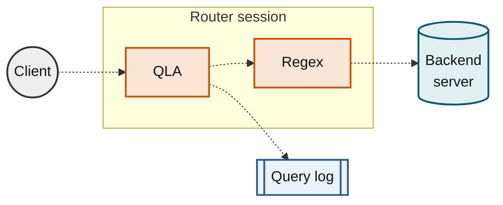

# MaxScale Configuration Guide

## Introduction

This document describes how to configure MariaDB MaxScale and presents some possible usage scenarios. MariaDB MaxScale is designed with flexibility in mind, and consists of an event processing core with various support functions and plugin modules that tailor the behavior of the program.

## Concepts

### Glossary

| Word                | Description                                                                                                                                                                                                                                                                                                                                      |
| ------------------- | ------------------------------------------------------------------------------------------------------------------------------------------------------------------------------------------------------------------------------------------------------------------------------------------------------------------------------------------------ |
| connection routing  | Connection routing is a method of handling requests in which MariaDB MaxScale will accept connections from a client and route data on that connection to a single database using a single connection. Connection based routing will not examine individual requests on a connection and it will not move that connection once it is established. |
| statement routing   | Statement routing is a method of handling requests in which each request within a connection will be handled individually. Requests may be sent to one or more servers and connections may be dynamically added or removed from the session.                                                                                                     |
| module              | A module is a separate code entity that may be loaded dynamically into MariaDB MaxScale to increase the available functionality. Modules are implemented as run-time loadable shared objects.                                                                                                                                                    |
| connection failover | When a connection currently being used between MariaDB MaxScale and the database server fails a replacement will be automatically created to another server by MariaDB MaxScale without client intervention                                                                                                                                      |
| backend database    | A term used to refer to a database that sits behind MariaDB MaxScale and is accessed by applications via MariaDB MaxScale.                                                                                                                                                                                                                       |
| REST API            | HTTP administrative interface                                                                                                                                                                                                                                                                                                                    |

### Objects

#### Server

A server represents an individual database server to which a client can be connected via MariaDB MaxScale. The status of a server varies during the lifetime of the server and typically the status is updated by some monitor. However, it is also possible to update the status of a server manually.

| Status                   | Description                                                                                                                                                                                                                                                                                                                |
| ------------------------ | -------------------------------------------------------------------------------------------------------------------------------------------------------------------------------------------------------------------------------------------------------------------------------------------------------------------------- |
| Running                  | The server is running.                                                                                                                                                                                                                                                                                                     |
| Master                   | The server is the primary.                                                                                                                                                                                                                                                                                                 |
| Slave                    | The server is a replica.                                                                                                                                                                                                                                                                                                   |
| Draining                 | The server is being drained. Existing connections can continue to be used, but no new connections will be created to the server. Typically this status bit is turned on manually using maxctrl, but a monitor may also turn it on.                                                                                         |
| Drained                  | The server has been drained. The server was being drained and now the number of connections to the server has dropped to 0.                                                                                                                                                                                                |
| Auth Error               | The monitor cannot login and query the server due to insufficient privileges.                                                                                                                                                                                                                                              |
| Maintenance              | The server is under maintenance. Typically this status bit is turned on manually using maxctrl, but it will also be turned on for a server that for some reason is blocking connections from MaxScale. When a server is in maintenance mode, no connections will be created to it and existing connections will be closed. |
| Slave of External Master | The server is a replica of a primary that is not being monitored.                                                                                                                                                                                                                                                          |
| Master Stickiness        | The server is monitored by a galeramon with disable\_master\_failback=true. See [disable\_master\_failback](../../../../reference/maxscale-monitors/galera-monitor.md#disable_master_failback) for more information.                                                                                                          |

For more information on how to manually set these states via MaxCtrl, read the [Administration Tutorial](../../../../mariadb-maxscale-tutorials/maxscale-administration-tutorial.md).

#### Monitor

A monitor module is capable of monitoring the state of a particular kind of cluster and making that state available to the routers of MaxScale.

Examples of monitor modules are `mariadbmon` that is capable of monitoring a regular primary-replica cluster and in addition of performing both _switchover_ and _failover_, `galeramon` that is capable of monitoring a Galera cluster, and `csmon` that is capable of monitoring a ColumnStore cluster.

Monitor modules have sections of their own in the MaxScale configuration file.

#### Filter

A filter module resides in front of routers in the request processing chain of MaxScale. That is, a filter will see a request before it reaches the router and before a response is sent back to the client. This allows filters to reject, handle, alter or log information about a request.

Examples of filters `cache` that provides query caching according to rules, `regexfilter` that can rewrite requests according to regular expressions, and `qlafilter` that logs information about requests.

Filters have sections of their own in the MaxScale configuration file that are referred to from _services_.

Simple filters that do not have any settings can be created automatically by referring to them by the module name in the `filters` list of a service. For example, using `filters=hintfilter` in a service will create a filter named `hintfilter` using the module `hintfilter`.

Limitations:

* MaxScale: No limitations.
* MaxScale Lite: At most 2 filters can be created.

#### Router

A router module is capable of routing requests to backend servers according to the characteristics of a request and/or the algorithm the router implements. Examples of routers are `readconnroute` that provides _connection routing_, that is, the server is chosen according to specified rules when the session is created and all requests are subsequently routed to that server, and `readwritesplit` that provides _statement routing_, that is, each individual request is routed to the most appropriate server.

Routers do not have sections of their own in the MaxScale configuration file, but are referred to from _services_.

#### Service

A service abstracts a set of databases and makes them appear as a single one to the client. Depending on what router (e.g. `readconnroute` or `readwritesplit`) the service uses, the servers are used in some particular way. If the service uses filters, then all requests will be pre-processed in some way before they reach the router.

Services have sections of their own in the MaxScale configuration file.

Limitations:

* MaxScale: No limitations.
* MaxScale Lite: At most 2 services can be created.

#### Listener

A listener defines a port MaxScale listens on. Connection requests arriving on that port will be forwarded to the service the listener is associated with. A listener may be associated with a single service, but several listeners may be associated with the same service.

Listeners have sections of their own in the MaxScale configuration file.

#### Include

An [include section](#include-1) defines common parameters used in other configuration sections.

## Administration

The administration of MaxScale can be divided in two parts:

* Writing the MaxScale configuration file, which is described in the following [section](#configuration).
* Performing runtime modifications using [MaxCtrl](../../../../reference/maxscale-maxctrl.md)

For detailed information about _MaxCtrl_ please refer to the specific documentation referred to above. In the following it will only be explained how MaxCtrl relate to each other, as far as user credentials go.

**Note**: By default all runtime configuration changes are saved on disk and loaded on startup. Refer to the [Dynamic Configuration](#dynamic-configuration) section for more details on how it works and how to disable it.

MaxCtrl can connect using TCP/IP sockets. When connecting with MaxCtrl using TCP/IP sockets, the user and password must be provided and are checked against a separate user credentials database. By default, that database contains the user `admin` whose password is `mariadb`.

Note that if MaxCtrl is invoked without explicitly providing a user and password then it will by default use `admin` and `mariadb`. That means that when the default user is removed, the credentials must always be provided.

### Administration audit file

The REST API calls to MaxScale can be logged by enabling [admin\_audit](global-settings.md#admin_audit).

For more detail see the admin audit configuration values `admin_audit`, `admin_audit_file` and `admin_audit_exclude_methods` below and [Administration Tutorial](../../../../mariadb-maxscale-tutorials/maxscale-administration-tutorial.md).

### Static Configuration Parameters

The following global configuration parameters can **NOT** be changed at runtime and can only be defined in a configuration file:

* `admin_auth`
* `admin_enabled`
* `admin_gui`
* `admin_host`
* `admin_pam_readonly_service`
* `admin_pam_readwrite_service`
* `admin_readonly_hosts`
* `admin_readwrite_hosts`
* `admin_port`
* `admin_secure_gui`
* `admin_ssl_ca`
* `admin_ssl_version`
* `admin_jwt_algorithm`
* `admin_jwt_key`
* `admin_jwt_issuer`
* `auto_tune`
* `connector_plugindir`
* `core_file`
* `datadir`
* `debug`
* `libdir`
* `load_persisted_configs`
* `persist_runtime_changes`
* `local_address`
* `log_augmentation`
* `log_warn_super_user`
* `logdir`
* `module_configdir`
* `persistdir`
* `piddir`
* `query_retries`
* `require_secure_transport`
* `secretsdir`
* `sharedir`
* `sql_mode`
* `substitute_variables`
* `threads_max`

All other parameters that relate to objects can be altered at runtime or can be changed by destroying and recreating the object in question.

## Configuration

MaxScale by default reads configuration from the file `/etc/maxscale.cnf`. If the command line argument `--configdir=<path>` is given, `maxscale.cnf` is searched for in _\<path>_ instead. If the argument `--config=<file>` is given, configuration is read from the file _\<file>_.

MaxScale also looks for a directory with the same name as the configuration file, followed by ".d" (for example `/etc/maxscale.cnf.d`). If found, MaxScale recursively reads all files with the ".cnf" suffix in the directory hierarchy. Other files are ignored.

After loading normal configuration files, MaxScale reads runtime-generated configuration files, if any, from the [persisted configuration files directory](global-settings.md#persistdir).

Different configuration sections can be arranged with little restrictions. Global path settings such as `logdir`, `piddir` and `datadir` are only read from the main configuration file. Other global settings are also best left in the main file to ensure they are read before other configuration sections are parsed.

The configuration file format used is [INI](https://en.wikipedia.org/wiki/INI_file), similar to the MariaDB Server. The files contain sections and each section can contain multiple key-value pairs.

Comments are defined by prefixing a row with a hash (#). Trailing comments are not supported.

```
# This is a comment before a parameter
some_parameter=123
```

A parameter can be defined on multiple lines as shown below. A value spread over multiple lines is simply concatenated. The additional lines of the value definition need to have at least one whitespace character in the beginning.

```
[MyService]
type=service
router=readconnroute
servers=server1,
        server2,
        server3
```

### Names

Section names may not contain whitespace and must not start with the characters `@@`.

As the object names are used to form URLs in the MaxScale REST API, they must be safe for use in URLs. This means that only alphanumeric characters (i.e. `a-z`, `A-Z` and `0-9`) and the special characters `_.~-` can be used.

### Dynamic Configuration

By default all changes done at runtime via the MaxScale GUI, MaxCtrl or the REST API will be saved on disk, inside the [persistdir](global-settings.md#persistdir) directory. The changes done at runtime will override the configuration found in the static configuration files for that particular object.

This means that if an object that is found in `/etc/maxscale.cnf` is modified at runtime, all future changes to it must also be done at runtime. Any modifications done to `/etc/maxscale.cnf` after a runtime change has been made are ignored for that object.

To prevent the saving of runtime changes and to make all runtime changes volatile, add [persist\_runtime\_changes=false](global-settings.md#persist_runtime_changes) and [load\_persisted\_configs=false](global-settings.md#load_persisted_configs) under the `[maxscale]` section. This will make MaxScale behave like the MariaDB server does: any changes done with `SET GLOBAL` statements are lost if the process is restarted.

### Special Parameter Types

#### Booleans

Boolean type parameters interpret the values `true`, `yes`, `on` and `1` as _true_ values and `false`, `no`, `off` and `0` as _false_ values. Starting with MaxScale 23.02, the REST API also accepts the same boolean values for boolean type parameters.

#### Sizes

Where _specifically noted_, a number denoting a size can be suffixed by a subset of the IEC binary prefixes or the SI prefixes. In the former case the number will be interpreted as a certain multiple of 1024 and in the latter case as a certain multiple of 1000. The supported IEC binary suffixes are `Ki`, `Mi`, `Gi` and `Ti` and the supported SI suffixes are `k`, `M`, `G` and `T`. In both cases, the matching is case-insensitive.

For instance, the following entries

```
max_size=1099511628000
max_size=1073741824Ki
max_size=1048576Mi
max_size=1024Gi
max_size=1Ti
```

are equivalent, as are the following

```
max_size=1000000000000
max_size=1000000000k
max_size=1000000M
max_size=1000G
max_size=1T
```

#### Durations

A number denoting a duration can be suffixed by one of the case-insensitive suffixes `h`, `m` or `min`, `s` and `ms`, for specifying durations in hours, minutes, seconds and milliseconds, respectively.

For instance, the following entries

```
soft_ttl=1h
soft_ttl=60m
soft_ttl=60min
soft_ttl=3600s
soft_ttl=3600000ms
```

are equivalent.

Note that if an explicit unit is not specified, then it is specific to the configuration parameter whether the duration is interpreted as seconds or milliseconds.

_Not_ providing an explicit unit has been deprecated in MaxScale 2.4.

#### Percent

A number denoting a percent must be suffixed with `%`.

For instance

```
some_param=42%
```

#### Regular Expressions

Many modules have settings which accept a regular expression. In most cases, these settings are named either _match_ or _exclude_, and are used to filter users or queries. MaxScale uses the [PCRE2-library](https://www.pcre.org/current/doc/html/) for matching regular expressions.

When writing a regular expression (regex) type parameter to a MaxScale configuration file, the pattern string should be enclosed in slashes e.g. `^select` -> `match=/^select/`. This clarifies where the pattern begins and ends, even if it includes whitespace. Without slashes the configuration loader trims the pattern from the ends. The slashes are removed before compiling the pattern. For backwards compatibility, the slashes are not mandatory. Omitting them is, however, deprecated. The _binlogfilter_, _ccrfilter_, _namedserverfilter_, _qlafilter_, _regexfilter_, _tee_, _topfilter_, _avrorouter_, _kafkacdc_, and _schemarouter_ modules accept parameters in this type of regular expression form. Other modules may not handle the slashes correctly.

PCRE2 supports a complicated regular expression [syntax](https://www.pcre.org/current/doc/html/pcre2syntax.html). MaxScale typically uses regular expressions simply, only checking whether the pattern and subject match at some point. For example, using the QLAFilter and setting `match=/SELECT/` causes the filter to accept any query with the text "SELECT" somewhere within. To force the pattern to only match at the beginning of the query, set `match=/^SELECT/`. To only match the end, set`match=/SELECT$/`.

Modules which accept regular expression parameters also often accept options which affect how the patterns are compiled. Typically, this setting is called _options_ and accepts values such as `ignorecase`, `case` and `extended`.

* `ignorecase`: Causes the regular expression matcher to ignore letter case, and is often on by default. When enabled, `/SELECT/` would match both `SELECT` and`select`.
* `extended`: Ignores whitespace and `#` comments in the pattern. Note that this is not the same as the extended regular expression syntax that for example`grep -E` uses.
* `case`: Turns on case-sensitive matching. This means that `/SELECT/` will not match `select`.

These settings can also be defined in the pattern itself, so they can be used even in modules without pattern compilation settings. The pattern settings are `(?i)` for `ignorecase` and `(?x)` for `extended`. See the [PCRE2 syntax documentation](https://www.pcre.org/current/doc/html/pcre2syntax.html#SEC16) for more information.

**Standard regular expression settings for filters**

Many filters use the settings _match_, _exclude_ and _options_. Since these settings are used in a similar way across these filters, the settings are explained here. The documentation of the filters link here and describe any exceptions to this generalized explanation.

These settings typically limit the queries the filter module acts on. _match_ and _exclude_ define PCRE2 regular expression patterns while _options_ affects how both of the patterns are compiled. _options_ works as explained above, accepting the values `ignorecase`, `case` and `extended`, with `ignorecase` being the default.

The queries are matched as they arrive to the filter on their way to a routing module. If _match_ is defined, the filter only acts on queries matching that pattern. If _match_ is not defined, all queries are considered to match.

If _exclude_ is defined, the filter only acts on queries not matching that pattern. If _exclude_ is not defined, nothing is excluded.

If both are defined, the query needs to match _match_ but not match _exclude_.

Even if a filter does not act on a query, the query is not lost. The query is simply passed on to the next module in the processing chain as if the filter was not there.

#### Enumerations

Enumeration type parameters have a predefined set of accepted values. For types declared as `enum`, only one value is accepted. For `enum_mask` types, multiple values can be defined by separating them with commas. All enumeration values in MaxScale are case-sensitive.

For example the `router_options` parameter in the `readconnroute` router is a mask type enumeration:

```
router_options=master,slave
```

#### Path Lists

A `pathlist` type parameter expects one or more filesystem paths separated by colons. The value must not include space between the separators.

Here is an example path list parameter that points to `/tmp/something.log` and `/var/log/maxscale/maxscale.log`:

```
path_list_parameter=/tmp/something.log:/var/log/maxscale/maxscale.log
```

### Global Settings

The global settings, in a section named `[MaxScale]`, allow various parameters that affect MariaDB MaxScale as a whole to be tuned. This section must be defined in the root configuration file which by default is `/etc/maxscale.cnf`.

**Note**: MariaDB MaxScale providess multiple global diagnostic and debugging options (including `gdb-stacktrace` and `dump-network-traffic`), which can be used to diagnose and troubleshoot core behavior.

For convenience, here is a quick overview of available diagnostic and debugging settings:

| Settings                    | Brief Description                                       |
| --------------------------- | ------------------------------------------------------- |
| `disable-module-unloading`  | Prevents modules from unloading during runtime          |
| `enable-module-unloading`   | Allows the unloading of modules during runtime          |
| `redirect-output-to-file`   | Reroutes `stdout` and `stderr` to a specified file.     |
| `enable-statement-logging`  | Allows logging of all SQL statements                    |
| `disable-statement-logging` | Disables SQL statement logging                          |
| `enable-cors`               | Enables Cross-Origin Resource Sharing (CORS) support    |
| `cors-allow-origin`         | Specifies COR's allowed origin                          |
| `allow-duplicate-servers`   | Multiple servers can use the same address and port      |
| `gdb-stacktrace`            | Enables the generation of gdb stacktraces upon crash    |
| `sql-batch-size`            | Determines the batch size for processing SQL statements |
| `disable-fcrdns`            | Disables the forward-confirmed reverse DNS lookup       |
| `dump-network-traffic`      | Dumps network traffic for debugging purposes            |
| `exception-frequency`       | Sets the frequency of generated API exceptions          |

See the [MaxScale Configuration Settings](../../../../reference/maxscale-configuration-settings.md) page for a comprehensive list of these configuration parameters.

Every global setting, with its type, default, and behavior, is described in [MaxScale Global Settings](global-settings.md), in alphabetical order.

#### REST API Configuration

The MaxScale REST API is an HTTP interface that provides JSON format data intended to be consumed by monitoring applications and visualization tools.

The following options must be defined under the `[maxscale]` section in the configuration file.

The REST API settings are the global settings whose names start with `admin_`. They are described in [MaxScale Global Settings](global-settings.md).

### Events

MaxScale logs warnings and errors for various reasons and often it is self- evident and generally applicable whether some occurrence should warrant a warning or an error, or perhaps just an info-level message.

However, there are events whose seriousness is not self-evident. For instance, in some environments an authentication failure may simply indicate that someone has made a typo, while in some other environment that can only happen in case there has been a security breech.

To handle events like these, MaxScale defines _events_ whose logging facility and level can be controlled by the administrator. Given an event `X`, its facility and level are controlled in the following manner:

```
event_X_facility=LOG_LOCAL0
event_X_level=LOG_ERR
```

The above means that if event _X_ occurs, then that is logged using the facility `LOG_LOCAL0` and the level `LOG_ERR`.

The valid values of `facility` are the facility values reported by`man syslog`, e.g.`LOG_AUTH`,`LOG_LOCAL0`and`LOG_USER`. Likewise, the valid values for `level`are the ones also reported by`man syslog`, e.g.`LOG_WARNING`,`LOG_ERR`and`LOG\_CRIT\`.

Note that MaxScale does not act upon the level, that is, even if the level of a particular event is defined to be `LOG_EMERG`, MaxScale will not shut down if that event occurs.

The default facility is `LOG_USER` and the default level is `LOG_WARNING`.

Note that you may also have to configure `rsyslog` to ensure that the event can be logged to the intended log file. For instance, if the facility is chosen to be `LOG_AUTH`, then `/etc/rsyslog.conf` should contain a line like

```
auth,authpriv.*                 /var/log/auth.log
```

for the logged events to end up in `/var/log/auth.log`, where the initial`auth` is the relevant entry.

The available events are:

#### `authentication_failure`

This event occurs when there is an authentication failure.

```
event_authentication_failure_facility=LOG_AUTH
event_authentication_failure_level=LOG_CRIT
```

#### `firewall_incident`

This event occurs when the firewall blocks a query.

```
event_firewall_incident_facility=LOG_AUTH
event_firewall_incident_level=LOG_CRIT
```

#### `session_start`


This event is available from MaxScale 26.10.


This event occurs when a client session is successfully started.
```
event_session_start_facility=LOG_AUTH
event_session_start_level=LOG_NOTICE
```

#### `session_stop`


This event is available from MaxScale 26.10.


This event occurs when a client disconnects.
```
event_session_stop_facility=LOG_AUTH
event_session_stop_level=LOG_NOTICE
```



This feature is only available in MaxScale 26.10.0 and later.



#### `transaction_replay_failure`

This event occurs when a readwritesplit service with `transaction_replay=true` fails to replay a transaction.

```
event_transaction_replay_failure_level=LOG_INFO
```



This feature is only available in MaxScale 26.10.0 and later.



### Service

A service represents the database service that MariaDB MaxScale offers to the clients. In general a service consists of a set of backend database servers and a routing algorithm that determines how MariaDB MaxScale decides to send statements or route connections to those backend servers.

A service may be considered as a virtual database server that MariaDB MaxScale makes available to its clients.

Several different services may be defined using the same set of backend servers. For example a connection based routing service might be used by clients that already performed internal read/write splitting, whilst a different statement based router may be used by clients that are not written with this functionality in place. Both sets of applications could access the same data in the same databases.

A service is identified by a service name, which is the name of the configuration file section and a type parameter of service.

```
[Test-Service]
type=service
```

In order for MariaDB MaxScale to forward any requests it must have at least one service defined within the configuration file. The definition of a service alone is not enough to allow MariaDB MaxScale to forward requests however, the service is merely present to link together the other configuration elements.

Every service setting, with its type, default, and behavior, is described in [MaxScale Service Settings](service-settings.md), in alphabetical order.

### Filter

Filters provide a means to manipulate or process requests as they pass through MariaDB MaxScale between the client side protocol and the query router. A full explanation of each filter's functionality can be found in its documentation.

#### `module`

* Type: filter
* Mandatory: Yes
* Dynamic: No
* Description: The module parameter specifies the name of the filter module that is included in the routing chain.

The `module` parameter defines the name of the filter module that is added to the routing chain.

### Server

Server sections define the backend database servers MaxScale uses. A server is identified by its section name in the configuration file. The only mandatory parameter of a server is _type_, but _address_ and _port_ are also usually defined. A server may be a member of one or more services. A server may only be monitored by at most one monitor.

```
[MyMariaDBServer1]
type=server
address=127.0.0.1
port=3000
```

For a complete list of server configuration parameters, see the [Server Reference](../../../../reference/maxscale-servers.md).

Limitations:

* MaxScale: No limitations.
* MaxScale Trial: At most 3 servers can be created.

### Monitor

Monitor sections are used to define the monitoring module that watches a set of servers. Each server can only be monitored by one monitor.

Common monitor parameters [can be found here](../../../../reference/maxscale-monitors/common-monitor-parameters.md).

### Listener

A listener defines a port MaxScale listens on for incoming connections. Accepted connections are linked with a MaxScale service. Multiple listeners can feed the same service. Mandatory parameters are _type_, _service_ and _protocol_. _address_ is optional, it limits connections to a certain network interface only. _socket_ is also optional and is used for Unix socket connections.

The network socket where the listener listens may have a backlog of connections. The size of this backlog is controlled by the _net.ipv4.tcp\_max\_syn\_backlog_ and _net.core.somaxconn_ kernel parameters.

Increasing the size of the backlog by modifying the kernel parameters helps with sudden connection spikes and rejected connections. For more information see [listen(2)](https://man7.org/linux/man-pages/man2/listen.2.html).

```
[MyListener1]
type=listener
service=MyService1
port=3006
```

For a complete list of listener configuration parameters, see the [Listener Reference](../../../../reference/maxscale-listeners.md).

#### `sni_mapping_file`


This setting is available from MaxScale 26.10.


* Type: path
* Mandatory: No
* Dynamic: Yes
* Default: none
* Description: Defines the path to a JSON file that maps SNI hostnames to certificates and services.

Path to file that contains the
[SNI](https://en.wikipedia.org/wiki/Server_Name_Indication) hostname-to-service
mapping for this listener. SNI allows a client to connect to different MaxScale
services through one listener. To work, SNI-mapping requires the following:

* Client-to-MaxScale connection is encrypted.
* Multiple hostnames are registered to the MaxScale host machine.
* Client application or connector sends the target hostname during SSL
  negotiation.

Ensure that your client application or connector supports SNI before attempting
to use SNI service mapping in MaxScale. For example,
[Connector/C 3.4.8](https://mariadb.com/docs/release-notes/connectors/c/3.4/3.4.8) and
[Connector/J 3.5.7](https://mariadb.com/docs/release-notes/connectors/java/3.5/3.5.7)
include SNI support.

When this feature is enabled, MaxScale reads the hostname the client wants to
connect to during SSL negotiation. If the hostname is found in the SNI mapping
configuration, MaxScale changes both the certificate MaxScale presents to the
client and the MaxScale service the client connects to from the standard
listener values to the ones defined in the mapping. The client essentially sees
a different MaxScale depending on the hostname it connects to, even if the final
IP address is unchanged. If the mapping contains no hostname that matches the
one the client requested, the client will use the standard service configured to
the listener.

If set, `sni_mapping_file` must point to a readable file in JSON format. The
file can contain two sub-elements: *certificates* and
*hostname_to_service_mapping*.  The former defines the certificate and key files
used in the latter.

*certificates* is an object that contains sub-objects, one for each certificate
and keyfile pair.  Each certificate sub-object must define the following:

* ssl_cert: String. Path to the certificate file.
* ssl_key: String. Path to the certificate private key file.

The key of the sub-object defines the name for the certificate file pair. This
name is used to refer to the certificate in *hostname_to_service_mapping*. The
certificate files referred to by the SNI configuration are processed similarly
to other MaxScale certificate files. Thus, it's recommended to also generate
them using similar tools and settings.

*hostname_to_service_mapping* defines an array of mapping elements. Each element
 must contain:

* hostnames: Array of strings. Each string must at least look like a valid
  hostname. Defines the hostnames this mapping element applies to.
* certificate: String. Name of the certificate presented to the client. Must
  match one of the certificate names defined in *certificates*.
* service: String. Name of the MaxScale service the client should be routed to.
  Must be a valid MaxScale service.

The certificates and the mapping are stored in different objects so that one
certificate can be easily shared between multiple service mapping elements.

An example SNI mapping file is below.

```
{
    "certificates":
    {
        "my-alternate-crt1": {
            "ssl_cert": "/home/me/ssl/alt-crt1.crt",
            "ssl_key": "/home/me/ssl/alt-crt2.key"
        },
        "my-alternate-crt2": {
            "ssl_cert": "/home/me/ssl/alt-crt2.crt",
            "ssl_key": "/home/me/ssl/alt-crt2.key"
        }
    },

    "hostname_to_service_mapping": [
        {
            "hostnames": ["alternate-host1", "alternate-host1b", "alternate-host1c"],
            "certificate": "my-alternate-crt1",
            "service": "Alt-Service-A"
        },
        {
            "hostnames": ["alternate-host2"],
            "certificate": "my-alternate-crt2",
            "service": "Alt-Service-B"
        },
        {
            "hostnames": ["alternate-host3"],
            "certificate": "my-alternate-crt2",
            "service": "Alt-Service-C"
        }
    ]
}
```

### Include

An _include_ section defined common parameters used in other configuration sections. Consider the following configuration.

```
[Monitor1]
type=monitor
module=mariadbmon
user=the_user
password=the_password
handle_events=false
monitor_interval=2000ms
backend_connect_timeout = 3s
backend_connect_attempts = 5
servers=Server1, Server2

[Monitor2]
type=monitor
module=mariadbmon
user=the_user
password=the_password
handle_events=false
monitor_interval=2000ms
backend_connect_timeout = 3s
backend_connect_attempts = 5
servers=Server3, Server4
```

The two monitor sections are identical except for the `servers` setting. If they otherwise should remain identical, a change must be made in two places. With an `include` section the situation can be simplified.

```
[Monitor-Common]
type=include
module=mariadbmon
user=the_user
password=the_password
handle_events=false
monitor_interval=2000ms
backend_connect_timeout = 3s
backend_connect_attempts = 5

[Monitor1]
type=monitor
@include=Monitor-Common
servers=Server1, Server2

[Monitor2]
type=monitor
@include=Monitor-Common
servers=Server3, Server3
```

With an `include` section, all common settings can be defined in one place, and then included to any number of other sections using the `@include` parameter.

The `@include` parameter takes a list of section names, so the settings can be distributed across several `include` sections.

```
@include=Some-Common-Attributes, Other-Common-Attributes
```

It is permissible to specify in the _including_ section, parameters that have already been specified in the _included_ section and they will take precedence. For instance, if `Monitor2` in the example above should have a longer backend connect timeout it can be specified as follows.

```
[Monitor2]
type=monitor
@include=Monitor-Common
servers=Server3, Server3
backend_connect_timeout = 5s
```

Note that an included section **must** be an `include` section and that an `include` section **cannot** include another `include` section. For instance, both of the following sections would cause an error at startup.

```
[Monitor-Common]
type=include
@include=Base-Common
...

[Monitor2]
type=monitor
@include=Monitor1
...
```

Note also that if an included parameter is changed using `maxctrl`, it will be changed _only_ on the actual object the change is applied on, not on the `include` section where the parameter is originally specified.

## Available Protocols

Protocol modules in MaxScale define what kind of clients can connect to a listener and what type of backend servers are supported. Protocol is defined in listener settings, and affects both the listener and any services the listener is linked to.

### `MariaDB` or `MariaDBClient`

Implements MariaDB protocol. The listener will accept MariaDB/MySQL connections from clients and route the client queries through a linked MaxScale service to backend servers. The backends used by the service should be MariaDB servers or compatible.

### `CDC`

See [Change Data Capture Protocol](../../../../reference/maxscale-protocols/maxscale-change-data-capture-cdc-protocol.md) for more information.

### `nosqlprotocol`

Accepts MongoDB® connections, yet stores and fetches results to/from MariaDB servers. See [NoSQL documentation](../../../../reference/maxscale-protocols/maxscale-nosql-protocol-module/README.md) for more information.

## TLS/SSL Encryption

TLS/SSL for servers and listeners, and its settings, are described in [MaxScale TLS/SSL Encryption](tls-ssl-encryption.md).

## Module Types

### Routing Modules

The main task of MariaDB MaxScale is to accept database connections from client applications and route the connections or the statements sent over those connections to the various services supported by MariaDB MaxScale.

A number of routing modules are available, these are designed for a range of different needs.

Connection based load balancing:

* [ReadConnRoute](../../../../reference/maxscale-routers/maxscale-readconnroute.md)

Read/Write aware statement based router:

* [ReadWriteSplit](../../../../reference/maxscale-routers/maxscale-readwritesplit/README.md)

Simple sharding on database level:

* [SchemaRouter](../../../../reference/maxscale-routers/maxscale-schemarouter.md)

Binary log server:

* [Binlogrouter](../../../../reference/maxscale-routers/maxscale-binlogrouter.md)

### Monitor Modules

Monitor modules are used by MariaDB MaxScale to internally monitor the state of the backend databases in order to set the server flags for each of those servers. The router modules then use these flags to determine if the particular server is a suitable destination for routing connections for particular query classifications. The monitors are run within separate threads of MariaDB MaxScale and do not affect MariaDB MaxScale's routing performance.

* [MariaDB Monitor](../../../../reference/maxscale-monitors/mariadb-monitor/README.md)
* [Galera Monitor](../../../../reference/maxscale-monitors/galera-monitor.md)

The use of monitors in MaxScale is not absolutely mandatory: it is possible to run MariaDB MaxScale without a monitor module. In this case an external monitoring system must the status of each server via MaxCtrl or the REST API. **Only do this if you know what you are doing.**

### Filter Modules


_A client's query passes through the router session's QLA and Regex filters on its way to the backend server, with QLA also logging the query._

Filters provide a means to manipulate or process requests as they pass through MariaDB MaxScale between the client side protocol and the query router. A full explanation of each filter's functionality can be found in its documentation.

The [Filter Tutorial](../../../../mariadb-maxscale-tutorials/filters.md) document shows how you can add a filter to a service and combine multiple filters in one service.

* [Query Log All (QLA) Filter](../../../../reference/maxscale-filters/maxscale-query-log-all-filter.md)
* [Regular Expression Filter](../../../../reference/maxscale-filters/maxscale-regex-filter.md)
* [Tee Filter](../../../../reference/maxscale-filters/maxscale-tee-filter.md)
* [Top Filter](../../../../reference/maxscale-filters/maxscale-top-filter.md)
* [Query Redirection Filter](../../../../reference/maxscale-filters/maxscale-named-server-filter.md)

## Encrypting Passwords

Passwords stored in the maxscale.cnf file may optionally be encrypted for added security. This is done by creation of an encryption key on installation of MariaDB MaxScale. Encryption keys may be created manually by executing the maxkeys utility with the argument of the filename to store the key. The default location MariaDB MaxScale stores the keys is `/var/lib/maxscale`. The passwords are encrypted using 256-bit AES CBC encryption.

```
# Usage: maxkeys [PATH]
maxkeys /var/lib/maxscale/
```

Changing the encryption key for MariaDB MaxScale will invalidate any currently encrypted keys stored in the maxscale.cnf file.

**Note**: The password encryption format changed in MaxScale 2.5. All encrypted passwords created with MaxScale 2.4 or older need to be re-encrypted.

### Creating Encrypted Passwords

Encrypted passwords are created by executing the maxpasswd command with the location of the .secrets file and the password you require to encrypt as an argument.

```
# Usage: maxpasswd PATH PASSWORD
maxpasswd /var/lib/maxscale/ MaxScalePw001
61DD955512C39A4A8BC4BB1E5F116705
```

The output of the maxpasswd command is a hexadecimal string, this should be inserted into the maxscale.cnf file in place of the ordinary, plain text, password. MariaDB MaxScale will determine this as an encrypted password and automatically decrypt it before sending it the database server.

```
[Split-Service]
type=service
router=readwritesplit
servers=server1,server2,server3,server4
user=maxscale
password=61DD955512C39A4A8BC4BB1E5F116705
```

## Runtime Configuration Changes

Runtime changes, configuration synchronization between MaxScale instances, and backing up changes are described in [MaxScale Runtime Configuration Changes](runtime-configuration-changes.md).

## Backing Up a MaxScale Installation

The section above covers the runtime configuration alone. To copy or back up a whole MaxScale
installation, include its static configuration and the data its modules keep on disk.

The main configuration file for MaxScale is in `/etc/maxscale.cnf` and additional user-created configuration files are in `/etc/maxscale.cnf.d/`. Objects created or modified at runtime are stored in `/var/lib/maxscale/maxscale.cnf.d/`. Some modules also store internal data in `/var/lib/maxscale/` named after the module or the configuration object.

The simplest way to back up the configuration and runtime data of a MaxScale installation is to create an archive from the following files and directories:

* `/etc/maxscale.cnf`
* `/etc/maxscale.cnf.d/`
* `/var/lib/maxscale/`

This can be done with the following command:

```bash
tar -caf maxscale-backup.tar.gz /etc/maxscale.cnf /etc/maxscale.cnf.d/ /var/lib/maxscale/
```

If MaxScale is configured to store data in custom locations, these should be included in the backup as well.

## Encryption Key Managers

The file-based, KMIP, and HashiCorp Vault key managers are described in [MaxScale Encryption Key Managers](encryption-key-managers.md).

## Threads

For routing, MaxScale uses asynchronous I/O and a fixed number of threads (aka _routing workers_), whose number up until 23.02 was fixed at startup. From 23.02 onwards the number of threads can be altered at runtime, which is convenient, for instance, if MaxScale is running in a container whose properties are changed during the lifetime of the container.

A thread can be in three different states:

* **Active**: The thread is routing client traffic and is listening for new connections.
* **Draining**: The thread is routing client traffic but is **not** listening for new connections.
* **Dormant**: The thread is not routing client traffic (all sessions have ended), and is not listening for new connections, and is waiting to be terminated.

All threads start as _Active_ and may become _Draining_ if the number of threads is reduced. A draining thread will eventually become _Dormant_, unless the number of threads is increased while the thread is still _Draining_.

Note that it is not possible to terminate a specific thread, but it is only possible to specify the _number_ of threads that MaxScale should use, and that the threads will be terminated from the end. This has implications if the number of threads is reduced by more than 1, as a _Dormant_ thread will not be terminated before it is the last thread.

In the following, MaxScale has been started with `threads=4`.

```
$ bin/maxctrl show threads
┌────────────────────────┬────────┬────────┬────────┬────────┬─────┐
│ Id                     │ 0      │ 1      │ 2      │ 3      │ All │
├────────────────────────┼────────┼────────┼────────┼────────┼─────┤
│ State                  │ Active │ Active │ Active │ Active │ N/A │
├────────────────────────┼────────┼────────┼────────┼────────┼─────┤
...
```

All threads are _Active_. If we now decrease the number of threads

```
$ bin/maxctrl alter maxscale threads=2
OK
$ bin/maxctrl show threads
┌────────────────────────┬────────┬────────┬──────────┬──────────┬─────────┐
│ Id                     │ 0      │ 1      │ 2        │ 3        │ All     │
├────────────────────────┼────────┼────────┼──────────┼──────────┼─────────┤
│ State                  │ Active │ Active │ Draining │ Draining │ N/A     │
├────────────────────────┼────────┼────────┼──────────┼──────────┼─────────┤
...
```

we will see that the threads 2 and 3 are now _Draining_. The reason is that threads 2 and 3 still handle client sessions. If some client sessions now end, the situation may become like

```
┌────────────────────────┬────────┬────────┬─────────┬──────────┬────────┐
│ Id                     │ 0      │ 1      │ 2       │ 3        │ All    │
├────────────────────────┼────────┼────────┼─────────┼──────────┼────────┤
│ State                  │ Active │ Active │ Dormant │ Draining │ N/A    │
├────────────────────────┼────────┼────────┼─────────┼──────────┼────────┤
...
```

That is, thread 2 is _Dormant_ and thread 3 is _Draining_. All client sessions that were handled by thread 2 have ended and the thread is ready to be terminated. However, as thread 3 is still _Draining_, thread 2 will not be terminated but stay _Dormant_.

If the sessions handled by thread 3 end, then it will become _Dormant_ at which point first thread 3 will be terminated and immediately after that thread 2.

```
$ bin/maxctrl show threads
┌────────────────────────┬────────┬────────┬──────┐
│ Id                     │ 0      │ 1      │ All  │
├────────────────────────┼────────┼────────┼──────┤
│ State                  │ Active │ Active │ N/A  │
├────────────────────────┼────────┼────────┼──────┤
...
```

If the situation is like

```
$ bin/maxctrl show threads
┌────────────────────────┬────────┬────────┬─────────┬──────────┬────────┐
│ Id                     │ 0      │ 1      │ 2       │ 3        │ All    │
├────────────────────────┼────────┼────────┼─────────┼──────────┼────────┤
│ State                  │ Active │ Active │ Dormant │ Draining │ N/A    │
├────────────────────────┼────────┼────────┼─────────┼──────────┼────────┤
...
```

that is, the number of threads was 4 but has been reduced to 2, and while thread 2 has become drained it stays as _Dormant_ since thread 3 is still _Draining_, it is possible to make thread 2 _Active_ again by increasing the number of threads to 3.

```
$ bin/maxctrl alter maxscale threads=3
OK
wikman@johan-P53s:maxscale $ bin/maxctrl show threads
┌────────────────────────┬────────┬────────┬────────┬──────────┬────────┐
│ Id                     │ 0      │ 1      │ 2      │ 3        │ All    │
├────────────────────────┼────────┼────────┼────────┼──────────┼────────┤
│ State                  │ Active │ Active │ Active │ Draining │ N/A    │
├────────────────────────┼────────┼────────┼────────┼──────────┼────────┤
...
```

Once the sessions of thread 3 ends, we will have

```
$ bin/maxctrl show threads
┌────────────────────────┬────────┬────────┬────────┬──────┐
│ Id                     │ 0      │ 1      │ 2      │ All  │
├────────────────────────┼────────┼────────┼────────┼──────┤
│ State                  │ Active │ Active │ Active │ N/A  │
├────────────────────────┼────────┼────────┼────────┼──────┤
...
```

## Error Reporting

MariaDB MaxScale is designed to be executed as a service, therefore all error reports, including configuration errors, are written to the MariaDB MaxScale error log file. By default, MariaDB MaxScale will log to a file in `/var/log/maxscale` and the system log.

## Limitations

The current limitations of MaxScale are listed in the [Limitations](../../../mariadb-maxscale-limitations-guide.md) document.

## Performance Optimization

Tuning tips and how to diagnose performance with MaxCtrl are described in [MaxScale Performance Optimization](performance-optimization.md).

## Troubleshooting

For a list of common problems and their solutions, read the [MaxScale Troubleshooting](../../../maxscale-troubleshooting.md) article on the MariaDB documentation.

### Systemd Watchdog

If MaxScale is running as a systemd service, the systemd Watchdog will be enabled by default. To configure it, change the `WatchdogSec` option in the Service section of the maxscale systemd configuration file located in `/lib/systemd/system/maxscale.service`:

```
WatchdogSec=30s
```

It is not recommended to use a watchdog timeout less than 30 seconds. When enabled MaxScale will check that all threads are running and notify systemd with a "keep-alive ping".

Systemd reference: [systemd.service.html](https://www.freedesktop.org/software/systemd/man/systemd.service.html)

<sub>_This page is licensed: CC BY-SA / Gnu FDL_</sub>


