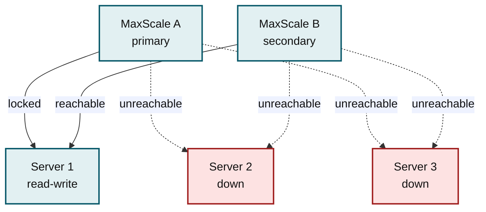
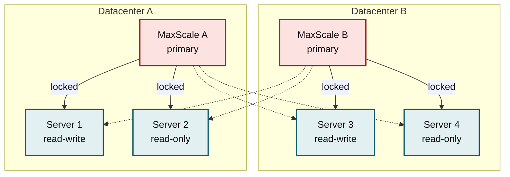
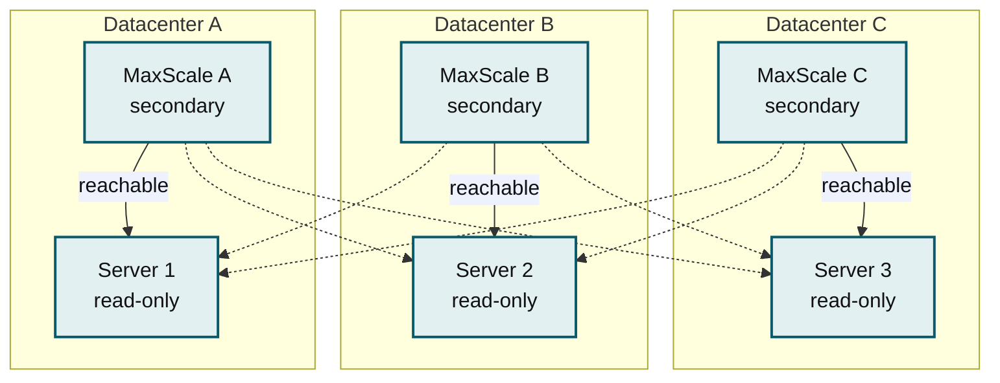
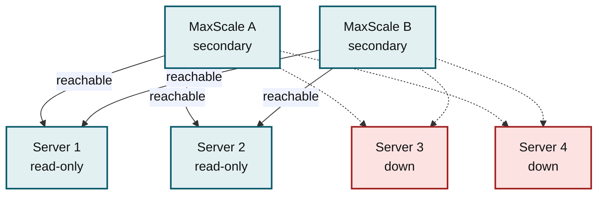
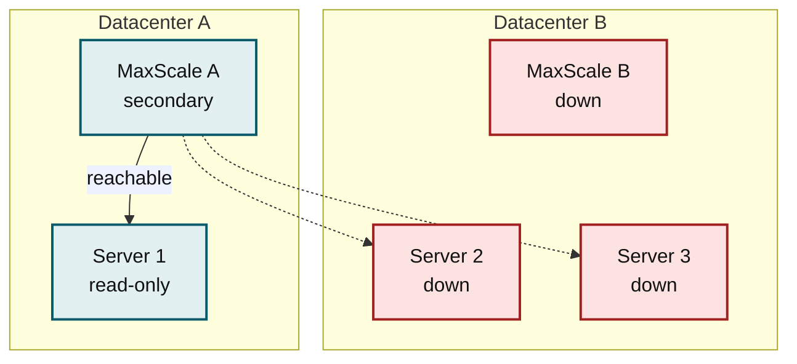
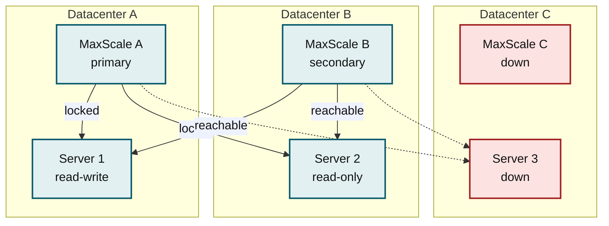
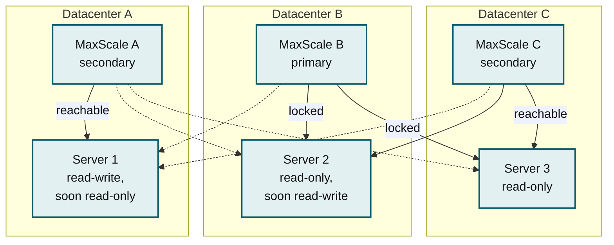

# MaxScale MariaDB Monitor Cooperative Monitoring

This page describes how MariaDB Monitors in several MaxScale instances share one cluster.

Cooperative monitoring means that multiple monitors (typically in different
MaxScale instances) can monitor the same backend server cluster and agree on
which one should be the primary monitor. Only the primary monitor can perform
_switchover_, _failover_, _rejoin_ and other cluster operations. The primary
monitor also decides which server is the primary, i.e. target of write queries.
Cooperative monitoring is enabled with
the [cooperative\_monitoring\_locks](mariadb-monitor-settings.md#cooperative_monitoring_locks)
-setting. This feature is meant to be used when multiple MaxScales manage the
same replication cluster. It's useful even if [auto\_failover](mariadb-monitor-settings.md#auto_failover)
and similar features are not in use, to ensure that all monitors agree on the
primary server.

Cooperative monitoring
uses [server locks](../../../../server/reference/sql-functions/secondary-functions/miscellaneous-functions/get_lock.md)
for coordinating between monitors. When cooperating, the monitor regularly
checks the status of a lock named _maxscale\_mariadbmonitor_ on every server and
acquires it if free. If the monitor acquires a majority of locks, it is the
primary. If a monitor cannot claim lock majority, it is a secondary monitor.
This means that multiple, or even all, monitors can be secondary if no monitor
manages to claim lock majority.

The primary monitor of a cluster also acquires the lock
_maxscale\_mariadbmonitor\_master_ on the primary server. Secondary monitors
check which server this lock is taken on and only accept that server as the
writable primary. This arrangement is required so that multiple monitors can
agree on which server is the primary regardless of replication topology. If a
secondary monitor does not see the _master_-lock taken, then it won't consider
any server writable, causing writes from that MaxScale to fail.

Lock majority means that a monitor has acquired a majority of locks across the
servers, i.e. _n\_servers/2 + 1_ (rounded down) locks. For example, a cluster of
two servers needs two locks for majority, a cluster of three needs two, a
cluster of four needs three, and a cluster of five needs
three. [cooperative\_monitoring\_locks](mariadb-monitor-settings.md#cooperative_monitoring_locks)
defines how the total number of available servers is calculated.
`cooperative_monitoring_locks=majority_of_all` means that all configured
servers, except for those
in [servers\_no\_cooperative\_monitoring\_locks](mariadb-monitor-settings.md#servers_no_cooperative_monitoring_locks),
add up to the total. This means that server status such as _Down_ or
_Maintenance_ does not affect lock majority calculation.
`cooperative_monitoring_locks=majority_of_running` means that only servers that
are _Running_ add up to the total. These options exist so that cooperative
monitoring can adapt to different use cases.
See [majority of running](#majority-of-running)
and [majority of all](#majority-of-all) for suggested use-cases.

To check if a monitor is primary, fetch monitor diagnostics with `maxctrl show
monitors` or the REST API. The boolean field **primary** indicates whether the
monitor has lock majority on the cluster. If cooperative monitoring is disabled,
the field value is _null_. Lock information for individual servers is listed in
the server-specific field **lock\_held**. Again, _null_ indicates that locks are
not in use or the lock status is unknown.

If a MaxScale instance tries to acquire the locks but fails to get majority
(perhaps another MaxScale was acquiring locks simultaneously) it will release
any acquired locks and try again after a random number of monitor ticks. This
prevents multiple MaxScales from fighting over the locks continuously as one
MaxScale will eventually wait less time than the others. Conflict probability
can be further decreased by configuring each monitor with a different
`monitor_interval`.

The diagram below illustrates the lock handling logic.

```mermaid
%%{init: {"themeVariables": {"edgeLabelBackground": "#eef2ff"}}}%%
stateDiagram-v2
    accTitle: MaxScale cooperative monitoring — acquiring the primary lock majority
    accDescr {
        The MariaDB Monitor's cooperative-locking decision on each monitor tick. The monitor
        tick starts and checks lock status on all servers. If this MaxScale already has a
        majority of locks, it acquires any remaining free locks and continues as the primary
        MaxScale. If it does not have a majority, it checks whether it can get a majority. If it
        cannot, it continues as a secondary MaxScale. If it can, it acquires all free locks and
        rechecks whether it got a majority: if yes, it continues as the primary MaxScale; if no,
        it releases all acquired locks and continues as a secondary MaxScale.
    }
    [*] --> Secondary
    Secondary --> UpdateSec
    UpdateSec --> CheckLocks
    Primary --> UpdatePrim
    UpdatePrim --> CheckLocks

    CheckLocks --> GetRemaining: have majority
    CheckLocks --> CanGetMajority: majority available
    CheckLocks --> Secondary: majority unavailable

    GetRemaining --> Primary
    CanGetMajority --> Primary: got majority
    CanGetMajority --> Release: failed to get majority
    Release --> Secondary

    Primary: Primary monitor
    Secondary: Secondary monitor
    UpdatePrim: Update all servers
    UpdateSec: Update all servers
    CheckLocks: Check lock status
    GetRemaining: Acquire remaining locks
    CanGetMajority: Acquire free locks
    Release: Release acquired locks

    classDef proc fill:#fbe5d6,stroke:#c15911,stroke-width:2px,color:#111;
    classDef decision fill:#e2f0f2,stroke:#0a5a6b,stroke-width:2px,color:#111;

    class Primary,Secondary,UpdatePrim,UpdateSec,GetRemaining,Release proc
    class CheckLocks,CanGetMajority decision
```


_MariaDB Monitor cooperative locking: on each tick, a MaxScale that holds
(or manages to acquire) a majority of server locks becomes primary; otherwise
it releases any held locks and continues as secondary._

## Majority of running

`cooperative_monitoring_locks=majority_of_running` is meant for situations where
the network is reliable in the sense that a network partition is highly
unlikely. In a reliable network, if a server becomes unconnectable for one
MaxScale, it does so for all MaxScales. This is typically the case if all
servers and all MaxScales are close by, in the same datacenter under the same
router. Because `majority_of_running` adjusts the total number of servers in the
majority calculation according to how many servers are connectable, a lock
majority is possible even with just one server left running.



_Both MaxScales maintain a connection to Server 1. All other servers are down.
MaxScale A has claimed the exclusive lock on Server 1 and concludes it has lock
majority (1/1 running servers). MaxScale A either considers Server 1 primary, or
promotes it if [auto_failover](mariadb-monitor-settings.md#auto_failover) is enabled. MaxScale A has also
claimed the master-lock on Server 1. MaxScale B sees the locks taken and agrees
that Server 1 is the primary._

`cooperative_monitoring_locks=majority_of_running` should not be used when
network partition is a credible threat. This is the case when the MaxScales and
the servers are separated into multiple datacenters or are otherwise in multiple
networks. If a network partition occurs, different MaxScales see different
servers as connectable, and claim the exclusive locks on them. Thus, multiple
MaxScales can conclude that they have lock majority, which leads to multiple
primary servers. This may lead to write-queries being routed to multiple
servers, splitting the cluster. Once the split happens, MaxScale can no longer
reassemble the cluster automatically, and manual intervention is required.



_The link between datacenters A and B is broken. MaxScale A holds locks on
Server 1 and Server 2, but cannot connect to Server 3 and Server 4. Datacenter B
has the opposite situation. Both MaxScales think they have two locks out of two
running servers, and act as the primary MaxScale. This leads to a split-brain
situation with two independent read-write servers._

## Majority of all

`cooperative_monitoring_locks=majority_of_all` is meant for situations where a
network partition is possible, e.g. when the servers and MaxScales are spread
over multiple datacenters. Because `majority_of_all` calculates the required
majority over all configured servers, it ensures that only one MaxScale can have
lock majority at any time. This does not mean that the cluster will survive
failure scenarios without service outage, though. If the network partitions or
too many servers go down, then the typical outcome is that no MaxScale will have
lock majority, no MaxScale is the primary MaxScale, and no server is writable.
Still, this may be preferable to a split cluster with multiple primary servers.



_The link between datacenters A, B and C is broken. Each MaxScale can only
connect to the server in their local datacenter. Each MaxScale can acquire one
lock out of three total servers, which is not enough for majority. All MaxScales
are in secondary status, and will release any locks they may have acquired. No
primary server is detected so all servers are in read-only mode. Once
connectivity is restored, one MaxScale will again claim lock majority and the
cluster resumes normal operation._

The downside of `majority_of_all` is that it can lead to a read-only cluster in
situations where it is not strictly necessary. This is the case when too many
servers go down or otherwise become unconnectable, so that a majority can no
longer be formed.



_Both MaxScales maintain a connection to Server 1 and Server 2. Server 3 and
Server 4 are down. Neither MaxScale can reach lock majority, which would require
three locks. Servers remain unlocked. Because both MaxScales are in secondary
mode, no server is declared primary. Servers 1 and 2 are in read-only mode._

`cooperative_monitoring_locks=majority_of_all` requires at least three servers
to work reliably. With only two servers, just one server going down means that
lock majority is no longer possible (one out of two is not a majority). Also,
separating the three servers to just two datacenters is fragile: if the
datacenter with two servers loses power, the remaining datacenter can no longer
reach majority.



_Datacenter B is down. Since it contained two out of three servers, the
surviving datacenter does not have enough servers to claim majority._

Resistance to datacenter-wide failures requires at least three datacenters, so
that a majority can be formed with the remaining datacenters.



_Datacenter C is down. It only contained one out of three servers, so the
servers in the remaining datacenters can still form a majority._

If a setup with just two datacenters needs to survive a datacenter failure, and
also be resistant to a split-brain scenario, then neither
`cooperative_monitoring_locks` mode is sufficient. Such a situation requires an
outside orchestrator to manage
the [passive](../../../maxscale-management/deployment/installation-and-configuration/maxscale-configuration-guide.md#passive)
-state of the MaxScales. Both MaxScale and servers also need to be carefully
configured so that different MaxScales cannot select different primaries.
See [failover with multiple MaxScales](../../../mariadb-maxscale-tutorials/failover-with-multiple-maxscales.md)
for more information.

Cooperative monitoring only deals with MaxScale-to-MaxScale synchronization
i.e. that all MaxScales eventually select the same primary server and that only
one MaxScale alters the cluster. Cooperative monitoring does NOT ensure
transaction consistency. If the primary MaxScale loses connection to the
current primary server, other MaxScales may still see that server as the primary
for some time and commit transactions. Only once the
_maxscale\_mariadbmonitor\_master_-lock expires (8s with default monitor
settings), do the other MaxScales realize that the situation has changed. During
this time, transactions can still commit to the old primary.


_Datacenter A disconnects from datacenters B and C but stays running. MaxScale A
(secondary) still sees the master-lock taken on Server 1 and assumes that it is
the primary. After a few seconds, the lock expires, and MaxScale A labels the
server read-only. However, many transactions could have committed during this
time. MaxScale B operates independently, and promotes Server 2. Server 1 and
Server 2 will then diverge._

This situation cannot be entirely protected against. The best remedy is to use
[semisynchronous replication](https://app.gitbook.com/o/diTpXxF5WsbHqTReoBsS/s/SsmexDFPv2xG2OTyO5yV/ha-and-performance/standard-replication/semisynchronous-replication))
with a sufficiently long (e.g. 1 minute)
[rpl_semi_sync_master_timeout](https://app.gitbook.com/o/diTpXxF5WsbHqTReoBsS/s/SsmexDFPv2xG2OTyO5yV/ha-and-performance/standard-replication/semisynchronous-replication#rpl_semi_sync_master_timeout).
This way, when Server 1 loses connectivity to the other servers, writes to
Server 1 will stall, greatly limiting the number of transactions that may be
committed. Any transactions in flight will eventually commit, though. As of
MaxScale 23.02.19, 23.08.15 and 24.02.11, 25.01.8 and 25.10.4, if a secondary
MaxScale is configured with `cooperative_monitoring_locks=majority_of_all` and
it notices that the primary server has lost the _master_-lock, MaxScale will
disconnect the entire routing session. Thus, clients will not get an OK-reply to
their hanging commits, alerting them that something is wrong.

## Related settings

Use [servers_no_cooperative_monitoring_locks](mariadb-monitor-settings.md#servers_no_cooperative_monitoring_locks)
to define servers that do not take part in cooperative monitoring.

Use [cooperative_monitoring_arbitrator_nodes](mariadb-monitor-settings.md#cooperative_monitoring_arbitrator_nodes)
to define servers that only take part in cooperative monitoring.

## Releasing locks

Monitor cooperation depends on the server locks. The locks are
connection-specific. The owning connection can manually release a lock, allowing
another connection to claim it. Also, if the owning connection closes, the
MariaDB Server process releases the lock. How quickly a lost connection is
detected affects how quickly the primary monitor status moves from one monitor
and MaxScale to another.

If the primary MaxScale or its monitor is stopped normally, the monitor
connections are properly closed, releasing the locks. This allows the secondary
MaxScale to quickly claim the locks. However, if the primary simply vanishes
(broken network), the connection may just look idle. In this case, the
MariaDB Server may take a long time before it considers the monitor connection
lost. This time ultimately depends on TCP keepalive settings on the machines
running MariaDB Server.

The TCP keepalive settings can be configured for just the server process. See
[Server System Variables](../../../../server/ha-and-performance/optimization-and-tuning/system-variables/server-system-variables.md#tcp_keepalive_interval)
for information on settings _tcp\_keepalive\_interval_, _tcp\_keepalive\_probes_ and
_tcp\_keepalive\_time_. These settings can also be set on the operating system
level, as described [here](https://www.tldp.org/HOWTO/TCP-Keepalive-HOWTO/usingkeepalive.html).

As of MaxScale 22.08.13, 23.02.10, 23.08.6 and 24.02.2, configuring
TCP keepalive is no longer necessary as the monitor sets the session _wait\_timeout_
variable when acquiring a lock. This causes the MariaDB Server to close the
monitor connection if the connection appears idle for too long. The value of
_wait\_timeout_ used depends on the monitor interval and connection timeout
settings, and is logged at MaxScale startup.

A monitor can also be ordered to manually release its locks via the module
command _release-locks_. This is useful for manually changing the primary
monitor. After running the release-command, the monitor will not attempt to
reacquire the locks for one minute, even if it wasn't the primary monitor to
begin with. This command can cause the cluster to become temporarily unusable by
MaxScale. Only use it when there is another monitor ready to claim the locks.

```
maxctrl call command mariadbmon release-locks MyMonitor1
```

<sub>_This page is licensed: CC BY-SA / Gnu FDL_</sub>


