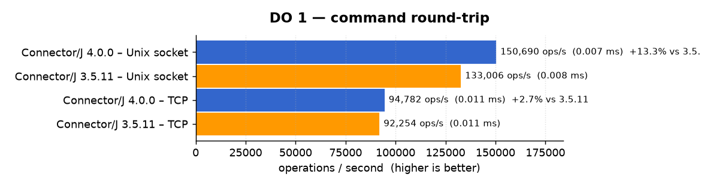
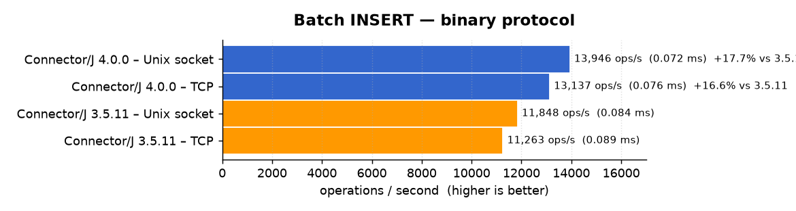
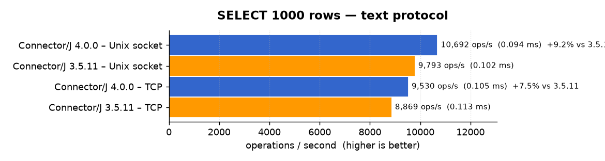
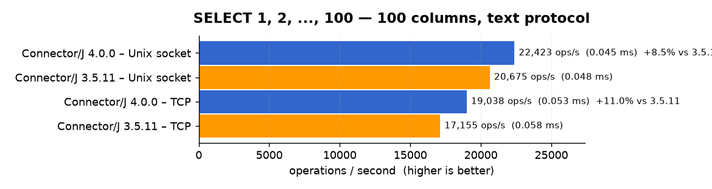

# Connector/J 4.0.0 Release Notes

<a href="https://mariadb.com/downloads/connectors/connectors-data-access/java8-connector" class="button primary">Download</a> <a href="4.0.0.md" class="button secondary">Release Notes</a> <a href="../changelogs/4.0/4.0.0.md" class="button secondary">Changelog</a> <a href="https://app.gitbook.com/s/CjGYMsT2MVP4nd3IyW2L/mariadb-connector-j/about-mariadb-connector-j" class="button secondary">Connector/J Overview</a>

**Release date:** 21 Oct 2026

MariaDB Connector/J 4.0.0 is a [_**Stable**_](../../../community-server/about/release-criteria.md) _**(GA)**_ release.



MariaDB Connector/J 4.0 is a new major release series. It requires Java 17 or later and changes several defaults, so read the upgrade notes at the end of this page before switching. The 3.5 release series remains maintained for applications that run on Java 8 or Java 11.

Connector/J 4.0.0 includes every fix of [Connector/J 3.5.11](../3.5/3.5.11.md).

## Major Changes

### Java 17 is the minimum runtime - [CONJ-1361](https://jira.mariadb.org/browse/CONJ-1361)

Java 8 and Java 11 are no longer supported. Raising the baseline to Java 17 lets the connector rely on the JDK alone, and on modern Java code, in places where it previously needed third-party libraries or workarounds:

* **GSSAPI authentication uses the JDK GSS-API** ([CONJ-1354](https://jira.mariadb.org/browse/CONJ-1354)); the Waffle-based Windows implementation and its `waffle-jna` dependency are removed; with `-Dsun.security.jgss.native=true`, the JDK delegates to the operating-system GSS-API (SSPI on Windows, `libgssapi_krb5` on Linux, GSS.framework on macOS), so single sign-on with the session credentials works without any third-party library or JAAS configuration
* **Unix domain sockets use the JDK implementation** ([CONJ-1370](https://jira.mariadb.org/browse/CONJ-1370)); the JNA dependency is removed, each socket read and write is now a plain JDK channel call, and Unix domain sockets also work on Windows, for example through an SSH tunnel ([CONJ-1220](https://jira.mariadb.org/browse/CONJ-1220), report by DAIKOZ)
* **The code base is written for Java 17 and later** ([CONJ-1364](https://jira.mariadb.org/browse/CONJ-1364)): records, pattern matching, `VarHandle` little-endian access in the packet buffers ([CONJ-1365](https://jira.mariadb.org/browse/CONJ-1365)), `readNBytes`, ranged `Arrays.equals`, `ServiceLoader.stream`, and the JDK UTF-8 encoder ([CONJ-1369](https://jira.mariadb.org/browse/CONJ-1369), [CONJ-1373](https://jira.mariadb.org/browse/CONJ-1373)); these APIs are what made the performance work below possible


#### Performance

The connector's JMH benchmarks were run with the 3.5.11 and 4.0.0 jars against a MariaDB 12.3 server on the same host, over loopback TCP and over the Unix domain socket, three JMH forks each. Values are operations per second, higher is better. There is no regression: every benchmark is at least as fast, and the gains come from the writer buffer work (batch inserts), the reader owning its buffer (large result sets), the faster client-side parsing (text-protocol decoding), and the JNA layer being gone (Unix domain socket round trips).



_The single round trip gains 13% over the Unix domain socket, where each read and write is now a plain JDK channel call instead of going through JNA, and 3% over TCP. On 4.0.0, the socket round trip is about 60% faster than loopback TCP._




_Batch inserts gain about 17% on both transports, from the writer buffer being kept across the commands of a steady workload._





_Large result sets gain 8 to 11% from the reader owning its buffer and from the faster text-protocol decoding. The benchmarks where the server dominates the time, such as the 1000-parameter `DO` or the 100-column binary result with cached metadata, are within their error bars._

### TLS enabled by default - [CONJ-1321](https://jira.mariadb.org/browse/CONJ-1321)

The `sslMode` option now defaults to `verify-full`: the connection is encrypted, and the server certificate and host name are validated.

* The certificate is validated against the `serverSslCert` or `trustStore` option when one is set, and otherwise against the Java default trust store
* With MariaDB Server 11.4 or later, a certificate that cannot be validated (self-signed, or from an unknown issuer) is still accepted when the server identity can be verified during authentication, through the certificate fingerprint and the password; this is the zero-configuration TLS introduced in Connector/J 3.4; the new `deferCertificateValidation` option, enabled by default, controls it: when disabled, such a certificate is rejected at the TLS handshake
* Set `sslMode=disable` to connect without TLS; the legacy `useSsl=false` option still disables TLS
* The `enabledSslProtocolSuites` option now defaults to `TLSv1.3,TLSv1.2`, whatever the JSSE defaults of the running JVM ([CONJ-1363](https://jira.mariadb.org/browse/CONJ-1363))

See [Using TLS/SSL with MariaDB Connector/J](https://app.gitbook.com/o/diTpXxF5WsbHqTReoBsS/s/CjGYMsT2MVP4nd3IyW2L/mariadb-connector-j/using-tls-ssl-with-mariadb-java-connector) for the details.

### AWS IAM authentication moves to a separate artifact - [CONJ-1384](https://jira.mariadb.org/browse/CONJ-1384)

The `AWS-IAM` credential plugin now ships as the `org.mariadb.jdbc:mariadb-java-client-aws` artifact, and the connector itself no longer depends on the AWS SDK. The plugin gains STS assume-role support through the `roleArn`, `roleSessionName`, and `externalId` options ([CONJ-877](https://jira.mariadb.org/browse/CONJ-877), report by Adrian Samatan), and ships the RDS root certificates, so the default `sslMode=verify-full` validates an RDS endpoint without any additional option.

### LOB columns are streamed from the socket - [CONJ-651](https://jira.mariadb.org/browse/CONJ-651)

Until now, a streaming result set (`Statement.setFetchSize(n)`) bounded the number of rows held in memory, but each row was still loaded entirely before the application could read it. A table of large `BLOB` or `TEXT` values therefore needed as much heap as its largest value, however it was read.

Connector/J 4.0 adds **sequential access**, enabled with `Statement.setFetchSize(Integer.MIN_VALUE)` or the `defaultFetchSize=-2147483648` option, on a forward-only, read-only statement. The driver then reads each row from the socket one column at a time, on demand:

* Regular getters (`getInt()`, `getString()`, ...) load only the column being read, into a small reusable buffer
* `getBinaryStream()`, `getBlob()`, `getCharacterStream()`, and `getClob()` return a stream bound to the socket, so a large value is copied to its destination as it arrives and is never held in memory

In exchange, columns must be read in increasing index order, and a streamed column must be fully consumed before the next column is read or `ResultSet.next()` is called, after which it cannot be read again. If another command runs on the connection while the result set is open, the remaining rows are loaded in memory first, like other streaming result sets.

Example: export the files stored in a table to disk without loading any of them in memory.

```java
try (Connection con = DriverManager.getConnection("jdbc:mariadb://localhost/myDb?user=myUser&password=MyPwd");
     Statement stmt = con.createStatement()) {
  // sequential access: rows are read from the socket one column at a time
  stmt.setFetchSize(Integer.MIN_VALUE);
  try (ResultSet rs = stmt.executeQuery("SELECT name, content FROM documents")) {
    while (rs.next()) {
      // column 1 must be read before column 2
      String name = rs.getString(1);
      // the stream reads straight from the socket and must be fully consumed
      // before rs.next() is called
      try (InputStream content = rs.getBinaryStream(2)) {
        Files.copy(content, Paths.get("/tmp/export", name));
      }
    }
  }
}
```

See [Streaming Result Sets](https://app.gitbook.com/o/diTpXxF5WsbHqTReoBsS/s/CjGYMsT2MVP4nd3IyW2L/mariadb-connector-j/about-mariadb-connector-j#streaming-result-sets) for the details (report by Ilya Zhavoronkov).

## Key Enhancements

* [CONJ-1306](https://jira.mariadb.org/browse/CONJ-1306) - `PreparedStatement.executeQuery()` throws an `SQLException` for a statement that returns no result set, as the JDBC specification requires; the `permitNoResults` option, which now defaults to `false`, restores the former behavior of returning an empty result set (report by Christopher Schultz)
* [CONJ-1386](https://jira.mariadb.org/browse/CONJ-1386) - New `sslMode=allow` value: `verify-full` when the server announces TLS, unencrypted otherwise, for a mix of servers with and without TLS behind one connection string; the choice is made from the capability flags the server sends in clear, so an active attacker can downgrade the connection; this is a migration mode, to be replaced by `verify-full` once every server has TLS
* [CONJ-1347](https://jira.mariadb.org/browse/CONJ-1347) - `Connection.setSavepoint()` throws in auto-commit mode instead of silently succeeding
* [CONJ-1262](https://jira.mariadb.org/browse/CONJ-1262) - The `cacheCodecs` option now defaults to `true`
* [CONJ-1371](https://jira.mariadb.org/browse/CONJ-1371) - The `useReadAheadInput` option and `ReadAheadBufferedStream` are removed
* [CONJ-1308](https://jira.mariadb.org/browse/CONJ-1308) - Support for the MariaDB 12.3 `XML` data type
* [CONJ-1378](https://jira.mariadb.org/browse/CONJ-1378) - Try every IP address a host name resolves to when opening the socket; `connectTimeout` bounds the attempts as a whole
* [CONJ-1369](https://jira.mariadb.org/browse/CONJ-1369) - Performance work on the Java 17 code base: packet reader and writer buffers, `readNBytes`, ranged `Arrays.equals`, no `String.format` on data paths
* [CONJ-1365](https://jira.mariadb.org/browse/CONJ-1365) - Performance: `VarHandle` little-endian access in packet buffers
* [CONJ-1373](https://jira.mariadb.org/browse/CONJ-1373) - Performance: JDK UTF-8 encoder for long strings in `Writer.writeString()` and `writeStringEscaped()`
* [CONJ-1375](https://jira.mariadb.org/browse/CONJ-1375) - Performance: cache codec resolution for `getObject(index, Class)` and `setObject()`
* [CONJ-1377](https://jira.mariadb.org/browse/CONJ-1377) - Performance: faster client-side query parsing in `ClientParser` and `NativeSql`
* [CONJ-1368](https://jira.mariadb.org/browse/CONJ-1368) - Build and test tooling: tests run against the built jar, GraalVM metadata refreshed, CI matrix on Java 17, 21, and 25

## Bugs Fixed

Connector/J 4.0.0 includes every fix of [Connector/J 3.5.11](../3.5/3.5.11.md), among them:

* [CONJ-1383](https://jira.mariadb.org/browse/CONJ-1383) - Connection initialization rebuilds `session_track_system_variables` from `@@global`, discarding the session-level `last_gtid` set by MaxScale (report by Sawan Patel)
* [CONJ-1379](https://jira.mariadb.org/browse/CONJ-1379) - Set an explicit session tracking list and guard `character_set_results` like `character_set_client` (report by fg0x0)
* [CONJ-1381](https://jira.mariadb.org/browse/CONJ-1381) - Bound server-declared lengths by the packet before allocating and reading from them (report by fg0x0)
* [CONJ-1374](https://jira.mariadb.org/browse/CONJ-1374) - Redirect URL password partially logged when it contains `@` (report by manus-pi)
* [CONJ-1372](https://jira.mariadb.org/browse/CONJ-1372) - `caching_sha2_password` full authentication fails over a Unix socket when SSL is disabled (report by 工藤航)
* [CONJ-1360](https://jira.mariadb.org/browse/CONJ-1360) - Incorrect dependency check in `AwsIamCredentialPlugin` (report by Dheeraj Nalluri)
* [CONJ-1344](https://jira.mariadb.org/browse/CONJ-1344) - `DatabaseMetaData` imported and exported keys ignore `lower_case_table_names` when using `SHOW CREATE TABLE` (report by plantegg ren)

## Upgrading from 3.x

| Behavior                                   | Connector/J 3.5                                          | Connector/J 4.0                                                                  |
| ------------------------------------------ | -------------------------------------------------------- | -------------------------------------------------------------------------------- |
| Minimum Java version                       | Java 8                                                   | Java 17                                                                          |
| `sslMode` default                          | `disable`                                                | `verify-full`                                                                    |
| `enabledSslProtocolSuites` default         | JVM default                                              | `TLSv1.3,TLSv1.2`                                                                |
| `permitNoResults` default                  | `true`                                                   | `false`                                                                          |
| `cacheCodecs` default                      | `false`                                                  | `true`                                                                           |
| `Connection.setSavepoint()` in auto-commit | Succeeds silently                                        | Throws an `SQLException`                                                         |
| `useReadAheadInput` option                 | Available                                                | Removed                                                                          |
| `AWS-IAM` credential plugin                | Bundled, needs `software.amazon.awssdk:rds` on the classpath | Separate `mariadb-java-client-aws` artifact                                   |
| GSSAPI on Windows                          | Waffle native implementation (`waffle-jna`)              | Operating-system GSS-API with `-Dsun.security.jgss.native=true`                  |
| Unix domain sockets                        | Need JNA, Unix only                                      | JDK implementation, no dependency, also on Windows                               |

See [About MariaDB Connector/J](https://app.gitbook.com/o/diTpXxF5WsbHqTReoBsS/s/CjGYMsT2MVP4nd3IyW2L/mariadb-connector-j/about-mariadb-connector-j) for the full option reference.

## Changelog

For a complete list of changes made in MariaDB Connector/J 4.0.0, with links to detailed
information on each push, see the [changelog](../changelogs/4.0/4.0.0.md).

<sub>_This page is: Copyright © 2026 MariaDB. All rights reserved._</sub>


