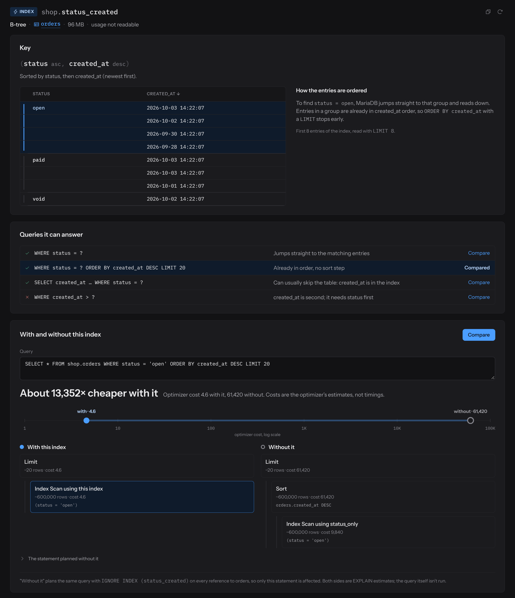
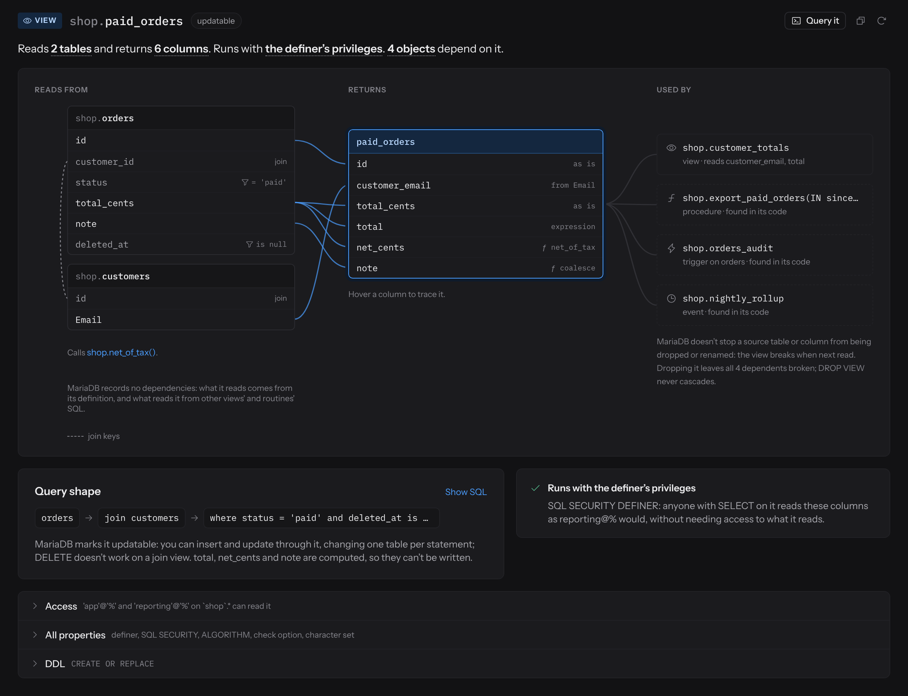
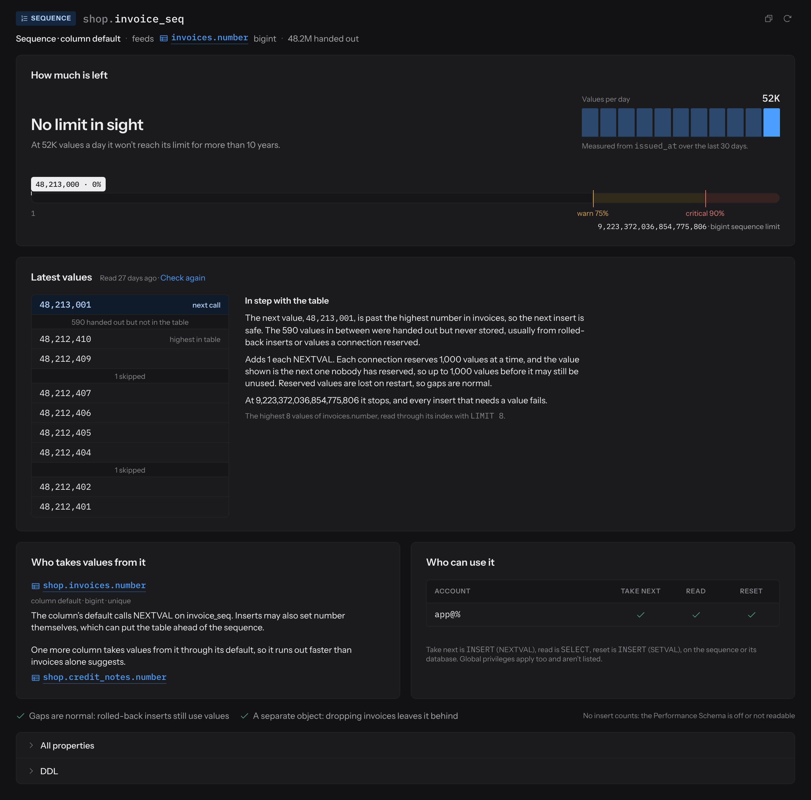

# Seqora


Seqora is third-party software, not developed or maintained by MariaDB and not included with MariaDB Server. MariaDB doesn't test, validate, or support it. Refer to its own documentation and license terms.


[Seqora](https://seqora.dev) is a desktop SQL client for Windows and for macOS on Apple silicon. It connects to MariaDB directly or through an SSH tunnel. TLS can be disabled, preferred, required, or set to verify the server certificate.

## Key Features

* SQL editor with MariaDB syntax highlighting, MariaDB autocompletion, and `DELIMITER` blocks.
* Data grid with cell editing, row insert, and row delete.
* A page for each table, index, constraint, view, trigger, stored routine, sequence, and partition. An index page shows the key parts and sort direction, the first entries in key order, the query shapes the index can answer, its size, its usage counts, and the optimizer's plan for a statement with and without the index.
* Visual EXPLAIN: the plan is drawn as a graph, and the estimate for each step is shown next to the line of SQL it came from.
* Schema design on an entity-relationship canvas. Seqora generates the MariaDB DDL and runs a dry run before applying it.

A view page shows which tables and columns the view reads, which columns it returns and where each comes from, whether the view is updatable, its `SQL SECURITY` setting and definer, and the views, procedures, triggers, and events that depend on it.

## MariaDB Support

Select MariaDB as the connection type. If a connection is set up as MySQL, Seqora also detects a MariaDB server from `SELECT VERSION()`. On MariaDB, Seqora:

* Uses `EXPLAIN FORMAT=JSON` for estimated plans and `ANALYZE FORMAT=JSON` for actual row counts and timings. It doesn't run `ANALYZE` on statements that change data.
* Compares plans with and without an index by adding `IGNORE INDEX` to the same statement. Both plans are `EXPLAIN` estimates, and the query isn't run. Indexes marked `IGNORED` are shown.
* Reads index usage counts from `performance_schema`, or from the `userstat` tables when they're enabled. Without either, the page says that usage isn't readable.
* Reads view dependencies from the view definition and from the SQL of other objects, because MariaDB doesn't record them.
* Shows `SEQUENCE` objects, the `SYSTEM_TIME` history partitions of system-versioned tables, and aggregate stored functions.
* Applies the statement time limit with `max_statement_time`.
* Runs the schema design dry run in a temporary database, because DDL commits implicitly. If the account can't create a database, Seqora checks the syntax only.

A sequence page shows the current value, how much of the range is left, the cache size, which column defaults call `NEXTVAL` on the sequence, and who can use it.

Limitations on MariaDB:

* The editor rejects executable comments (`/*! ... */` and `/*M! ... */`), so `mariadb-dump` output can't be run from it.
* There are no pages for events or user accounts. Grants are shown per table.

## Supported Databases

Besides MariaDB, Seqora connects to MySQL, PostgreSQL, and SQLite.

## License

Seqora is proprietary software with two editions. The Free edition has no time limit, needs no account, and can be used commercially. It includes the SQL editor, data editing, schema browsing, entity-relationship diagrams, and export of the rows loaded in the grid. The paid Pro edition adds the object pages, visual EXPLAIN, schema design, schema compare, schema history and drift, full result export, data import, and an index advisor. Pro has a 14-day trial.

* [Seqora website](https://seqora.dev)
* [Video overview](https://www.youtube.com/watch?v=QSgW4E0CAYI)

_This page is licensed: CC BY-SA / Gnu FDL_


