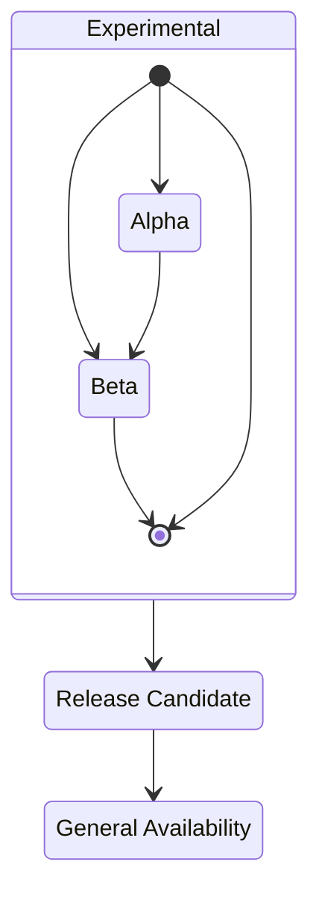

# Writing Plugins for MariaDB



## About

Generally speaking, writing plugins for MariaDB is very similar to writing plugins for MySQL.

## Authentication Plugins

See [Pluggable Authentication](../../plugins/authentication-plugins/pluggable-authentication-overview.md).

## Storage Engine Plugins

Storage engines can extend `CREATE TABLE` syntax with optional
index, field, and table attribute clauses. See [Extending CREATE TABLE](storage-engines-storage-engine-development/engine-defined-new-tablefieldindex-attributes.md) for more information. See also [Storage Engine Development](storage-engines-storage-engine-development/).

## Information Schema Plugins

Information Schema plugins can have their own [FLUSH](../../sql-statements/administrative-sql-statements/flush-commands/flush.md) and [SHOW](../../sql-statements/administrative-sql-statements/show/) statements. See [FLUSH and SHOW for Information Schema plugins](information-schema-plugins-show-and-flush-statements.md).

## Encryption Plugins

[Encryption plugins](encryption-plugin-api.md) in MariaDB are used for the [data at rest encryption](../../../security/encryption/data-at-rest-encryption/) feature. They are responsible for both key management and for the actual encryption and decryption of data.

## Function Plugins

Function plugins add new SQL functions to MariaDB. Unlike the old [UDF API](../../../server-usage/user-defined-functions/), a function plugin supplies a complete `Item` subclass — the same representation the server uses for its own native functions — so it defines its own return type, argument handling, and evaluation, and can do almost anything a built-in function can.

Several functions that look built-in are implemented this way, including `UUID()`, `UUID_V4()`, `UUID_V7()` and `SYS_GUID()`, the `INET_ATON()`, `INET6_NTOA()` and `IS_IPV4()` family, and `CURSOR_REF_COUNT()`.

### The Plugin Descriptor

The API is declared in `include/mysql/plugin_function.h`. The type-specific descriptor for a function plugin is a `Plugin_function` object wrapping a pointer to a `Create_func` builder:

```c
static Plugin_function
  plugin_descriptor_function_sysconst_test(&Create_func_sysconst_test::s_singleton);
```

The builder is what the parser calls to construct the function's `Item` each time the function appears in a statement.

### Function Names and Precedence

The plugin name **is** the SQL function name. When the parser meets a function name it does not recognize, it looks for a plugin of type `FUNCTION` registered under exactly that name. A plugin therefore provides exactly one SQL function; to add several functions, declare several plugins.

Built-in functions take precedence. The server searches its native function registry first and consults function plugins only when the name is not already taken, so a function plugin cannot override or replace a built-in function.

### Declaring the Plugin

Use the ordinary [plugin declaration](#plugin-declaration-structure), with `MariaDB_FUNCTION_PLUGIN` as the type and the `Plugin_function` descriptor as the info pointer:

```c
maria_declare_plugin(sysconst_test)
{
  MariaDB_FUNCTION_PLUGIN,                   // the plugin type
  &plugin_descriptor_function_sysconst_test, // type-specific descriptor
  "sysconst_test",                           // plugin name, and the SQL function name
  "MariaDB Corporation",                     // plugin author
  "Function SYSCONST_TEST()",                // the plugin description
  PLUGIN_LICENSE_GPL,                        // the plugin license
  0,                                         // pointer to plugin initialization function
  0,                                         // pointer to plugin deinitialization function
  0x0100,                                    // numeric version 0xAABB means AA.BB version
  NULL,                                      // status variables
  NULL,                                      // system variables
  "1.0",                                     // string version representation
  MariaDB_PLUGIN_MATURITY_EXPERIMENTAL       // maturity
}
maria_declare_plugin_end;
```

A complete worked example, covering both a function taking no arguments and functions taking arguments, is in the source tree at `plugin/func_test/plugin.cc`. It is built only as a test component, so it is not present in a normal server installation.

### Aggregate Function Plugins


Aggregate function plugins are available from MariaDB 13.2.1.


A function plugin can also implement an aggregate function. The builder reports this by overriding `Create_func::is_aggregate()` to return `true`. The default is `false`, so existing scalar function plugins need no change. The parser checks `is_aggregate()` before parsing the function's arguments, so the arguments are parsed in an aggregate context. An aggregate builder must create an `Item_sum_plugin` descendant (declared in `sql/item_sum.h`). The plugin is declared in the same way as a scalar function plugin, with `MariaDB_FUNCTION_PLUGIN` and a `Plugin_function` descriptor.

Legacy aggregate [UDFs](../../../server-usage/user-defined-functions/) continue to work. A UDF is looked up only when no built-in function or function plugin has the name, so an aggregate function plugin is used in preference to a legacy aggregate UDF of the same name.

#### Implementing an Aggregate

An aggregate implementation provides:

* `clear()`, which resets the aggregate state for a new group. The result for an empty group is whatever the cleared state produces. For example, the `test_plugin_count` example returns `0` and `test_plugin_first` returns `NULL`.
* `add_row()`, which adds one row to the state. It must read its arguments with `aggregation_arg()` rather than directly from `args[]`, so that `DISTINCT` processing can substitute the values it replays.
* The result accessors (`val_int()`, `val_str()` and so on), `type_handler()`, `fix_length_and_dec()`, `cleanup()`, and the copy methods such as `copy_or_same()`.

To reject an unsupported argument type, report an error from `fix_length_and_dec()` and return `true`.

#### DISTINCT, FILTER and Window Functions

* `DISTINCT` is supported by default. The replay order is unspecified, so an order-sensitive aggregate must override `supports_distinct()` to return `false`. The server then rejects `DISTINCT` for that function with an error that it is not yet supported.
* The server applies `FILTER (WHERE ...)`. `add_row()` and `remove_row()` are called only for rows that pass the filter.
* To work efficiently with moving window frames, override `supports_removal()` and `remove_row()`. Without them the server still runs the aggregate as a window function, but recomputes it by scanning the whole frame.
* A plugin aggregate with `DISTINCT` cannot be used as a window function. The server returns an error that this is not yet supported.

Plugin aggregates follow the same placement rules as built-in aggregate functions. For example, they cannot be used in a `CHECK` constraint, a `DEFAULT` expression or a generated column, and they cannot be nested inside other aggregates.

#### Pluggable Data Types

An aggregate can accept arguments of a type supplied by a data type plugin and return the same type. If the aggregate sets its result type from its argument's type handler, the result keeps that type through `CREATE TABLE ... AS`, temporary tables, views, `UNION`, `CASE` and derived tables. To return native values, override `val_native()`. The `test_plugin_first` example does this and works on `UUID` columns.

#### Examples

The aggregates `test_plugin_count` and `test_plugin_first` in `plugin/func_test/plugin.cc` are working examples. `test_plugin_count` supports window frame removal. `test_plugin_first` keeps the argument's type and does not support `DISTINCT`.

### Viewing Function Plugins

Function plugins appear in [SHOW PLUGINS](../../sql-statements/administrative-sql-statements/show/show-plugins.md) with a `Type` of `FUNCTION`, and the functions they provide are listed in the [Information Schema SQL\_FUNCTIONS table](../../system-tables/information-schema/information-schema-tables/information-schema-sql_functions-table.md) alongside built-in functions.

Function plugins are initialized early in server startup, before storage engine plugins.

## Building and Packaging a Plugin


Building a plugin with only the MariaDB development package, without the server source tree, requires MariaDB 11.4.14, 11.8.10, 12.3.4, 13.1.2, 13.2.1, or later ([MDEV-40608](https://jira.mariadb.org/browse/MDEV-40608)).


To build a plugin, install the MariaDB development package. On RPM-based distributions:

```bash
dnf install MariaDB-devel
```

On Debian and Ubuntu:

```bash
apt install libmariadb-dev
```

Then create a `CMakeLists.txt` file. For a simple plugin, a few lines are enough:

```cmake
cmake_minimum_required(VERSION 3.12)
find_package(mariadb-plugin REQUIRED)
MARIADB_ADD_PLUGIN(exampledb example.cc STORAGE_ENGINE
                 AUTHOR "John Smith" VERSION 0.1
                 DESCRIPTION "Example of plugin interface")
include(CPack)
```

With this file, you can do the following:

* Configure the build: `cmake .`. To build packages, add `-DRPM=1` or `-DDEB=1`, depending on the kind of package you need.
* Compile the plugin: `cmake --build .`
* Install the plugin: `cmake --build . --target install`
* Create a package: `cmake --build . --target package`

If MariaDB was installed from a `.tar.gz` or `.zip` archive, the development files are not in a standard location. Pass the MariaDB base directory when you configure the build:

```bash
cmake . -DCMAKE_PREFIX_PATH=/path/to/mariadb/basedir
```

## Plugin Declaration Structure

The MariaDB plugin declaration differs from
the MySQL plugin declaration in the following ways:

1. it has no useless 'reserved' field (the very last field in the MySQL plugin declaration)
2. it has a 'maturity' declaration
3. it has a field for a text representation of the version field

MariaDB can load plugins that only have the MySQL plugin declaration but both `PLUGIN_MATURITY` and `PLUGIN_AUTH_VERSION` will show up as 'Unknown' in the [INFORMATION\_SCHEMA.PLUGINS table](../../system-tables/information-schema/information-schema-tables/plugins-table-information-schema.md).

For compiled-in (not dynamically loaded) plugins, the presence of the MariaDB plugin declaration is mandatory.

### Example Plugin Declaration

The MariaDB plugin declaration looks like this:

```c
/* MariaDB plugin declaration */
maria_declare_plugin(example)
{
   MYSQL_STORAGE_ENGINE_PLUGIN, /* the plugin type (see include/mysql/plugin.h) */
   &example_storage_engine_info, /* pointer to type-specific plugin descriptor   */
   PLUGIN_NAME, /* plugin name */
   PLUGIN_AUTHOR,  /* plugin author */
   PLUGIN_DESCRIPTION, /* the plugin description */
   PLUGIN_LICENSE, /* the plugin license (see include/mysql/plugin.h) */
   example_init_func,   /* Pointer to plugin initialization function */
   example_deinit_func,  /* Pointer to plugin deinitialization function */
   PLUGIN_HEX_VERSION, /* Numeric version 0xAABB means AA.BB version */
   example_status_variables,  /* Status variables */
   example_system_variables,  /* System variables */
   PLUGIN_VERSION,  /* String version representation */
   MariaDB_PLUGIN_MATURITY_EXPERIMENTAL /* Maturity (see include/mysql/plugin.h)*/
}
maria_declare_plugin_end;
```

The build takes the values of `PLUGIN_NAME`, `PLUGIN_AUTHOR`, `PLUGIN_DESCRIPTION`, `PLUGIN_VERSION`, and `PLUGIN_HEX_VERSION` from the `MARIADB_ADD_PLUGIN()` call in `CMakeLists.txt`, and sets `PLUGIN_LICENSE` to `PLUGIN_LICENSE_GPL`. You can also specify the values explicitly, as in the `sysconst_test` example above. This is particularly useful if the plugin binary contains several plugins.

## Maturity Guidelines For Plugins

### Plugin Maturity At a Glance



### Plugin Maturity Guidelines


New features or sufficiently big code changes to a plugin should lead to:

* an increase of the plugin version
* knocking the maturity level down.


* First a plugin is Alpha
* After at least 1.5 months (or more, in 3 month increments, until the quality is deemed acceptable) it becomes Gamma. Meanwhile it can transition through Beta as the maintainer wants (e,g. it can start directly from beta)
* After at least 3 more months (or more, in 3 month increments — depending on the bug inflow) it becomes Stable

If a plugin must be statically compiled into the server, it is a subject to an additional limitation — its maturity cannot be lower than the server's.

## Beta Plugins In GA Releases

If a plugin contribution is added directly at beta maturity to a GA release series, it will not be removed from that release series. However, we reserve the right to exclude a plugin from future release series if it is unmaintained (for example, if it stops receiving bug fixes).

<sub>_This page is licensed: CC BY-SA / Gnu FDL_</sub>


