# How to Authenticate to Control Center With Kerberos

## Prerequisites

- A running [**Keycloak**](https://www.keycloak.org/) server
- A **Kerberos** KDC and realm, or the ability to create one
- A [**GridGain 8 Control Center**](../README.md) instance

## Overview

This guide walks you through setting up [Control Center](../README.md) to use [Kerberos authentication](https://www.fortinet.com/resources/cyberglossary/kerberos-authentication#:~:text=Kerberos%20authentication%20allows%20service%20systems,are%20interacting%20with%20are%20authentic) with [Keycloak](https://www.keycloak.org/).

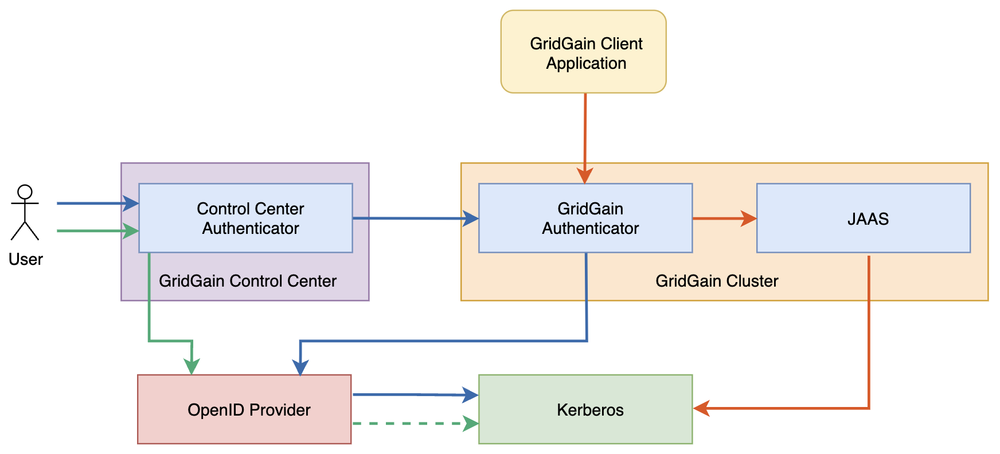

This guide uses the following software versions:

- Control Center 2023.3
- Keycloak 19.0.2
- Kerberos 5 1.19.2

The setup has five steps:

1. [Configure Control Center to use OAuth2 Keycloak authentication](#configure-control-center-to-use-oauth2-keycloak-authentication)
2. [Set up Kerberos server on Ubuntu](#set-up-kerberos-server-on-ubuntu)
3. [Create Kerberos principals](#create-kerberos-principals)
4. [Configure Keycloak to log in with a Kerberos ticket](#configure-keycloak-to-log-in-with-a-kerberos-ticket)
5. [Sign in to Control Center with the Kerberos user](#sign-in-to-control-center-with-the-kerberos-user)

## Configure Control Center to use OAuth2 Keycloak Authentication

1. Open the **Keycloak Administration console** in your browser and log in as administrator.
2. Create the `gridgain` realm:

   1. Initiate realm creation.

      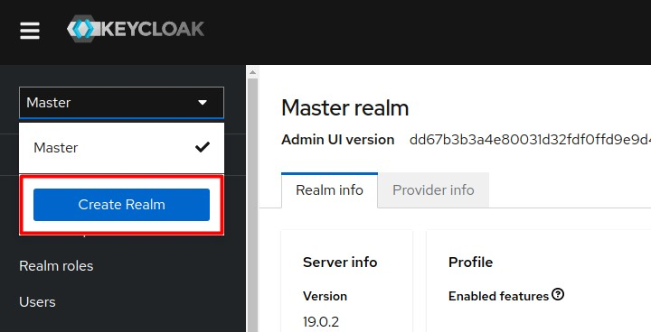

   1. Enter the name "gridgain" and save the new realm.

      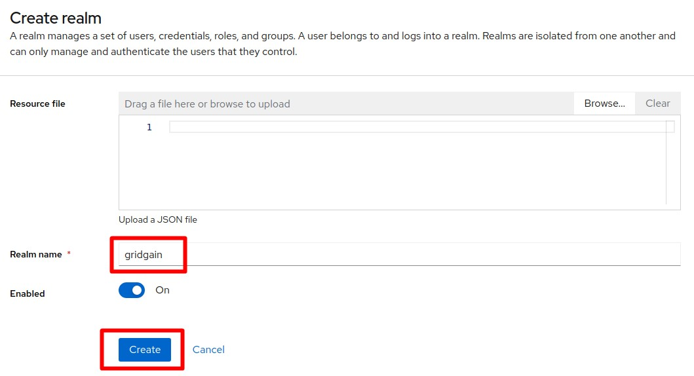

3. Create the `control-center` client:

   1. Initiate client creation.

      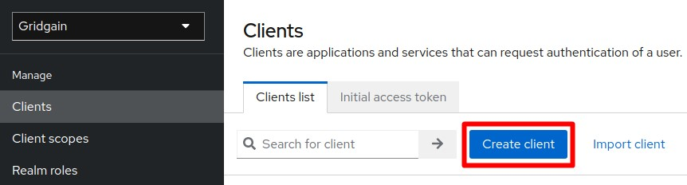

   1. Enter the values as they appear in the screenshot below and click **Next**.

      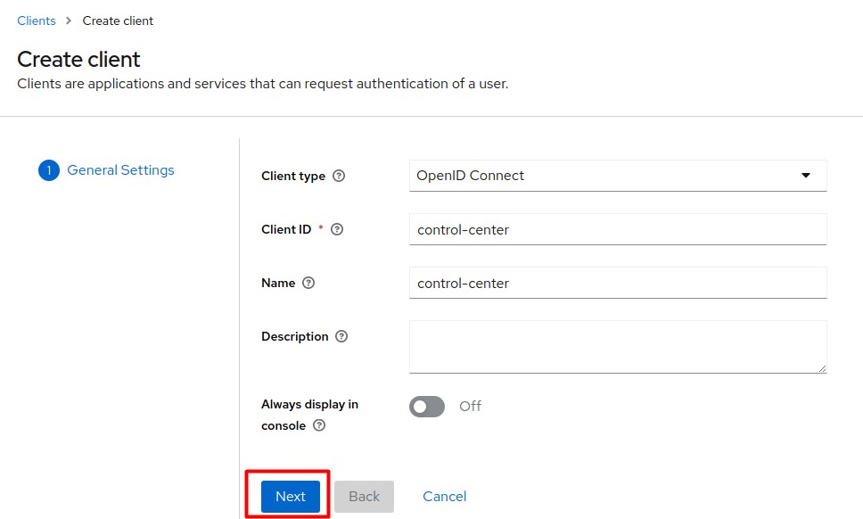

   1. Enter the values as they appear in the screenshot below and click **Save**.

      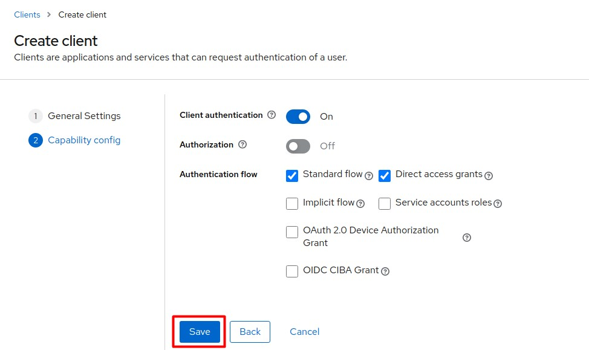

4. On the **Client Details** page, define access settings for the client you have created. Use your actual Control Center host address and port number.

   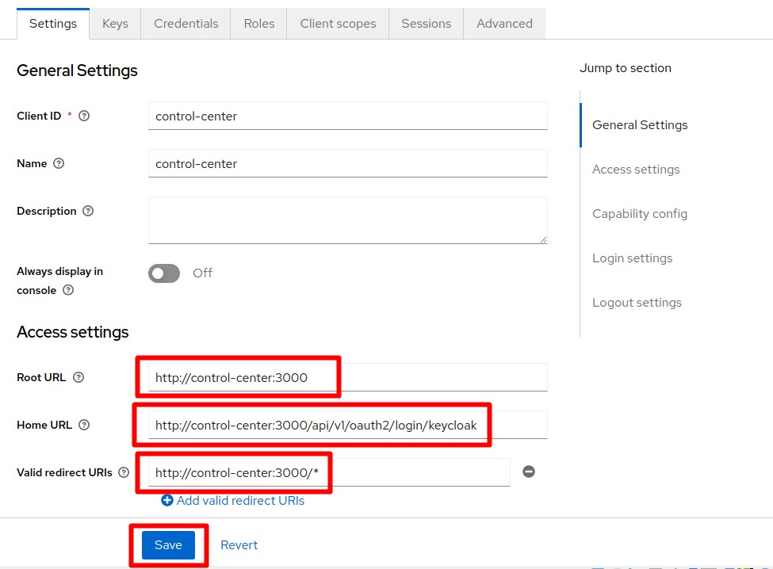

   - Root URL: http://[cc-host]:[cc-port]
   - Home URL: http://[cc-host]:[cc-port]/api/v1/oauth2/login/keycloak
   - Valid Redirect URIs: http://[cc-host]:[cc-port]/*

5. On the **Credentials** tab, copy **Client secret**, which is required to set up the Control Center connection to Keycloak.

   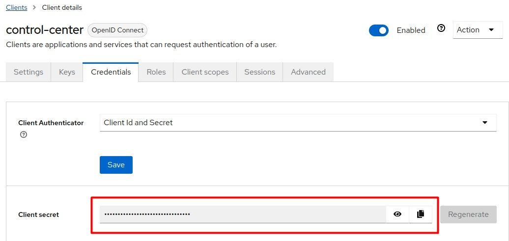

6. Click the **OpenID endpoint configuration** link on the **Realm Settings** page.

   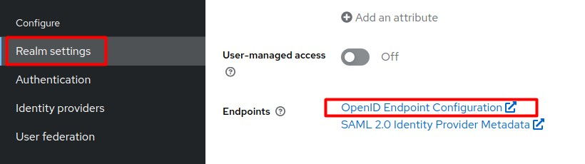

7. On the page that opens, define the following settings.

   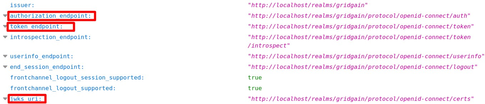

8. Create a new Control Center user:

   1. Initiate user creation.

      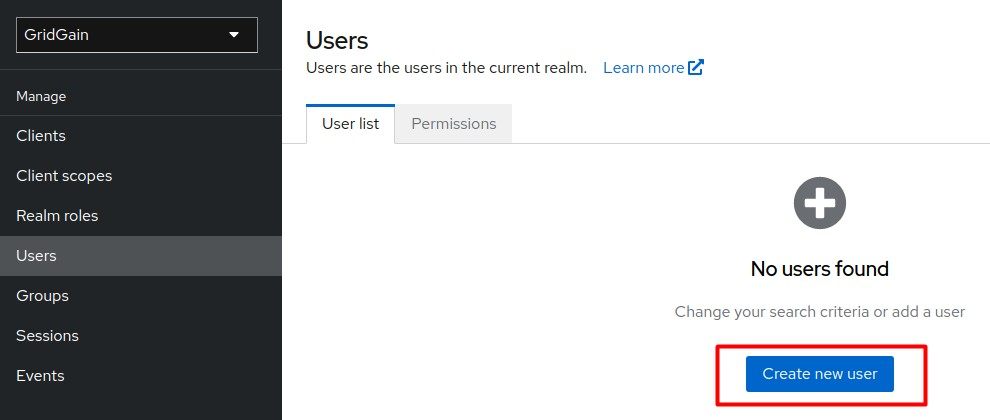

   1. Enter the values as they appear in the screenshot below and click **Create**.

      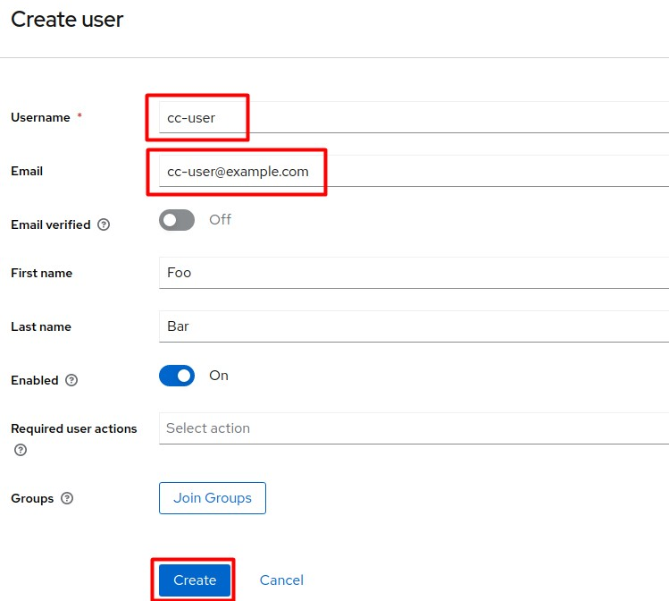

9. Manually set up a password for `cc-user`:

   1. Initiate the **Set password** procedure.

      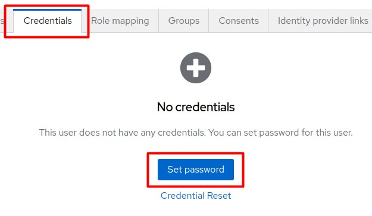

   1. Enter the required password and click **Save**.

      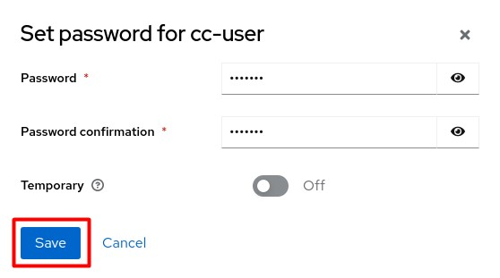

   You can now authenticate to Control Center as `cc-user` with the password you created in the previous step.

10. Edit the Control Center's `application.yaml` configuration. Use the values from step 5 and step 7 above. Replace `[kc-url]` with the actual Keycloak network address.

    ```yaml
    spring.security.oauth2.client:
      registration:
        keycloak:
          client-id: control-center
          client-secret: <secret>
          scope: openid, profile, roles
      provider:
        keycloak:
          authorization-uri: http://[kc-url]/realms/gridgain/protocol/openid-connect/auth
          token-uri: http://[kc-url]/realms/gridgain/protocol/openid-connect/token
          jwk-set-uri: http://[kc-url]/realms/gridgain/protocol/openid-connect/certs
    ```

## Set up Kerberos Server on Ubuntu

1. Install the Key Distribution Center and Kerberos Admin Service:

   ```bash
   $ sudo apt install krb5-admin-server krb5-kdc
   ```

   During installation, set the following properties:

   - Default realm: `EXAMPLE.COM`
   - Kerberos server: `kdc.example.com`
   - Admin server: `kdc.example.com`

2. Create a realm:

   ```bash
   $ sudo krb5_newrealm
   ```

## Create Kerberos Principals

1. Create a new principal to be used by Keycloak:

   ```bash
   $ sudo kadmin.local -q 'addprinc -randkey HTTP/kdc.example.com@EXAMPLE.COM'
   ```

2. Generate the principal keytab file:

   ```bash
   $ sudo kadmin.local -q 'ktadd -k /tmp/http.keytab HTTP/kdc.example.com@EXAMPLE.COM'
   ```

3. Place the `http.keytab` file on the Keycloak machine locally.
4. Create a principal and keytab to be used by Control Center:

   ```bash
   $ sudo kadmin.local -q 'addprinc -randkey krb-user@EXAMPLE.COM'
   $ sudo kadmin.local -q 'ktadd -k /tmp/krb-user.keytab krb-user@EXAMPLE.COM'
   ```

## Configure Keycloak to log in With a Kerberos Ticket

1. Select the `gridgain` realm and go to **User Federation**.

   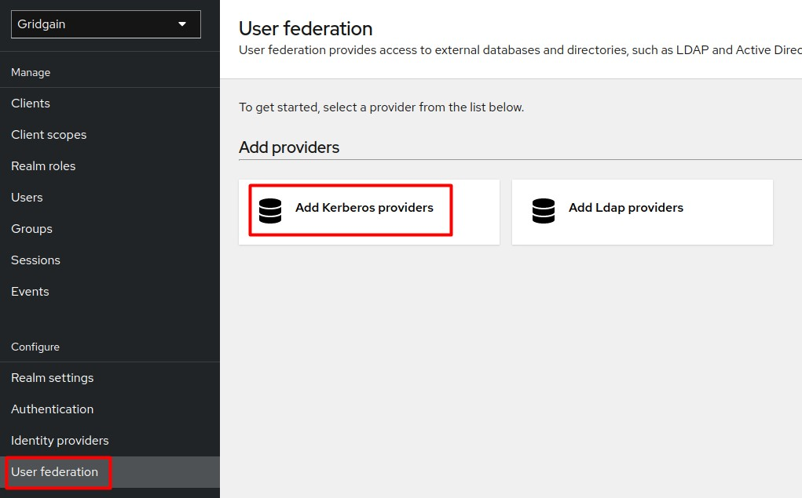

2. Add the **Kerberos** provider and click **Save**.

   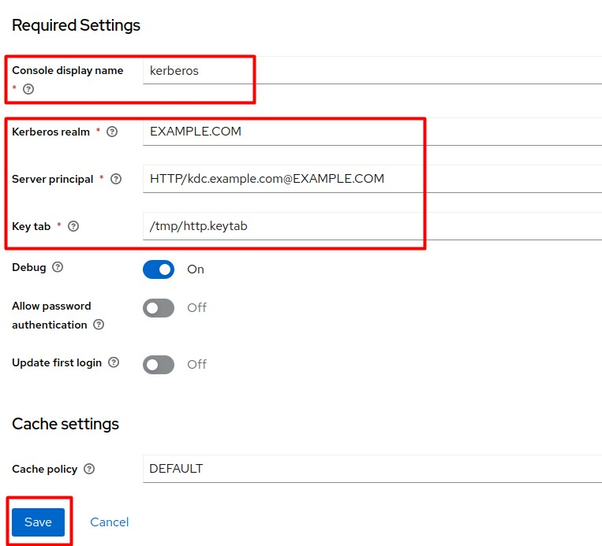

3. From the side menu, select **Authentication**.

   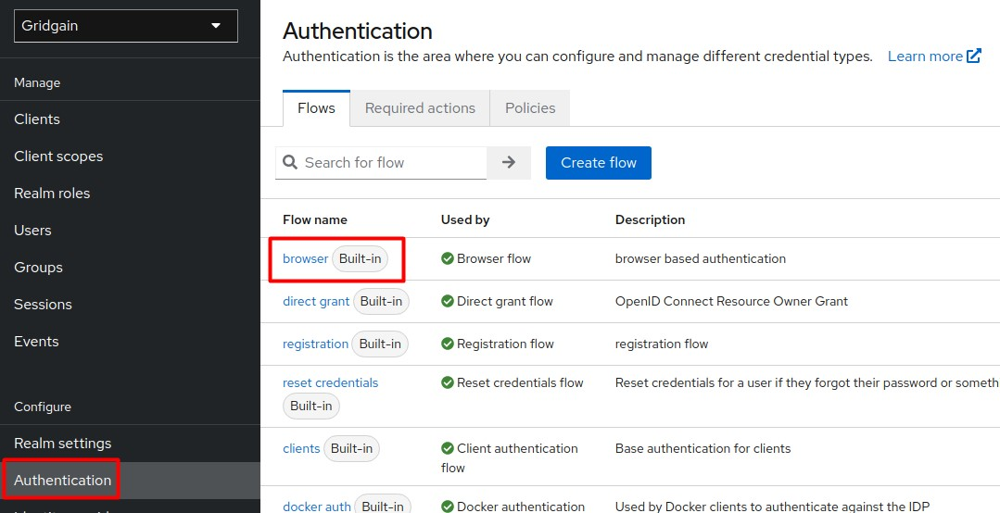

4. Add **Kerberos** as an alternative step to the **Browser** flow.

   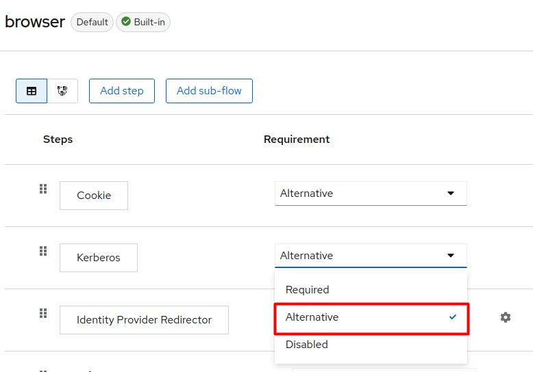

## Sign in to Control Center With the Kerberos User

1. Install the Kerberos client on the client side (if not already installed):

   ```bash
   $ sudo apt install krb5-user
   ```

   During installation, configure the realm host.

2. Authenticate to Kerberos as `krb-user` with the keytab you created in step 3.3:

   ```bash
   $ kinit -kt /tmp/krb-user.keytab krb-user@EXAMPLE.COM
   ```

3. Check whether the Kerberos tickets have been successfully granted by the KDC:

   ```bash
   $ klist
   ```

   The response should be:

   ```text
   Ticket cache: FILE:/tmp/krb5cc_1000

   Default principal: krb-user@EXAMPLE.COM

   Valid starting       Expires              Service principal

   10/16/2022 12:19:10  10/16/2022 22:19:10  krbtgt/EXAMPLE.COM@EXAMPLE.COM

   renew until 10/17/2022 12:19:09
   ```

4. Launch your browser (Chrome in this guide) with SPNEGO enabled to allow Kerberos authentication with Keycloak:

   ```bash
   $ /usr/bin/google-chrome-stable --auth-server-whitelist="*.example.com" --auth-negotiate-delegate-whitelist="*.example.com"
   ```

5. Open Control Center in the browser and select the **Sign in to your account with OpenID** option.

   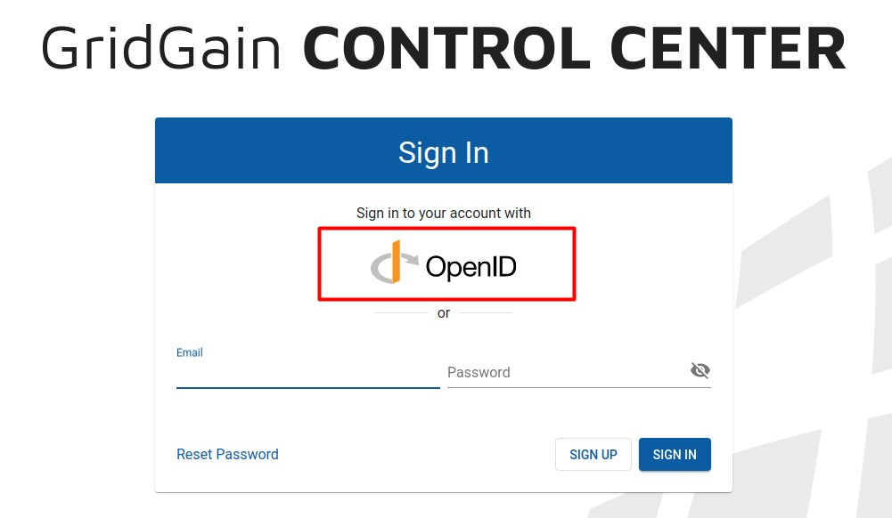

   Authentication with the Kerberos principal is performed automatically.

   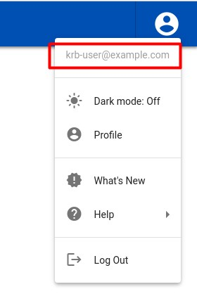

## Related

- [Keycloak documentation](https://wjw465150.gitbooks.io/keycloak-documentation/content/server_admin/topics/authentication/kerberos.html) - Configuring Kerberos user federation in Keycloak.
- [OpenID Connect Authentication](open-id.md) - Setting up OpenID Connect authentication in Control Center.
