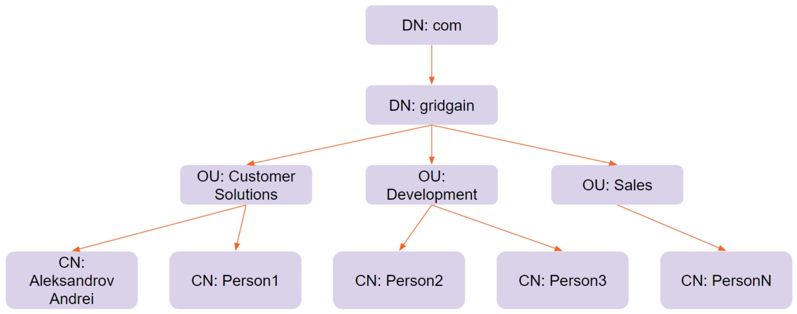
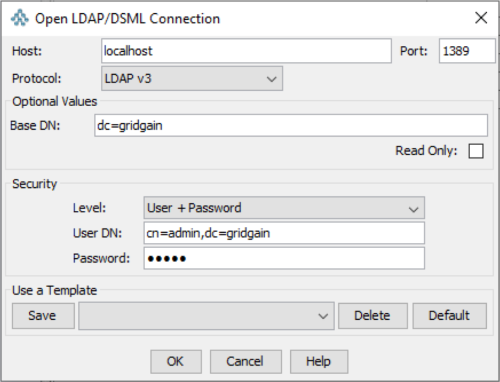
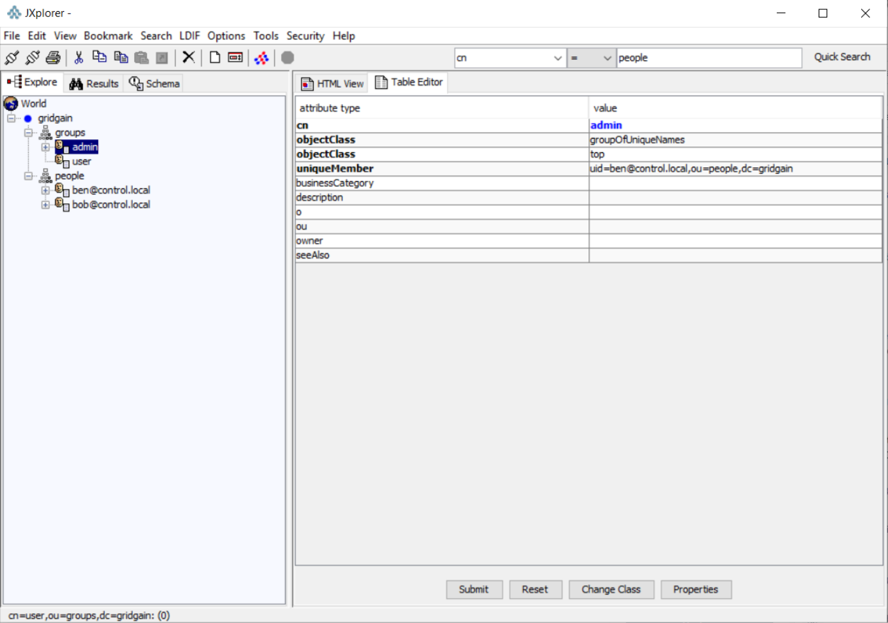
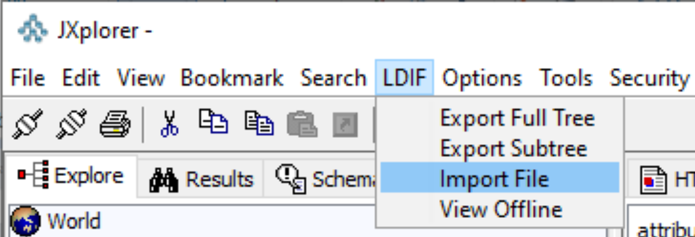
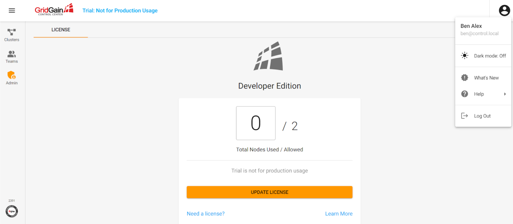
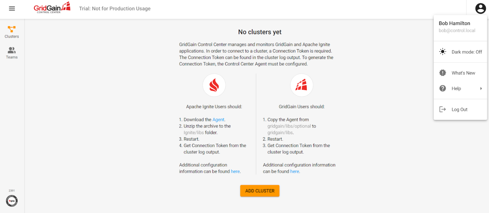

# How to Integrate Control Center With LDAP

## Prerequisites

- A running **GridGain 8** cluster
- **GridGain Control Center** binaries
- **Docker**, to run the OpenLDAP server
- An LDAP viewer such as [**JXplorer**](http://jxplorer.org)

## Overview

Lightweight Directory Access Protocol (or LDAP) is a software protocol that enables you to store information about the structure of your organization in a specially structured way. LDAP configuration is organized in a tree-like hierarchy that includes the following items that can be optional:

- **Root directory**: Where you begin looking for the information in the LDAP tree.
- **Common name** (**CN**): Used for storage of people's names, product names, job titles, and so on.
- **Organization** (**O**): The name of an organization. Used as a top-level item (root).
- **Organization unit** (**OU**): The name of a unit or team in the organization.
- **Domain name** (**DC**) or **Domain component** (**DN**): Usually points to some kind of DNS-based LDAP tree that has the following style - *CN=Aleksandrov Andrei,OU=Customer Solutions,DN=gridgain,DN=org*

These are the items that you are most likely to use. However, there are more items, such as *country* (*C*) and *street* (*S*).

*CN=Aleksandrov Andrei,OU=Customer Solutions,DN=gridgain,DN=org* must be read from right to left and it can be represented in the following LDAP tree:



Now, look at how LDAP is used:

- Usually, LDAP is used for authentication and authorization processes. It has several mechanisms:
  - The process of verifying a username and password combination (by using a directory server such as MS Active Directory or OpenLDAP) can be implemented via various protocols:
    - **Anonymous**: When neither a username nor a password is required.
    - **Username/Password**: When both a username and password are required.
    - **Simple Authentication and Security Layer**: A subset of protocols that can be used for authentication. For example, GridGain uses Java Authentication and Authorization Service (JAAS) to access LDAP login modules that can connect via SASL.
    - **Generic Security Services API** (**GSSAPI**): Protocols that can be used for SSO access. For example, Kerberos authentication servers can be used for login. If JAAS is used for Kerberos, an additional login module should be set.
  - When authorization is complete, user roles or permissions can be checked, to enable granting of special application-level permissions.
- LDAP can be used as a data store, and various applications can connect to it to retrieve information about the structure of the organization and to store files. However, this guide does not cover this use case.

Thus, authentication and data searching are two of the operations that can be performed in LDAP. Look more closely at the search operation.

For every search, the following parts should be configured:

- **Information about the authentication mechanism and user credentials**: Both are required.
- **Search base**: The place in the LDAP tree from which the search should be performed.
- **LDAP address**: The host and port of the LDAP server.
- **LDAP search filter**: Filters are used to limit the number of users or groups that are allowed to access the application or to build the authorization system (based on the roles that are applicable to the filters). You can read more about this model in the [Role-based Authorization with Active Directory for GridGain](https://medium.com/@valentin.kulichenko/role-based-authorization-with-active-directory-for-gridgain-eaad394ba173) article.

Additional features can be used for search, but they are not covered in this guide. You are ready to integrate GridGain Control Center with LDAP.

## OpenLDAP Server Configuration

In this example, you use the OpenLDAP server. You can read about the server on the [OpenLDAP website](https://www.openldap.org/).

To simplify the process, you use Docker images with the OpenLDAP service. For configuration of the OpenLDAP server on a Windows host, you complete the steps below. The steps for other operating systems are similar:

1. Install [Docker for Windows](https://docs.docker.com/docker-for-windows/install/).
2. When installation is complete, install the LDAP viewer. The viewer can be any tool that enables you to view and modify the LDAP structure. If possible, you should use a tool that can work with LDIF files, because you will use LDIF files later. For example, it can be [http://jxplorer.org](http://jxplorer.org). However, you can use the CMD interface instead.
3. Prepare the structure of your LDAP tree and store it to the `gridgain.ldif` file.

   ```text
   #
   # Copyright (C) GridGain Systems. All Rights Reserved.
   #  _________        _____ __________________        _____
   #  __  ____/___________(_)______  /__  ____/______ ____(_)_______
   #  _  / __  __  ___/__  / _  __  / _  / __  _  __ `/__  / __  __ \
   #  / /_/ /  _  /    _  /  / /_/ /  / /_/ /  / /_/ / _  /  _  / / /
   #  \____/   /_/     /_/   \_,__/   \____/   \__,_/  /_/   /_/ /_/
   #
   dn: ou=people,dc=gridgain
   objectclass: top
   objectclass: organizationalUnit
   ou: people

   dn: uid=bob@control.local,ou=people,dc=gridgain
   objectclass: top
   objectclass: person
   objectclass: organizationalPerson
   objectclass: inetOrgPerson
   cn: Bob Hamilton
   sn: Hamilton
   uid: bob@control.local
   userPassword: bobspassword

   dn: uid=ben@control.local,ou=people,dc=gridgain
   objectclass: top
   objectclass: person
   objectclass: organizationalPerson
   objectclass: inetOrgPerson
   cn: Ben Alex
   sn: Alex
   uid: ben@control.local
   userPassword: benspassword

   dn: ou=groups,dc=gridgain
   objectclass: organizationalUnit
   objectclass: top
   ou: groups

   dn: cn=user,ou=groups,dc=gridgain
   objectclass: groupOfUniqueNames
   objectclass: top
   cn: user
   uniqueMember: uid=ben@control.local,ou=people,dc=gridgain
   uniqueMember: uid=bob@control.local,ou=people,dc=gridgain

   dn: cn=admin,ou=groups,dc=gridgain
   objectclass: groupOfUniqueNames
   objectclass: top
   cn: admin
   uniqueMember: uid=ben@control.local,ou=people,dc=gridgain
   ```

   This structure has two users (`Ben` and `Bob`) and two groups (`admin` and `user`). Both Ben and Bob are in the user group. But, only Ben is in the admin group. Later, you will see why the users are treated differently.

4. Start the OpenLDAP server by using the following command:

   ```bash
   docker run -p 1389:1389 -p 1636:1636 --env LDAP_ADMIN_USERNAME=admin --env LDAP_ADMIN_PASSWORD=admin --env LDAP_ROOT=dc=gridgain --env LDAP_CUSTOM_LDIF_DIR=./ldif --name openldap bitnami/openldap:latest
   ```

5. Under administration permissions, start the JXplorer tool and connect to the LDAP server as shown in the following screenshot (where the password is admin):

   

6. View the structure of the LDAP tree:

   

7. If you see an empty structure or different structure, delete the existed structure and manually import the settings from the ldif file:

   

That is how you configure the LDAP server.

## Configuring Control Center

Now, you configure Control Center:

1. Download and unzip the Control Center binaries.
2. Navigate to the root folder of the unzipped directory and create an `application.yaml` file:

   ```yaml
   spring.ldap.urls: ldap://localhost:1389
   spring.ldap.base: dc=gridgain
   control.metric-collector.limitEnabled: true
   spring.ldap.user-details.groupSearchBase: "ou=groups"
   spring.ldap.bind-authenticator.enabled: true
   spring.ldap.admin-role: admin
   spring.ldap.user-details.groupRoleAttribute: cn
   spring.ldap.user-details.groupMemberAttributeName: uniquemember
   ```

   You are required to add a special URL to connect to the OpenLDAP server and start the Control Center. Control Center will perform the following:

   - Authentication with the username and password that you provide in the Control Center UI
   - An LDAP search that determines whether the current user is a member of the admin group

3. Start Control Center by using the `control-center.sh` script.
4. Move to the Control Center UI and click the **SIGN IN** button.

Now, you should be logged in using Ben and Bob accounts.

Ben's account can see the following UI:



And, Bob's account will be able to see the following UI:



As you see, Ben has a special admin panel that provides additional functionality.

## Related

- [OpenLDAP](https://www.openldap.org/) - The open-source LDAP server used in this guide.
- [Role-based Authorization with Active Directory for GridGain](https://medium.com/@valentin.kulichenko/role-based-authorization-with-active-directory-for-gridgain-eaad394ba173) - Building an authorization system from LDAP search filters.
