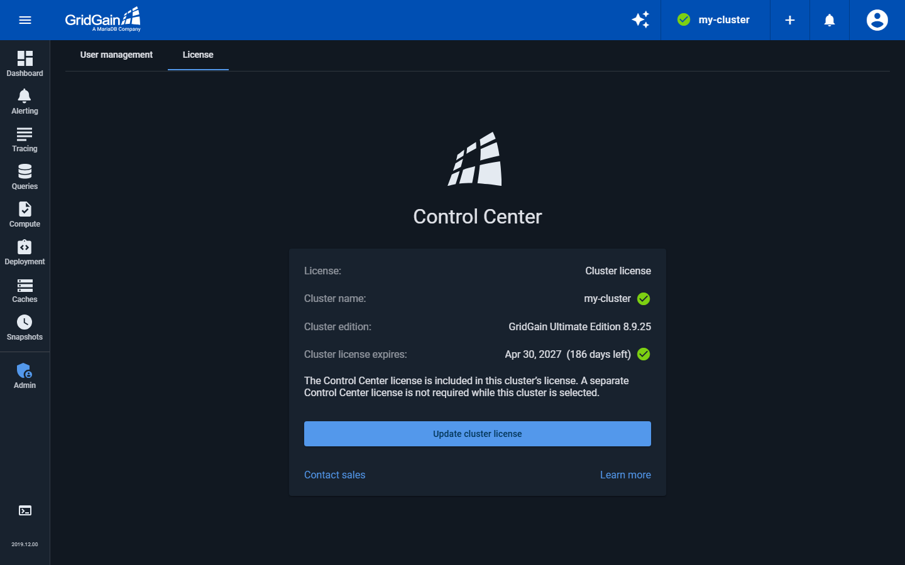
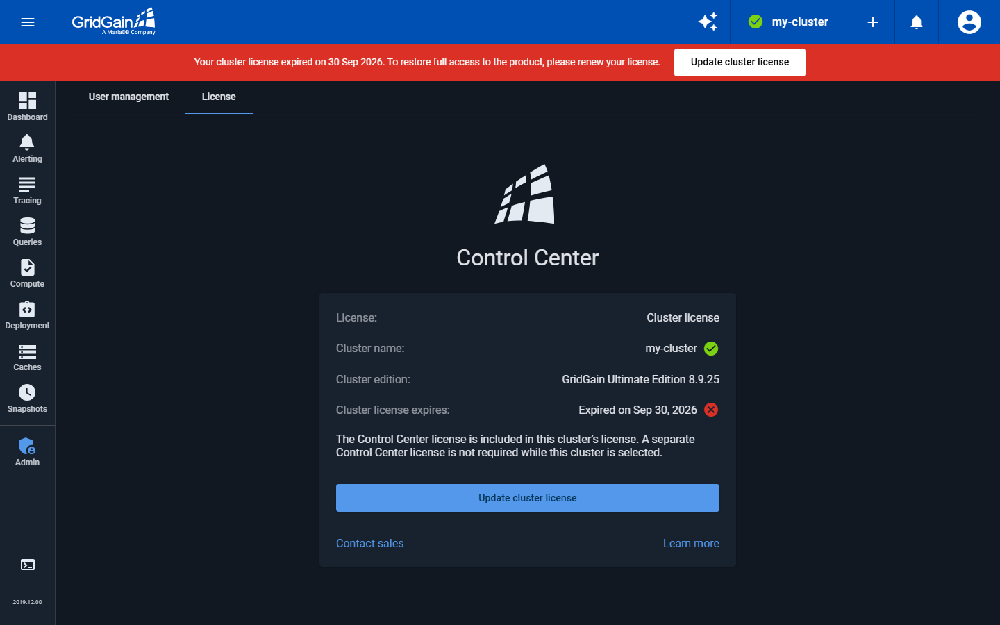
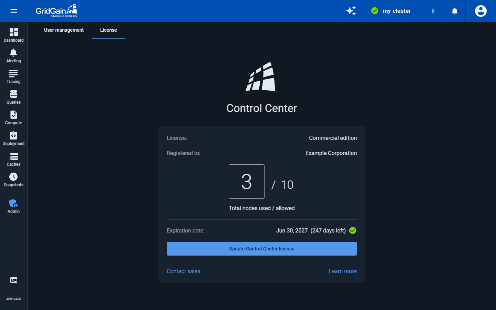
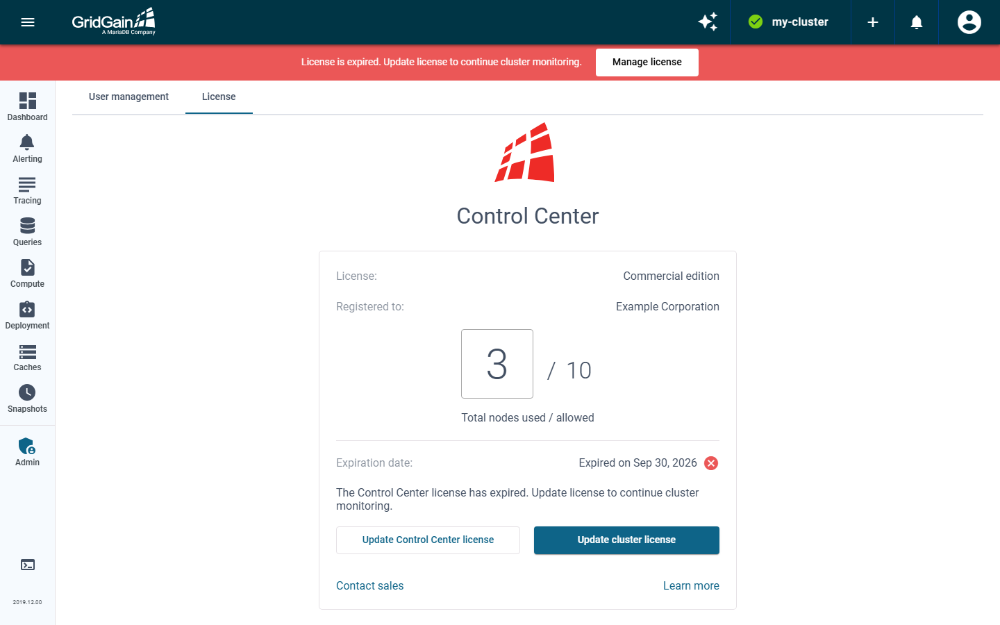
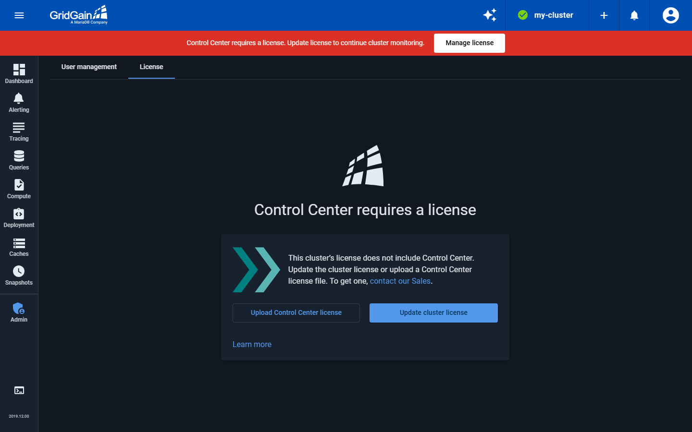
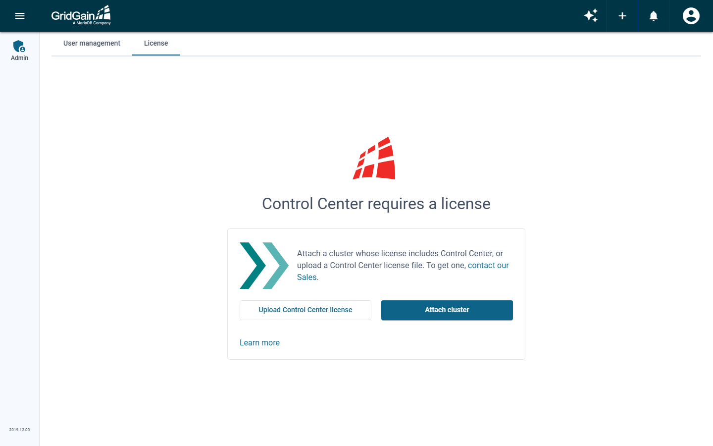

# Managing License

Control Center needs a license to monitor a cluster. The license can come from either of two places:

* **The cluster license.** If the license of the selected cluster includes Control Center, that license also licenses Control Center, and you do not need a separate Control Center license while the cluster is selected.
* **A Control Center license.** A separate license file that applies to the whole Control Center installation. Contact [the Sales team](https://mariadb.com/contact/) to get one.

The cluster license is checked for the selected cluster, so the **License** page changes when you select a different cluster. The Control Center license applies to the whole installation.

You can attach a cluster and manage its license even when Control Center has no license of its own. If the selected cluster has no access through either license, Control Center shows a banner for administrators that links to the **License** page. Until a license grants access, you can update the cluster license and view saved data, but other cluster actions are blocked.


Control Center does not monitor GridGain Community Edition, Apache Ignite 2, or Apache Ignite 3 clusters. You can attach them, but they stay blocked whatever license Control Center has. Update the cluster to an Enterprise or Ultimate Edition license.


## Checking the License

Open the **Admin** screen and go to the **License** tab. What the page shows depends on how Control Center is licensed.

### Licensed by the Cluster

When the license of the selected cluster includes Control Center, the page shows:

| Field | Description |
| --- | --- |
| **License** | `Cluster license`. |
| **Cluster name** | The name of the selected cluster. |
| **Cluster edition** | The edition of the cluster. Shown when the cluster reports it. |
| **Cluster license expires** | The cluster license expiration date and the days left, or `Expired on` and the date. Shown when the cluster reports an expiration date. |

The cluster stops when its license expires. Control Center shows `Expired on` and the date, and a banner warns you before and after the expiration. To renew the license, click **Update cluster license**.

### Licensed by a Control Center License

When the selected cluster does not include Control Center, the page shows the Control Center license:

* **Valid license.** The license type (commercial or developer edition), the registered owner, the used and allowed nodes and cores, and the expiration date.
* **Expired license.** The same information with `Expired on` and the date. The page says "The Control Center license has expired. Update license to continue cluster monitoring." Update the cluster license or upload a Control Center license to restore access.
* **No license.** Control Center asks you to update the cluster license or upload a Control Center license to get access.

If no cluster is selected, or the selected cluster cannot receive a license through Control Center, the page offers **Attach cluster** instead of **Update cluster license**. Attach a cluster whose license includes Control Center, or upload a Control Center license.

## Updating the Cluster License

Click **Update cluster license** to open the license dialog of the selected cluster. The dialog works even when Control Center has no license of its own. The button is available only when the cluster can receive a license through Control Center, and it is disabled while the cluster is disconnected.

## Uploading License via UI

Once you have received the Control Center license (an XML file):

1. Open the **Admin** screen and go to the **License** tab.
2. Click **Upload Control Center license** if Control Center has no license yet, or **Update Control Center license** to replace the existing one. Select your license file.


If you have no Administrator account, use a link in the Control Center log to connect and create the Administrator account.


The UI has no **Remove license** control. To replace a license, upload a new one.

## Adding License Before Startup

To add a license to a new installation, you can place the license file,  in the Control Center `root/license` folder. On the initial startup, Control Center will load the license file and apply the license.


If Control Center already has a license, you need to update it via UI or using the file watcher mechanism.


### Updating License Automatically

Instead of [Uploading License via UI](#uploading-license-via-ui) every time you need to update it, you can configure Control Center to update license automatically:

1. Enable the file watcher mechanism by adding `control.license.filestorage=true` to the [Control Center configuration](configuration.md).
2. Set the `control.license.path` to the license path location. For example:

   `control.license.path=/etc/cc/license/control-center-license.xml` - absolute or `control.license.path=license/2023/control-center-license.xml` - relative to root
3. Store the license file at the `control.license.path` location.

When the watcher discovers a new or updated license file, it will validate the license and, if the file is validated successfully, apply the new license. If the file fails validation, the old license will remain in power.

If you decide to update the license via UI while the file watcher is enabled, Control Center will store the manually uploaded license at `control.license.path`. If `control-center-license.xml` is already stored there, it will be renamed to `control-center-license.bak.xml`.
