# How to Integrate Control Center With Okta


This guide applies to Control Center connected to **GridGain 8** clusters. GridGain 9 uses a different security configuration and is out of scope.


## Prerequisites

- A free [**Okta**](https://developer.okta.com/signup/) developer account. Okta provides a development environment that is free and can be used for testing.
- A **GridGain 8 Control Center** installation

## Overview

OpenID is an open-standard, decentralized authentication protocol. It enables users to authenticate to collaborating sites that use third-party services. Thus, it eliminates the need for webmasters to provide their own login systems and enables users to log in to multiple unrelated websites without providing a unique identifier and password for each site.

GridGain Control Center supports this mechanism. Control Center can be configured to use third-party authentication servers such as Google and Okta. This guide uses Okta because Okta provides a development environment that is free and can be used for testing.

This guide walks you through the process of integrating Control Center with Okta OpenID in two stages:

1. [OpenID authentication cluster configuration](#openid-authentication-cluster-configuration)
2. [Control Center configuration](#control-center-configuration)

## OpenID Authentication Cluster Configuration

First, create your own free development account:

1. Navigate to https://developer.okta.com/signup/.
2. Complete the form.
3. Verify that you are not a robot.
4. Click **Sign up**.

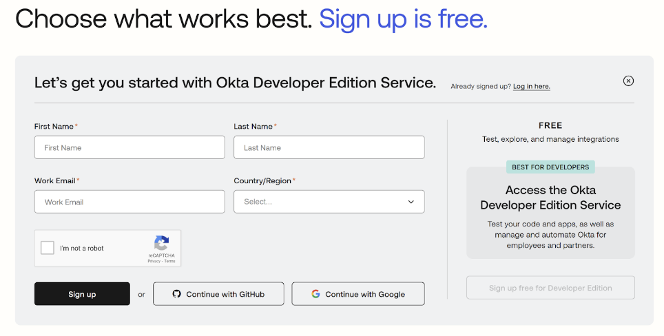

After logging in to the developer UI portal, create an authentication server:

1. Navigate to the **Security** menu.
2. Select the **API** tab.
3. Select **Add Authorization Server**.
4. Specify a name, audience, and description for the server.

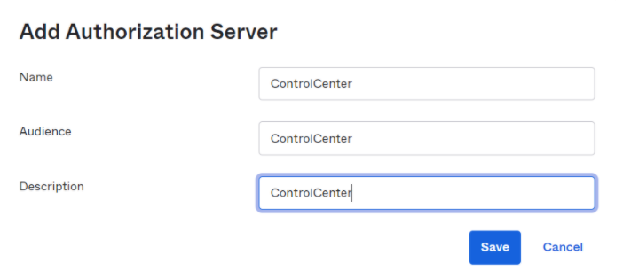

After you create the server, you must create at least one access policy. If there is no access policy, all user login attempts fail. For this test, you can use the default policy, as shown below:

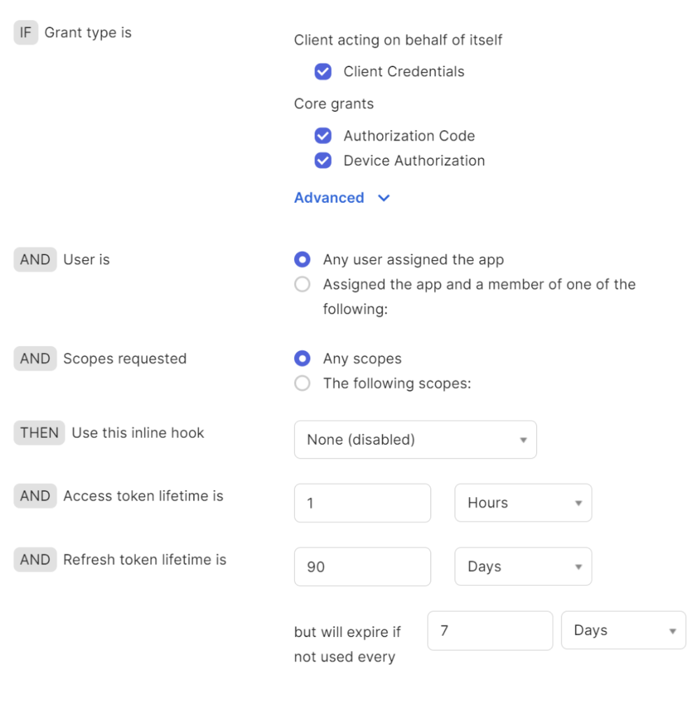

For other parts of the configuration, you can also use the defaults. Then, navigate to the **Settings** tab and click the **Metadata URI** link to get authentication cluster metadata.

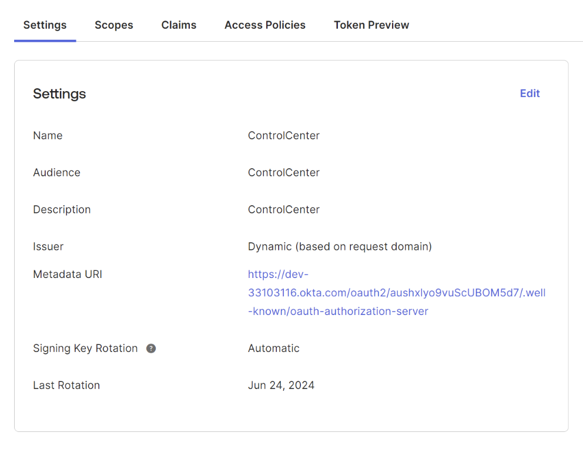

You use the metadata later, to configure Control Center. The following is a metadata output example:

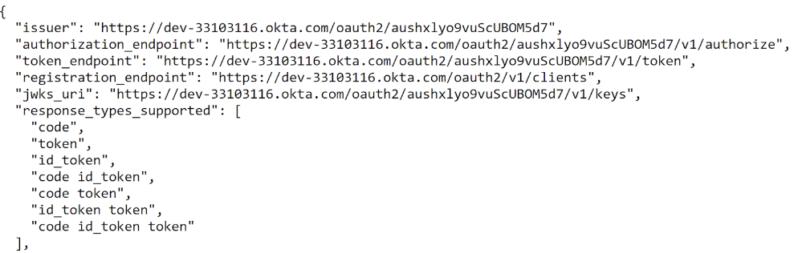

Now, create the OpenID application that is used to authenticate Control Center:

1. Navigate to the **Applications** menu.
2. Select the **Applications** tab.
3. Click **Create App Integration**.

   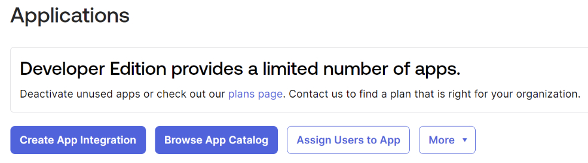

4. In the **Create a new app integration** dialog, select **OpenID Connect**.
5. In the lower part of the dialog, select **Native app**.
6. Click **Next**.

   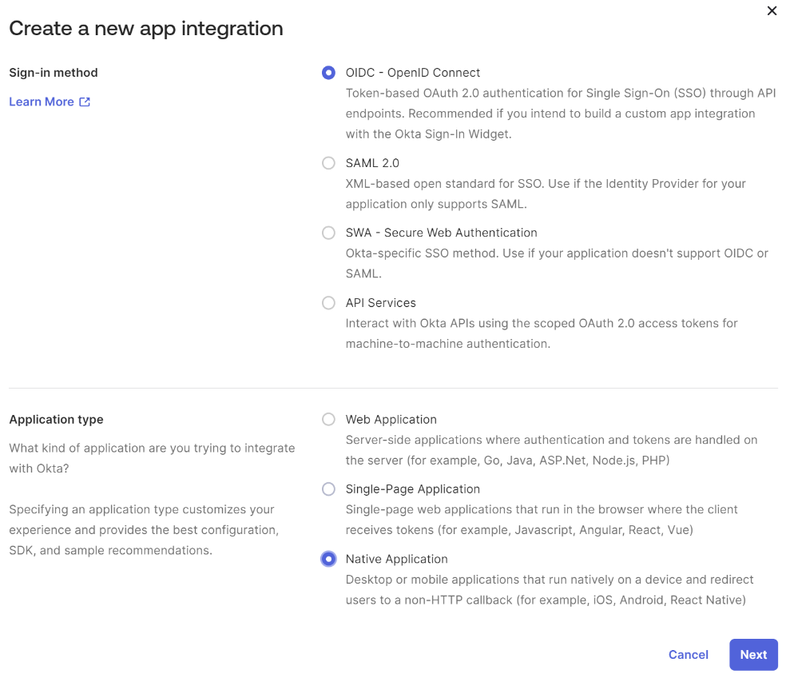

7. Enter the following line in the **Sign-in redirect URIs** field, where you must set the Control Center host and port: `http://[Control Center host]:[Control Center port]/api/v1/oauth2/login/okta`.

   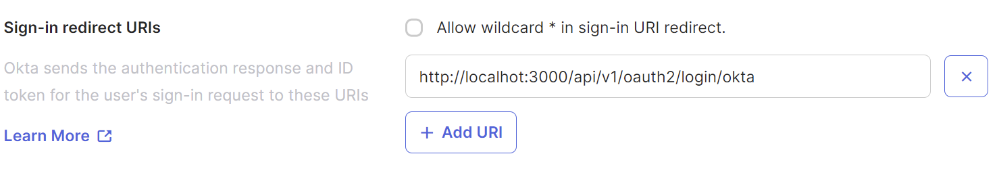

8. Select **Skip group assignment for now**.
9. Click **Save**.

   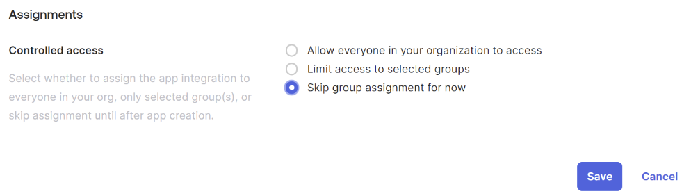

10. In the **Client Credentials** screen, select the **Client secret** option under **Client authentication**.
11. Make sure the **PKCE** option is deselected.
12. Copy the `Client ID` and `Client secret` values: you will use them for Control Center configuration.

    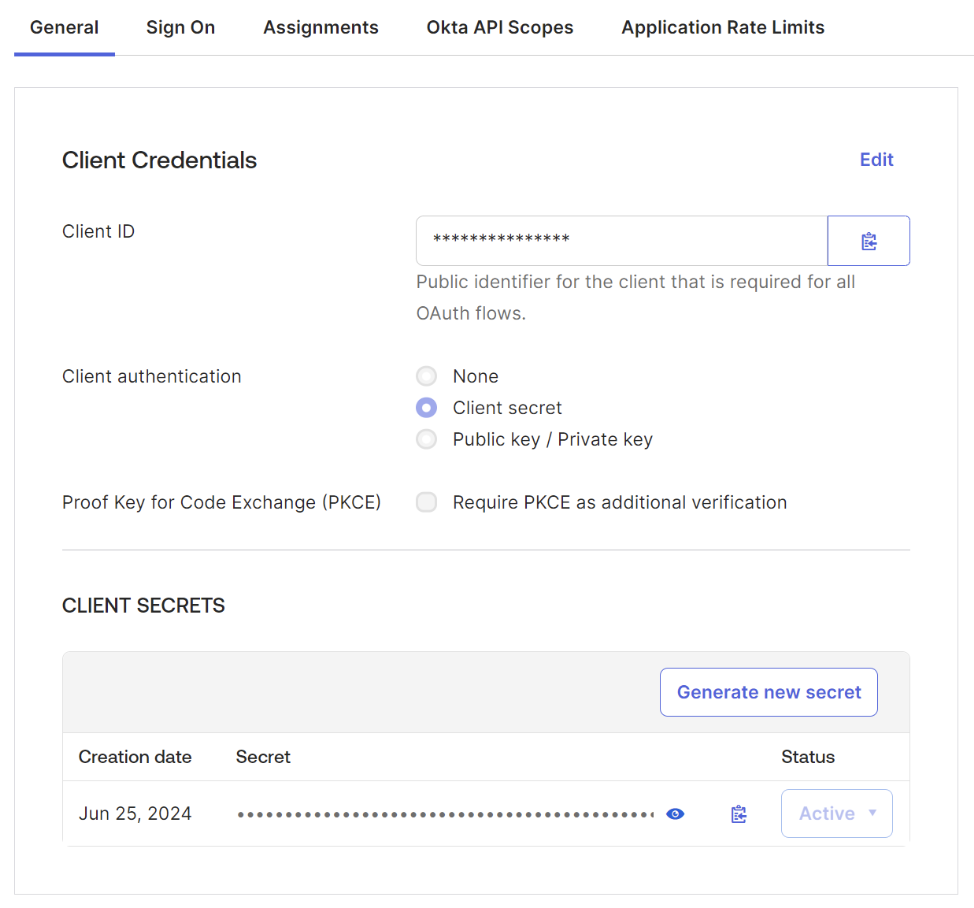

13. Navigate to the **Directory** menu.
14. Open the **People** tab.

    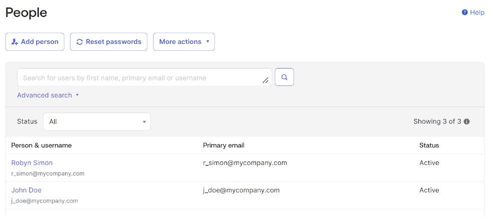

15. Click **Add person** to create a new user.

    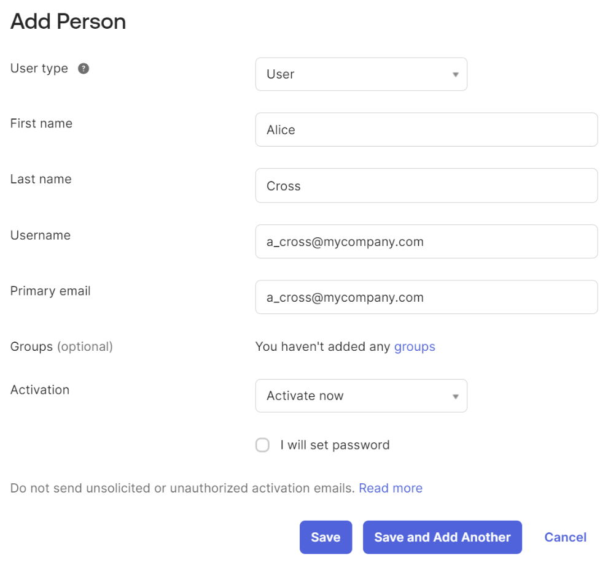

16. Open your newly created application settings and edit the **Assignments** list to identify the people and groups who can access the Control Center UI.

    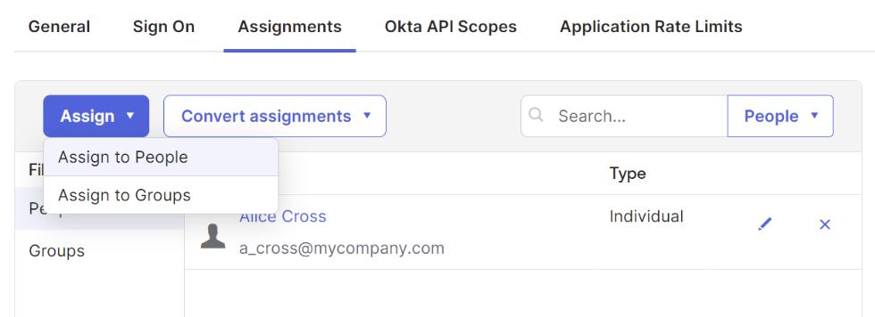

You are now ready to use the OpenID authentication to log into Control Center.

## Control Center Configuration

Now, configure Control Center:

1. Download and unzip the Control Center binaries.
2. Move to the root folder of the unzipped directory and create the `application.yaml` file:

   ```yaml
   spring:
     security:
       oauth2:
         client:
           registration:
             okta:
               client-id: ****************************
               client-secret: *****************************
           provider:
             okta:
               authorization-uri: https://dev-33103116.okta.com/oauth2/aushxlyo9vuScUBOM5d7/v1/authorize
               token-uri: https://dev-33103116.okta.com/oauth2/aushxlyo9vuScUBOM5d7/v1/token
               jwk-set-uri: https://dev-33103116.okta.com/oauth2/aushxlyo9vuScUBOM5d7/v1/keys
   ```


   You find the Okta client ID and client-secret in the settings of the Okta application you have created - see [OpenID authentication cluster configuration](#openid-authentication-cluster-configuration). You find authorization-uri, token-uri, and jwk-set-uri in the metadata you have obtained earlier.


3. Start Control Center using the `control-center.sh` script.
4. Navigate to the Control Center UI and click the **Sign in** button:

   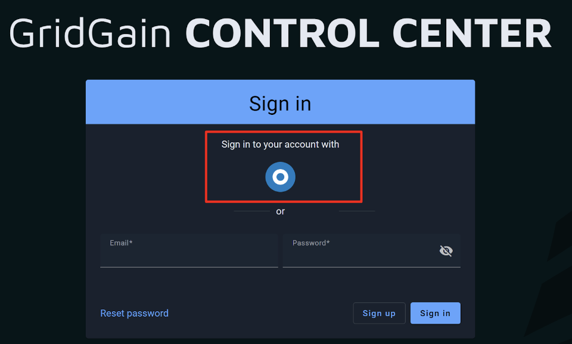

5. Make sure that you are logged off in the Okta developer portal.
6. Click the "target" button (framed in red in the screenshot above) to display the Okta login page.

   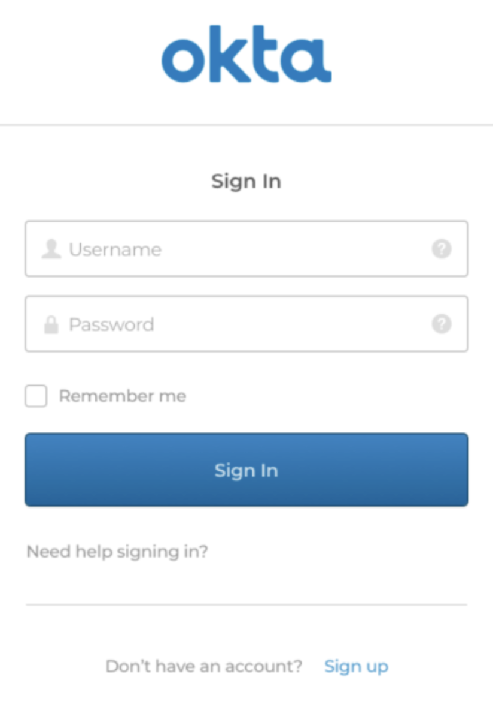

7. Enter your Okta credentials and click **Sign In**.

You are now logged into Okta.

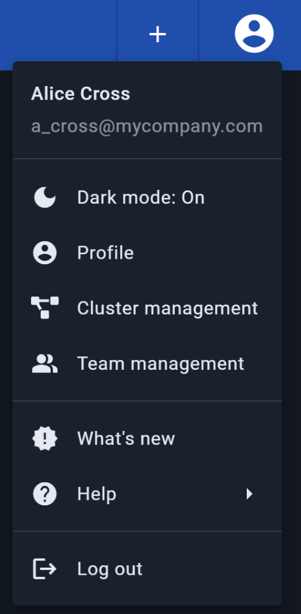

## Related

- [Control Center overview](../README.md) - GridGain's cluster management and diagnostics tool.
- [Okta developer documentation](https://developer.okta.com/docs/) - OpenID Connect and authorization server reference.
