# How to Integrate Control Center With PingOne


This guide applies to Control Center connected to **GridGain 8** clusters. GridGain 9 uses a different security configuration and is out of scope.


## Prerequisites

- A **GridGain 8.x** Control Center installation. This guide applies to **GridGain 8.x** clusters.
- Access to a **PingOne organization and environment**. This guide assumes **one of the following**:
  - You already have an existing PingOne environment
  - You have completed PingOne self-service registration and trial provisioning

  If you do not yet have a PingOne environment, complete self-service [registration](https://www.pingidentity.com/en/account/register.html) first, then return to this guide.

## Overview

Control Center for **GridGain 8** clusters lets you use SSO providers for authorization in the system. This means a Control Center administrator can use role-based access control (RBAC) and assign specific privileges to certain users. Cluster action permissions can also be checked when the user is authorized via SSO.

This guide uses the PingOne SSO provider as an example. The setup has two independent parts, each answering a different question:

- **Control Center** decides who may sign in and what they may do inside Control Center, such as reaching the **Administration** tab. This is driven by the `cc-role` attribute.
- **The cluster** decides what a signed-in user may do *on the cluster* when they trigger an action from Control Center, such as starting SQL or renaming the cluster. This is driven by the `gg-role` attribute, which the cluster resolves itself.

You configure PingOne to issue both attributes, then configure each half to read the one that belongs to it.

## Configure PingOne

1. First, [sign in to PingOne](https://www.pingidentity.com/bin/ping/signOnLink) and pass the email verification.
1. After completing the verification process, proceed to create a new application. Specify the **Application name** and choose the **OIDC Web App** option.

   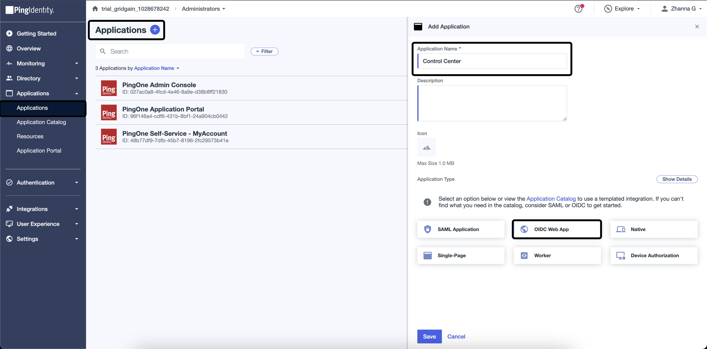

1. Create two **User Attributes**: `gg-role` and `cc-role` with the **No validation** option.

   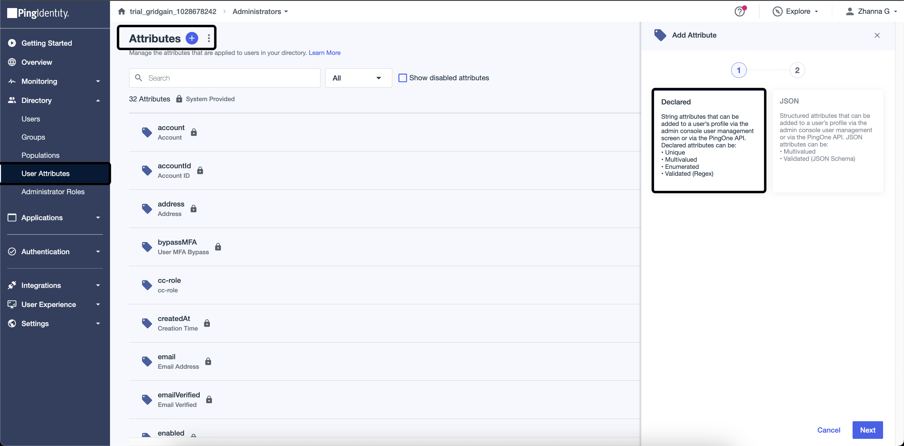

   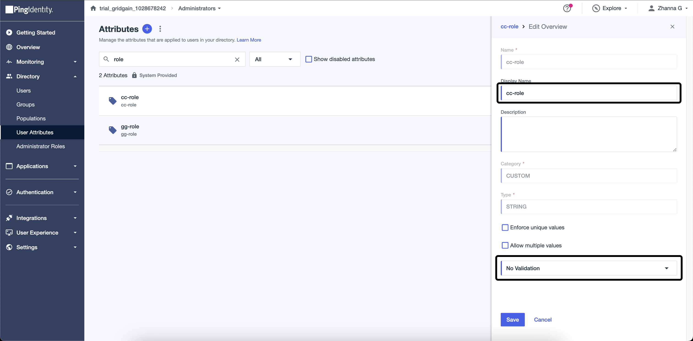

1. Add the `gg-role` and `cc-role` mapping in the created application. Find the **Attribute Mapping** tab in the application and add the mapping in the **Custom Attributes** section.


   `cc-role` is an example name. You can use any custom claim name, as long as it matches `account.oidc.rbac.attributeName` in the Control Center configuration.

   This guide maps both attributes into the UserInfo response, which is the recommended setup for PingOne. Control Center 2026.1 and later fall back to a claim of the same name in the ID token when `cc-role` is absent from the UserInfo response, but a role read from the ID token is re-evaluated only when the user signs in again, whereas a role read from the UserInfo response is picked up during an active session. See [Role Attribute Sources](open-id.md#role-attribute-sources).


   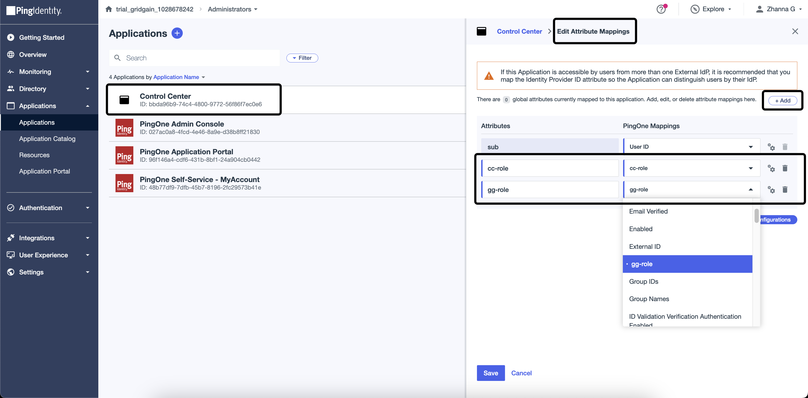

1. Set the **Redirect URIs** parameter as `http://localhost:3000/api/v1/oauth2/login/ping` and activate **Refresh Token**. These parameters are located on the **Configuration** tab.

   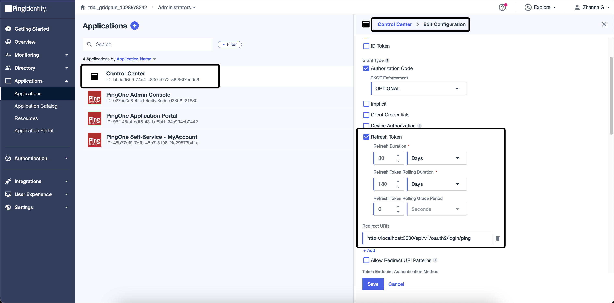

1. Assign `gg-role` and `cc-role` to the users. User management is carried out through the **Users** page.

   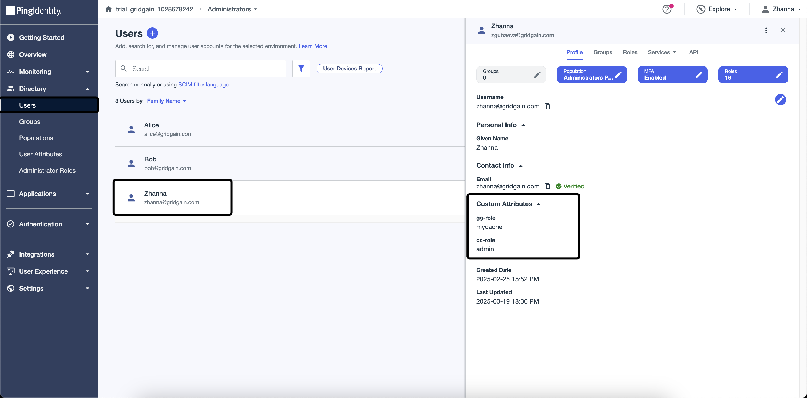

1. Add **email** to the allowed scope on the **Resources** tab.

   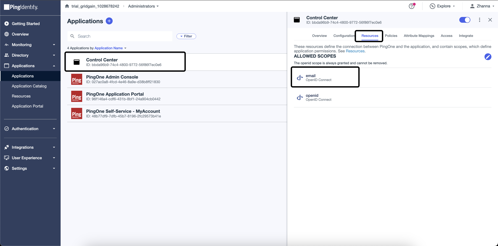

## Configure Control Center Sign-in and Roles

This half lets users sign in to Control Center with their PingOne account and assigns each user a Control Center role from the `cc-role` attribute.

After completing the Ping configuration, [set up Control Center](configuration.md) via the `application.properties` file. This file should be located in the Control Center root folder.

The `account.oidc.rbac.enabled` attribute sets permissions towards Control Center based on a value in the `cc-role` attribute. The possible values are "admin", "regular", or "no-access".

All the values for the `spring.security.oauth2.client.xxx` parameters are defined on the **Overview** tab in the application.

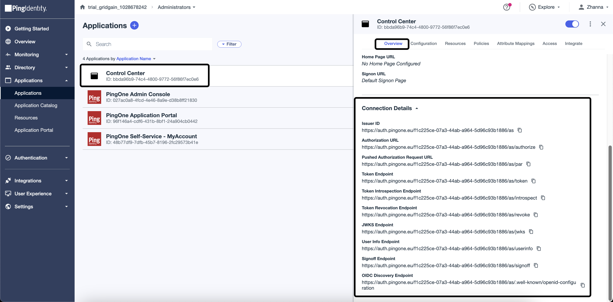

```yaml
account.oidc.rbac.enabled: true
account.oidc.rbac.attributeName: cc-role
spring.security.oauth2.client.registration.ping.client-id: {{client_id}}
spring.security.oauth2.client.registration.ping.client-secret: {{client_secret}}
spring.security.oauth2.client.provider.ping.authorization-uri: https://auth.pingone.eu/{{id}}/as/authorize
spring.security.oauth2.client.provider.ping.token-uri: https://auth.pingone.eu/{{id}}/as/token
spring.security.oauth2.client.provider.ping.jwk-set-uri: https://auth.pingone.eu/{{id}}/as/jwks
spring.security.oauth2.client.provider.ping.user-info-uri: https://auth.pingone.eu/{{id}}/as/userinfo
```

Restart Control Center to apply the changes.

## Configure Cluster Action Permissions

Control Center roles decide what a user may do *inside* Control Center. They say nothing about what that user may do *on the cluster*. Cluster actions triggered from Control Center, such as starting SQL or renaming the cluster, are authorized by the cluster itself against the `gg-role` attribute.

Add `OpenIdAuthenticator` to the cluster configuration to enable this. Three properties drive it:

- `userInfoUrl` — the PingOne UserInfo endpoint the cluster calls to read the user's attributes. The cluster resolves `gg-role` here and has no ID token fallback, so `gg-role` must be present in the UserInfo response.
- `claimName` — the attribute that holds the role name, `gg-role` in this configuration. If you use a different name, define it as a Custom Attribute in your PingOne application.
- `permissionsJson` — maps each role name to its [permissions](https://www.gridgain.com/docs/gridgain8/latest/administrators-guide/security/authorization-permissions) on the cluster.

```xml
    <!-- Credentials for the current node. -->
    <bean id="node.cred" class="org.apache.ignite.plugin.security.SecurityCredentials">
        <constructor-arg value="admin"/>
        <constructor-arg value="admin_password"/>
    </bean>

    <!-- Credentials Control Center uses to log in to the cluster. -->
    <bean id="cc_login.user.cred" class="org.apache.ignite.plugin.security.SecurityCredentials">
        <constructor-arg value="cc_password"/>
        <constructor-arg value="default"/>
    </bean>

    <bean id="ignite.cfg" class="org.apache.ignite.configuration.IgniteConfiguration">
        <property name="authenticator">
            <bean class="org.gridgain.grid.security.composite.CompositeAuthenticator">
                <property name="authenticators">
                    <list>
                        <bean class="org.gridgain.grid.security.passcode.PasscodeAuthenticator">
                            <!-- Set acl provider. -->
                            <property name="aclProvider">
                                <bean class="org.gridgain.grid.security.passcode.AuthenticationAclBasicProvider">
                                    <constructor-arg>
                                        <map>
                                            <entry key-ref="node.cred" value="{defaultAllow:true}"/>
                                            <entry key-ref="cc_login.user.cred" value="{defaultAllow:true, {cache:'allow_cache', permissions:[CACHE_READ, CACHE_PUT, CACHE_REMOVE]},{cache:'deny_cache', permissions:[]}}"/>
                                        </map>
                                    </constructor-arg>
                                </bean>
                            </property>
                        </bean>
                        <!-- Set OpenID provider. -->
                        <bean class="org.gridgain.grid.security.oidc.OpenIdAuthenticator">
                            <property name="userInfoUrl" value="https://auth.pingone.eu/{{id}}/as/userinfo"/>
                            <!-- The "value" may be a custom one, but the same name should be defined as a Custom Attribute in your Ping Application. -->
                            <property name="claimName" value="gg-role"/>
                            <property name="permissionsJson">
                                <map>
                                    <entry key="default" value="{defaultAllow:true}"/>
                                    <entry key="mycache" value="{defaultAllow:false, {cache:'MYCACHE*',permissions:['CACHE_READ','CACHE_DESTROY']}}"/>
                                </map>
                            </property>
                        </bean>
                    </list>
                </property>
            </bean>
        </property>

        <property name="securityCredentialsProvider">
            <bean class="org.apache.ignite.plugin.security.SecurityCredentialsBasicProvider">
                <constructor-arg ref="node.cred"/>
            </bean>
        </property>
    </bean>
```

## Verify Sign-in and Permissions

With both halves configured, check that each one behaves as expected for a user authenticated through PingOne: the Control Center role controls the UI, and the cluster role controls the action.

1. Go to Control Center and select PingOne as a way of authentication.

   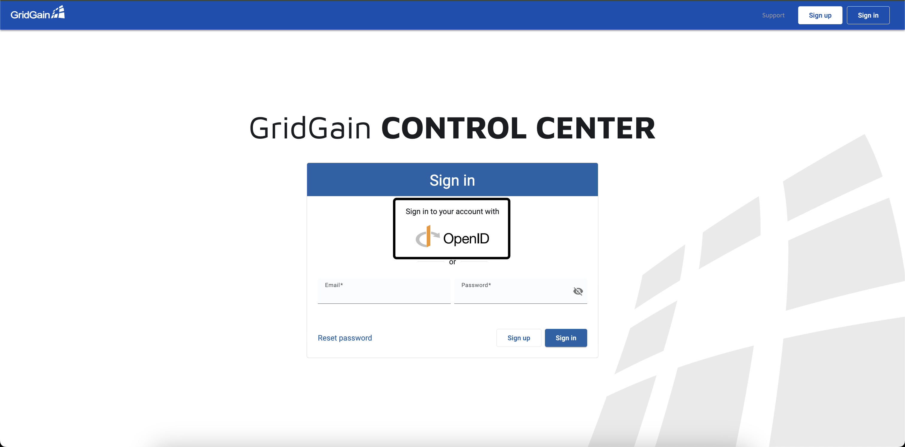

   If the user has `cc-role=admin`, then the **Administration** tab is visible.

   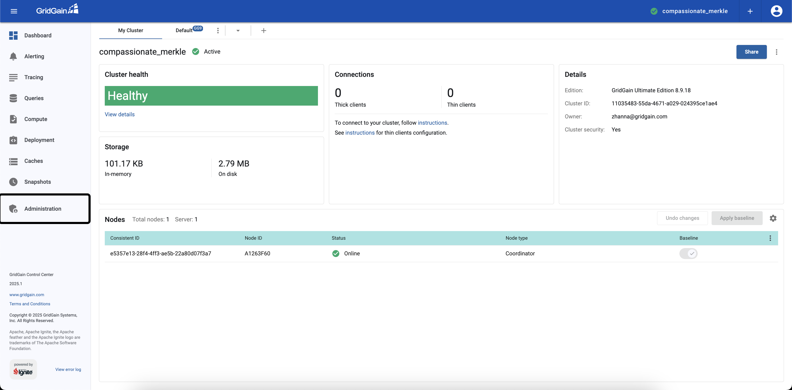

1. Attach a GridGain cluster with the `CompositeAuthenticator` in its configuration.
1. Try to **Rename** the attached cluster.

   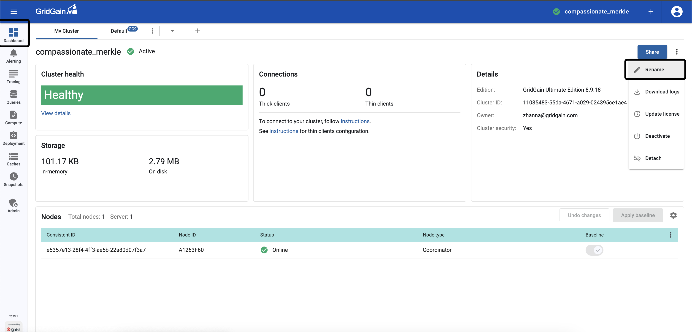

1. Select the **Authenticate via ping** option and click **Sign In**. The cluster will check the user's permissions.

   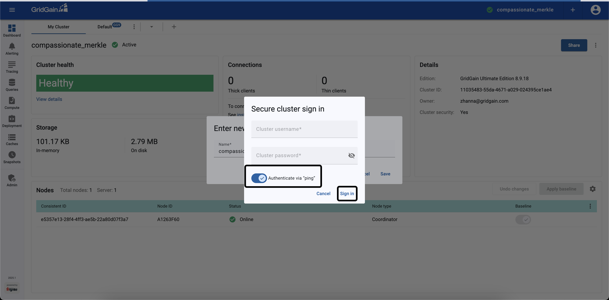

   If the user has the previously configured `gg-role=mycache` role, the action is prohibited and an error message is shown, as the role does not allow renaming clusters.

   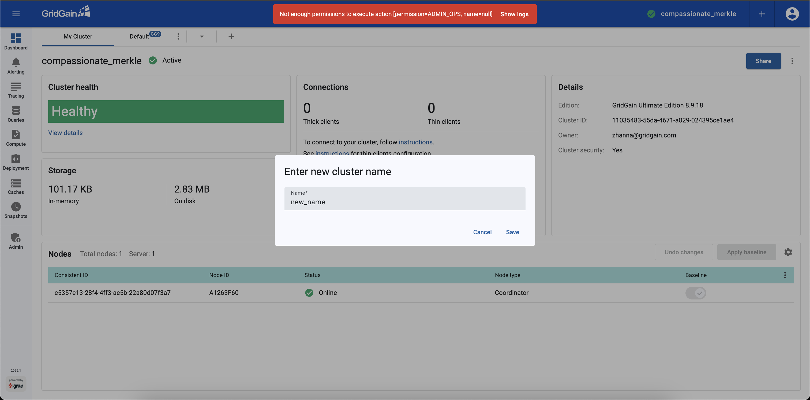

## Related

- [Control Center configuration](configuration.md) - Configure Control Center via the `application.properties` file.
- [Authorization and permissions](https://www.gridgain.com/docs/gridgain8/latest/administrators-guide/security/authorization-permissions) - GridGain 8 cluster action permissions reference.
