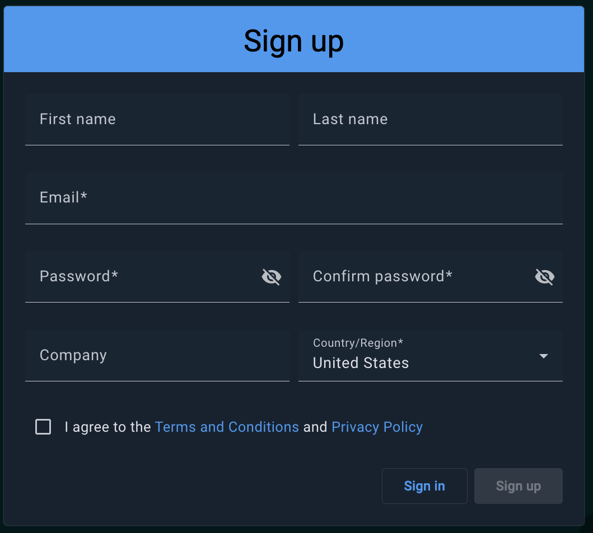
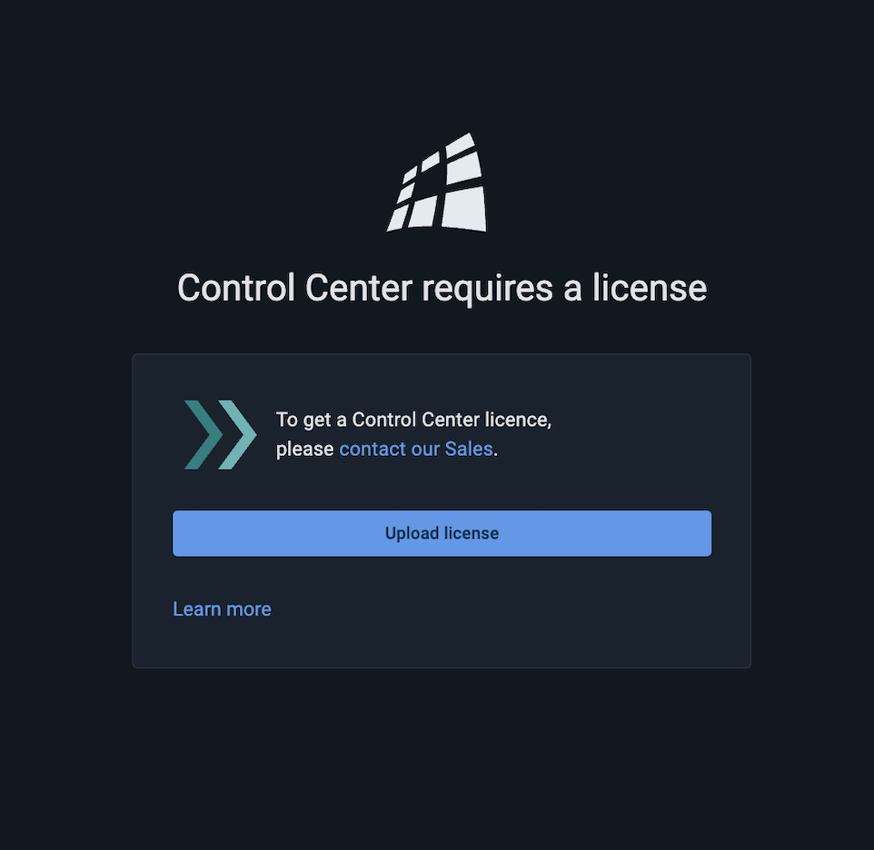

# Install Control Center and Add License

When you start working with Control Center, our Sales Team will provide you with a copy of the latest release of Control Center. To start working with it:

1. Unpack the archive into a directory of your choice.
2. Launch Control Center by running `control-center.sh` (or `control-center.bat` for Windows) in the installation directory.

On the initial launch, Control Center provides a link to be used for creating an administrator account.


When you launch the [Docker version](../installation/docker.md) of Control Center, the "admin" link is found in the backend Control Center log.


Follow the link, fill out the fields on the page that opens, and click **Sign up**. You are now logged into Control Center as an administrator.


You can change your password and profile data on the Profile page at any time. Click the user image in the top right corner and select **Profile**.


Control Center does not require a license to start, and you can attach a cluster right away. Control Center is licensed in one of two ways:

* If the license of the attached cluster includes Control Center, no separate license is needed for that cluster.
* Otherwise, upload a Control Center license. If necessary, get the license file from our sales team. Open **Admin** > **License**, click **Upload Control Center license**, and select the license file.

If the selected cluster is not licensed for Control Center, a banner links administrators to the **License** page. See [Managing License](../admin-guide/license.md).

Once Control Center is licensed, it is available for any user to work with.

Now Control Center is available for any user to work with.

- [Connect a pre-made cluster](demo.md)
