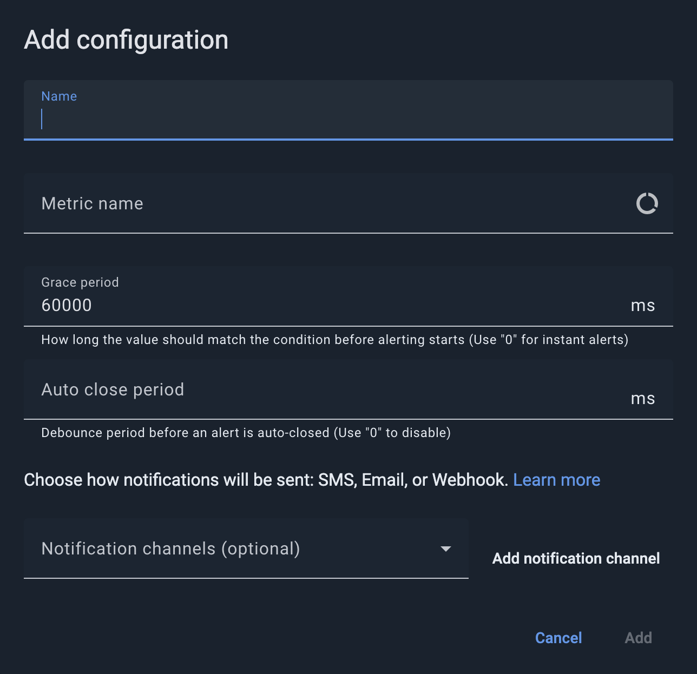
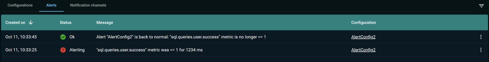
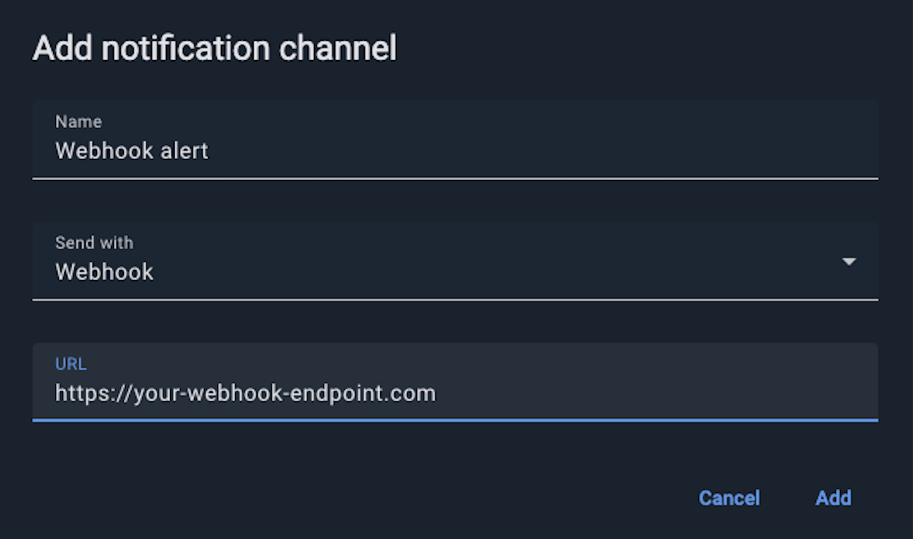

# Alerting

On the **Alerting** screen, you can configure alerts for user-defined conditions that could indicate cluster issues.

You can use one of the available numeric metrics to specify the condition. For example, you can specify a condition for sustained high CPU load or excessive disk usage on nodes. If a condition lasts for the specified time, Control Center sends a notification via email, SMS, webhook, or an in-app notification.

Each alert can have multiple channels assigned.


Depending on configuration, [secured clusters](../auth/authorization-permissions.md) might require a cluster-level authentication for some (or all) of the actions.


## Creating Alerts

On the **Configurations** tab, click the **Add configuration** button and fill out the fields of the dialog box that appears.



| Field | Description |
|---|---|
| Name | The name of the alert |
| Metric name | The metric that you want to monitor |
| Condition | The condition to be met |
| Value | The value to which the metric is to be compared |
| Grace period | The amount of time that the condition can exist before an alert is generated. The grace period prevents occasional spikes from triggering alerts. A setting of `0` enables instant alerts. |
| Auto close period | The minimum time, in milliseconds, counted from the moment the alert is generated, that must pass before the alert can be closed automatically. After the condition is no longer met, the alert status changes to **Ok** only once this period has passed. This field is optional. If the field is empty or set to `0`, the alert is closed as soon as the condition is no longer met. |
| Notification channels | The notification channels that are associated with the alert. To create a notification channel, click **Add notification channel**. |

## Viewing Alert History

The **Alerts** tab displays the alert history.



| Column | Description |
|---|---|
| Created on | The time when the alert was generated. |
| Status | The status of the alert:<br>- Alerting - the alert is active (has been triggered and is sending messages)<br>- Ok - the alert is inactive (the triggering condition has passed) |
| Message | The alert message. |
| Configuration | The configuration of the alert. |

Use the **Filters** panel on the right to filter the alert list by configuration, status, and the creation period.

## Viewing In-App Notifications

Control Center displays in-app notifications in the **Notifications** panel. To open it, click the **Notifications** (bell) icon in the header. A dot on the icon indicates that you have unread notifications. When a new notification arrives while the panel is closed, a notification message appears in the upper-right corner of the screen. Click **Dismiss** to close it.

The panel shows the number of notifications and lists them with the following information:

- The title of the notification. For an alert, the title is the cluster tag followed by the alert name.
- The notification message. For an alert, this is the alert message.
- The time elapsed since the notification was received and the tag of the cluster it relates to.

You can do the following in the **Notifications** panel:

- Turn on the **Only show unread** toggle to hide the notifications that you have already read.
- Click the dot in a notification to mark it as read or unread.
- Click **Mark all as read** to mark all notifications as read.

To receive alerts as in-app notifications, your username must be in the `usernames` list of an `IN_APP` notification channel. See [Configure In-App Notifications](#configure-in-app-notifications).

## Creating Notification Channels


If you are running a self-hosted Control Center, configure email server and/or SMS provider settings. See [Configuration](../../admin-guide/configuration.md).


To create a notification channel:

1. Go to the **Notification channels** tab and click **Add notification channel**.
2. Enter the name of the notification channel.
3. In the **Send with** field, select **Email**, **SMS** or **Webhook**.
4. In the **Send to** field, enter an email address or a phone number. If **Webhook** option is selected, provide the URL of the endpoint that accepts alerts.



### Configure Webhook Notifications

When an alert is triggered, Control Center sends a `POST` request to the configured webhook URL with the following JSON payload:

| Column | Description |
|---|---|
| eventType | Event type. Always is `CONTROL_CENTER_ALERT`. |
| alertId | ID of the triggered alert. |
| alertName | Alert name as configured in Control Center (e.g. `High CPU Usage`). |
| clusterId | ID of the cluster that triggered the alert. |
| clusterTag | Cluster name (for GridGain 9 clusters) or cluster tag (for GridGain 8) associated with the cluster (e.g. `production-cluster`). |
| state | Current state of the alert. Possible values:<br>- `ALERTING` – The condition has lasted long enough, so the alert is now active.<br>- `GOOD` – The condition is no longer met; the system has returned to normal. |
| message | Alert message describing the condition that caused it (e.g. `CPU usage has exceeded 80% threshold`). |
| timestamp | Time the alert was triggered, in milliseconds. |
| controlCenterUrl | URL of the Control Center instance that sent an alert. |

Below is a sample JSON sent by the Control Center when an alert is triggered:

```json
{
  "eventType": "CONTROL_CENTER_ALERT",
  "alertId": "123e4567-e89b-12d3-a456-426614174000",
  "alertName": "High CPU Usage",
  "clusterId": "987fcdeb-51a2-43d7-b123-456789abcdef",
  "clusterTag": "production-cluster",
  "state": "ALERTING",
  "message": "CPU usage has exceeded 80% threshold",
  "timestamp": 1704067200000,
  "controlCenterUrl": "https://control-center.example.com"
}
```

### Configure In-App Notifications

An in-app notification channel delivers alert notifications to the Control Center users that you specify. The users see the notifications in the **Notifications** panel. See [Viewing In-App Notifications](#viewing-in-app-notifications). After you create the channel, it appears in the **Notification channels** list of the **Add configuration** dialog box, so you can assign it to an alert in the UI.


You can manage in-app notification channels only with the [REST API](../../admin-guide/rest-api.md). The **Send with** field in the **Add notification channel** dialog box offers **Email**, **SMS**, and **Webhook** channels.


The channel is bound to a cluster. In the following requests, `<connectionId>` is the ID of the cluster connection. See [REST API](../../admin-guide/rest-api.md) for the authentication options and for how to find the connection ID.

To create an in-app notification channel, send a `POST` request to the `/rest/v1/clusters/<connectionId>/notifications` endpoint with the following parameters:

| Parameter | Description |
|---|---|
| tag | The name of the notification channel. It must be unique within the cluster. If a channel with the same tag exists, the request fails with the `409` status. |
| type | The type of the channel. Always `IN_APP`. |
| usernames | The list of Control Center users who receive the notifications. Use the email addresses that the users sign in with. The list must contain at least one entry. Otherwise, the request fails with the `400` status. |

Control Center does not check that the usernames belong to existing users when you create the channel. When it sends a notification, it skips the usernames that do not match an existing user.

Example request:

```bash
curl -X POST \
  -u "username@example.com:password" \
  "https://<control-center-url:port>/rest/v1/clusters/<connectionId>/notifications" \
  -H "Content-Type: application/json" \
  -d '{"tag": "ops-in-app", "type": "IN_APP", "usernames": ["admin@example.com", "operator@example.com"]}'
```

A successful request returns the `200` status and an empty response body.

To change the users of the channel, send a `PATCH` request to `/rest/v1/clusters/<connectionId>/notifications/<tag>`. The request must contain the `type` and the full list of `usernames`, which replaces the existing list:

```bash
curl -X PATCH \
  -u "username@example.com:password" \
  "https://<control-center-url:port>/rest/v1/clusters/<connectionId>/notifications/ops-in-app" \
  -H "Content-Type: application/json" \
  -d '{"type": "IN_APP", "usernames": ["admin@example.com"]}'
```

A successful request returns the `204` status.

To delete the channel, send a `DELETE` request to the same endpoint. A successful request returns the `204` status. To list the channels of the cluster, send a `GET` request to `/rest/v1/clusters/<connectionId>/notifications`.

To send alerts through the channel, add its tag to the `notificationChannelTags` list when you create or update the alert configuration through the `/rest/v1/clusters/<connectionId>/alert-configurations` endpoint. See [Automated Deployment](../../admin-guide/automated-deployment.md) for an example.

When the state of an alert changes, that is, when the alert is generated and when the condition is no longer met, every user in the `usernames` list receives a notification. The title of the notification is the cluster tag followed by the alert name, and the message is the alert message.
