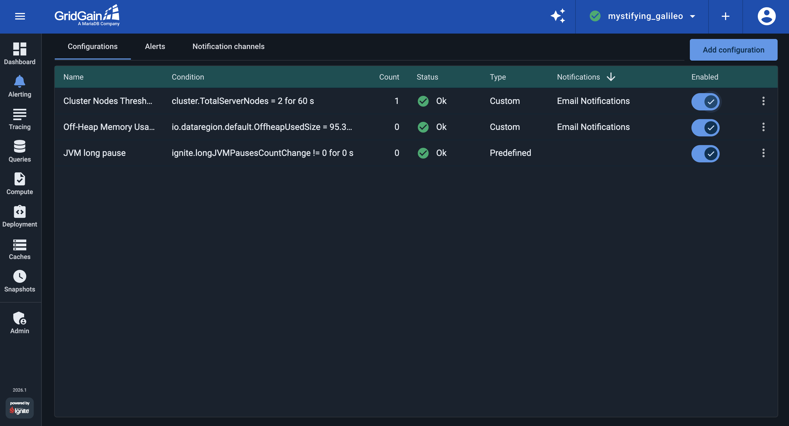
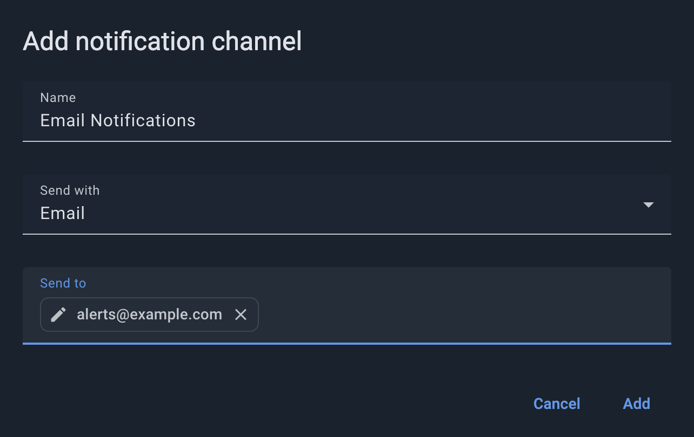
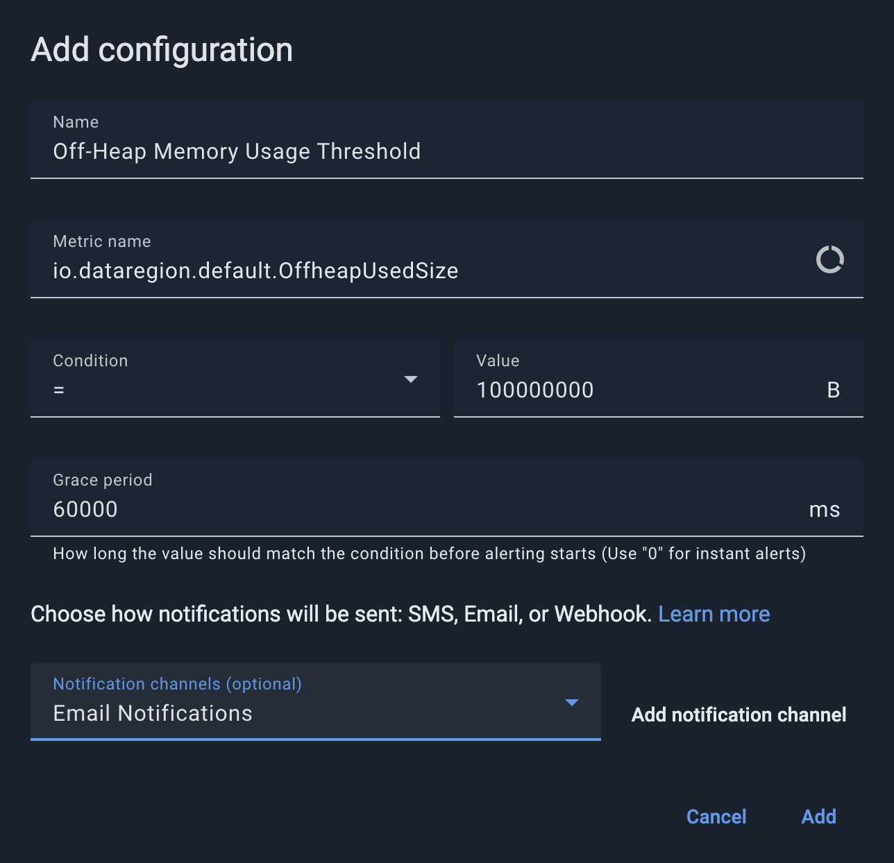
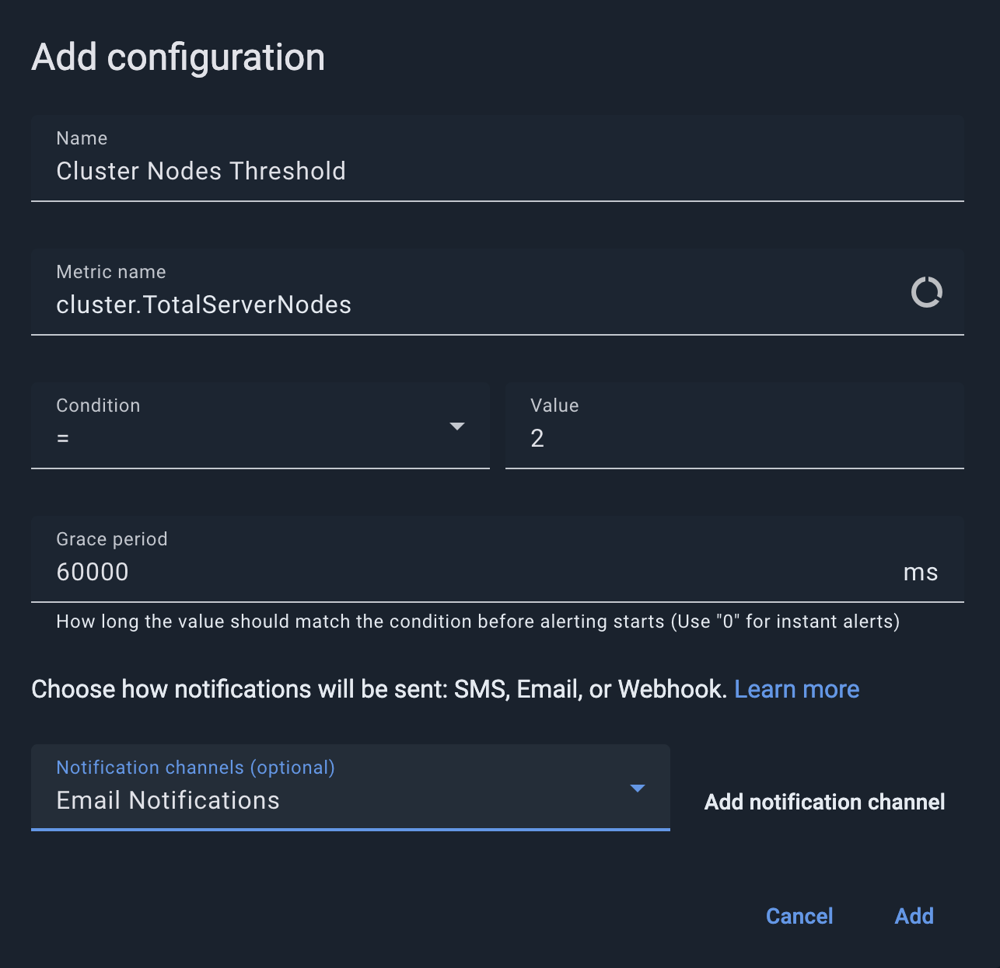
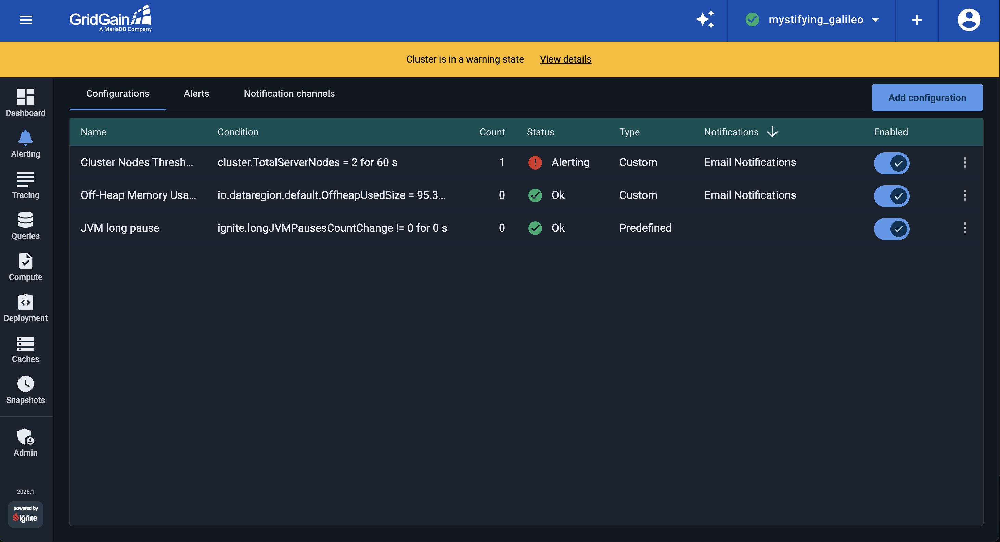

# Configure GridGain Monitoring Alerts

An alert notifies you when a cluster metric or condition crosses a configured threshold. By configuring alerts, you automate routine monitoring and can respond when important signals require attention. For example, you can be notified when off-heap memory usage grows too high, disk usage approaches a limit, or the number of server nodes drops below the expected count.

GridGain Control Center provides [built-in alerting capabilities](../../gg8/alerting/alerting.md) for GridGain metrics. In this part of the tutorial, you configure two alerts: one for off-heap memory usage and one for server node count. By the end, your alerting screen should look like the following:



## Configure a Notification Channel

To receive notifications when an alert fires, set up at least one notification channel. Control Center supports email, SMS, and webhook channels.


Email notifications require a configured mail server. Until one is set up, Control Center flags the `Email` option with a warning icon (as in the screenshot above) and cannot deliver email. Set the `spring.mail.*` properties described in the [Control Center mail server settings](../../admin-guide/configuration.md#mail-server) and restart Control Center.


Open the [Alerting screen](../../gg8/alerting/alerting.md), select the `Notification channels` tab, and click `Add notification channel`. Fill in the dialog:



- `Name`: a name for the channel. For this tutorial, use `Email Notifications`.
- `Send with`: select `Email`.
- `Send to`: an email address that should receive alerts.

Click `Add` to save the channel.

## Create a Memory-Usage Alert

In the second part of the tutorial, you configured the [Storage Usage dashboard](storage-monitoring.md), which displays various memory and disk-usage metrics. Now create an alert for off-heap memory usage, one of the core storage-pressure signals from that dashboard.

On the `Configurations` tab, click `Add configuration` and configure an alert that fires when off-heap memory usage exceeds 10 MB on any node:



- `Name`: Specify a custom name for the alert, such as `Off-Heap Memory Usage Threshold`.
- `Metric Name`: In the metrics dialog, select the `io.dataregion.default.OffheapUsedSize` metric.
- `Condition` and `Value`: Set the condition to trigger the alert when off-heap usage is greater than `10000000 bytes` (`10 MB`).
- `Grace Period`: Set the grace period such that the alert fires only if the condition lasts for `10000 ms` (`10 seconds`).
- `Notification Channels`: Select the `Email Notifications` channel that you configured previously.

## Create a Node-Count Alert

The number of server nodes is a critical parameter for GridGain clusters in production: if a cluster runs with too few nodes, its performance or availability can suffer. In Control Center, you can configure a node-count alert that monitors the cluster's size and notifies you when it drops to a risky level.

On the `Configurations` tab, click `Add configuration` again and configure an alert that fires when the cluster has fewer than two server nodes:



- `Name`: Use `Cluster Nodes Threshold` as the name.
- `Metric Name`: In the metrics dialog, select the `cluster.TotalServerNodes` metric.
- `Condition` and `Value`: Set the condition to trigger the alert when the number of server nodes is less than `2`.
- `Grace Period`: Set the grace period to `0` to ensure that the alert fires without delay.
- `Notification Channels`: Select the `Email Notifications` channel that you configured previously.

### Test the Node-Count Alert

Test the alert by taking one of the two server nodes offline. Stop the second node's container; `cluster.TotalServerNodes` drops to `1` and Control Center raises the alert. If you set up a mail server for the notification channel above, you also receive an email.

```bash
docker stop docker-ignite-server-node-2
```

Before you proceed with the following parts of the tutorial, start the node again:

```bash
docker start docker-ignite-server-node-2
```


`docker stop` takes the node offline but keeps its data volume, and `docker start` brings the same node back. The node rejoins the cluster's baseline topology with its data intact and no rebalancing, the same way a node recovers after a restart in production.


## Review the Final List of Alerts

You now have two alert configurations:

- `Off-Heap Memory Usage Threshold`: fires when off-heap memory usage exceeds the configured threshold.
- `Cluster Nodes Threshold`: fires when the number of server nodes drops below two.



## What's Next

In the next part, you use tracing to investigate performance bottlenecks and hot spots in cluster operations:

- [Part 5: Trace operation performance](performance-tracing.md)
