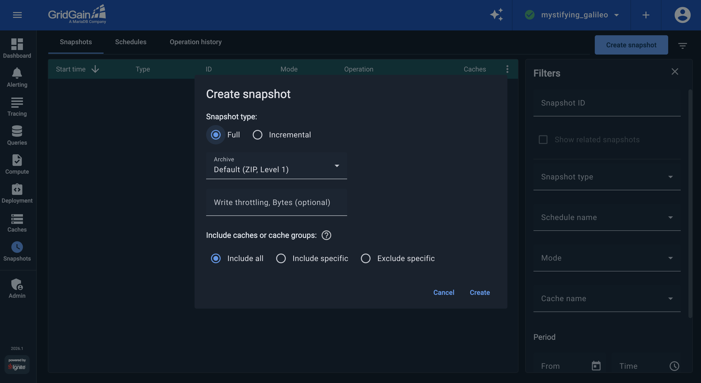
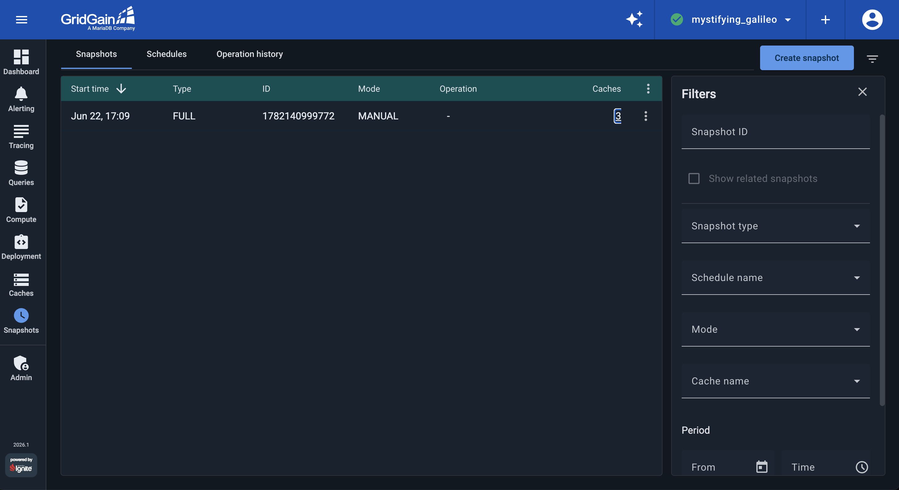
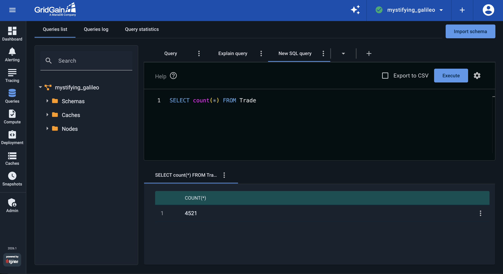
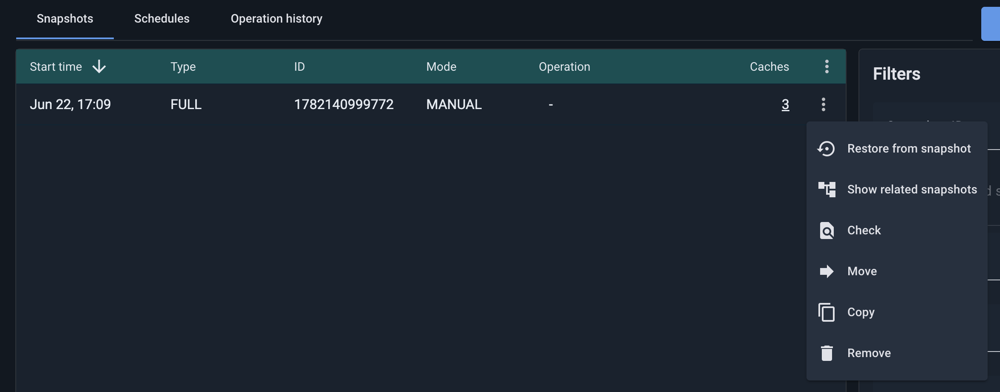

# Create GridGain Cluster Backups

Before you go into production with GridGain, you need to decide on a cluster backup and recovery strategy. The disk that stores your records does not last forever. A new version of an application might have a bug that corrupts the data. The data center that is running your GridGain-based solution might fail and become unreachable. These examples are just a few of the many problems that can lead to data corruption or make your primary cluster unavailable. You can't eliminate all such events, but if you back up GridGain regularly, you can restore a cluster after a data-loss incident.

In this part of the tutorial, you use the [Snapshots screen](../../gg8/snapshots/snapshots.md) to create a cluster backup and later use it to resolve a data-corruption incident.


**Snapshots require GridGain Ultimate**

Control Center uses the [Snapshots and Recovery feature](https://www.gridgain.com/docs/gridgain8/latest/administrators-guide/snapshots/snapshots-and-recovery) of GridGain Ultimate Edition to create and manage cluster backups. The demo cluster you started in the [first part of the tutorial](starting-streaming-demo.md) runs GridGain Ultimate with snapshots enabled, so you can create and restore backups directly. Snapshots are unavailable on GridGain Enterprise clusters and on clusters where snapshot storage has not been configured.


## Pause the Application

GridGain can create hot cluster snapshots while applications keep updating records and, later, use the snapshots and WALs to [recover to any point in time](https://www.gridgain.com/docs/gridgain8/latest/administrators-guide/snapshots/point-in-time-recovery). In this tutorial, you simulate a data-loss incident by deleting all of a table's records, then confirm that restoring the cluster brings the record count back to normal. First, stop the tutorial application:

```bash
docker compose -f docker/ignite-streaming-app.yaml stop
```

## Create a Cluster Snapshot

After you pause the application, navigate to the [Snapshots screen](../../gg8/snapshots/snapshots.md) and create a cluster snapshot:

1. Click `Create snapshot`. In the dialog, keep the default `Full` snapshot type, then click `Create`:

   
1. The new snapshot appears in the `Snapshots` list:

   

## Corrupt a Cluster Table

After you create a cluster snapshot, open the [Queries screen](../../gg8/queries/querying.md) and simulate a data-loss incident by removing records from the `Trade` table:

1. Check the number of trades in your cluster by executing the `SELECT count(*) FROM Trade` query. Your record count might not match the number in the following screenshot, because the application may have been running for a different amount of time in your environment.

   
1. Use the `DELETE FROM Trade` query to remove all the trades.
1. Confirm that the table is empty by running the `SELECT count(*) FROM Trade` query again.

## Restore From the Snapshot

You removed records only from the `Trade` table, so restore just that cache instead of the whole snapshot:

1. On the `Snapshots` screen, click the `⋮` icon in the snapshot's row and select `Restore from snapshot`.
1. In the **Restore snapshot** dialog, select **Include specific**, choose the `Trade` cache from the **Caches** drop-down, and click `Restore`:

   

   Restoring the full snapshot instead (the default **All** scope) replaces every cache in the cluster and is meant for full disaster recovery on a healthy cluster, not for recovering a single table.
1. After the restore procedure is complete, return to the Queries screen and execute the `SELECT count(*) FROM Trade` query. Confirm that all the records were recovered:

   

## What's Next

Congratulations! You've finished all the steps of the tutorial. Now you can stop the demo:

- [Part 7: Stop the demo application](terminating-streaming-demo.md)
