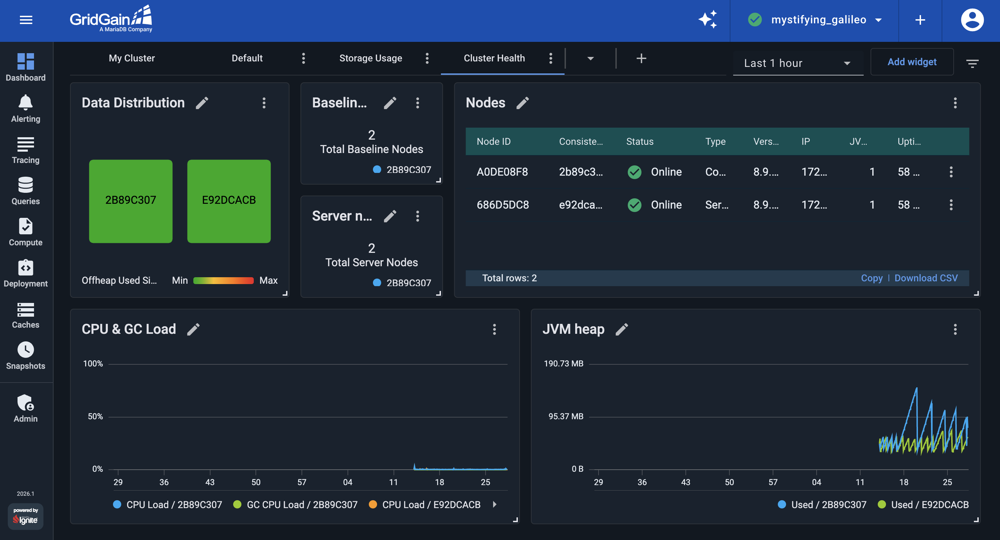
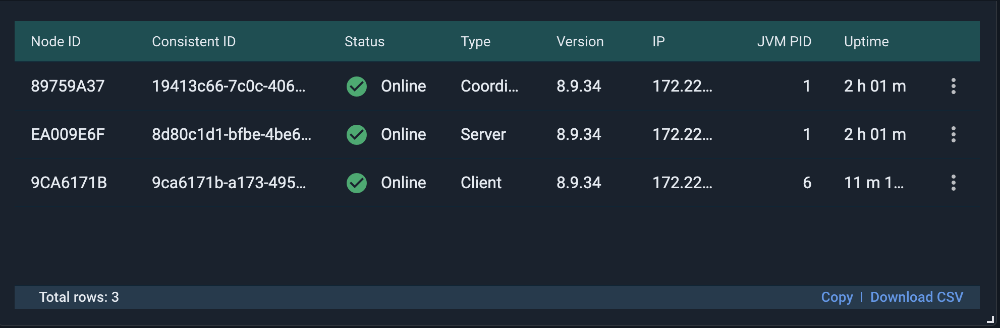
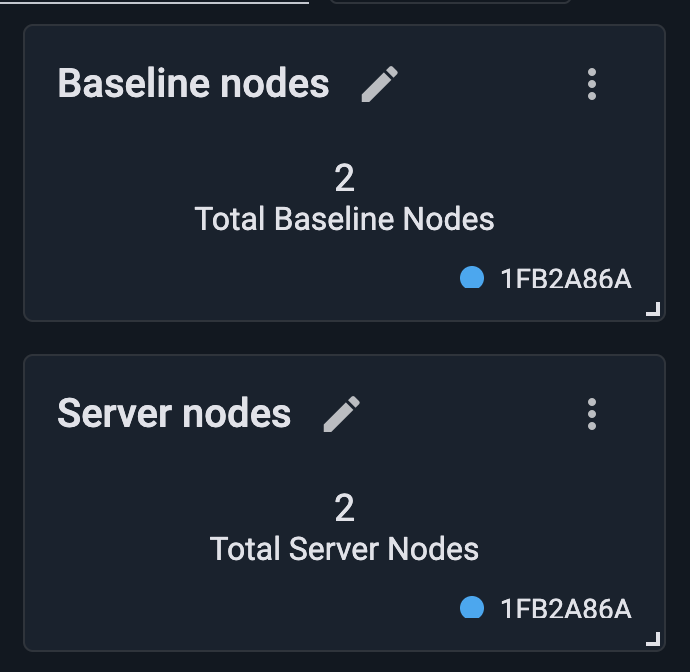
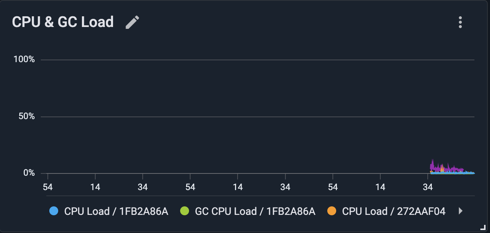
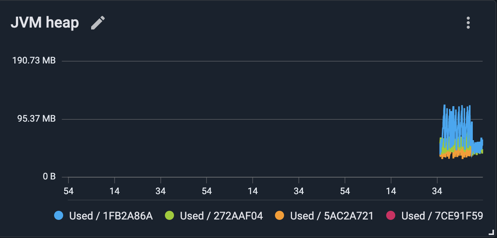
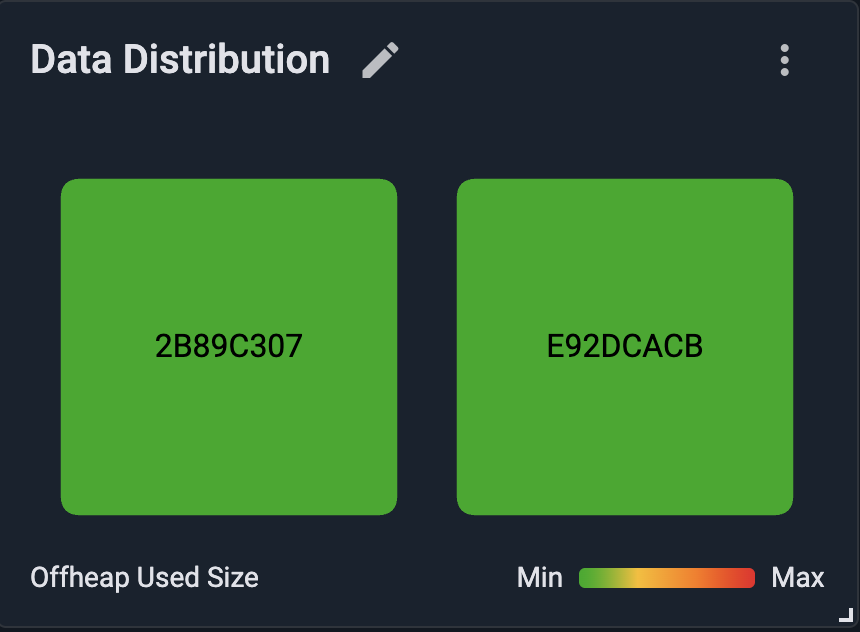

# Monitor GridGain Cluster Health

The [previous part](storage-monitoring.md) built a dashboard for what each node stores. In this part, you build a Cluster Health dashboard that shows whether the cluster infrastructure is healthy: the expected nodes are present, the JVM on each node is healthy, and data is evenly distributed across the cluster. By the end of this part, your Cluster Health dashboard should look like the following:

## Create the Cluster Health Dashboard

1. Open the [Dashboard screen](../../gg8/dashboard/dashboard-overview.md), click the `+` icon in the tab bar, and create an empty dashboard. Open the new tab's `⋮` menu, select **Rename**, and name it `Cluster Health`.

## Monitor Cluster Membership

Losing server nodes reduces cluster capacity and can eventually affect availability. Track whether all expected cluster nodes are present.

Add a **Nodes** widget to see the status of each node at a glance.

Then add two **Metrics (single value)** widgets with the following metrics:

- `cluster.TotalServerNodes`: the number of server nodes currently in the cluster.
- `cluster.TotalBaselineNodes`: the expected baseline node count, which helps you detect when baseline nodes are missing from the current topology.

These are cluster-wide metrics, so when a widget asks which node to read from, select any node; every node reports the same value. Rename the widgets to `Server Nodes` and `Baseline Nodes` respectively. You set up an alert on the cluster's node count in the [alerting part](alerts.md).

## Monitor Node JVM Health

Besides monitoring the data stored in the cluster, you should also monitor the JVM running on each node: how much CPU it is using, how much of that CPU goes to garbage collection, and how much Java heap it is using. A rising GC load can be an early sign of heap pressure, well before it surfaces as an out-of-memory error.

Add a **Metrics (chart)** widget with two metrics:

- `sys.CpuLoad`: the node's overall CPU load.
- `sys.GcCpuLoad`: the share of CPU time spent in garbage collection.

Rename the widget to `CPU & GC Load`.


Under this demo's light load these values stay low. In production, a sustained high `sys.CpuLoad` points to CPU saturation, and a rising `sys.GcCpuLoad` to GC pressure. When investigating performance issues, also monitor `sys.ThreadCount` for thread leaks and `sys.memory.direct.buffers.used` for direct-buffer exhaustion.


Then add a **Metrics (chart)** widget on `sys.memory.heap.used` and rename it to `JVM Heap`. This is the Java heap GridGain uses, primarily for temporary objects created while processing operations.

## Monitor Data Distribution

GridGain distributes each cache's partitions across the cluster's baseline nodes. A [Heat Map widget](../../gg8/dashboard/configuring-widgets.md#heat-map-widget) shows how a chosen metric is distributed across those nodes, making it easy to spot an unbalanced cluster.

Add a **Heat Map** widget on `io.dataregion.default.OffheapUsedSize` and rename it to `Data Distribution`. The widget shows one tile per server node, colored on a relative **Min**–**Max** scale: nodes holding more data appear "hotter" (toward red), while those holding less data appear "cooler" (toward green). When data is evenly distributed, as in this demo, all tiles have the same color. A noticeably hotter tile indicates that one node holds a disproportionate share of the data.

The color scale compares nodes only with each other. It does not show how full the off-heap memory is. Equal colors indicate balanced data distribution, not a particular level of off-heap memory usage.


GridGain rebalances partitions whenever the baseline topology changes, such as when you add, remove, or upgrade nodes. Control Center's [Rebalance widget](../../gg8/dashboard/configuring-widgets.md#rebalance-widget) shows the progress of that operation. It is most useful in production during planned operations such as rolling upgrades, which can move large amounts of data between nodes.

On clusters with native persistence, a newly added node joins the topology immediately but does not store data until you add it to the baseline topology.


## Review Your Cluster Health Dashboard

With all widgets in place, the `Cluster Health` dashboard provides a quick overview of your cluster's health:

- **Are the expected nodes present?** — Nodes, Server Nodes and Baseline Nodes.
- **Are the JVMs healthy?** — CPU & GC Load and JVM Heap.
- **Is data distributed evenly across the cluster?** — Data Distribution.

## What's Next

This dashboard shows whether the cluster's infrastructure is healthy. In the next part, you set up alerting, so GridGain notifies you when something that could affect the cluster's stability or performance happens, even when no one is watching a dashboard:

- [Part 4: Configure alerts](alerts.md)
