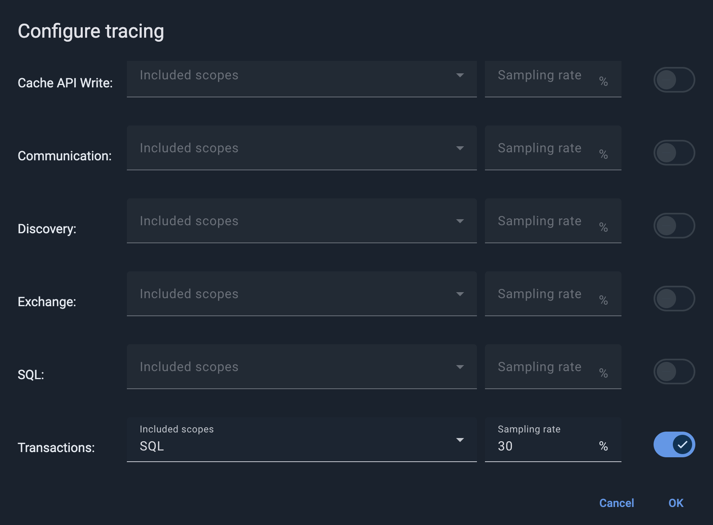
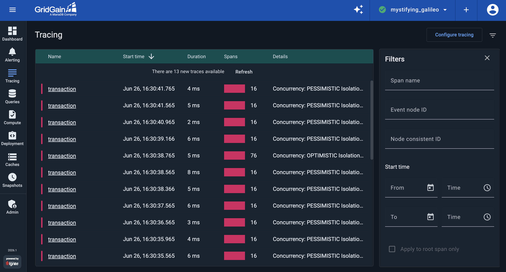
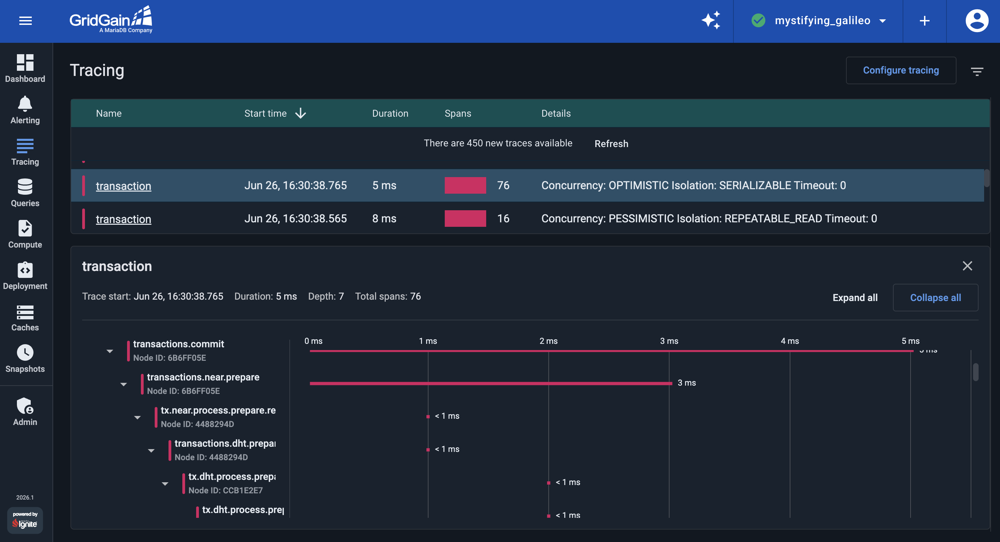

# Use Tracing to Resolve Performance Issues in GridGain

Performance troubleshooting gets harder when a single operation spans multiple processes, and every operation against a GridGain cluster does: it starts in the application and is processed by one or more server nodes. [Tracing](https://en.wikipedia.org/wiki/Tracing_(software)) is a well-known technique for this. It records an operation's journey from start to finish and provides the timing details you need to find bottlenecks and hot spots in your cluster.

In this part of the tutorial, you learn how to use [GridGain Control Center tracing](../../gg8/tracing/tracing.md) capabilities to observe the execution steps of distributed transactions generated by the [tutorial's demo application](starting-streaming-demo.md#launch-the-market-orders-application).


**Prerequisite: Launch the demo**

Make sure you have completed the tutorial's first step, where you start [the demo cluster and application](starting-streaming-demo.md).

Tracing records operations only while the application is actively running. If the demo has finished its run, relaunch it (see [Part 1](starting-streaming-demo.md#launch-the-market-orders-application)) before you configure tracing. Otherwise, there are no transactions to trace.


## Enable Tracing for Transactions

In GridGain, tracing is disabled by default, so the cluster does not spend resources collecting traces you don't need. You turn tracing on manually for a specific operation type when you observe performance degradation.

Now enable tracing for distributed transactions. The demo's application wraps each cache write in a transaction, so the **Transactions** scope captures the commit and prepare steps you analyze below.

1. Switch to the **Tracing** view in Control Center and click **Configure tracing**.
1. In the **Transactions** row, turn on the toggle and set the **Sampling rate** to `30`. You can leave **Included scopes** empty to trace transactions only, or use it to pull in related operations, such as **SQL**, that run inside a transaction.
1. Click **OK**.

The sampling rate is the percentage of operations that GridGain traces. This tutorial uses a high rate (`30%`) on purpose: the demo cluster has a light, steady transaction load, so a high rate makes sampled traces appear quickly and you can inspect them right away. On a busy production cluster, tracing a large share of operations adds overhead, so use a much lower rate — the [Control Center tracing documentation](../../gg8/tracing/tracing.md) suggests starting around `5-10%` and adjusting from there.


Control Center can trace other scopes too: cache reads and writes, communication, discovery, exchange, and SQL. Enable only the scopes you need: tracing adds overhead, so keep the sampling rate low on busy clusters.


When tracing is enabled, GridGain Control Center records transaction traces. Open the [Tracing screen](../../gg8/tracing/tracing.md) of Control Center to see a list of already recorded traces:

## Analyze a Trace Sample

GridGain uses the two-phase commit protocol (2PC) for its transactional engine. With tracing in place, you can observe how a transaction spans multiple nodes, how the commit splits into several steps and, most importantly, how much time is required to complete each step.

The **Tracing** screen lists each recorded transaction with its duration, span count, and — in the **Details** column — its concurrency and isolation. The demo produces two kinds of transaction, so the list shows two distinct patterns: frequent single-record commits (`Concurrency: PESSIMISTIC Isolation: REPEATABLE_READ`) with a modest span count, and periodic heavier transactions that write a batch of records in one commit (`Concurrency: OPTIMISTIC Isolation: SERIALIZABLE`) with many more spans. Sort by **Spans** or **Duration** to tell them apart.

Select one of the heavier `transaction` traces and expand its `transactions.commit` span tree to see how the commit travels through the cluster, as shown in the following screenshot:

Reading the tree from the top, these spans show the phases of the commit:

1. `transactions.commit`: the commit is initiated by the application through its client node (here, node `686FF05E`).
1. `tx.near.process.prepare.request`: the 2PC prepare phase begins, and the request reaches a primary node that holds records the transaction updates (node `4488294D`).
1. `tx.dht.process.prepare.request`: because the cluster keeps a backup copy of every record, the primary node forwards the prepare request to the backup node that holds the copy (node `CC81E2E7`). A batch transaction prepares records on many partitions across both server nodes, which is why this heavier trace has so many more spans than a single-record one.

The timeline beside each span shows how long it took. In this demo every transaction commits in a few milliseconds, so there is no bottleneck to fix. In production, this is the view you use to find one: sort by **Duration**, open the slowest transaction, and follow its span tree to the step or node that accounts for the time.

## Disable Tracing for Transactions

Before you proceed with the tutorial's next part, disable tracing for transactions:

1. Go to the **Tracing** view.
1. Click **Configure Tracing**.
1. Disable **Transactions** tracing.
1. Click **OK**.

## What's Next

In the next part, you back up and restore the cluster:

- [Part 6: Create cluster backups](backups.md)
