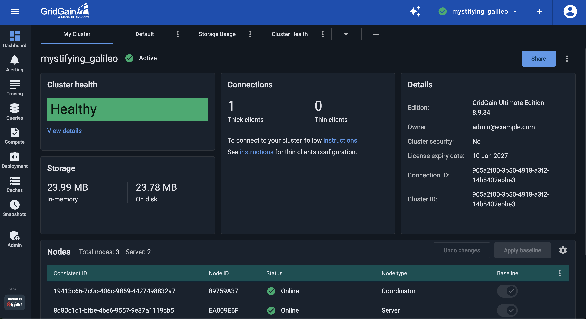
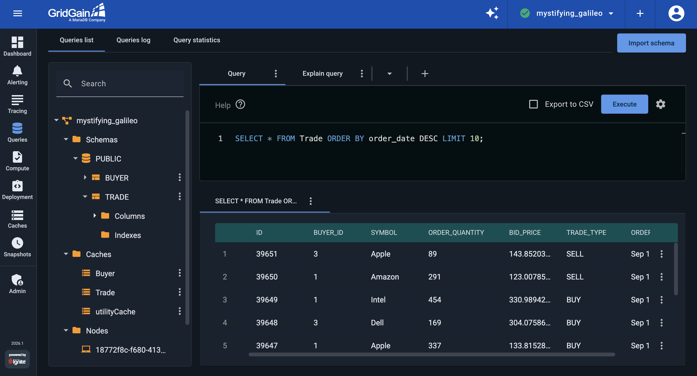

# Start the GridGain Streaming Demo

The [GridGain Streaming Demo](https://github.com/GridGain-Demos/ignite-streaming-monitoring-demo) starts a sample application that simulates stock-exchange trading activity. The application generates market orders locally and streams them to a running GridGain cluster, so no Internet connection is required.

In this first part of the tutorial, you start a two-node GridGain 8 cluster in Docker, activate it, start a local [GridGain Control Center](../../README.md) instance, register the cluster with it, and launch the application that streams market orders into the cluster. Everything runs locally on your machine.

## What you Need

Required:

- Docker 20.10 or later with Docker Compose V2
- Git 2.24 or later
- A GridGain Ultimate license file for the cluster (see the license note below)
- A GridGain Control Center license, which you upload to Control Center the first time you open it

Optional:

- A Java Development Kit (JDK) 8 or later and Apache Maven 3.3 or later, only if you want to build the application outside Docker. Docker builds it from source for you, so the standard steps need only Docker.

## Download the Streaming Demo

First, download the demo project to your machine:

- Either [download](https://github.com/GridGain-Demos/ignite-streaming-monitoring-demo) and unzip the source repository, or clone it with Git:

  ```bash
  git clone https://github.com/GridGain-Demos/ignite-streaming-monitoring-demo.git
  ```
- Go into the project root directory:

  ```bash
  cd ignite-streaming-monitoring-demo
  ```

## Start the GridGain Cluster


This demo runs GridGain Ultimate Edition, so the cluster needs a license file. Place your GridGain Ultimate license at `config/gridgain-license.xml`; the demo's `docker/ignite-cluster.yaml` mounts it so the nodes load it on startup. The license file is specific to your environment and is not included in the repository.


Start a two-node GridGain cluster, with each node running as a separate container:

```bash
docker compose -f docker/ignite-cluster.yaml up -d --scale ignite-server-node=2
```

Each node is configured with a 150 MB off-heap data region for cached data and uses native persistence to store records on disk. Each node writes its persistence to its own Docker volume, so the two nodes do not share a storage directory. For other settings, see `config/ignite-config-node.xml` and `docker/ignite-cluster.yaml`.


The demo uses the multi-architecture `gridgain/ultimate:8.9.34-openjdk17` image, which Docker resolves to the build for your CPU (Intel/AMD64 or Apple Silicon). You do not need to change the image tag for your architecture.


## Activate the Cluster

Because the nodes use native persistence, the cluster starts in an inactive state and must be activated before it can hold data. Activate it from inside the first node:

```bash
docker exec docker-ignite-server-node-1 /opt/gridgain/bin/control.sh --set-state ACTIVE --yes
```

The command reports `Cluster state changed to ACTIVE`. You activate the cluster only once; it stays active across restarts as long as its persistence volumes remain.

## Start GridGain Control Center

In the rest of the tutorial, you use GridGain Control Center as the main management and monitoring tool. The demo includes a Control Center deployment that runs locally in Docker, on the same network as the cluster.

1. Start the Control Center backend and frontend:

   ```bash
   docker compose -f docker/control-center.yaml up -d
   ```
1. Open Control Center in your browser at http://localhost:8008.
1. The first time you open Control Center, create an administrator account. On first start, the backend logs a one-time sign-up link. Print it with:

   ```bash
   docker logs control-center-backend | grep -A1 "register the first administrator"
   ```

   The link is logged with the backend's internal port `3000`, for example `http://localhost:3000/auth/signup?adminToken=...`. Replace `3000` with `8008` to open it in your browser, then complete the sign-up form.
1. When Control Center prompts for a license, upload your GridGain Control Center license. Control Center requires a license before it can monitor a cluster.


The account and license steps are one-time setup. If you have already set up this Control Center and restarted it with `start` rather than `down` followed by `up`, it keeps your account and license. In that case, skip those steps and sign in with your existing account.


## Register the Cluster With Control Center

The cluster's Control Center agent is already configured (in `docker/ignite-cluster.yaml`) to connect to the local Control Center, so you only need to register the cluster with a one-time token.

1. Generate a registration token from the first node:

   ```bash
   docker exec docker-ignite-server-node-1 /opt/gridgain/bin/management.sh --token
   ```

   The command prints two ways to register the cluster: a browser link and, separately, the same token for manual entry. The relevant part of the output looks like this:

   ```text
   Open the link in a browser to monitor your cluster:
   http://control-center-frontend:8008/go/xxxxxxxx-xxxx-xxxx-xxxx-xxxxxxxxxxxx

   If you are already using Control Center, you can add the cluster manually using a one-time token:
   xxxxxxxx-xxxx-xxxx-xxxx-xxxxxxxxxxxx

   NOTE: the token will expire in 5 minutes.
   ```
1. Use the browser link (the first option), not the manual token. Copy the link, replace the container host name `control-center-frontend:8008` with `localhost:8008`, and open the result in your browser:

   ```text
   http://localhost:8008/go/xxxxxxxx-xxxx-xxxx-xxxx-xxxxxxxxxxxx
   ```

   Because you are already signed in to Control Center, opening the link registers the cluster and shows its dashboard. The token expires five minutes after you generate it; if it has expired, run the command again for a new one.

You should now see a dashboard similar to the following, reporting two server nodes and a healthy cluster:



## Launch the Market Orders Application

In the final step, you build and start the application that streams market orders into the cluster. Docker compiles the application from source and starts it with a single command, so you do not need a local JDK or Maven:

```bash
docker compose -f docker/ignite-streaming-app.yaml up -d --build
```

The first build downloads the application's dependencies and takes a few minutes; later builds are faster. The `--build` flag rebuilds the image, so run the same command again after changing the application source.

The application joins the cluster as a client node, creates the `Trade` and `Buyer` tables, and begins streaming simulated trades.


The application streams for the number of minutes set by `execTime` in `docker/ignite-streaming-app.yaml` (150 by default), then stops. Change `execTime` to adjust how long it runs.


Finally, confirm that the application is streaming data into the cluster. Open the Control Center Queries screen and run the following queries:



- Get the last 10 executed trades:

  ```sql
  SELECT * FROM Trade ORDER BY order_date DESC LIMIT 10;
  ```
- Get the most popular stocks among the buyers:

  ```sql
  SELECT symbol, SUM(bid_price) AS total
  FROM Trade
  GROUP BY symbol
  ORDER BY total DESC;
  ```
- Get a list of the buyers that completed the most transactions:

  ```sql
  SELECT Buyer.id, first_name, last_name, SUM(bid_price) AS total
  FROM Trade
  JOIN Buyer ON Trade.buyer_id = Buyer.id
  GROUP BY Buyer.id
  ORDER BY total DESC;
  ```

### If the Application Can't Join the Cluster

The application joins the cluster as a client node through node discovery. On Docker networks, multicast discovery is often unavailable, so the application is configured with the cluster nodes' static discovery addresses through the `DISCOVERY_ADDRS` environment variable in `docker/ignite-streaming-app.yaml`: the server container names and the discovery port (`47500`), for example `docker-ignite-server-node-1:47500..47502,docker-ignite-server-node-2:47500..47502`. The application and the cluster must also run the same GridGain version; a client built against a different minor version is rejected during discovery.

## What's Next

In the next part, you set up a Control Center dashboard that displays storage-related metrics:

- [Part 2: Monitor storage usage](storage-monitoring.md)
