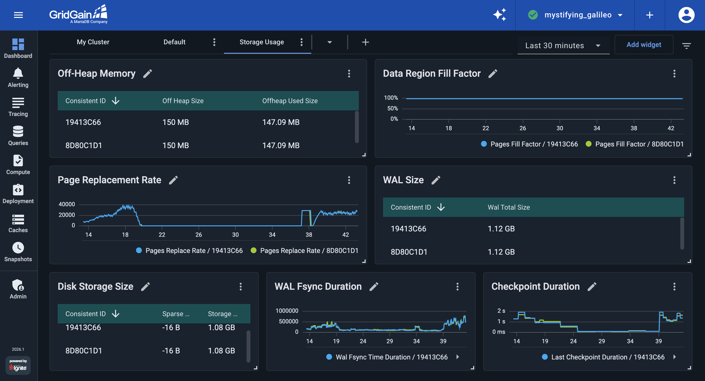
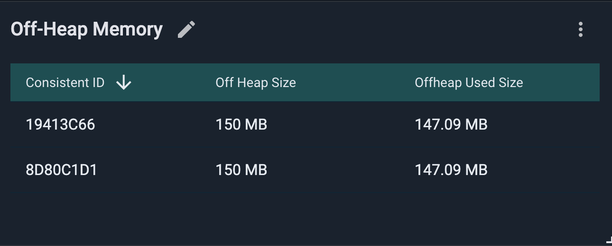
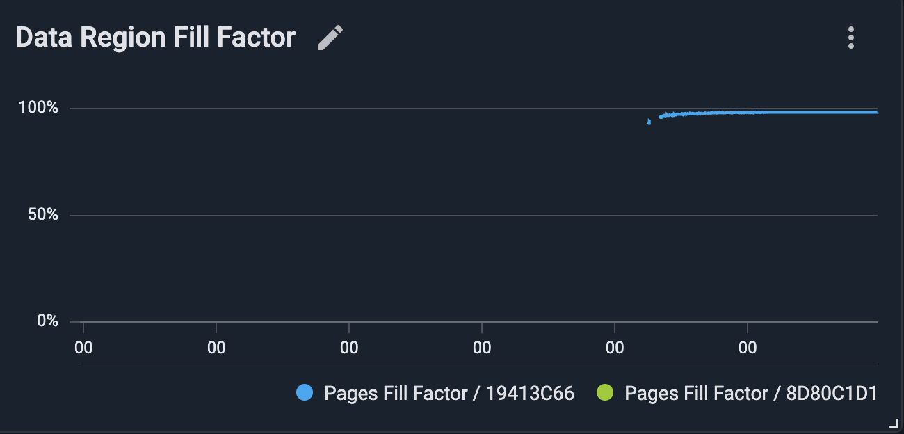
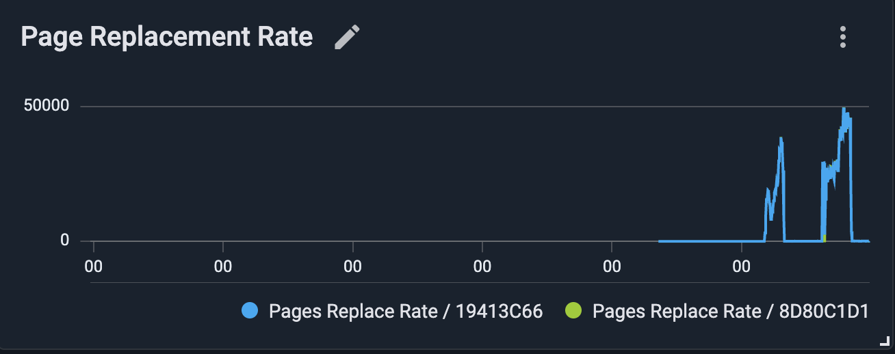
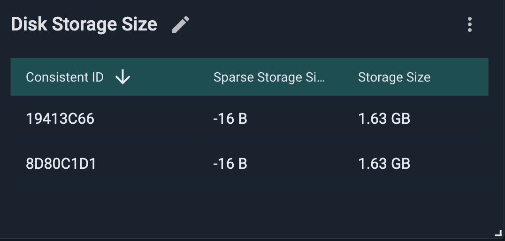
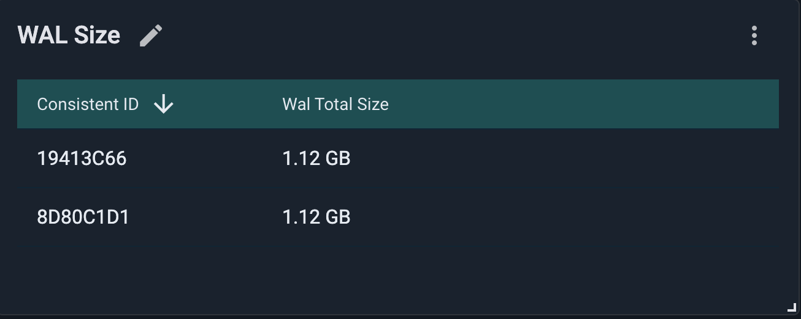
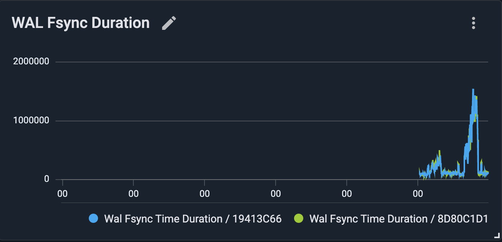
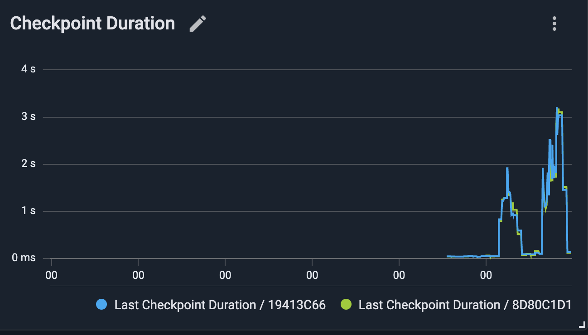

# Monitor GridGain Storage Usage

GridGain stores application data both in memory and, when persistence is enabled, on disk. To keep a cluster healthy, you need to monitor memory pressure, disk usage, write-ahead log (WAL) growth, and checkpoint duration.

In this part of the tutorial, you create a GridGain Control Center dashboard that tracks memory and disk consumption, so you can detect storage pressure before it affects production performance. By the end, your Storage Usage dashboard should look like the following:


Make sure you have completed the tutorial's first step, where you start [the demo cluster and application](starting-streaming-demo.md).


A storage dashboard is useful only if it answers the questions you need to ask in production. The widgets below are grouped around three questions:

- **Is memory filling up?** — off-heap usage, data region fill factor, and page replacement.
- **Is disk filling up?** — disk space used by persisted records and storage files.
- **Is the write path keeping up?** — WAL size, WAL fsync duration, and checkpoint duration.

## Create the Storage Usage Dashboard

Start by creating an empty dashboard to hold the widgets:

1. Open the [Dashboard screen](../../gg8/dashboard/dashboard-overview.md).
1. Click the `+` icon in the tab bar and create an empty dashboard. Open the new tab's `⋮` menu, select **Rename**, and name it `Storage Usage`.

## Add Monitoring Widgets

First, [add a widget](../../gg8/dashboard/configuring-widgets.md#adding-widgets-for-gridgain-8-clusters) to your `Storage Usage` dashboard and choose its type:

- Use a **Metrics (table)** widget when you want to read a value at a glance, such as a current size against its limit.
- Use a **Metrics (chart)** widget when you want to watch how a value trends over time, such as a rate or a duration.

Then, in the widget creation dialog, search for the metric by name and select it. A single widget can show more than one metric, so related metrics, such as used against total, can share one widget. Once the widget is created, open its `⋮` menu, select **Rename**, and give it the name suggested in each section below.

For more on resizing and arranging widgets, see the Control Center [widget documentation](../../gg8/dashboard/configuring-widgets.md).

### Monitor Off-Heap Memory

GridGain stores application records and indexes in memory regions outside the Java heap. These regions are managed by GridGain rather than by the Java garbage collector and are usually called off-heap memory.

Add a **Metrics (table)** widget with two metrics to read used against total:

- `io.dataregion.default.OffheapUsedSize`: the off-heap memory in use, which grows as the application loads data.
- `io.dataregion.default.OffHeapSize`: the region's configured capacity.

Rename the widget to `Off-Heap Memory`.

### Monitor Memory Pressure

The off-heap widget shows how much memory is in use, but not how close the region is to full or whether GridGain has already started replacing pages to make room. These are the signals that usually precede latency spikes in production: once the region fills, GridGain must replace pages, and data that was previously served from memory may need to be loaded from disk.

Add a **Metrics (chart)** widget on `io.dataregion.default.PagesFillFactor` to track how full the data region is, and rename it to `Data Region Fill Factor`.

Then add a **Metrics (chart)** widget on `io.dataregion.default.PagesReplaceRate` and rename it to `Page Replacement Rate`. A sustained non-zero rate indicates that the data region is undersized for the working set and that GridGain is actively replacing pages, which can increase read latency.

### Track Disk Storage Size

If [GridGain native persistence](https://www.gridgain.com/docs/gridgain8/latest/developers-guide/persistence/native-persistence) is enabled for your cluster, GridGain persists application data to disk.

Add a **Metrics (table)** widget with two metrics to compare logical size against the real disk footprint:

- `io.datastorage.StorageSize`: the logical size of the storage files.
- `io.datastorage.SparseStorageSize`: the actual space they occupy on disk, which can be smaller because the files are sparse.

Rename the widget to `Disk Storage Size`.


On Docker Desktop and other virtualized filesystems, `SparseStorageSize` may read as `0` or even a small negative value. This metric is calculated from the number of allocated disk blocks per file, but these filesystems do not always report that information accurately. If this happens, use `StorageSize` as an approximation. On production storage, such as local disks or block volumes, `SparseStorageSize` reports the actual on-disk size.


### Monitor WAL Size

GridGain does not write every update directly to its final location in storage files because random disk updates are expensive. Instead, changes are appended to the WAL first and later written to storage files during checkpointing.

Add a **Metrics (table)** widget on `io.datastorage.WalTotalSize` and rename it to `WAL Size`.

### Watch WAL Synchronization Duration

GridGain appends changes to the WAL for every data update, and the operating system (OS) must fsync those changes to disk according to the configured persistence mode. If GridGain or the OS spends significant time in the fsync stage, write latency can increase, and you might need to apply [WAL-related tuning](https://www.gridgain.com/docs/gridgain8/latest/perf-troubleshooting-guide/persistence-tuning).

Add a **Metrics (chart)** widget on `io.datastorage.WalFsyncTimeDuration` and rename it to `WAL Fsync Duration`.

### Watch Checkpointing Duration

[Checkpointing](https://www.gridgain.com/docs/gridgain8/latest/developers-guide/persistence/native-persistence#checkpointing) is the process of writing dirty pages from memory to storage files on disk. Long checkpoint durations can indicate that the disk subsystem or checkpoint configuration is not keeping up with the write load and may call for [disk tuning](https://www.gridgain.com/docs/gridgain8/latest/perf-troubleshooting-guide/persistence-tuning).

Finally, add a **Metrics (chart)** widget on `io.datastorage.LastCheckpointDuration` and rename it to `Checkpointing Duration`.

### When you Need to Investigate Further

The widgets above are the signals to watch routinely. When one of them looks off, these metrics help you find the cause; add them to this dashboard (or a separate one) as needed:

- **WAL Throughput** — `io.datastorage.WalWritingRate` (add `io.datastorage.WalArchiveSegments` for the archive backlog): how hard the cluster is writing, useful when WAL size or fsync time rises.
- **Dirty Pages** — `io.dataregion.default.DirtyPages`: shows checkpoint pressure in more detail. A value that does not drop after checkpoints can indicate that checkpoints are not keeping up with the write rate.
- **Checkpoint Distribution** — a `Metrics (histogram)` widget on `io.datastorage.CheckpointHistogram`, paired with `io.datastorage.LastCheckpointFsyncDuration` and `LastCheckpointPagesWriteDuration` to see which checkpoint phase is slow.

## Review Your Storage Usage Dashboard

With every widget in place, your `Storage Usage` dashboard now answers the three questions the page opened with:

- **Is memory filling up?** — Off-Heap Memory, Data Region Fill Factor, and Page Replacement Rate.
- **Is disk filling up?** — Disk Storage Size.
- **Is the write path keeping up?** — WAL Size, WAL Fsync Duration, and Checkpointing Duration.

Drag the widgets to arrange them so the signals you watch most often sit at the top. For more on resizing, rearranging, and editing widgets, see the [Control Center widget documentation](../../gg8/dashboard/configuring-widgets.md).

## What's Next

This dashboard shows what each node stores. In the next part, you build a second dashboard for the cluster-wide view: node membership, per-node JVM health, and data distribution across nodes.

- [Part 3: Monitor cluster health](cluster-health.md)
