# Introduction

The GridGain 8 Kubernetes Operator extends the Kubernetes API with a `GridGainCluster` resource (`gridgain.gridgain.com/v1`). You describe the cluster you want. The operator watches that resource and keeps compute, networking, and configuration aligned with it.

```mermaid
%%{init: {"themeVariables": {"edgeLabelBackground": "#eef2ff"}}}%%
flowchart LR
  accTitle: GridGain 8 Kubernetes Operator reconciliation loop
  accDescr { A user creates a GridGainCluster resource. The operator validates it and reconciles child Kubernetes objects until the current state matches the spec. }

  classDef actorStyle fill:#ffffff,stroke:#333333,stroke-width:1.5px,color:#111;
  classDef resourceStyle fill:#e8f0fe,stroke:#1a73e8,stroke-width:1.5px,color:#111;
  classDef operatorStyle fill:#fdecc8,stroke:#b8860b,stroke-width:1.5px,color:#111;
  classDef stateStyle fill:#f1f1f1,stroke:#555555,stroke-width:1.5px,color:#111;

  User(["User"]):::actorStyle
  CR["GridGainCluster"]:::resourceStyle
  WH["Validating webhook"]:::resourceStyle
  Op["GridGain 8 Kubernetes Operator"]:::operatorStyle
  STS["StatefulSet, Services, ConfigMaps, Secrets"]:::stateStyle

  User --> CR
  CR --> WH
  WH --> Op
  Op --> STS
```

## What the Operator Manages

* A StatefulSet of GridGain 8 server nodes.
* A headless Service for discovery and a client Service for REST (port `8080`) and the thin client (port `10800`).
* Operator-generated `default-config.xml` (discovery, data regions, probes) unless you supply your own XML.
* A license file mounted from a Secret you create. No license is shipped with the operator.
* Optional NetworkPolicy, PodDisruptionBudget, and scheduling fields on the custom resource.

The operator does **not** orchestrate backups, VolumeSnapshots, or Prometheus alert rules.

## Requirements

* A MariaDB Enterprise Platform Ultimate subscription. The 1.0.0 GA release is available only to Ultimate customers.
* Kubernetes `1.35` or later, on [CNCF-certified](https://www.cncf.io/training/certification/software-conformance/) distributions. This release was tested on Kubernetes `1.35`. Infrastructure issues (misconfigured clusters, CSI, or CNI) are outside the support scope.
* OpenShift is tested with Helm on OpenShift `4.22.1`. The operator is **not** Red Hat certified and is **not** in the OpenShift catalog. See [Helm](installation/helm.md#openshift).
* GridGain 8 **8.9.37** or newer. Operator default probes and drain REST require that line.
* A GridGain license in a Kubernetes Secret.
* Access to `docker.mariadb.com` for the operator image. See [Customer Access to docker.mariadb.com](../mariadb-enterprise-operator/customer-access-to-docker-mariadb-com.md).

## Versioning

The operator version (`1.0.0`, then `1.x.x`) is independent of the GridGain 8 image tag. Pin both. See [Docker Images](docker-images.md) and [Helm](installation/helm.md#supported-versions).

## Support

This operator is available only with MariaDB Enterprise Platform Ultimate. Report problems through MariaDB Enterprise Support (`support@mariadb.com`).

## Capabilities in 1.0.0

* Helm install, including cluster-wide and single-namespace modes.
* Declarative `GridGainCluster` with validating admission (cluster-wide mode).
* Operator-managed configuration restarts: one node at a time, highest ordinal first.
* GridGain **version** changes by scaling to zero, then applying the new image. Mixed-version rolling upgrades are not supported.
* Drain / supply wait before a voluntary pod deletion (GridGain 8.9.37+).
* Alpha feature gates (off by default) for auth, TLS, metrics, named caches, persistence, and Control Center. See [Configuration](configuration.md#feature-gates).

_This page is: Copyright © 2026 MariaDB. All rights reserved._


